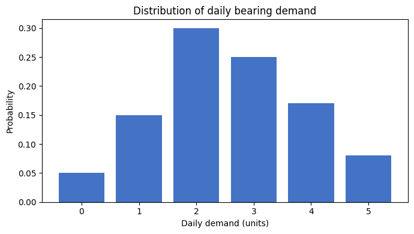
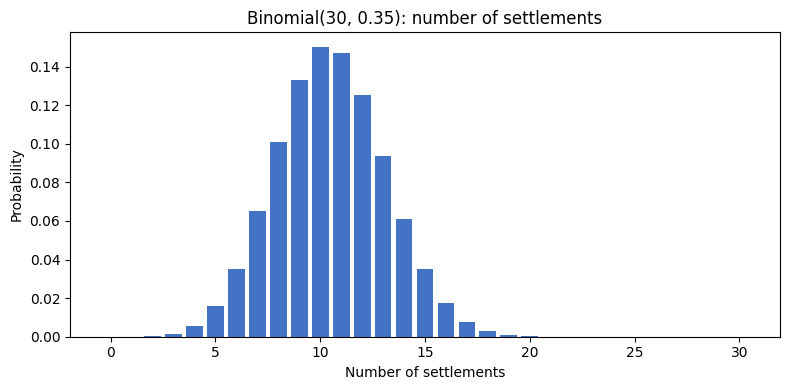

# Chapter 02 — Solutions

[Student notebook](../ch02-student.ipynb) · [exercises](../exercises/ch02.md)

Consult the solutions after attempting the exercises.

# Complementary materials — Chapter 2

**Prof. Daniel de Abreu Pereira Uhr**

**Course:** Statistics and Econometrics with Python


Probability and Random Variables

The online store recorded 2,000 orders. Draw one uniformly. Let D denote a returned order and K an order placed through the marketplace. The tables summarize the same orders.

| Channel | Returned | Kept | Total |
|---|---:|---:|---:|
| App |40|760|800|
| Website |50|650|700|
| Marketplace |60|440|500|
| Total |150|1,850|2,000|

| Payment | Returned | Kept | Total |
|---|---:|---:|---:|
| Card |90|1,110|1,200|
| Mobile payment |60|740|800|
| Total |150|1,850|2,000|

```python
import pandas as pd

channels = pd.DataFrame({
    "channel": ["app", "website", "marketplace"],
    "returned": [40, 50, 60],
    "not_returned": [760, 650, 440],
})
channels["orders"] = channels["returned"] + channels["not_returned"]

payments = pd.DataFrame({
    "payment": ["card", "mobile"],
    "returned": [90, 60],
    "not_returned": [1_110, 740],
})
payments["orders"] = payments["returned"] + payments["not_returned"]

total_orders = channels["orders"].sum()
print(channels.to_string(index=False))
print(payments.to_string(index=False))
print("Total orders:", total_orders)
```

```text
    channel  returned  not_returned  orders
        app        40           760     800
    website        50           650     700
marketplace        60           440     500
payment  returned  not_returned  orders
   card        90          1110    1200
 mobile        60           740     800
Total orders: 2000
```

## Solution to Exercise 01 — Mechanism and events

Describe the mechanism and sample space. Count the orders in D, K, the complement of D, their intersection, and their union.

```python
marketplace = channels["channel"] == "marketplace"

n_d = channels["returned"].sum()
n_k = channels.loc[marketplace, "orders"].sum()
n_d_and_k = channels.loc[marketplace, "returned"].sum()
n_d_or_k = n_d + n_k - n_d_and_k

print("D:", n_d)
print("K:", n_k)
print("Complement of D:", total_orders - n_d)
print("D ∩ K:", n_d_and_k)
print("D ∪ K:", n_d_or_k)
```

```text
D: 150
K: 500
Complement of D: 1850
D ∩ K: 60
D ∪ K: 590
```

One order is drawn uniformly from the 2,000 recorded orders. The sample space contains orders, not the three channels. The five counts are 150, 500, 1,850, 60, and 590. The union subtracts the 60 orders counted in both groups.

## Solution to Exercise 02 — Probabilities

Calculate the five corresponding probabilities. Check the union by direct counting and by the general addition rule.

```python
p_d = n_d / total_orders
p_k = n_k / total_orders
p_d_and_k = n_d_and_k / total_orders

direct_union_count = n_k + channels.loc[~marketplace, "returned"].sum()

print(f"P(D) = {p_d:.3f}")
print(f"P(D^c) = {1 - p_d:.3f}")
print(f"P(K) = {p_k:.3f}")
print(f"P(D ∩ K) = {p_d_and_k:.3f}")
print(f"P(D ∪ K) by direct count = {direct_union_count / total_orders:.3f}")
print(f"P(D ∪ K) by the general rule = {p_d + p_k - p_d_and_k:.3f}")
```

```text
P(D) = 0.075
P(D^c) = 0.925
P(K) = 0.250
P(D ∩ K) = 0.030
P(D ∪ K) by direct count = 0.295
P(D ∪ K) by the general rule = 0.295
```

Dividing by 2,000 gives 0.075, 0.925, 0.250, 0.030, and 0.295. The marketplace accounts for 500 orders and the other channels for 90 returns. Their disjoint counts give 590. Adding the two marginal probabilities without subtracting 0.030 would count their overlap twice.

## Solution to Exercise 03 — Conditional probability

Find the return probability within each channel and P(K | D). Use the resulting values to explain why reversing the condition changes the question.

```python
channels["p_return_given_channel"] = channels["returned"] / channels["orders"]
p_k_given_d = n_d_and_k / n_d

print(channels[["channel", "orders", "returned", "p_return_given_channel"]].round(3).to_string(index=False))
print(f"P(K | D) = {p_k_given_d:.2f}")
```

```text
    channel  orders  returned  p_return_given_channel
        app     800        40                   0.050
    website     700        50                   0.071
marketplace     500        60                   0.120
P(K | D) = 0.40
```

The channel rates are 0.050, 0.071, and 0.120. Among returned orders 60/150 = 0.40 came from the marketplace. Among marketplace orders 60/500 = 0.12 were returned. The first denominator is all returns; the second is all marketplace orders.

## Solution to Exercise 04 — Independence

Test independence of D and mobile payment, then D and K. Use both conditional probabilities and factorization and interpret each conclusion.

```python
mobile = payments["payment"] == "mobile"
n_mobile = payments.loc[mobile, "orders"].sum()
n_d_and_mobile = payments.loc[mobile, "returned"].sum()
p_mobile = n_mobile / total_orders

print(f"P(D | mobile) = {n_d_and_mobile / n_mobile:.3f}   P(D) = {p_d:.3f}")
print(f"P(D ∩ mobile) = {n_d_and_mobile / total_orders:.4f}   P(D) × P(mobile) = {p_d * p_mobile:.4f}")
print(f"P(D | K) = {n_d_and_k / n_k:.3f}   P(D) = {p_d:.3f}")
print(f"P(D ∩ K) = {p_d_and_k:.4f}   P(D) × P(K) = {p_d * p_k:.4f}")
```

```text
P(D | mobile) = 0.075   P(D) = 0.075
P(D ∩ mobile) = 0.0300   P(D) × P(mobile) = 0.0300
P(D | K) = 0.120   P(D) = 0.075
P(D ∩ K) = 0.0300   P(D) × P(K) = 0.0187
```

The mobile-payment return rate is 60/800 = 0.075, equal to the overall rate. The joint probability 0.030 equals the product. For the marketplace, 0.120 differs from 0.075 and the joint probability 0.030 exceeds the product 0.01875. In this portfolio the first pair is independent and the second is dependent.

## Solution to Exercise 05 — Disjoint or independent?

Are card payment and mobile payment disjoint? Are they independent? Justify both answers with probabilities.

```python
n_card = payments.loc[~mobile, "orders"].sum()
p_card = n_card / total_orders
n_card_and_mobile = 0  # each order has exactly one payment method

print(f"P(card ∩ mobile) = {n_card_and_mobile / total_orders:.2f}")
print(f"P(card) × P(mobile) = {p_card * p_mobile:.2f}")
print(f"P(mobile | card) = {n_card_and_mobile / n_card:.2f}   P(mobile) = {p_mobile:.2f}")
```

```text
P(card ∩ mobile) = 0.00
P(card) × P(mobile) = 0.24
P(mobile | card) = 0.00   P(mobile) = 0.40
```

An order has only one payment method. The joint probability is zero, while multiplying the marginal probabilities gives 0.6 × 0.4 = 0.24. Learning an order was paid by card takes the conditional probability of mobile payment to zero.

## Solution to Exercise 06 — Challenge — Does the marketplace cause returns?

A manager proposes closing the marketplace because it causes returns. Compare its shares of orders and returns, give two alternative explanations, and identify additional information needed for the decision.

```python
order_share = n_k / total_orders
return_share = p_k_given_d

print(f"Marketplace share of orders: {order_share:.0%}")
print(f"Marketplace share of returns: {return_share:.0%}")
print(f"Marketplace return rate: {n_d_and_k / n_k:.1%}")
print(f"Return rate in other channels: {channels.loc[~marketplace, 'returned'].sum() / channels.loc[~marketplace, 'orders'].sum():.1%}")
```

```text
Marketplace share of orders: 25%
Marketplace share of returns: 40%
Marketplace return rate: 12.0%
Return rate in other channels: 6.0%
```

The marketplace supplies 25% of orders and 40% of returns. Its return rate is 12% versus 6% elsewhere. Its product mix may include harder-to-fit goods, or its customers may be less familiar with the products. Compare like products and customer groups, examine reasons for returns, and weigh channel margins before deciding whether closure would improve results.

[Open the exercises](../exercises/ch02.md)

# Complementary materials — Chapter 2

**Prof. Daniel de Abreu Pereira Uhr**

**Course:** Statistics and Econometrics with Python


Probability and Random Variables

The demand-example wholesaler sells a replacement bearing for USD 180 per unit. Daily fixed storage cost is USD 60. Its planning model for daily demand is:

| Units |0|1|2|3|4|5|
|---|---:|---:|---:|---:|---:|---:|
| Probability |0.05|0.15|0.30|0.25|0.17|0.08|

```python
import numpy as np
import pandas as pd
import matplotlib.pyplot as plt
```

## Solution to Exercise 07 — Distribution

Put the distribution in a DataFrame, check both validity conditions, and plot a bar chart with a title and labeled axes.

```python
demand = pd.DataFrame({
    "units": [0, 1, 2, 3, 4, 5],
    "probability": [0.05, 0.15, 0.30, 0.25, 0.17, 0.08],
})

print(demand.to_string(index=False))
print("Nonnegative probabilities:", (demand["probability"] >= 0).all())
print("Sum of probabilities:", round(demand["probability"].sum(), 10))

fig, ax = plt.subplots(figsize=(7, 4))
ax.bar(demand["units"], demand["probability"], color="#4472C4")
ax.set_title("Distribution of daily bearing demand")
ax.set_xlabel("Daily demand (units)")
ax.set_ylabel("Probability")
fig.tight_layout()
plt.show()
```

```text
 units  probability
     0         0.05
     1         0.15
     2         0.30
     3         0.25
     4         0.17
     5         0.08
Nonnegative probabilities: True
Sum of probabilities: 1.0
```



Every mass is nonnegative and the masses sum to one. Demand of two units is the most likely outcome. Each bar shows the probability of one particular daily demand.

## Solution to Exercise 08 — Center and spread

Calculate the expectation, variance, and standard deviation from their definitions. Interpret the mean and standard deviation in units of demand. Can a single day realize the expectation?

```python
expectation = (demand["units"] * demand["probability"]).sum()
variance = ((demand["units"] - expectation) ** 2 * demand["probability"]).sum()
std_dev = np.sqrt(variance)

print(f"E(X) = {expectation:.2f} units")
print(f"Var(X) = {variance:.4f} units²")
print(f"σ = {std_dev:.3f} units")
```

```text
E(X) = 2.58 units
Var(X) = 1.6636 units²
σ = 1.290 units
```

Weight each quantity by its mass for a mean of 2.58 units. Weight squared deviations from 2.58 to obtain 1.6636 squared units. The square root is about 1.290 units. Fractional expected demand is meaningful for planning across days even though daily sales are integer counts.

## Solution to Exercise 09 — Stockout risk

Start with three units in stock. Find the probability demand exceeds stock and the probability demand is at most one unit. Interpret both for the manager.

```python
p_stockout_at_3 = demand.loc[demand["units"] > 3, "probability"].sum()
p_at_most_1 = demand.loc[demand["units"] <= 1, "probability"].sum()

print(f"P(X > 3) = {p_stockout_at_3:.2f}")
print(f"P(X ≤ 1) = {p_at_most_1:.2f}")
```

```text
P(X > 3) = 0.25
P(X ≤ 1) = 0.20
```

The risk of running out is the mass above three, 0.17 + 0.08 = 0.25. The mass at zero and one sums to 0.20. The first quantity describes potential missed sales and the second quantifies low-demand days.

## Solution to Exercise 10 — Net revenue as a transformation

Assume every unit demanded can be supplied. Daily net revenue in dollars is $L=180X-60$. Calculate its expectation and standard deviation from its distribution and from the transformation rules. Explain both constants.

```python
price = 180
fixed_cost = 60

demand["net_revenue"] = price * demand["units"] - fixed_cost
e_l = (demand["net_revenue"] * demand["probability"]).sum()
var_l = ((demand["net_revenue"] - e_l) ** 2 * demand["probability"]).sum()

print(demand[["units", "net_revenue", "probability"]].to_string(index=False))
print(f"From the distribution: E(L) = {e_l:.2f}; σ(L) = {np.sqrt(var_l):.2f}")
print(f"Using the rules:      E(L) = {price * expectation - fixed_cost:.2f}; σ(L) = {price * std_dev:.2f}")
```

```text
 units  net_revenue  probability
     0          -60         0.05
     1          120         0.15
     2          300         0.30
     3          480         0.25
     4          660         0.17
     5          840         0.08
From the distribution: E(L) = 404.40; σ(L) = 232.17
Using the rules:      E(L) = 404.40; σ(L) = 232.17
```

Multiplying by 180 converts units into gross dollars. Subtracting 60 deducts daily storage cost. The distribution calculation agrees with the rules: expected daily net revenue is USD 404.40 and its standard deviation is USD 232.17. Limited stock would cap sales and change the transformation.

## Solution to Exercise 11 — Changing units

Express net revenue in thousands of dollars. How do its expectation, variance, and standard deviation change? Explain the different scaling of variance.

```python
print(f"E(L) = {e_l / 1_000:.4f} thousand dollars")
print(f"Var(L) = {var_l / 1_000**2:.4f} (thousand USD)²")
print(f"σ(L) = {np.sqrt(var_l) / 1_000:.4f} thousand dollars")
```

```text
E(L) = 0.4044 thousand dollars
Var(L) = 0.0539 (thousand USD)²
σ(L) = 0.2322 thousand dollars
```

Dividing by 1,000 gives a mean of 0.4044 thousand dollars and a standard deviation of about 0.2322 thousand dollars. The variance is about 0.0539 in squared thousands. Squaring the rescaled deviations divides the variance by a million.

## Solution to Exercise 12 — Demand over two days

Assume independent daily demands with the given distribution. Find the expectation, variance, and standard deviation of two-day demand. Compare its standard deviation with twice the daily standard deviation. Describe a situation that makes independence questionable.

```python
e_t = 2 * expectation
var_t = 2 * variance

pair_totals = []
pair_probabilities = []
for x1, p1 in zip(demand["units"], demand["probability"]):
    for x2, p2 in zip(demand["units"], demand["probability"]):
        pair_totals.append(x1 + x2)
        pair_probabilities.append(p1 * p2)

pair_totals = np.array(pair_totals)
pair_probabilities = np.array(pair_probabilities)
e_t_pairs = (pair_totals * pair_probabilities).sum()
var_t_pairs = ((pair_totals - e_t_pairs) ** 2 * pair_probabilities).sum()

print(f"Using the rules: E(T) = {e_t:.2f}; Var(T) = {var_t:.4f}; σ(T) = {np.sqrt(var_t):.3f}")
print(f"Enumerating all 36 pairs: E(T) = {e_t_pairs:.2f}; Var(T) = {var_t_pairs:.4f}")
print(f"2σ(X) = {2 * std_dev:.3f}")
```

```text
Using the rules: E(T) = 5.16; Var(T) = 3.3272; σ(T) = 1.824
Enumerating all 36 pairs: E(T) = 5.16; Var(T) = 3.3272
2σ(X) = 2.580
```

Adding expectations gives 5.16 units. Independence makes the covariance zero, giving variance 3.3272 and standard deviation 1.824 units. Enumerating all 36 pairs gives the same moments. Twice the daily standard deviation would be 2.580 units. A maintenance shutdown driving demand on consecutive days could create dependence.

## Solution to Exercise 13 — Challenge — Minimum stock

Find the smallest initial stock for which the daily stockout probability is at most 10%. Show the risk for each possible stock level and discuss the benefits and costs of this criterion in two or three sentences.

```python
risk = pd.DataFrame({"stock": demand["units"]})
risk["p_stockout"] = [
    demand.loc[demand["units"] > s, "probability"].sum() for s in risk["stock"]
]

print(risk.round(2).to_string(index=False))

meets_criterion = risk[risk["p_stockout"] <= 0.10]
print("Minimum stock meeting the criterion:", meets_criterion["stock"].min())
```

```text
 stock  p_stockout
     0        0.95
     1        0.80
     2        0.50
     3        0.25
     4        0.08
     5        0.00
Minimum stock meeting the criterion: 4
```

For starting stocks zero through five the risks are 0.95, 0.80, 0.50, 0.25, 0.08, and 0. Four units are the first to meet the limit. Higher stock reduces lost-sale risk but ties up working capital and storage space. The threshold is a service target, not a profit calculation.

[Open the exercises](../exercises/ch02.md)

# Complementary materials — Chapter 2

**Prof. Daniel de Abreu Pereira Uhr**

**Course:** Statistics and Econometrics with Python


Probability and Random Variables

The collections center will contact 30 overdue accounts. Each settlement recovers USD 1,200. Campaign cost is USD 9,000. For Exercises 14–18 assume independent contacts with a common settlement probability of 0.35.

```python
import numpy as np
import matplotlib.pyplot as plt
from scipy import stats
```

## Solution to Exercise 14 — One contact

Define an indicator for the outcome of one contact. Give its distribution, support, expectation, and variance.

```python
p_settlement = 0.35

print("Support: {0, 1}")
print(f"E(X) = p = {p_settlement:.2f}")
print(f"Var(X) = p(1 − p) = {p_settlement * (1 - p_settlement):.4f}")
```

```text
Support: {0, 1}
E(X) = p = 0.35
Var(X) = p(1 − p) = 0.2275
```

Let X equal one for settlement and zero otherwise. X is Bernoulli with probability 0.35 and support {0,1}. Its expectation is 0.35 and variance is 0.35 × 0.65 = 0.2275.

## Solution to Exercise 15 — Conditions for a binomial model

List the four binomial conditions. Discuss each in this campaign and give a concrete reason one could fail.

Thirty planned contacts fix the trial count, and settlement is binary over a specified campaign window. A common probability is questionable if groups differ in delinquency. Independence may fail if accounts share a debtor or face the same shock. Exercise 20 examines the common-probability condition.

## Solution to Exercise 16 — Number of settlements

For the number of settlements S, calculate its expectation, standard deviation, and probability of exactly ten. Plot its distribution and interpret the results.

```python
n_contracts = 30
settlements = stats.binom(n_contracts, p_settlement)

print(f"E(S) = {settlements.mean():.2f} settlements")
print(f"σ(S) = {settlements.std():.3f} settlements")
print(f"P(S = 10) = {settlements.pmf(10):.3f}")

s_values = np.arange(0, n_contracts + 1)
fig, ax = plt.subplots(figsize=(8, 4))
ax.bar(s_values, settlements.pmf(s_values), color="#4472C4")
ax.set_title("Binomial(30, 0.35): number of settlements")
ax.set_xlabel("Number of settlements")
ax.set_ylabel("Probability")
fig.tight_layout()
plt.show()
```

```text
E(S) = 10.50 settlements
σ(S) = 2.612 settlements
P(S = 10) = 0.150
```



Under the model the expected count is 10.5, its standard deviation is about 2.612 settlements, and exactly ten has probability about 0.150. The plot places about 95% of the probability between six and fifteen inclusive; the expected count need not be an attainable single outcome.

## Solution to Exercise 17 — Net proceeds

Net campaign proceeds are $L=1200S-9000$ dollars. Calculate their expectation and standard deviation and explain both to management.

```python
settlement_value = 1_200
campaign_cost = 9_000

e_l = settlement_value * settlements.mean() - campaign_cost
sigma_l = settlement_value * settlements.std()

print(f"E(L) = $ {e_l:.2f}")
print(f"σ(L) = $ {sigma_l:.2f}")
```

```text
E(L) = $ 3600.00
σ(L) = $ 3134.96
```

The mean net is 1,200 × 10.5 − 9,000 = USD 3,600. The standard deviation is about USD 3,134.96. A fixed cost lowers each possible net by the same amount. Positive expected proceeds do not ensure a gain on this campaign.

## Solution to Exercise 18 — Probability of breaking even

Express breaking even or better as an event involving S and find its probability. Check by simulation using NumPy’s default generator with seed 2026 and 10,000 repetitions. Explain the discrepancy.

```python
p_break_even = settlements.pmf(s_values[s_values >= 8]).sum()

rng = np.random.default_rng(2026)
R = 10_000
simulated_settlements = rng.binomial(n=n_contracts, p=p_settlement, size=R)
simulated_net = settlement_value * simulated_settlements - campaign_cost

print(f"P(L ≥ 0) = P(S ≥ 8) = {p_break_even:.3f}")
print(f"Simulated fraction breaking even or better: {(simulated_net >= 0).mean():.3f}")
```

```text
P(L ≥ 0) = P(S ≥ 8) = 0.876
Simulated fraction breaking even or better: 0.881
```

Breaking even requires at least 7.5 settlements, hence at least eight integer settlements. Summing the binomial masses gives about 0.876. The simulated fraction is 0.881. A finite sample of campaigns varies around the model probability.

## Solution to Exercise 19 — Call duration

Call duration follows a working normal model with mean 6 and standard deviation 1.5 minutes. Calculate the probabilities of exceeding 9 minutes, lasting between 4 and 8 minutes, and being negative. Assess plausibility and describe a check using actual calls.

```python
duration = stats.norm(loc=6, scale=1.5)

print(f"P(D > 9) = {1 - duration.cdf(9):.3f}")
print(f"P(4 ≤ D ≤ 8) = {duration.cdf(8) - duration.cdf(4):.3f}")
print(f"P(D < 0) = {duration.cdf(0):.5f}")
```

```text
P(D > 9) = 0.023
P(4 ≤ D ≤ 8) = 0.818
P(D < 0) = 0.00003
```

The three probabilities are approximately 0.023, 0.818, and 0.00003. Negative times are physically impossible, though this model assigns them very little mass. Compare the observed histogram and upper tail with the fitted curve; long calls can introduce substantial right skew.

## Solution to Exercise 20 — Challenge — Different settlement probabilities by delinquency group

Keep contacts independent. Twelve accounts are at most 60 days overdue with settlement probability 0.50. Eighteen are more than 60 days overdue with probability 0.25. Use the sum rules for the mean and variance. Estimate the break-even probability with seed 2027 and 10,000 repetitions. Compare with Binomial(30, 0.35) and explain why the common-probability model no longer applies.

```python
e_groups = 12 * 0.50 + 18 * 0.25
var_groups = 12 * 0.50 * 0.50 + 18 * 0.25 * 0.75

challenge_rng = np.random.default_rng(2027)
group_settlements = challenge_rng.binomial(12, 0.50, size=R) + challenge_rng.binomial(18, 0.25, size=R)
group_net = settlement_value * group_settlements - campaign_cost

print(f"Two groups:     E(S) = {e_groups:.2f}; Var(S) = {var_groups:.3f}; σ(S) = {np.sqrt(var_groups):.3f}")
print(f"Single binomial:  E(S) = {settlements.mean():.2f}; Var(S) = {settlements.var():.3f}; σ(S) = {settlements.std():.3f}")
print(f"P(L ≥ 0) simulated with two groups: {(group_net >= 0).mean():.3f}")
print(f"P(L ≥ 0) under the single binomial: {p_break_even:.3f}")
```

```text
Two groups:     E(S) = 10.50; Var(S) = 6.375; σ(S) = 2.525
Single binomial:  E(S) = 10.50; Var(S) = 6.825; σ(S) = 2.612
P(L ≥ 0) simulated with two groups: 0.889
P(L ≥ 0) under the single binomial: 0.876
```

The two means sum to 12 × 0.50 + 18 × 0.25 = 10.5. Their independent variances sum to 6.375, giving standard deviation 2.525, versus 6.825 and 2.612 in the common-probability model. The simulated break-even fraction is 0.889 versus the original model probability 0.876. Matching the average probability preserves the expectation while changing the distribution of the count.

[Open the exercises](../exercises/ch02.md)

### Transfer within Exercise 20 — Cost and portfolio composition

Keep the independent groups of 12 accounts with p=0.50 and 18 with p=0.25 and recovery of USD 1,200 per settlement. Cost is now USD 10,500, an alternative assumption. Find the minimum settlement count, expected net proceeds, and exact loss probability. To obtain the sum's distribution, multiply the probabilities of each pair of counts and add pairs with the same total; np.convolve implements this operation. Compare with Binomial(30,0.35) using the same cost. Apply the hypothetical criterion of positive expectation and risk up to 15%, and write a recommendation stating receipt and independence limits.

```python
group_a = stats.binom.pmf(np.arange(13), 12, 0.50)
group_b = stats.binom.pmf(np.arange(19), 18, 0.25)
total_pmf = np.convolve(group_a, group_b)
transfer_cost, transfer_recovery = 10500, 1200
transfer_minimum = int(np.ceil(transfer_cost / transfer_recovery))
transfer_mean = transfer_recovery * np.dot(np.arange(31), total_pmf) - transfer_cost
transfer_risk = total_pmf[:transfer_minimum].sum()
pooled_risk = stats.binom.cdf(transfer_minimum - 1, 30, 0.35)
assert np.isclose(total_pmf.sum(), 1)
print(transfer_minimum, round(transfer_mean, 2))
print(round(float(transfer_risk), 4), round(float(pooled_risk), 4))
print(bool(transfer_mean > 0 and transfer_risk <= 0.15))
```

```text
9 2100.0
0.216 0.2247
False
```

Nine settlements are required, and expected net proceeds remain USD 2,100. Use the printed exact probabilities to assess the rule: both exceed 15%, so neither model clears this hypothetical risk limit. Equal expected counts do not imply equal tail probabilities. This is a scenario rejection under a chosen rule, not a general verdict on collections. The calculation assumes full payment within the window, a fixed recovery per settlement, and independence within and between groups. Debtor clustering or payment failures require revising the model.
