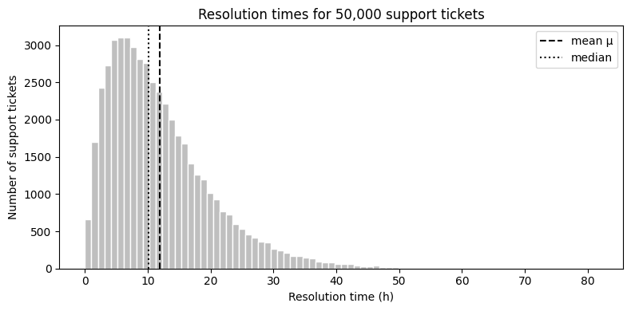
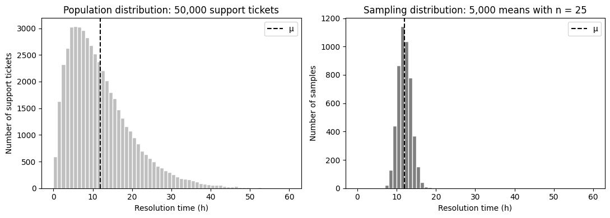
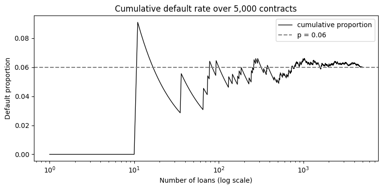
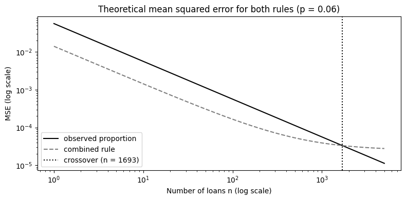
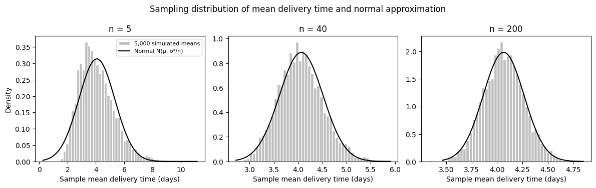
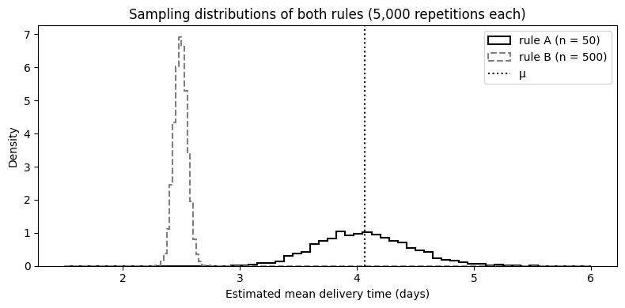

# Chapter 03 — Solutions

[Student notebook](../ch03-student.ipynb) · [exercises](../exercises/ch03.md)

Consult the solutions after attempting the exercises.

# Worked solutions 01–06

**Prof. Daniel de Abreu Pereira Uhr**

**Course:** Statistics and Econometrics with Python


Daniel de Abreu Pereira Uhr

Chapter 3

## Case

The software platform wants the mean support ticket resolution time in hours. Its synthetic register contains 50,000 tickets. A gamma distribution generates positive, right-skewed times. Run the setup once and work through the items in order using the same random generator.

```python
import numpy as np
import pandas as pd
import matplotlib.pyplot as plt

rng = np.random.default_rng(2026)
support_tickets = pd.Series(np.round(rng.gamma(shape=2, scale=6, size=50_000), 2), name="hours")
hours = support_tickets.to_numpy()
```

## Solution to Exercise 01 — Population parameters

Calculate the population mean, population standard deviation (divisor N), median and skewness of resolution times. Plot a histogram. Why are the population values known here?

```python
mu = support_tickets.mean()
sigma = support_tickets.std(ddof=0)

print(f"Mean resolution time μ: {mu:.2f} h")
print(f"Standard deviation σ: {sigma:.2f} h")
print(f"Median: {support_tickets.median():.2f} h")
print(f"Skewness: {support_tickets.skew():.2f}")

fig, ax = plt.subplots(figsize=(8, 4))
ax.hist(support_tickets, bins=80, color="#BFBFBF", edgecolor="white")
ax.axvline(mu, color="black", linestyle="--", label="mean μ")
ax.axvline(support_tickets.median(), color="black", linestyle=":", label="median")
ax.set_title("Resolution times for 50,000 support tickets")
ax.set_xlabel("Resolution time (h)")
ax.set_ylabel("Number of support tickets")
ax.legend()
fig.tight_layout()
plt.show()
```

```text
Mean resolution time μ: 11.97 h
Standard deviation σ: 8.44 h
Median: 10.09 h
Skewness: 1.43
```



The population mean is 11.97 hours, the standard deviation 8.44 hours and the median 10.09 hours. Skewness of 1.43 and the histogram show a long right tail. The complete synthetic register makes the parameters observable.

## Solution to Exercise 02 — One sample, one estimate

Draw 25 tickets with replacement. Compute the mean, sample standard deviation and estimated standard error. Compare them with the population mean and theoretical standard error. Which numbers could an analyst report from the sample alone?

```python
n = 25
sample = rng.choice(hours, size=n, replace=True)

sample_mean = sample.mean()
s = sample.std(ddof=1)
estimated_se = s / np.sqrt(n)
se_25 = sigma / np.sqrt(n)

print(f"Estimated mean resolution time: {sample_mean:.2f} h   (μ = {mu:.2f} h)")
print(f"Sample standard deviation s: {s:.2f} h   (σ = {sigma:.2f} h)")
print(f"Estimated standard error s/√n: {estimated_se:.2f} h   (σ/√n = {se_25:.2f} h)")
```

```text
Estimated mean resolution time: 11.81 h   (μ = 11.97 h)
Sample standard deviation s: 9.19 h   (σ = 8.44 h)
Estimated standard error s/√n: 1.84 h   (σ/√n = 1.69 h)
```

This sample gives 11.81 hours and an estimated standard error of 1.84 hours. The true sampling standard error is about 1.69 hours. Only the first two numbers would usually be available.

## Solution to Exercise 03 — Sampling distribution

Draw 5,000 samples of 25 tickets. Compare the mean and standard deviation of their means with the theoretical values. Plot individual times and sample means side by side on a common horizontal scale. Interpret both shapes.

```python
R = 5_000
samples_25 = rng.choice(hours, size=(R, 25), replace=True)
means_25 = samples_25.mean(axis=1)

print(f"Mean of the {R} estimates: {means_25.mean():.3f} h   (μ = {mu:.3f} h)")
print(f"Simulated bias: {means_25.mean() - mu:+.3f} h")
print(f"Standard deviation of estimates: {means_25.std():.3f} h   (σ/√n = {se_25:.3f} h)")

fig, axes = plt.subplots(1, 2, figsize=(11, 4), sharex=True)
axes[0].hist(support_tickets, bins=60, range=(0, 60), color="#BFBFBF", edgecolor="white")
axes[0].set_title("Population distribution: 50,000 support tickets")
axes[0].set_ylabel("Number of support tickets")
axes[1].hist(means_25, bins=60, range=(0, 60), color="#7F7F7F", edgecolor="white")
axes[1].set_title("Sampling distribution: 5,000 means with n = 25")
axes[1].set_ylabel("Number of samples")
for ax in axes:
    ax.axvline(mu, color="black", linestyle="--", label="μ")
    ax.set_xlabel("Resolution time (h)")
    ax.legend()
fig.tight_layout()
plt.show()
```

```text
Mean of the 5000 estimates: 11.973 h   (μ = 11.966 h)
Simulated bias: +0.007 h
Standard deviation of estimates: 1.690 h   (σ/√n = 1.689 h)
```



The average of the simulated means is within 0.007 hour of the target. Their standard deviation is 1.690 hours, close to 1.689 in theory. Averaging reduces spread and right skew relative to the individual times.

## Solution to Exercise 04 — More tickets per sample

Repeat with 100 tickets per sample. Compare empirical bias, standard error and its theoretical value with Exercise 03. Explain the ratio of standard errors and what happened to dispersion among individual tickets.

```python
samples_100 = rng.choice(hours, size=(R, 100), replace=True)
means_100 = samples_100.mean(axis=1)
se_100 = sigma / np.sqrt(100)

comparison = pd.DataFrame({
    "n": [25, 100],
    "mean_estimates": [means_25.mean(), means_100.mean()],
    "bias": [means_25.mean() - mu, means_100.mean() - mu],
    "sd_estimates": [means_25.std(), means_100.std()],
    "theoretical_se": [se_25, se_100],
})
print(comparison.round(3).to_string(index=False))
print(f"Ratio of simulated standard deviations (n = 25 / n = 100): {means_25.std() / means_100.std():.2f}")
print(f"Standard deviation of resolution times σ: {sigma:.2f} h (independent of n)")
```

```text
  n  mean_estimates   bias  sd_estimates  theoretical_se
 25          11.973  0.007         1.690           1.689
100          11.962 -0.004         0.838           0.844
Ratio of simulated standard deviations (n = 25 / n = 100): 2.02
Standard deviation of resolution times σ: 8.44 h (independent of n)
```

The empirical standard errors are about 1.69 and 0.84 hours. Quadrupling n halves σ/√n. Individual resolution times still have a population standard deviation of 8.44 hours.

## Solution to Exercise 05 — Standard deviation or standard error?

A report gives a mean of 12 hours and a standard deviation of 8.5 hours for 100 tickets. It says the estimated mean can be off by up to 8.5 hours. Evaluate the claim and calculate a measure of uncertainty for the mean.

```python
print(f"Variation across support tickets (σ): {sigma:.2f} h")
print(f"Standard error of the mean time with n = 100 (σ/√n): {se_100:.2f} h")
print(f"Number of samples of 100 with absolute error above 2 h (5,000 repetitions): {(np.abs(means_100 - mu) > 2).mean():.2%}")
```

```text
Variation across support tickets (σ): 8.44 h
Standard error of the mean time with n = 100 (σ/√n): 0.84 h
Number of samples of 100 with absolute error above 2 h (5,000 repetitions): 1.68%
```

The reported 8.5 hours describes dispersion across tickets. Using the report’s numbers gives an estimated standard error of 8.5/√100 = 0.85 hours. Neither quantity is an upper bound on error.

## Solution to Exercise 06 — Challenge — The quick rule

For each sample in Exercises 03 and 04, average its minimum and maximum. Compare this midrange with the sample mean on average estimate, bias, standard error and MSE. Explain the effect of sample size and assess consistency for this population.

```python
def summarize(estimates, rule, size):
    return {
        "rule": rule,
        "n": size,
        "mean_estimates": estimates.mean(),
        "bias": estimates.mean() - mu,
        "sd": estimates.std(),
        "mse": np.mean((estimates - mu) ** 2),
    }

midrange_25 = (samples_25.min(axis=1) + samples_25.max(axis=1)) / 2
midrange_100 = (samples_100.min(axis=1) + samples_100.max(axis=1)) / 2

challenge = pd.DataFrame([
    summarize(means_25, "sample mean", 25),
    summarize(midrange_25, "midrange", 25),
    summarize(means_100, "sample mean", 100),
    summarize(midrange_100, "midrange", 100),
])
print(challenge.round(3).to_string(index=False))
print(f"Largest sample mean time: {samples_25.max(axis=1).mean():.1f} h (n = 25) and {samples_100.max(axis=1).mean():.1f} h (n = 100)")
```

```text
       rule   n  mean_estimates   bias    sd     mse
sample mean  25          11.973  0.007 1.690   2.855
   midrange  25          17.897  5.931 4.544  55.824
sample mean 100          11.962 -0.004 0.838   0.702
   midrange 100          22.284 10.318 4.401 125.833
Largest sample mean time: 34.1 h (n = 25) and 43.8 h (n = 100)
```

The midrange assigns half the weight to the longest time. As the sample grows, the extremes approach the ends of this finite register, so the midrange converges to their midpoint. Here that midpoint differs from the population mean. The sample mean converges to the target. At sample sizes 25 and 100, its simulated biases are 5.9 and 10.3 hours and its MSEs are 55.8 and 125.8 hours squared. The corresponding MSEs of the sample mean are 2.9 and 0.7.

# Worked solutions 07–12

**Prof. Daniel de Abreu Pereira Uhr**

**Course:** Statistics and Econometrics with Python


Daniel de Abreu Pereira Uhr

Chapter 3

## Case

At the finance company, each contract defaults independently with probability 0.06. Compare the observed proportion with a rule that gives equal weight to that proportion and a historical rate of 5%. Run the setup once and work through the items in order using the same random generator.

```python
import numpy as np
import pandas as pd
import matplotlib.pyplot as plt

rng = np.random.default_rng(2026)
p = 0.06
historical_rate = 0.05
```

## Solution to Exercise 07 — Law of large numbers

Simulate 5,000 independent contracts. Report the cumulative default rate at 20, 100, 500 and 5,000 contracts and plot the path against p. State the law of large numbers and assess its assumptions here.

```python
loans = rng.binomial(n=1, p=p, size=5_000)
cumulative_proportion = loans.cumsum() / np.arange(1, len(loans) + 1)

for k in [20, 100, 500, 5_000]:
    print(f"After {k:>5} loans: proportion {cumulative_proportion[k - 1]:.4f}")

fig, ax = plt.subplots(figsize=(8, 4))
ax.plot(np.arange(1, len(loans) + 1), cumulative_proportion, color="black", linewidth=1, label="cumulative proportion")
ax.axhline(p, color="#7F7F7F", linestyle="--", label="p = 0.06")
ax.set_xscale("log")
ax.set_title("Cumulative default rate over 5,000 contracts")
ax.set_xlabel("Number of loans (log scale)")
ax.set_ylabel("Default proportion")
ax.legend()
fig.tight_layout()
plt.show()
```

```text
After    20 loans: proportion 0.0500
After   100 loans: proportion 0.0600
After   500 loans: proportion 0.0500
After  5000 loans: proportion 0.0600
```



Under independent Bernoulli sampling, the cumulative proportion converges to p. The reported checkpoints describe a single path. Its distance from p need not shrink at every step.

## Solution to Exercise 08 — The compensation fallacy

Three of the last ten contracts defaulted. Must later contracts compensate? Compare default frequencies following a default and following repayment in Exercise 07. At n = 20, 100, 500 and 5,000, calculate the standard deviations of the count and the proportion. Use both results to evaluate the claim.

```python
previous = loans[:-1]
following = loans[1:]

print(f"Default after a defaulted loan: {following[previous == 1].mean():.4f}")
print(f"Default after a performing loan: {following[previous == 0].mean():.4f}")

scale = pd.DataFrame({"n": [20, 100, 500, 5_000]})
scale["sd_count"] = np.sqrt(scale["n"] * p * (1 - p))
scale["se_proportion"] = np.sqrt(p * (1 - p) / scale["n"])
print(scale.round(4).to_string(index=False))
```

```text
Default after a defaulted loan: 0.0600
Default after a performing loan: 0.0600
   n  sd_count  se_proportion
  20    1.0621         0.0531
 100    2.3749         0.0237
 500    5.3104         0.0106
5000   16.7929         0.0034
```

Independence keeps the next default probability at 0.06 after either outcome. The count’s standard deviation grows like √n while the proportion’s falls like 1/√n. Convergence requires no compensating sequence.

## Solution to Exercise 09 — Two rules and three portfolio sizes

Simulate 5,000 portfolios at each of n = 20, 500 and 5,000. For each rule, report average estimate, bias, variance and mean squared error. Which rule has lower MSE at each size?

```python
R = 5_000
sizes = [20, 500, 5_000]

rows = []
for n in sizes:
    defaults = rng.binomial(n=n, p=p, size=R)
    observed_p = defaults / n
    combined_p = 0.5 * observed_p + 0.5 * historical_rate
    for rule, estimates in [("observed", observed_p), ("combined", combined_p)]:
        rows.append({
            "n": n,
            "rule": rule,
            "mean_estimates": estimates.mean(),
            "bias": estimates.mean() - p,
            "variance": estimates.var(),
            "mse": np.mean((estimates - p) ** 2),
        })
simulation = pd.DataFrame(rows)
print(simulation.round(6).to_string(index=False))
```

```text
   n     rule  mean_estimates      bias  variance      mse
  20 observed        0.061330  0.001330  0.002936 0.002938
  20 combined        0.055665 -0.004335  0.000734 0.000753
 500 observed        0.059939 -0.000061  0.000115 0.000115
 500 combined        0.054969 -0.005031  0.000029 0.000054
5000 observed        0.060032  0.000032  0.000011 0.000011
5000 combined        0.055016 -0.004984  0.000003 0.000028
```

The combined rule has smaller MSE at 20 and 500 contracts. At 5,000 the observed proportion wins. The fixed historical weight lowers variance but introduces a bias that persists.

## Solution to Exercise 10 — Theoretical check and crossover

Derive the combined rule’s expectation and variance. Calculate theoretical bias, variance and MSE for both rules at the three portfolio sizes and compare with Exercise 09. Plot both theoretical MSEs from 1 to 5,000 contracts. Find the first integer size at which the observed proportion has strictly lower MSE.

```python
def theoretical_mse(n, true_p, rate=historical_rate):
    observed_variance = true_p * (1 - true_p) / n
    combined_bias = 0.5 * true_p + 0.5 * rate - true_p
    observed_mse = observed_variance
    combined_mse = 0.25 * observed_variance + combined_bias**2
    return observed_mse, combined_mse, combined_bias

theory = []
for n in sizes:
    mse_obs, mse_comb, combined_bias = theoretical_mse(n, p)
    theory.append({"n": n, "combined_bias": combined_bias, "observed_mse": mse_obs, "combined_mse": mse_comb})
print(pd.DataFrame(theory).round(6).to_string(index=False))

n_grid = np.arange(1, 5_001)
observed_mse_grid, combined_mse_grid, _ = theoretical_mse(n_grid, p)
crossover = n_grid[observed_mse_grid < combined_mse_grid][0]
print(f"First sample size at which the observed proportion has lower MSE: n = {crossover} loans")

fig, ax = plt.subplots(figsize=(8, 4))
ax.plot(n_grid, observed_mse_grid, color="black", label="observed proportion")
ax.plot(n_grid, combined_mse_grid, color="#7F7F7F", linestyle="--", label="combined rule")
ax.axvline(crossover, color="black", linestyle=":", label=f"crossover (n = {crossover})")
ax.set_xscale("log")
ax.set_yscale("log")
ax.set_title("Theoretical mean squared error for both rules (p = 0.06)")
ax.set_xlabel("Number of loans n (log scale)")
ax.set_ylabel("MSE (log scale)")
ax.legend()
fig.tight_layout()
plt.show()
```

```text
   n  combined_bias  observed_mse  combined_mse
  20         -0.005      0.002820      0.000730
 500         -0.005      0.000113      0.000053
5000         -0.005      0.000011      0.000028
First sample size at which the observed proportion has lower MSE: n = 1693 loans
```



The combined rule has expectation 0.5p + 0.025, bias −0.005 at p = 0.06 and variance 0.25p(1−p)/n. The observed proportion has zero bias and variance p(1−p)/n. Equating MSEs gives n = 1,692. The observed proportion first wins strictly at 1,693.

## Solution to Exercise 11 — Consistency

Draw one portfolio at each of 10,000, 100,000 and 1,000,000 contracts. Compute both estimates. Derive each rule’s probability limit and identify which is consistent for p.

```python
for n in [10_000, 100_000, 1_000_000]:
    observed_p = rng.binomial(n=n, p=p) / n
    combined_p = 0.5 * observed_p + 0.5 * historical_rate
    print(f"n = {n:>9}: observed {observed_p:.4f}   combined {combined_p:.4f}")
print(f"Expectation of the combined rule: {0.5 * p + 0.5 * historical_rate:.4f}")
```

```text
n =     10000: observed 0.0603   combined 0.0552
n =    100000: observed 0.0601   combined 0.0551
n =   1000000: observed 0.0602   combined 0.0551
Expectation of the combined rule: 0.0550
```

The observed proportion converges to 0.06. The combined rule converges to 0.055 because the historical rate retains half the weight however large the portfolio becomes.

## Solution to Exercise 12 — Challenge — When to use the historical rate

When would management prefer each rule? Suppose p rises to 0.09 while the historical rate stays at 5%. Calculate both theoretical MSEs at n = 20 and 500. Explain the risk of keeping the historical rate fixed.

```python
for n in [20, 500]:
    mse_obs, mse_comb, combined_bias = theoretical_mse(n, 0.09)
    print(f"n = {n:>3}, p = 0.09: observed MSE {mse_obs:.6f}   combined MSE {mse_comb:.6f}   combined-rule bias {combined_bias:+.3f}")
```

```text
n =  20, p = 0.09: observed MSE 0.004095   combined MSE 0.001424   combined-rule bias -0.020
n = 500, p = 0.09: observed MSE 0.000164   combined MSE 0.000441   combined-rule bias -0.020
```

At p = 0.09 the combined rule’s bias is −0.02. Its MSE is about 0.00142 versus 0.00410 for the observed rate at n = 20, and 0.00044 versus 0.00016 at n = 500. Small portfolios can benefit from stabilization when the historical rate is credible. Persistent changes in default risk require reassessing that reference.

# Worked solutions 13–18

**Prof. Daniel de Abreu Pereira Uhr**

**Course:** Statistics and Econometrics with Python


Daniel de Abreu Pereira Uhr

Chapter 3

## Case

Seagull Freight needs the mean time in days for all deliveries. Its synthetic register contains 100,000 deliveries, about 30% on short routes. Rule A samples 50 deliveries across the operation. Rule B samples 500 from a central depot serving short routes only. Run the setup once and work through the items in order using the same random generator.

```python
import numpy as np
import pandas as pd
import matplotlib.pyplot as plt
from scipy import stats

rng = np.random.default_rng(2026)
N = 100_000
short_route = rng.random(N) < 0.30
delivery_time = np.where(
    short_route,
    1 + rng.gamma(shape=1.5, scale=1.0, size=N),
    1 + rng.gamma(shape=1.5, scale=2.5, size=N),
)
deliveries = pd.DataFrame({"short_route": short_route, "delivery_days": np.round(delivery_time, 1)})
delivery_times = deliveries["delivery_days"].to_numpy()
```

## Solution to Exercise 13 — Population and target parameter

Calculate the overall mean, population standard deviation and skewness of delivery times, the share of short routes and the mean for each route type. State management’s target parameter.

```python
mu = deliveries["delivery_days"].mean()
sigma = deliveries["delivery_days"].std(ddof=0)

print(f"Mean delivery time μ: {mu:.3f} days")
print(f"Standard deviation σ: {sigma:.3f} days")
print(f"Skewness: {deliveries['delivery_days'].skew():.2f}")
print(f"Proportion of deliveries on short routes: {deliveries['short_route'].mean():.3f}")
print(deliveries.groupby("short_route")["delivery_days"].mean().round(3))
```

```text
Mean delivery time μ: 4.065 days
Standard deviation σ: 2.842 days
Skewness: 1.91
Proportion of deliveries on short routes: 0.303
short_route
False    4.746
True     2.497
Name: delivery_days, dtype: float64
```

The operation-wide mean is 4.07 days, with a standard deviation of 2.84 days and skewness of 1.91. About 30% of deliveries use short routes. Short-route trips average about 2.5 days and long-route trips about 4.7 days. Management needs the overall mean.

## Solution to Exercise 14 — Sampling distribution of the mean

Draw 5,000 samples from the whole operation at each of n = 5, 40 and 200. Plot the three distributions of sample means with normal densities of mean μ and variance σ²/n. Calculate their skewness. Explain what changed for deliveries and for means.

```python
R = 5_000
sizes = [5, 40, 200]
means_by_n = {t: rng.choice(delivery_times, size=(R, t), replace=True).mean(axis=1) for t in sizes}

fig, axes = plt.subplots(1, 3, figsize=(12, 3.8))
for ax, size in zip(axes, sizes):
    estimates = means_by_n[size]
    normal = stats.norm(loc=mu, scale=sigma / np.sqrt(size))
    grid = np.linspace(mu - 3 * sigma / np.sqrt(size), estimates.max(), 300)
    ax.hist(estimates, bins=50, density=True, color="#BFBFBF", edgecolor="white", label="5,000 simulated means")
    ax.plot(grid, normal.pdf(grid), color="black", label="Normal N(μ, σ²/n)")
    ax.set_title(f"n = {size}")
    ax.set_xlabel("Sample mean delivery time (days)")
axes[0].set_ylabel("Density")
axes[0].legend(fontsize=8)
fig.suptitle("Sampling distribution of mean delivery time and normal approximation")
fig.tight_layout()
plt.show()

for size in sizes:
    print(f"n = {size:>3}: skewness of sample means = {pd.Series(means_by_n[size]).skew():.2f}")
print(f"Skewness of delivery times: {deliveries['delivery_days'].skew():.2f}")
```



```text
n =   5: skewness of sample means = 0.82
n =  40: skewness of sample means = 0.32
n = 200: skewness of sample means = 0.10
Skewness of delivery times: 1.91
```

Skewness of the means falls from approximately 0.82 to 0.32 and 0.10. The normal shape fits progressively better. The underlying delivery-time distribution retains its original skewness.

## Solution to Exercise 15 — Assessing the normal approximation

At each size, compare the normal probability that the sample mean exceeds five days with its simulated frequency. Assess the approximation at n = 40 and explain why its quality depends on the event.

```python
rows = []
for size in sizes:
    normal = stats.norm(loc=mu, scale=sigma / np.sqrt(size))
    rows.append({
        "n": size,
        "simulated": (means_by_n[size] > 5).mean(),
        "normal": 1 - normal.cdf(5),
    })
print(pd.DataFrame(rows).round(4).to_string(index=False))
```

```text
  n  simulated  normal
  5     0.2032  0.2311
 40     0.0288  0.0188
200     0.0000  0.0000
```

At n = 5 the normal approximation gives 0.2311 versus 0.2032 in simulation. At n = 40 it gives 0.0188 versus 0.0288. Both probabilities are very small at n = 200. Agreement in the center need not imply accurate relative probabilities in a tail.

## Solution to Exercise 16 — Comparing the rules

Simulate each rule 5,000 times. Compare mean estimate, bias, standard error and MSE against the operation-wide target. Plot the sampling distributions with the target marked. Which rule is more precise? Which is more accurate?

```python
rule_a = rng.choice(delivery_times, size=(R, 50), replace=True).mean(axis=1)
rule_b = rng.choice(delivery_times[short_route], size=(R, 500), replace=True).mean(axis=1)

rules = pd.DataFrame([
    {
        "rule": name,
        "mean_estimates": estimates.mean(),
        "bias": estimates.mean() - mu,
        "standard_error": estimates.std(),
        "mse": np.mean((estimates - mu) ** 2),
    }
    for name, estimates in [("A: 50 from the entire operation", rule_a), ("B: 500 from short routes", rule_b)]
])
print(rules.round(4).to_string(index=False))

fig, ax = plt.subplots(figsize=(8, 4))
ax.hist(rule_a, bins=60, range=(1.5, 6), density=True, histtype="step", color="black", linewidth=1.5, label="rule A (n = 50)")
ax.hist(rule_b, bins=180, range=(1.5, 6), density=True, histtype="step", color="#7F7F7F", linewidth=1.5, linestyle="--", label="rule B (n = 500)")
ax.axvline(mu, color="black", linestyle=":", label="μ")
ax.set_title("Sampling distributions of both rules (5,000 repetitions each)")
ax.set_xlabel("Estimated mean delivery time (days)")
ax.set_ylabel("Density")
ax.legend()
fig.tight_layout()
plt.show()
```

```text
                           rule  mean_estimates    bias  standard_error    mse
A: 50 from the entire operation          4.0616 -0.0036          0.3933 0.1547
       B: 500 from short routes          2.4959 -1.5694          0.0562 2.4661
```



Rule A has approximately zero bias, standard error 0.39 day and MSE 0.15 days squared. Rule B is more precise within its frame (0.056 day) but biased by about −1.57 days for the target. Its MSE of 2.47 days squared favors A for the operation-wide question.

## Solution to Exercise 17 — Estimated standard error under rule B

Apply each rule once and calculate its estimated mean and estimated standard error. What population does the small standard error from rule B describe?

```python
sample_a = rng.choice(delivery_times, size=50, replace=True)
sample_b = rng.choice(delivery_times[short_route], size=500, replace=True)

for name, sample in [("Rule A", sample_a), ("Rule B", sample_b)]:
    estimated_se = sample.std(ddof=1) / np.sqrt(len(sample))
    print(f"{name}: estimate {sample.mean():.2f} days   estimated standard error {estimated_se:.3f} day")
print(f"True mean delivery time μ: {mu:.2f} days")
```

```text
Rule A: estimate 3.88 days   estimated standard error 0.328 day
Rule B: estimate 2.58 days   estimated standard error 0.058 day
True mean delivery time μ: 4.07 days
```

A gives 3.88 days with an estimated standard error of 0.33 day. B gives 2.58 days with an estimated standard error of 0.058 day. The latter quantifies random variation within short routes and excludes the coverage error.

## Solution to Exercise 18 — Challenge — A recommendation to management

Write a short recommendation for management. Justify your rule using bias, standard error and MSE. Report the estimate and estimated standard error from Exercise 17 in days. Explain a limitation and how the central depot records could contribute to an operation-wide estimate.

Use a random sample of all deliveries. The sample of 50 gives an estimated average of 3.9 days and an estimated standard error of about 0.3 day. This describes operations in the sampled period. The central depot can characterize short routes. Combine those data with representative long-route data using each route type’s share of deliveries.

### Transfer within Exercise 18 — Budget and precision

Management hypothetically has USD 1,000 to check records, at USD 8 per delivery with no fixed cost. It wants a standard error no greater than 0.25 day for the overall mean. Retaining iid sampling with replacement and using the known population standard deviation only in the laboratory, find the largest affordable n and the smallest n meeting the target. Use SE = sigma/sqrt(n) and round the required size upward. Compare required cost with the budget and write a recommendation. Explain why using free short-route records does not solve the budget shortfall for the same target, and what would change if sigma had to be estimated. The target is a standard error, not a confidence-interval margin.

```python
transfer_budget = 1000
transfer_unit_cost = 8
transfer_target_se = 0.25
transfer_max_n = transfer_budget // transfer_unit_cost
transfer_required_n = int(np.ceil((sigma / transfer_target_se)**2))
transfer_required_cost = transfer_unit_cost * transfer_required_n
transfer_se = sigma / np.sqrt(transfer_max_n)
print("n_max, n_required:", transfer_max_n, transfer_required_n)
print("cost_required:", transfer_required_cost)
print("SE_at_budget:", round(float(transfer_se), 4))
print("feasible:", transfer_required_n <= transfer_max_n)
assert sigma / np.sqrt(transfer_required_n) <= transfer_target_se
assert sigma / np.sqrt(transfer_required_n - 1) > transfer_target_se
```

```text
n_max, n_required: 125 130
cost_required: 1040
SE_at_budget: 0.2542
feasible: False
```

The displayed minimum exceeds the affordable sample. Request the cost difference or disclose the attainable precision; do not claim the original target was met. Free short-route records cannot replace coverage of all routes. The laboratory calculation assumes known dispersion, constant unit cost, and iid draws. An estimated planning standard deviation introduces uncertainty; an observed standard error is not guaranteed to equal the planned value.
