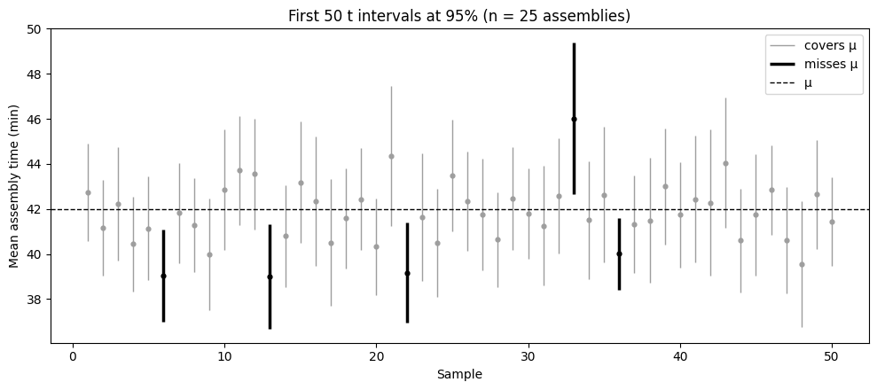
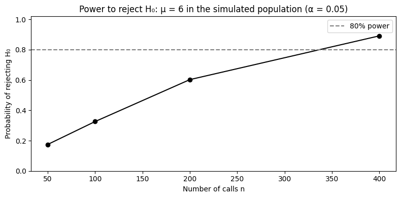

# Chapter 04 — Solutions

[Student notebook](../ch04-student.ipynb) · [exercises](../exercises/ch04.md)

Consult the solutions after attempting the exercises.

# Worked solutions 01–06

**Prof. Daniel de Abreu Pereira Uhr**

**Course:** Statistics and Econometrics with Python


Daniel de Abreu Pereira Uhr · Chapter 4

## Case

The woodworking shop wants the mean assembly time in minutes for a shelving unit. The analyst times 25 randomly sampled assemblies. The laboratory knows the complete synthetic register of 20,000 assembly times. Run the setup once. Use the same random generator and work in order.

```python
import numpy as np
import pandas as pd
import matplotlib.pyplot as plt
from scipy import stats

rng = np.random.default_rng(2026)
assembly_times = np.round(rng.gamma(shape=49, scale=6 / 7, size=20_000), 1)
```

## Solution to Exercise 01 — One sample and its interval

In the laboratory calculate the population mean and SD using divisor N. As the analyst, sample 25 assemblies with replacement, find the mean, sample SD and estimated standard error. Build a 95% t interval by hand and check with `stats.t.interval`. Does the interval cover the laboratory mean?

```python
mu = assembly_times.mean()
sigma = assembly_times.std()
print(f"Laboratory: μ = {mu:.2f} min; σ = {sigma:.2f} min; skewness = {pd.Series(assembly_times).skew():.2f}")

n = 25
sample = rng.choice(assembly_times, size=n, replace=True)
sample_mean = sample.mean()
standard_error = sample.std(ddof=1) / np.sqrt(n)

critical_t = stats.t.ppf(0.975, df=n - 1)
ci = (sample_mean - critical_t * standard_error, sample_mean + critical_t * standard_error)
library_ci = stats.t.interval(0.95, df=n - 1, loc=sample_mean, scale=standard_error)

print(f"Analyst: x̄ = {sample_mean:.2f} min; s = {sample.std(ddof=1):.2f} min; standard error = {standard_error:.2f} min")
print(f"95% CI by hand: {ci[0]:.2f} to {ci[1]:.2f} min")
print(f"95% CI using stats.t.interval: {library_ci[0]:.2f} to {library_ci[1]:.2f} min")
print(f"Does the interval cover μ? {ci[0] <= mu <= ci[1]}")
```

```text
Laboratory: μ = 41.99 min; σ = 5.96 min; skewness = 0.27
Analyst: x̄ = 40.74 min; s = 4.36 min; standard error = 0.87 min
95% CI by hand: 38.94 to 42.54 min
95% CI using stats.t.interval: 38.94 to 42.54 min
Does the interval cover μ? True
```

The full register has mean 41.99 minutes and SD 5.96 minutes. The sample gives 40.74 minutes, s = 4.36 and estimated SE = 0.87 minute. With 24 degrees of freedom the hand calculation and SciPy give 38.94 to 42.54 minutes. This interval covers the known mean.

## Solution to Exercise 02 — Communicating an interval

Evaluate each statement. (1) There is a 95% probability that the fixed mean falls in this observed interval. (2) Repeating the procedure many times gives intervals that cover the true mean about 95% of the time under the model. (3) The interval contains 95% of assembly times. (4) A new sample of 25 generally produces a different interval. Give management one sentence with the estimate, units and interval.

Statements 2 and 4 are defensible. Coverage refers to repeated samples. The fixed mean either falls inside this observed interval or outside it. An interval for a population mean does not describe the distribution of individual assembly times. Tell management: “Based on 25 sampled assemblies, we estimate an average of 40.74 minutes, with a 95% interval from 38.94 to 42.54 minutes.”

## Solution to Exercise 03 — Coverage

Repeat the analyst’s procedure 5,000 times at n = 25. Estimate coverage and plot the first 50 intervals, marking misses. How closely does the experiment support the nominal confidence level?

```python
R = 5_000
samples = rng.choice(assembly_times, size=(R, n), replace=True)
means = samples.mean(axis=1)
margins = critical_t * samples.std(axis=1, ddof=1) / np.sqrt(n)
covers_mu = np.abs(means - mu) <= margins
print(f"Coverage of the 95% t interval at n = 25: {covers_mu.mean():.4f}")

first = np.arange(50)
fig, ax = plt.subplots(figsize=(10, 4.5))
for covers, color, thickness, label in [(True, "#9E9E9E", 1.0, "covers μ"), (False, "black", 2.5, "misses μ")]:
    selection = first[covers_mu[first] == covers]
    ax.vlines(selection + 1, means[selection] - margins[selection], means[selection] + margins[selection], color=color, linewidth=thickness, label=label)
    ax.scatter(selection + 1, means[selection], color=color, s=12, zorder=3)
ax.axhline(mu, color="black", linestyle="--", linewidth=1, label="μ")
ax.set_title("First 50 t intervals at 95% (n = 25 assemblies)")
ax.set_xlabel("Sample")
ax.set_ylabel("Mean assembly time (min)")
ax.legend(loc="upper right")
fig.tight_layout()
plt.show()
```

```text
Coverage of the 95% t interval at n = 25: 0.9488
```



The 5,000 intervals cover the population mean in 94.88% of repetitions. In the plot a miss lies entirely on one side of the benchmark. This experiment supports approximate 95% coverage under the stated design. Finite simulation and the shape of the population both matter.

## Solution to Exercise 04 — Confidence, width and sample size

Using the sample from Exercise 01, calculate 90% and 99% intervals and compare their widths to the 95% interval. Using a planning SD of six minutes, find the sample sizes for margins of two minutes and one minute at 95% confidence.

```python
for level in [0.90, 0.95, 0.99]:
    lower, upper = stats.t.interval(level, df=n - 1, loc=sample_mean, scale=standard_error)
    print(f"CI at {level:.0%}: {lower:.2f} to {upper:.2f} min   width {upper - lower:.2f} min")

planning_sigma = 6
for margin in [2, 1]:
    print(f"Margin of {margin} min: about {int(np.ceil((stats.norm.ppf(0.975) * planning_sigma / margin) ** 2))} assemblies")
```

```text
CI at 90%: 39.25 to 42.24 min   width 2.98 min
CI at 95%: 38.94 to 42.54 min   width 3.60 min
CI at 99%: 38.31 to 43.18 min   width 4.88 min
Margin of 2 min: about 35 assemblies
Margin of 1 min: about 139 assemblies
```

The widths are 2.98, 3.60 and 4.88 minutes at 90%, 95% and 99%. Holding the standard error fixed, higher confidence increases the critical value. Using the planning SD gives 35 assemblies for a two-minute margin and 139 for one minute. Round up after evaluating the squared ratio.

## Solution to Exercise 05 — What the interval misses

The manager proposes timing only morning assemblies by the most experienced team. What mean would that interval estimate? Explain how a narrow interval could mislead a planner responsible for the whole factory.

A representative sample from the morning shift estimates the morning team’s mean. The experienced crew may assemble shelves faster than other crews. Repeated sampling from that shift can yield a small standard error while leaving the overall plant mean outside the interval. Sample across shifts in proportion to their production or use a sampling design that accounts for their separate shares.

## Solution to Exercise 06 — Challenge — Rework on the assembly line

On a new line, 10% of assemblies require rework, with an additional exponential time averaging 25 minutes. After Exercise 04, use the supplied code to generate the population. Calculate its mean and skewness. Estimate 95% t interval coverage with 5,000 repetitions at n = 10, 40 and 160. Explain the pattern.

The solution block below includes the population generation. Run it only once to preserve the random sequence.

```python
rework = rng.random(20_000) < 0.10
rework_times = np.round(assembly_times + np.where(rework, rng.exponential(25, size=20_000), 0), 1)
mu_rework = rework_times.mean()
print(f"Population with rework: μ = {mu_rework:.2f} min; skewness = {pd.Series(rework_times).skew():.2f}")

for sample_size in [10, 40, 160]:
    repetitions = rng.choice(rework_times, size=(R, sample_size), replace=True)
    margin = stats.t.ppf(0.975, df=sample_size - 1) * repetitions.std(axis=1, ddof=1) / np.sqrt(sample_size)
    coverage = (np.abs(repetitions.mean(axis=1) - mu_rework) <= margin).mean()
    print(f"n = {sample_size:>3}: coverage of the 95% t interval = {coverage:.4f}")
```

```text
Population with rework: μ = 44.61 min; skewness = 4.43
n =  10: coverage of the 95% t interval = 0.8900
n =  40: coverage of the 95% t interval = 0.8914
n = 160: coverage of the 95% t interval = 0.9216
```

The new population mean is 44.61 minutes with skewness 4.43. Simulated coverage is 89.00%, 89.14% and 92.16%. A small sample can miss the few long jobs and underestimate both the mean and its uncertainty. Increasing n helps, but even 160 assemblies fall short of nominal coverage in this experiment.

# Worked solutions 07–12

**Prof. Daniel de Abreu Pereira Uhr**

**Course:** Statistics and Econometrics with Python


Daniel de Abreu Pereira Uhr · Chapter 4

## Case

The experimental contact center targets a six-minute mean handling time. The manager wants to know whether the current mean differs from six in either direction. The analyst samples 50 calls. The laboratory has 50,000 synthetic call times. Run the setup once. Use the same random generator and work in order.

```python
import numpy as np
import pandas as pd
import matplotlib.pyplot as plt
from scipy import stats

rng = np.random.default_rng(2026)
call_times = np.round(rng.gamma(shape=(6.4 / 2.5) ** 2, scale=2.5**2 / 6.4, size=50_000), 2)
target = 6
```

## Solution to Exercise 07 — Hypotheses and test statistic

Specify null and alternative hypotheses for the manager’s question. Justify a two-sided test. Draw 50 calls with replacement and calculate the sample mean, estimated standard error and test statistic by hand.

```python
n = 50
sample = rng.choice(call_times, size=n, replace=True)
sample_mean = sample.mean()
standard_error = sample.std(ddof=1) / np.sqrt(n)
observed_t = (sample_mean - target) / standard_error

print(f"Estimated mean time: {sample_mean:.3f} min")
print(f"Estimated standard error: {standard_error:.3f} min")
print(f"Test statistic: t = {observed_t:.3f}")
```

```text
Estimated mean time: 6.173 min
Estimated standard error: 0.346 min
Test statistic: t = 0.499
```

Test H₀: μ = 6 against H₁: μ ≠ 6, since the manager asked about either direction before sampling. The estimate is 6.173 minutes with estimated SE 0.346. The standardized difference is 0.499.

## Solution to Exercise 08 — P-value and interval

Calculate the two-sided t p-value and check with `stats.ttest_1samp`. Obtain the 95% interval. Interpret the p-value, give two incorrect interpretations, and relate the interval to the test.

```python
p_value = 2 * (1 - stats.t.cdf(abs(observed_t), df=n - 1))
test = stats.ttest_1samp(sample, popmean=target)
ci = test.confidence_interval(confidence_level=0.95)

print(f"p-value from the t distribution: {p_value:.4f}")
print(f"ttest_1samp: t = {test.statistic:.3f}; p-value = {test.pvalue:.4f}")
print(f"95% CI: {ci.low:.2f} to {ci.high:.2f} min")
print(f"Does the interval include the target? {ci.low <= target <= ci.high}")
```

```text
p-value from the t distribution: 0.6200
ttest_1samp: t = 0.499; p-value = 0.6200
95% CI: 5.48 to 6.87 min
Does the interval include the target? True
```

The two-sided p-value is 0.6200. If the reference mean is six, the model frequently yields a statistic at least this extreme. This is neither a posterior probability that the null is true nor the probability of obtaining this exact sample. The 95% interval, 5.48 to 6.87 minutes, includes six, consistent with the test decision.

## Solution to Exercise 09 — Choosing one tail after seeing the data?

After seeing a sample mean above six, a supervisor suggests testing only for an increase. Calculate the one-sided p-value with `alternative="greater"`. Assess the proposal and explain when a one-sided test would be warranted.

```python
one_sided_test = stats.ttest_1samp(sample, popmean=target, alternative="greater")
print(f"One-sided p-value (H₁: μ > 6): {one_sided_test.pvalue:.4f}")
print(f"Two-sided p-value: {test.pvalue:.4f}")
```

```text
One-sided p-value (H₁: μ > 6): 0.3100
Two-sided p-value: 0.6200
```

For an increase the one-sided p-value is 0.3100. Choosing the favorable direction after seeing the sign changes the rejection rule and its nominal type I error. A one-sided test needs an advance rationale under which only an increase addresses the decision.

## Solution to Exercise 10 — Type I and type II errors

Shift every time so the laboratory population mean equals six. Draw 5,000 samples of 50 from this shifted population. Estimate the rejection rate at α = 0.05. Repeat with the original population and interpret the rates as type I error, type II error or power.

```python
mu = call_times.mean()
print(f"Laboratory: true mean time μ = {mu:.3f} min")

R = 5_000

def rejection_rate(population, sample_size):
    repetitions = rng.choice(population, size=(R, sample_size), replace=True)
    t = (repetitions.mean(axis=1) - target) / (repetitions.std(axis=1, ddof=1) / np.sqrt(sample_size))
    return (np.abs(t) > stats.t.ppf(0.975, df=sample_size - 1)).mean()

target_population = call_times + (target - mu)
type_i_error = rejection_rate(target_population, n)
power_50 = rejection_rate(call_times, n)

print(f"Rejection when μ = 6 (type I error): {type_i_error:.4f}")
print(f"Rejection when μ = {mu:.2f} (power): {power_50:.4f}")
print(f"Type II error: {1 - power_50:.4f}")
```

```text
Laboratory: true mean time μ = 6.392 min
Rejection when μ = 6 (type I error): 0.0532
Rejection when μ = 6.39 (power): 0.1748
Type II error: 0.8252
```

Under a true mean of six, 5.32% of repetitions reject, estimating type I error. At the original mean of 6.392 minutes, 17.48% reject, estimating power at that alternative. The remaining 82.52% estimate type II error there.

## Solution to Exercise 11 — Power and sample size

Estimate power by simulation in the original population at n = 50, 100, 200 and 400. Plot power against n. Explain how the effect size, dispersion, test rule and sample size enter the interpretation.

```python
sample_sizes = [50, 100, 200, 400]
power = [power_50] + [rejection_rate(call_times, sample_size) for sample_size in sample_sizes[1:]]
print(pd.DataFrame({"n": sample_sizes, "power": power}).round(3).to_string(index=False))

fig, ax = plt.subplots(figsize=(8, 4))
ax.plot(sample_sizes, power, color="black", marker="o")
ax.axhline(0.8, color="#7F7F7F", linestyle="--", label="80% power")
ax.set_ylim(0, 1.02)
ax.set_title("Power to reject H₀: μ = 6 in the simulated population (α = 0.05)")
ax.set_xlabel("Number of calls n")
ax.set_ylabel("Probability of rejecting H₀")
ax.legend()
fig.tight_layout()
plt.show()
```

```text
  n  power
 50  0.175
100  0.326
200  0.603
400  0.892
```



The estimated powers are 0.175, 0.326, 0.603 and 0.892. For this fixed difference the standard error falls with sample size. Power would change with a different effect, population dispersion, significance level or direction of testing.

## Solution to Exercise 12 — Challenge — Has the mean stayed the same?

The manager concludes from Exercise 08 that the mean remains six minutes and no action is needed. Use the interval and estimated power to assess that claim. Search sample sizes from 250 through 350, using the grid in the solution for comparison. Report the smallest **tested** size with estimated power of at least 80% and write a conclusion for the manager.

```python
for sample_size in [250, 275, 300, 325, 350]:
    print(f"n = {sample_size}: power = {rejection_rate(call_times, sample_size):.3f}")
```

```text
n = 250: power = 0.713
n = 275: power = 0.753
n = 300: power = 0.793
n = 325: power = 0.819
n = 350: power = 0.845
```

Six minutes remains compatible with the observations, as do means up to 6.87 minutes. The original design had little power to detect the laboratory difference. Estimated power crosses 80% between 300 and 325 calls on the tested grid (79.3% and 81.9%). Use 325 as the first tested size above target. Specify the effect and design before collecting further data.

# Worked solutions 13–18

**Prof. Daniel de Abreu Pereira Uhr**

**Course:** Statistics and Econometrics with Python


Daniel de Abreu Pereira Uhr · Chapter 4

## Case

The bookstore randomly assigns 2,000 visitors per version to an existing checkout A or a new checkout B. Revenue is zero for a visitor who does not purchase. The license requires at least one additional percentage point of conversion. Laboratory conversion probabilities are 8.0% and 9.5%. The analyst sees only the visitor records. Run the setup once. Use the same random generator and work in order.

```python
import numpy as np
import pandas as pd
import matplotlib.pyplot as plt
from scipy import stats
from statsmodels.stats.proportion import confint_proportions_2indep, proportions_ztest

rng = np.random.default_rng(2026)
visits_per_version = 2_000
purchased_a = rng.random(visits_per_version) < 0.080
purchased_b = rng.random(visits_per_version) < 0.095
values_a = np.round(rng.gamma(shape=(120 / 50) ** 2, scale=50**2 / 120, size=purchased_a.sum()), 2)
values_b = np.round(rng.gamma(shape=(115 / 50) ** 2, scale=50**2 / 115, size=purchased_b.sum()), 2)

visitors = pd.DataFrame({
    "version": np.repeat(["A", "B"], visits_per_version),
    "purchased": np.concatenate([purchased_a, purchased_b]),
})
visitors["order_value"] = 0.0
visitors.loc[visitors["purchased"], "order_value"] = np.concatenate([values_a, values_b])
```

## Solution to Exercise 13 — Difference in conversion

Calculate conversion in each group and B minus A in percentage points. Build a 95% interval by hand and check with `confint_proportions_2indep`. Test equality using `proportions_ztest`. Compare the interval with a one-point improvement.

```python
conversion = visitors.groupby("version")["purchased"].agg(["sum", "count", "mean"])
print(conversion)

p_a, p_b = conversion.loc["A", "mean"], conversion.loc["B", "mean"]
difference = p_b - p_a
error = np.sqrt(p_a * (1 - p_a) / visits_per_version + p_b * (1 - p_b) / visits_per_version)
critical_z = stats.norm.ppf(0.975)

print(f"Difference B − A: {100 * difference:.2f} percentage points")
print(f"95% CI by hand: {100 * (difference - critical_z * error):.2f} to {100 * (difference + critical_z * error):.2f} p.p.")
ci_lib = confint_proportions_2indep(conversion.loc["B", "sum"], visits_per_version, conversion.loc["A", "sum"], visits_per_version, method="wald", compare="diff")
print(f"95% CI using confint_proportions_2indep: {100 * ci_lib[0]:.2f} to {100 * ci_lib[1]:.2f} p.p.")
z, p_value = proportions_ztest([conversion.loc["B", "sum"], conversion.loc["A", "sum"]], [visits_per_version, visits_per_version])
print(f"Test: z = {z:.3f}; p-value = {p_value:.4f}")
```

```text
         sum  count    mean
version                    
A        150   2000  0.0750
B        181   2000  0.0905
Difference B − A: 1.55 percentage points
95% CI by hand: -0.16 to 3.26 p.p.
95% CI using confint_proportions_2indep: -0.16 to 3.26 p.p.
Test: z = 1.779; p-value = 0.0752
```

Conversion is 7.50% for A and 9.05% for B. B minus A is 1.55 percentage points, with a 95% interval from −0.16 to 3.26 points and p = 0.0752 against equality. The point estimate exceeds the licensing threshold, while the interval also includes effects below it.

## Solution to Exercise 14 — Order value

Among visitors who bought something, estimate B minus A in mean order value. Use Welch’s procedure to report a 95% interval and p-value. Explain the variance assumption and who enters this comparison.

```python
buyers = visitors[visitors["purchased"]]
value_a = buyers.loc[buyers["version"] == "A", "order_value"]
value_b = buyers.loc[buyers["version"] == "B", "order_value"]

print(buyers.groupby("version")["order_value"].agg(["count", "mean", "std"]).round(2))
value_welch = stats.ttest_ind(value_b, value_a, equal_var=False)
value_ci = value_welch.confidence_interval(confidence_level=0.95)
print(f"Difference B − A: USD {value_b.mean() - value_a.mean():.2f}; 95% CI: USD {value_ci.low:.2f} to USD {value_ci.high:.2f}; p-value = {value_welch.pvalue:.4f}")
```

```text
         count    mean    std
version                      
A          150  125.24  55.38
B          181  116.84  49.89
Difference B − A: USD -8.40; 95% CI: USD -19.90 to USD 3.11; p-value = 0.1521
```

The 150 buyers in A average USD 125.24 and the 181 buyers in B average USD 116.84. Welch allows different variances and sample sizes. B minus A is −USD 8.40, with a 95% interval from −USD 19.90 to USD 3.11 and p = 0.1521. Because purchase occurs after assignment, the composition of buyers may differ.

## Solution to Exercise 15 — Revenue per visitor

Revenue per visitor averages `order_value` across everyone assigned, including zeros. Apply Welch’s procedure to B minus A. Interpret the result alongside Exercises 13 and 14.

```python
revenue_a = visitors.loc[visitors["version"] == "A", "order_value"]
revenue_b = visitors.loc[visitors["version"] == "B", "order_value"]

revenue_welch = stats.ttest_ind(revenue_b, revenue_a, equal_var=False)
revenue_ci = revenue_welch.confidence_interval(confidence_level=0.95)
print(f"Revenue per visitor: A = USD {revenue_a.mean():.2f}; B = USD {revenue_b.mean():.2f}")
print(f"Difference B − A: USD {revenue_b.mean() - revenue_a.mean():.2f}; 95% CI: USD {revenue_ci.low:.2f} to USD {revenue_ci.high:.2f}; p-value = {revenue_welch.pvalue:.4f}")
```

```text
Revenue per visitor: A = USD 9.39; B = USD 10.57
Difference B − A: USD 1.18; 95% CI: USD -1.08 to USD 3.44; p-value = 0.3062
```

Including nonbuyers gives USD 9.39 per visitor in A and USD 10.57 in B. The USD 1.18 gain has a 95% interval from −USD 1.08 to USD 3.44 and p = 0.3062. Increased conversion can coexist with a smaller average purchase among buyers. The experiment is still compatible with a revenue loss.

## Solution to Exercise 16 — What random assignment supports

Explain why random assignment supports an effect interpretation for the conversion difference. Identify two limits and explain how conditioning on purchase changes the comparison.

Random assignment makes baseline groups comparable in expectation. With consistent outcome measurement and no interference, conversion and revenue per assigned visitor support an effect interpretation for this trial. The result may change with season, audience or novelty. Selecting buyers after assignment removes the original comparability for order value among buyers.

## Solution to Exercise 17 — Was the test informative?

At laboratory rates of 8.0% and 9.5%, simulate 5,000 experiments to estimate the power of the equality test at 2,000 visitors per version. Repeat at 4,000, 5,000, 6,000 and 7,000. What size would give about 80% power on this grid?

```python
R = 5_000

def ab_test_power(visits, p_a=0.080, p_b=0.095):
    conv_a = rng.binomial(visits, p_a, size=R) / visits
    conv_b = rng.binomial(visits, p_b, size=R) / visits
    pooled = (conv_a + conv_b) / 2
    z = (conv_b - conv_a) / np.sqrt(pooled * (1 - pooled) * 2 / visits)
    return (np.abs(z) > critical_z).mean()

for visits in [2_000, 4_000, 5_000, 6_000, 7_000]:
    print(f"{visits} visitors per version: power = {ab_test_power(visits):.3f}")
```

```text
2000 visitors per version: power = 0.401
4000 visitors per version: power = 0.666
5000 visitors per version: power = 0.767
6000 visitors per version: power = 0.833
7000 visitors per version: power = 0.877
```

Power to reject equality is 40.1% with 2,000 visitors per version and rises to 66.6%, 76.7%, 83.3% and 87.7% at the larger sizes. Of the sizes evaluated, 6,000 per version is the first above 80%. This calculation targets a 1.5-point difference against zero. Establishing a gain above one point would require a design directed at that threshold.

## Solution to Exercise 18 — Challenge — Recommendation to management

Write a recommendation that reports the three contrasts and intervals with units, compares conversion with the one-point licensing threshold, chooses adoption, continued testing or abandonment, and identifies the limits of the decision.

Continue testing under a prespecified design. Conversion rose by 1.55 points (95% interval −0.16 to 3.26), order value among buyers fell by USD 8.40 (−19.90 to 3.11), and revenue per visitor rose by USD 1.18 (−1.08 to 3.44). The conversion interval crosses the licensing threshold. Specify the target effect, sample size and decision rule before further enrollment. The evidence describes visitors in this period, and the buyer-only comparison can reflect changes in who purchases.

A new test needs a prespecified protocol. The simulated power in Exercise17 concerns zero difference, not the one-point business threshold. Do not add observations until significance.

### Transfer within Exercise 18 — Licensing and the business threshold

Retain the observed data and the 95% interval for the conversion difference. As planning assumptions, use 10,000 visitors next period and constant contribution of USD 20 per additional purchase. Compare license fees of USD 1,000, USD 2,000, and USD 6,000 without new draws. Calculate the conversion threshold C/(V*m), in percentage points, and transform the estimate and interval endpoints through G=V*m*Delta-C. Classify evidence by the lesson's interval rule: entirely above the threshold, entirely below, or inconclusive. Explain why positive point-estimated net contribution does not guarantee approval, why the p-value against zero does not change with the license fee, and which assumptions prevent interpreting the bounds as a cash forecast.

```python
transfer_a = purchased_a.mean()
transfer_b = purchased_b.mean()
transfer_delta = transfer_b-transfer_a
transfer_se = np.sqrt(
    transfer_a*(1-transfer_a)/2000 + transfer_b*(1-transfer_b)/2000)
transfer_ci = transfer_delta + np.array([-1, 1])*stats.norm.ppf(.975)*transfer_se
transfer_volume, transfer_margin = 10000, 20
transfer_rows = []
for fee in [1000, 2000, 6000]:
    threshold = fee/(transfer_volume*transfer_margin)
    decision = ("ABOVE" if transfer_ci[0] > threshold else
                "BELOW" if transfer_ci[1] < threshold else "INCONCLUSIVE")
    net = transfer_volume*transfer_margin*transfer_delta-fee
    bounds = transfer_volume*transfer_margin*transfer_ci-fee
    transfer_rows.append({
        "fee": fee, "threshold_pp": 100*threshold,
        "net": net, "lower": bounds[0], "upper": bounds[1],
        "decision": decision,
    })
print(pd.DataFrame(transfer_rows).round(2).to_string(index=False))
```

```text
 fee  threshold_pp     net    lower   upper     decision
1000           0.5  2100.0 -1313.77 5513.77 INCONCLUSIVE
2000           1.0  1100.0 -2313.77 4513.77 INCONCLUSIVE
6000           3.0 -2900.0 -6313.77  513.77 INCONCLUSIVE
```

All three scenarios remain inconclusive: the interval crosses each threshold. Point estimates of net contribution are 2,100, 1,100, and -2,900 monetary units; their signs alone do not settle the decision. Sampling information and the equality-test p-value are unchanged. Fixed future volume, constant contribution, transportability of the effect, and omitted costs limit the economic transformation; it is not a prediction interval for realized cash.
