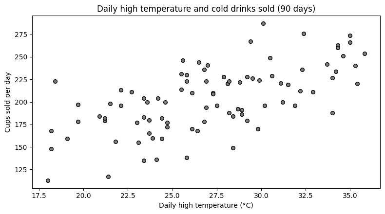
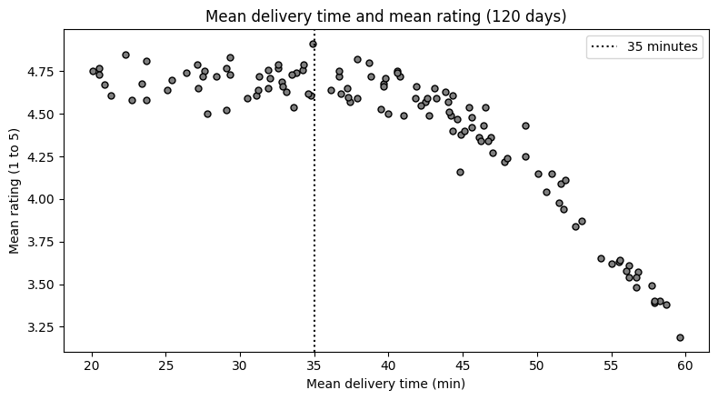
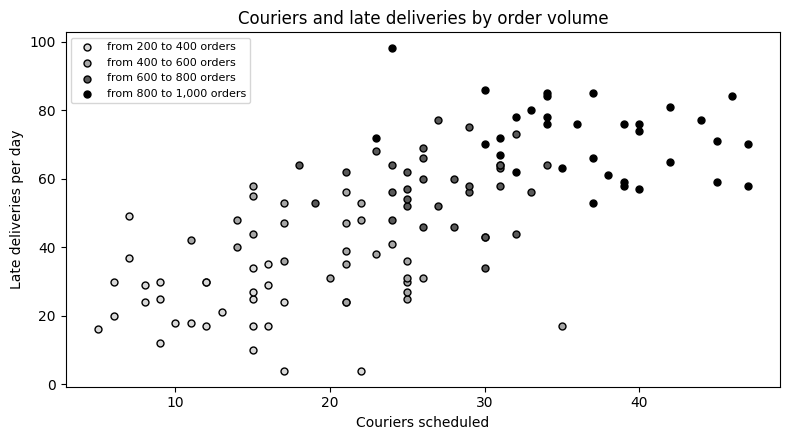
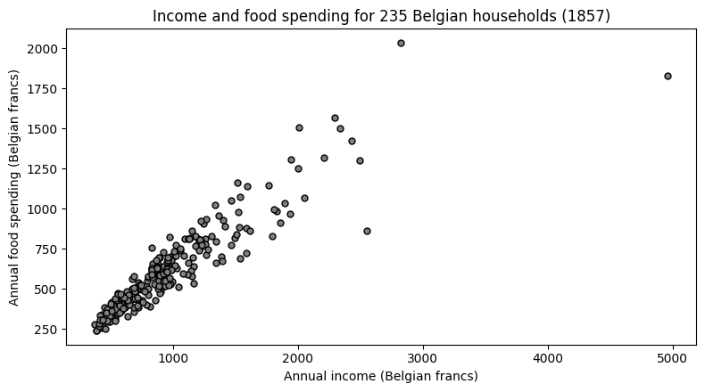
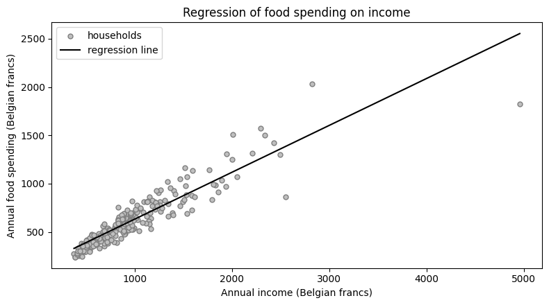
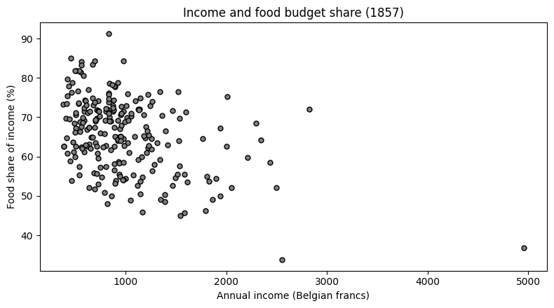

# Chapter 05 — Solutions

[Student notebook](../ch05-student.ipynb) · [exercises](../exercises/ch05.md)

Consult the solutions after attempting the exercises.

# Worked solutions 01–06

**Prof. Daniel de Abreu Pereira Uhr**

**Course:** Statistics and Econometrics with Python


Daniel de Abreu Pereira Uhr · Chapter 5

## Case

The example café recorded the daily high temperature in degrees Celsius and the number of cups of cold drinks sold on 90 days. Use the synthetic data to study the association. Run the setup once. Use the same random generator and work in order.

```python
import numpy as np
import pandas as pd
import matplotlib.pyplot as plt

rng = np.random.default_rng(2026)
days = pd.DataFrame({"temperature_c": np.round(rng.uniform(18, 36, size=90), 1)})
days["cups"] = np.round(40 + 6 * days["temperature_c"] + rng.normal(0, 25, size=90)).astype(int)
```

## Solution to Exercise 01 — Read the plot first

Plot temperature on the horizontal axis and cups sold on the vertical axis. Describe direction, shape, spread and any unusual observations.

```python
fig, ax = plt.subplots(figsize=(8, 4.5))
ax.scatter(days["temperature_c"], days["cups"], color="#7F7F7F", edgecolor="black", s=30)
ax.set_title("Daily high temperature and cold drinks sold (90 days)")
ax.set_xlabel("Daily high temperature (°C)")
ax.set_ylabel("Cups sold per day")
fig.tight_layout()
plt.show()
```



The cloud slopes upward. Daily sales tend to rise with temperature, with appreciable variation at similar temperatures. A line describes the broad tendency, while the vertical spread limits a forecast for any given day. Inspect isolated days before deciding whether their sales follow the same process.

## Solution to Exercise 02 — Covariance

Calculate covariance by hand using paired deviations from the means. Check with Series.cov. Count observations in each of the four quadrants and identify the units of covariance.

```python
x = days["temperature_c"]
y = days["cups"]
deviation_x = x - x.mean()
deviation_y = y - y.mean()

print("Above both means:", ((deviation_x > 0) & (deviation_y > 0)).sum())
print("Below both means:", ((deviation_x < 0) & (deviation_y < 0)).sum())
print("Opposite signs:", ((deviation_x * deviation_y) < 0).sum())

covariance = (deviation_x * deviation_y).sum() / (len(days) - 1)
print(f"Covariance by hand: {covariance:.2f}")
print(f"Covariance with pandas: {x.cov(y):.2f}")
```

```text
Above both means: 30
Below both means: 32
Opposite signs: 28
Covariance by hand: 107.12
Covariance with pandas: 107.12
```

There are 30 days above both means and 32 below both. The remaining 28 have opposite signs. Thirteen days are warmer than average with below-average sales, and 15 are cooler with above-average sales. Each same-sign product contributes positively and each opposite-sign product negatively. The signed sum divided by 89 gives 107.12 degree-Celsius cups.

## Solution to Exercise 03 — Correlation

Calculate Pearson correlation by hand and check it with Series.corr.

```python
correlation = covariance / (x.std() * y.std())
print(f"Correlation by hand: {correlation:.4f}")
print(f"Correlation with pandas: {x.corr(y):.4f}")
```

```text
Correlation by hand: 0.6319
Correlation with pandas: 0.6319
```

Divide 107.12 by the product of the sample SDs. The result, 0.6319, agrees with the library. Both variables must vary for this standardization to be defined.

## Solution to Exercise 04 — Degrees Fahrenheit

Convert Celsius to Fahrenheit using F = 1.8C + 32. Recalculate covariance and correlation with cups sold. Which result changes and why?

```python
temperature_f = 1.8 * x + 32
print(f"Covariance in °C: {x.cov(y):.2f}   in °F: {temperature_f.cov(y):.2f}   ratio: {temperature_f.cov(y) / x.cov(y):.2f}")
print(f"Correlation in °C: {x.corr(y):.4f}   in °F: {temperature_f.corr(y):.4f}")
```

```text
Covariance in °C: 107.12   in °F: 192.82   ratio: 1.80
Correlation in °C: 0.6319   in °F: 0.6319
```

Adding 32 shifts the temperature mean and every observation equally, leaving centered deviations unchanged. Multiplication by 1.8 scales each deviation, taking covariance from 107.12 to 192.82. It also scales the temperature SD, so correlation stays at 0.6319.

## Solution to Exercise 05 — Interpreting the coefficient

A partner asks whether the correlation is strong. Use the coefficient, scatterplot and business context to answer without a fixed cutoff. Give one conclusion the evidence cannot support.

Hotter days tend to have higher sales. Days at similar temperatures still sell quite different numbers of cups. The coefficient does not specify sales per additional degree or establish how much sales would change if temperature could be altered while holding everything else fixed.

## Solution to Exercise 06 — Challenge — Festival day

A festival outside the café brings sales to 520 cups on a 21 °C day. Add the day to the records and recalculate Pearson and Spearman correlations. Explain how you would treat and report this observation.

```python
with_festival = pd.concat([days, pd.DataFrame({"temperature_c": [21.0], "cups": [520]})], ignore_index=True)

print(f"Without the festival: Pearson {x.corr(y):.3f}; Spearman {x.corr(y, method='spearman'):.3f}")
print(f"With the festival: Pearson {with_festival['temperature_c'].corr(with_festival['cups']):.3f}; "
      f"Spearman {with_festival['temperature_c'].corr(with_festival['cups'], method='spearman'):.3f}")
```

```text
Without the festival: Pearson 0.632; Spearman 0.623
With the festival: Pearson 0.370; Spearman 0.579
```

With the festival, Pearson falls from 0.632 to 0.370. Spearman changes from 0.623 to 0.579. Verify the event and retain the dated observation in the register. Report the ordinary-day relationship separately if it is the target, and show how the result changes when event days are included.

# Worked solutions 07–12

**Prof. Daniel de Abreu Pereira Uhr**

**Course:** Statistics and Econometrics with Python


Daniel de Abreu Pereira Uhr · Chapter 5

## Case

The delivery company recorded average delivery time in minutes, mean customer rating from one to five, order volume, scheduled couriers and late deliveries on 120 days. Use the synthetic data to evaluate the staffing proposal. Run the setup once. Use the same random generator and work in order.

```python
import numpy as np
import pandas as pd
import matplotlib.pyplot as plt

rng = np.random.default_rng(2026)
n_days = 120
days = pd.DataFrame({"mean_time_min": np.round(rng.uniform(20, 60, size=n_days), 1)})
days["mean_rating"] = np.round(4.7 - 0.0025 * np.maximum(days["mean_time_min"] - 35, 0) ** 2 + rng.normal(0, 0.08, size=n_days), 2)
days["orders"] = np.round(rng.uniform(200, 1000, size=n_days)).astype(int)
days["couriers"] = np.round(days["orders"] / 25 + rng.normal(0, 4, size=n_days)).astype(int)
days["late_deliveries"] = np.round(np.maximum(0.08 * days["orders"] - 1.5 * (days["couriers"] - days["orders"] / 25) + rng.normal(0, 6, size=n_days), 0)).astype(int)
```

## Solution to Exercise 07 — Delivery time and ratings

Plot mean delivery time against mean rating, using time on the horizontal axis. Compute Pearson correlation. Is the relationship approximately linear throughout the range?

```python
fig, ax = plt.subplots(figsize=(8, 4.5))
ax.scatter(days["mean_time_min"], days["mean_rating"], color="#7F7F7F", edgecolor="black", s=25)
ax.axvline(35, color="black", linestyle=":", label="35 minutes")
ax.set_title("Mean delivery time and mean rating (120 days)")
ax.set_xlabel("Mean delivery time (min)")
ax.set_ylabel("Mean rating (1 to 5)")
ax.legend()
fig.tight_layout()
plt.show()

print(f"Pearson correlation: {days['mean_time_min'].corr(days['mean_rating']):.3f}")
```



```text
Pearson correlation: -0.828
```

Pearson is −0.828. The cloud has two regimes: ratings remain fairly flat at shorter times and decline sharply after about 35 minutes. A single negative coefficient misses that change in shape.

## Solution to Exercise 08 — Two regimes

Calculate the correlations below 35 minutes and at or above 35 minutes separately. Compute Spearman correlation over all days. What does pooled Pearson correlation conceal?

```python
fast = days[days["mean_time_min"] < 35]
slow = days[days["mean_time_min"] >= 35]

print(f"Below 35 min ({len(fast)} days): r = {fast['mean_time_min'].corr(fast['mean_rating']):.3f}")
print(f"At least 35 min ({len(slow)} days): r = {slow['mean_time_min'].corr(slow['mean_rating']):.3f}")
print(f"Spearman, all days: {days['mean_time_min'].corr(days['mean_rating'], method='spearman'):.3f}")
```

```text
Below 35 min (43 days): r = 0.006
At least 35 min (77 days): r = -0.951
Spearman, all days: -0.837
```

The 43 shorter-time days give 0.006; the 77 longer-time days give −0.951. Overall Spearman is −0.837. The common downward tendency largely reflects the range in which delays become consequential. An overall rank correlation also conceals the flat region.

## Solution to Exercise 09 — More couriers, more late deliveries?

Calculate the correlation of scheduled couriers with late deliveries. A manager proposes cutting staffing because days with more couriers have more late deliveries. Identify a variable that could account for both.

```python
print(f"Correlation of couriers with late deliveries: {days['couriers'].corr(days['late_deliveries']):.3f}")
print(f"Correlation of order volume with courier count: {days['orders'].corr(days['couriers']):.3f}")
print(f"Correlation of order volume with late deliveries: {days['orders'].corr(days['late_deliveries']):.3f}")
```

```text
Correlation of couriers with late deliveries: 0.683
Correlation of order volume with courier count: 0.913
Correlation of order volume with late deliveries: 0.895
```

The courier–delay correlation is 0.683. Busy days require more couriers and create more opportunities for a delay. Orders correlate 0.913 with courier count and 0.895 with delays. Cutting staff on the basis of the pooled coefficient would confuse demand with staffing.

## Solution to Exercise 10 — Compare days of similar volume

Group days by order volume in four bands: 200–400, 400–600, 600–800 and 800–1,000 orders. Calculate courier–delay correlations within each band and plot the observations with a separate shade for each band. Compare with Exercise 09.

```python
days["order_band"] = pd.cut(
    days["orders"], bins=[200, 400, 600, 800, 1000], include_lowest=True,
    labels=["200 to 400", "400 to 600", "600 to 800", "800 to 1,000"],
)

for band, group in days.groupby("order_band", observed=True):
    print(f"From {band} orders: {len(group)} days; correlation of couriers with late deliveries = {group['couriers'].corr(group['late_deliveries']):.3f}")

fig, ax = plt.subplots(figsize=(8, 4.5))
shades = ["#D9D9D9", "#A6A6A6", "#595959", "black"]
for shade, (band, group) in zip(shades, days.groupby("order_band", observed=True)):
    ax.scatter(group["couriers"], group["late_deliveries"], color=shade, edgecolor="black", s=25, label=f"from {band} orders")
ax.set_title("Couriers and late deliveries by order volume")
ax.set_xlabel("Couriers scheduled")
ax.set_ylabel("Late deliveries per day")
ax.legend(fontsize=8)
fig.tight_layout()
plt.show()
```

```text
From 200 to 400 orders: 28 days; correlation of couriers with late deliveries = -0.342
From 400 to 600 orders: 26 days; correlation of couriers with late deliveries = -0.644
From 600 to 800 orders: 33 days; correlation of couriers with late deliveries = -0.076
From 800 to 1,000 orders: 33 days; correlation of couriers with late deliveries = -0.340
```



Within the four bands, correlations are −0.342, −0.644, −0.076 and −0.340. At similar volumes the association changes direction relative to the pooled value. Some variation in orders remains within bands. Workload, route composition and scheduling can still differ across days.

## Solution to Exercise 11 — Rates and workload

For each day, compute orders per courier and late deliveries per 100 orders. Find their correlation and explain what it suggests about the proposed staffing cut.

```python
days["orders_per_courier"] = days["orders"] / days["couriers"]
days["late_per_100_orders"] = 100 * days["late_deliveries"] / days["orders"]
print(f"Correlation: {days['orders_per_courier'].corr(days['late_per_100_orders']):.3f}")
```

```text
Correlation: 0.618
```

Orders per courier correlates 0.618 with late deliveries per 100 orders. A heavier workload goes with a higher rate of late deliveries. A staffing cut could make workload heavier. The ratios answer a more relevant descriptive question but do not identify a causal staffing effect.

## Solution to Exercise 12 — Challenge — An eight-day pilot

In an eight-day pilot the correlation between courier bonuses and average ratings was 0.6. Simulate 5,000 samples of eight independent pairs with population correlation zero and calculate the proportion with absolute sample correlation at least 0.6. Evaluate the claim that the bonus improved ratings.

```python
R = 5_000
x_sim = rng.normal(size=(R, 8))
y_sim = rng.normal(size=(R, 8))
dx = x_sim - x_sim.mean(axis=1, keepdims=True)
dy = y_sim - y_sim.mean(axis=1, keepdims=True)
r_sim = (dx * dy).sum(axis=1) / np.sqrt((dx**2).sum(axis=1) * (dy**2).sum(axis=1))

print(f"Frequency of |r| ≥ 0.6 with n = 8 and ρ = 0: {(np.abs(r_sim) >= 0.6).mean():.3f}")
```

```text
Frequency of |r| ≥ 0.6 with n = 8 and ρ = 0: 0.115
```

The simulated frequency is 0.115. Even under independence, about one in nine eight-day samples reaches an absolute correlation of 0.6. A single small pilot gives little basis for claiming a bonus effect. Assignment, workload and other changes across days also matter.

# Worked solutions 13–18

**Prof. Daniel de Abreu Pereira Uhr**

**Course:** Statistics and Econometrics with Python


Daniel de Abreu Pereira Uhr · Chapter 5

## Case

The data describe 235 Belgian working households in 1857. Annual household income and food expenditure are measured in Belgian francs. Read data/ch05/engel_1857_SOURCE.md, the accompanying source record. The setup cell verifies the source file and loads the two columns. Run the setup once. Use the same random generator and work in order.

```python
import hashlib

import numpy as np
import pandas as pd
import matplotlib.pyplot as plt

path = "data/ch05/engel_1857.csv"
with open(path, "rb") as file:
    print("File matches the source record:", hashlib.sha256(file.read()).hexdigest() == "05b60e091325bc170cb6803ce78f80c029bfe2ae072891ec577f1ebe8deefd61")

engel = pd.read_csv(path)
```

```text
File matches the source record: True
```

## Solution to Exercise 13 — Meet the dataset

Read the source record. Identify the observational unit, variables and units. Summarize income and food expenditure with describe(). Which historical households do the data describe? Discuss limits to generalization.

```python
print("Households:", len(engel))
print(engel.describe().round(1))
```

```text
Households: 235
       income  foodexp
count   235.0    235.0
mean    982.5    624.2
std     519.2    276.5
min     377.1    242.3
25%     638.9    429.7
50%     884.0    582.5
75%    1164.0    743.9
max    4957.8   2032.7
```

One row is one working household in Belgium in 1857. Income and food spending both use annual Belgian francs. Mean income is 982.5 francs and mean food spending is 624.2 francs. The dataset describes these historical records; extrapolation to current Belgian households or other populations requires additional evidence.

## Solution to Exercise 14 — Scatterplot, covariance and correlation

Plot food spending against income. Calculate covariance and Pearson correlation. Express both variables in thousands of francs and repeat the calculations, explaining how both changes of units enter the covariance.

```python
income = engel["income"]
food_spending = engel["foodexp"]

fig, ax = plt.subplots(figsize=(8, 4.5))
ax.scatter(income, food_spending, color="#7F7F7F", edgecolor="black", s=25)
ax.set_title("Income and food spending for 235 Belgian households (1857)")
ax.set_xlabel("Annual income (Belgian francs)")
ax.set_ylabel("Annual food spending (Belgian francs)")
fig.tight_layout()
plt.show()

print(f"Covariance in francs²: {income.cov(food_spending):.1f}")
print(f"Covariance in (thousand francs)²: {(income / 1_000).cov(food_spending / 1_000):.4f}")
print(f"Correlation: {income.corr(food_spending):.4f}   in thousands of francs: {(income / 1_000).corr(food_spending / 1_000):.4f}")
```



```text
Covariance in francs²: 130804.4
Covariance in (thousand francs)²: 0.1308
Correlation: 0.9112   in thousands of francs: 0.9112
```

The cloud rises, with appreciable variation and a few high-income observations. Covariance is 130,804.4 francs squared. Dividing both variables by 1,000 divides covariance by one million, giving 0.1308 in squared thousands of francs. Pearson remains 0.9112.

## Solution to Exercise 15 — Slope

Take income as X and food spending as Y. Calculate the slope as sample covariance divided by sample income variance. Obtain the intercept from the means. Draw the fitted line, give the slope’s units, and explain why it cannot predict the causal response of an individual household to an income increase.

```python
b1 = income.cov(food_spending) / income.var()
b0 = food_spending.mean() - b1 * income.mean()
print(f"b1 = {b1:.4f} franc of food spending per franc of income")
print(f"b0 = {b0:.2f} francs")

grid = np.linspace(income.min(), income.max(), 100)
fig, ax = plt.subplots(figsize=(8, 4.5))
ax.scatter(income, food_spending, color="#BFBFBF", edgecolor="#7F7F7F", s=25, label="households")
ax.plot(grid, b0 + b1 * grid, color="black", label="regression line")
ax.set_title("Regression of food spending on income")
ax.set_xlabel("Annual income (Belgian francs)")
ax.set_ylabel("Annual food spending (Belgian francs)")
ax.legend()
fig.tight_layout()
plt.show()
```

```text
b1 = 0.4852 franc of food spending per franc of income
b0 = 147.48 francs
```



The fitted intercept is 147.48 francs and the slope is 0.4852 franc of annual food spending per additional franc of annual income. Two households 100 francs apart in income differ by about 48.5 francs in fitted spending. Family size and prices are unobserved. This cross-household comparison cannot identify an individual household’s response to a raise.

## Solution to Exercise 16 — Food share

For each household calculate food expenditure divided by income. Summarize the shares, plot share against income and compute their correlation. How does the result relate to Engel’s law?

```python
engel["food_share"] = food_spending / income
print(engel["food_share"].describe().round(3))
print(f"Correlation of income with food share: {income.corr(engel['food_share']):.3f}")

fig, ax = plt.subplots(figsize=(8, 4.5))
ax.scatter(income, 100 * engel["food_share"], color="#7F7F7F", edgecolor="black", s=25)
ax.set_title("Income and food budget share (1857)")
ax.set_xlabel("Annual income (Belgian francs)")
ax.set_ylabel("Food share of income (%)")
fig.tight_layout()
plt.show()
```

```text
count    235.000
mean       0.656
std        0.094
min        0.339
25%        0.592
50%        0.662
75%        0.719
max        0.912
Name: food_share, dtype: float64
Correlation of income with food share: -0.416
```



The average of the household shares is 0.656 and the median is 0.662. Income and share correlate −0.416. The downward tendency in the share can coexist with higher spending in francs. In these data, food expenditure generally rises less than proportionally with income.

## Solution to Exercise 17 — The highest-income households

Identify households with income above 2,500 francs. Recalculate Pearson correlation, Spearman correlation and the slope excluding them as a sensitivity check. Compare with the complete records.

```python
high_income = income > 2_500
without_high = engel[~high_income]
print("Households with income above 2,500 francs:", high_income.sum())

for label, base in [("All households", engel), ("Excluding income above 2,500", without_high)]:
    pearson = base["income"].corr(base["foodexp"])
    spearman = base["income"].corr(base["foodexp"], method="spearman")
    slope = base["income"].cov(base["foodexp"]) / base["income"].var()
    print(f"{label}: Pearson {pearson:.3f}; Spearman {spearman:.3f}; b1 {slope:.3f}")
```

```text
Households with income above 2,500 francs: 3
All households: Pearson 0.911; Spearman 0.938; b1 0.485
Excluding income above 2,500: Pearson 0.936; Spearman 0.936; b1 0.553
```

Three households exceed 2,500 francs. Excluding them gives Pearson 0.936 instead of 0.911, Spearman 0.936 instead of 0.938, and slope 0.553 instead of 0.485. The positive association persists but its estimated slope changes materially. Retain the full sample and explain the diagnostic comparison.

## Solution to Exercise 18 — Challenge — Explain Engel’s law

Write a short account for a general audience. Explain the association in levels and its slope, the pattern in food budget shares, and the limits imposed by the date, households and observational design.

Among these 235 working households, higher-income families generally spent more francs on food. The correlation was about 0.91 and a 100-franc difference in annual income corresponded to about 49 francs in fitted food spending. Yet food usually took a smaller share of a higher income. These records describe Belgium in 1857. Family size, local prices and region could matter; the comparison does not measure what a particular family would do after receiving a raise.

### Transfer within Exercise 18 — Which denominator?

A commercial analyst describes the mean household food share as the ratio of total food spending to total income. Calculate both quantities and their difference in percentage points. Show which income weights reproduce the ratio of totals. Explain which question each measure answers and why neither forecasts current Hummingbird sales. Specify four data requirements for a present-day customer segmentation study, including population coverage and the distinction between household spending and purchases at the chain.

```python
transfer_share = engel["foodexp"] / engel["income"]
transfer_weights = engel["income"] / engel["income"].sum()
transfer_mean = transfer_share.mean()
transfer_total = engel["foodexp"].sum() / engel["income"].sum()
transfer_weighted = (transfer_weights * transfer_share).sum()
print("mean %, total %, difference pp:",
      round(100*transfer_mean, 4), round(100*transfer_total, 4),
      round(100*(transfer_mean-transfer_total), 4))
assert np.isclose(transfer_total, transfer_weighted)
```

```text
mean %, total %, difference pp: 65.5783 63.5285 2.0499
```

The mean weights households equally; the ratio weights their shares by income. Their difference is not a rounding discrepancy, and neither weighting scheme establishes representativeness. Specify a current population and period; household size and income measurement; comparable prices and food categories; purchases inside and outside the chain with a documented coverage and nonresponse rule. No historical coefficient here identifies a commercial action effect.
