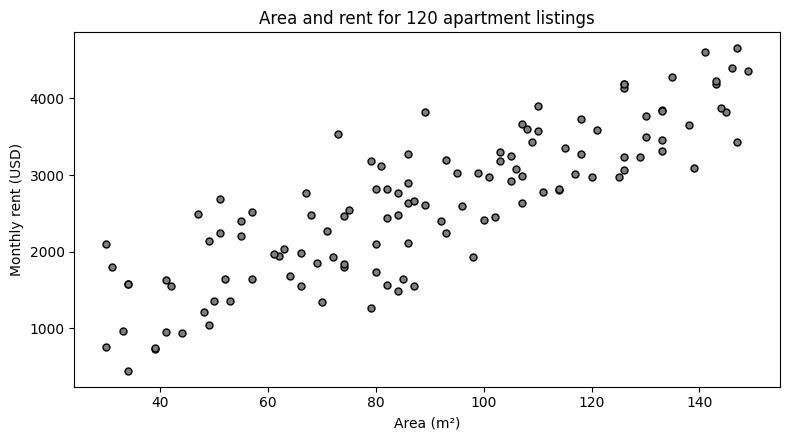
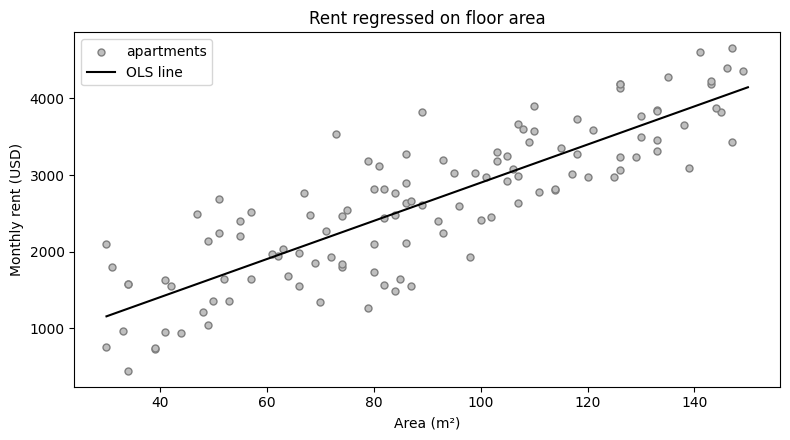
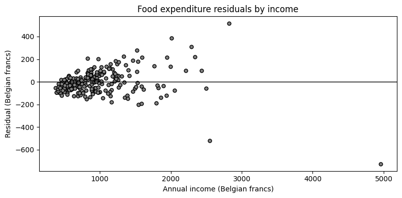

# Chapter 06 — Solutions

[Student notebook](../ch06-student.ipynb) · [exercises](../exercises/ch06.md)

Consult the solutions after attempting the exercises.

# Solutions 01–06 · Simple Linear Regression

**Prof. Daniel de Abreu Pereira Uhr**

**Course:** Statistics and Econometrics with Python


Editorial worked solution

## The real estate agency

The real estate agency has assembled 120 simulated apartment listings. Each listing records floor area in square meters and monthly asking rent in dollars. Apartments of similar size can have different rents. Treat the listing as the observation and ask how average asking rent varies over the observed range.

```python
import numpy as np
import pandas as pd
import matplotlib.pyplot as plt
import statsmodels.formula.api as smf

rng = np.random.default_rng(2026)
apartments = pd.DataFrame({"area_m2": rng.integers(30, 151, size=120)})
apartments["rent"] = np.round(400 + 25 * apartments["area_m2"] + rng.normal(0, 450, size=120), -1)
```

## Solution to Exercise 01 — Plot the listings

Plot rent against area. Describe direction, shape, strength and unusual points. Explain which variable belongs on each axis.

Use rent as the response because the requested benchmark is monthly rent at a given area. The points form a rising, roughly linear band with moderate spread. Location, floor and condition can distinguish apartments of similar size. No listing is strikingly isolated.

```python
fig, ax = plt.subplots(figsize=(8, 4.5))
ax.scatter(apartments["area_m2"], apartments["rent"], color="#7F7F7F", edgecolor="black", s=25)
ax.set_title("Area and rent for 120 apartment listings")
ax.set_xlabel("Area (m²)")
ax.set_ylabel("Monthly rent (USD)")
fig.tight_layout()
plt.show()
```



## Solution to Exercise 02 — Fit by hand

Calculate the slope from centered cross-products and the intercept from the two sample means. Check the slope using covariance divided by variance.

The estimates are 24.8854 dollars per square meter and 411.07 dollars per month. The covariance-to-variance ratio agrees because the common sample divisor cancels.

```python
x = apartments["area_m2"]
y = apartments["rent"]

b1 = ((x - x.mean()) * (y - y.mean())).sum() / ((x - x.mean()) ** 2).sum()
b0 = y.mean() - b1 * x.mean()
print(f"β̂1 = {b1:.4f} USD per m²")
print(f"β̂0 = {b0:.2f} USD")
print(f"cov/var = {x.cov(y) / x.var():.4f}")
```

```text
β̂1 = 24.8854 USD per m²
β̂0 = 411.07 USD
cov/var = 24.8854
```

## Solution to Exercise 03 — Fit in statsmodels

Fit rent on floor area with an intercept. Compare with the hand calculation and add the fitted line to the scatterplot.

The software returns the same pair of coefficients. The line passes through the sample means and follows the center of the point cloud.

```python
model = smf.ols("rent ~ area_m2", data=apartments).fit()
print(model.params)

grade = np.linspace(30, 150, 100)
fig, ax = plt.subplots(figsize=(8, 4.5))
ax.scatter(x, y, color="#BFBFBF", edgecolor="#7F7F7F", s=25, label="apartments")
ax.plot(grade, model.params["Intercept"] + model.params["area_m2"] * grade, color="black", label="OLS line")
ax.set_title("Rent regressed on floor area")
ax.set_xlabel("Area (m²)")
ax.set_ylabel("Monthly rent (USD)")
ax.legend()
fig.tight_layout()
plt.show()
```

```text
Intercept    411.065938
area_m2       24.885449
dtype: float64
```



## Solution to Exercise 04 — Account for the first two listings

Calculate fitted rents and residuals for the first two apartments. Interpret each residual. Check the residual sum and correlation with floor area.

At 133 m² the fitted rent is 3,720.83 dollars and the listing is 129.17 dollars above the line. At 51 m² the listing is 569.78 dollars above its fitted 1,680.22 dollars. These differences could reflect other features. Both algebraic checks are zero up to rounding.

```python
apartments["fitted"] = model.fittedvalues
apartments["residual"] = model.resid
print(apartments.head(2).round(2).to_string(index=False))
print(f"Sum of residuals: {apartments['residual'].sum():.6f}")
print(f"Correlation of residuals with area: {apartments['residual'].corr(apartments['area_m2']):.6f}")
```

```text
 area_m2   rent  fitted  residual
     133 3850.0 3720.83    129.17
      51 2250.0 1680.22    569.78
Sum of residuals: 0.000000
Correlation of residuals with area: 0.000000
```

## Solution to Exercise 05 — Change the units

Interpret slope and intercept. Refit with rent in thousands of dollars and floor area in tens of square meters. Explain both changes.

An additional square meter is associated with about 24.89 dollars more monthly rent across listings. The intercept extrapolates to zero area. In the new units the intercept is 0.4111 thousand dollars, and the slope is 0.2489 thousand dollars per ten square meters.

```python
escalas = apartments.assign(rent_mil=apartments["rent"] / 1_000, area_dezenas=apartments["area_m2"] / 10)
print(smf.ols("rent_mil ~ area_dezenas", data=escalas).fit().params.round(4))
```

```text
Intercept       0.4111
area_dezenas    0.2489
dtype: float64
```

## Solution to Exercise 06 — Price a 300 m² penthouse

Calculate the predicted asking rent. Assess the risk of relying on the prediction and suggest evidence the firm could obtain.

The line gives about 7,877 dollars, but the largest listing is only 149 m². Penthouses may differ in amenities and location as well as size. Collect comparable large-apartment listings before recommending a price.

```python
previsao_300 = model.params["Intercept"] + model.params["area_m2"] * 300
print(f"Predicted rent at 300 m²: USD {previsao_300:,.0f}")
print(f"Largest area observed: {apartments['area_m2'].max()} m²")
```

```text
Predicted rent at 300 m²: USD 7,877
Largest area observed: 149 m²
```

# Solutions 07–12 · Simple Linear Regression

**Prof. Daniel de Abreu Pereira Uhr**

**Course:** Statistics and Econometrics with Python


Editorial worked solution

## The logistics operator

The logistics operator records diesel use in liters per route and distance in kilometers. Its laboratory contains 30,000 new-fleet routes. Load varies with distance, and the old fleet has additional variation in fuel use. Keep the fleet, population and quantity held fixed explicit.

```python
import numpy as np
import pandas as pd
import matplotlib.pyplot as plt
import statsmodels.formula.api as smf

rng = np.random.default_rng(2026)
N = 30_000
km = np.round(rng.uniform(50, 600, size=N), 1)
load_t = np.round(np.clip(8 + 0.02 * km + rng.normal(0, 3, size=N), 1, None), 1)
liters = np.round(5 + 0.30 * km + 2.0 * load_t + rng.normal(0, 12, size=N), 1)
liters_frota_antiga = np.round(5 + 0.30 * km + 2.0 * load_t + rng.normal(0, 45, size=N), 1)

rotas = pd.DataFrame({"km": km, "load_t": load_t, "liters": liters})
rotas_antigas = pd.DataFrame({"km": km, "liters": liters_frota_antiga})
```

## Solution to Exercise 07 — Decompose fuel use

Sample 80 new-fleet routes with replacement and regress liters on distance. Compute total, explained and residual sums of squares. Check the decomposition and the squared-correlation identity.

The slope is 0.3376 liters per kilometer and the total sum of squares is about 257,442 squared liters. The fitted line accounts for 93.81% of sample variation. The direct calculation, software and squared correlation agree.

```python
n = 80
sample = rotas.iloc[rng.choice(N, size=n, replace=True)]
model = smf.ols("liters ~ km", data=sample).fit()

y = sample["liters"]
sqt = ((y - y.mean()) ** 2).sum()
sqe = ((model.fittedvalues - y.mean()) ** 2).sum()
sqr = (model.resid ** 2).sum()

print(model.params.round(4))
print(f"TSS = {sqt:.0f}; ESS + RSS = {sqe + sqr:.0f}")
print(f"R² = {sqe / sqt:.4f}; statsmodels = {model.rsquared:.4f}; correlation² = {sample['km'].corr(y) ** 2:.4f}")
```

```text
Intercept    24.1863
km            0.3376
dtype: float64
TSS = 257442; ESS + RSS = 257442
R² = 0.9381; statsmodels = 0.9381; correlation² = 0.9381
```

## Solution to Exercise 08 — Compare fleets

Draw 80 routes from the old fleet and repeat the fit. Compare slopes and R². Explain the difference.

The slopes are about 0.338 and 0.308 liters per kilometer. R² falls from 0.938 to 0.523 in the old fleet, where fuel use varies more across routes of similar length. More residual variation can coexist with a similar slope.

```python
sample_antiga = rotas_antigas.iloc[rng.choice(N, size=n, replace=True)]
model_antigo = smf.ols("liters ~ km", data=sample_antiga).fit()
print(f"New fleet:   slope {model.params['km']:.3f} L/km; R² {model.rsquared:.3f}")
print(f"Old fleet: slope {model_antigo.params['km']:.3f} L/km; R² {model_antigo.rsquared:.3f}")
```

```text
New fleet:   slope 0.338 L/km; R² 0.938
Old fleet: slope 0.308 L/km; R² 0.523
```

## Solution to Exercise 09 — Evaluate the fleet director’s claim

The director says distance matters little because old-fleet R² is low. Evaluate the claim and give two conclusions that a high new-fleet R² would not establish.

The slope measures liters per kilometer. R² measures the share of variation captured. The old-fleet slope is close to the new-fleet estimate. A high R² cannot establish a fixed-load effect or justify extrapolating the relationship beyond the simulated distances.

## Solution to Exercise 10 — Repeat the sampling

Fit the simple regression to all 30,000 new-fleet routes. Draw 5,000 samples of 80 routes and compare the mean and standard deviation of their slopes with the full-population slope.

The population linear projection has slope 0.3403 L/km. The simulated mean is also 0.3403 to four decimals, with standard deviation 0.0096. Individual draws vary. Agreement of the averages is a numerical comparison at the displayed precision.

```python
slope_populacional = smf.ols("liters ~ km", data=rotas).fit().params["km"]

R = 5_000
indices = rng.choice(N, size=(R, n), replace=True)
x_sim = km[indices]
y_sim = liters[indices]
dx = x_sim - x_sim.mean(axis=1, keepdims=True)
dy = y_sim - y_sim.mean(axis=1, keepdims=True)
slopes = (dx * dy).sum(axis=1) / (dx**2).sum(axis=1)

print(f"Population regression slope: {slope_populacional:.4f} L/km")
print(f"Mean of {R} sample slopes: {slopes.mean():.4f} L/km")
print(f"Standard deviation of slopes: {slopes.std():.4f}")
```

```text
Population regression slope: 0.3403 L/km
Mean of 5000 sample slopes: 0.3403 L/km
Standard deviation of slopes: 0.0096
```

## Solution to Exercise 11 — Assess the assumptions

For each of the four assumptions in Section 6.10, give a plausible failure in actual transport data.

Mountain roads could bend the mean fuel curve. Observing one client could compromise sampling. A fixed 300-km route gives no distance variation. Omitted load, terrain or traffic can vary with distance, compromising the fixed-load interpretation.

## Solution to Exercise 12 — Hold load fixed

The laboratory mechanism adds 0.30 L per extra kilometer at fixed load. Compare that quantity with the population and simulated simple-regression slopes. Explain the discrepancy.

The simple slopes center near 0.3403. Longer routes tend to carry heavier loads, with a load-distance correlation of about 0.729. Their extra consumption enters the comparison across routes. Chapter 7 considers comparisons at the same load.

```python
print(f"Known mechanism: 0,30 L/km holding load fixed")
print(f"Population simple regression slope: {slope_populacional:.4f} L/km")
print(f"Mean of simulações: {slopes.mean():.4f} L/km")
print(f"Load-distance correlation: {rotas['load_t'].corr(rotas['km']):.3f}")
```

```text
Known mechanism: 0,30 L/km holding load fixed
Population simple regression slope: 0.3403 L/km
Mean of simulações: 0.3403 L/km
Load-distance correlation: 0.729
```

# Solutions 13–18 · Simple Linear Regression

**Prof. Daniel de Abreu Pereira Uhr**

**Course:** Statistics and Econometrics with Python


Editorial worked solution

## Engel’s household budgets

The historical data cover annual food expenditure and income in Belgian francs for 235 working-class households in Belgium in 1857. Use the local CSV and its source note in the data folder. Verify the checksum before fitting the model.

```python
import hashlib

import numpy as np
import pandas as pd
import matplotlib.pyplot as plt
import statsmodels.formula.api as smf

caminho = "data/ch06/engel_1857.csv"
with open(caminho, "rb") as arquivo:
    print("Dataset checksum matches:", hashlib.sha256(arquivo.read()).hexdigest() == "05b60e091325bc170cb6803ce78f80c029bfe2ae072891ec577f1ebe8deefd61")

engel = pd.read_csv(caminho)
```

```text
Dataset checksum matches: True
```

## Solution to Exercise 13 — Fit the budget line

Regress food expenditure on income. Verify the slope using sample covariance divided by the sample variance of income.

The fitted intercept is 147.4754 francs and the slope is 0.4852 francs per franc. This reproduces the covariance-based slope from Chapter 5.

```python
model = smf.ols("foodexp ~ income", data=engel).fit()
print(model.params.round(4))
print(f"cov/var = {engel['income'].cov(engel['foodexp']) / engel['income'].var():.4f}")
```

```text
Intercept    147.4754
income         0.4852
dtype: float64
cov/var = 0.4852
```

## Solution to Exercise 14 — Interpret both coefficients

Interpret the slope and intercept in their original units. Use the lowest observed income to assess the intercept.

Across households, 100 more francs of annual income are associated with about 48.5 more francs of annual food expenditure. The minimum observed income is 377.1 francs. Zero income lies outside the data, making the intercept an extrapolation.

```python
print(f"Minimum observed income: {engel['income'].min():.1f} francs")
```

```text
Minimum observed income: 377.1 francs
```

## Solution to Exercise 15 — Examine residuals across income

Find the largest positive residual. Plot residuals against income and compute the residual standard deviation in each income quartile. Describe the pattern.

The household with income around 2,822.5 francs spent 2,032.7 francs on food, around 515.8 above its fitted value. The spread generally grows across income groups. Differences in household composition are plausible but cannot be identified from these two variables.

```python
engel["fitted"] = model.fittedvalues
engel["residual"] = model.resid
print("Household with largest positive residual:")
print(engel.loc[engel["residual"].idxmax()].round(1))

fig, ax = plt.subplots(figsize=(8, 4))
ax.scatter(engel["income"], engel["residual"], color="#7F7F7F", edgecolor="black", s=25)
ax.axhline(0, color="black", linewidth=1)
ax.set_title("Food expenditure residuals by income")
ax.set_xlabel("Annual income (Belgian francs)")
ax.set_ylabel("Residual (Belgian francs)")
fig.tight_layout()
plt.show()

quartil_renda = pd.qcut(engel["income"], 4, labels=["1st quartile", "2nd quartile", "3rd quartile", "4th quartile"])
print(engel.groupby(quartil_renda, observed=True)["residual"].std().round(1))
```

```text
Household with largest positive residual:
income      2822.5
foodexp     2032.7
fitted      1516.9
residual     515.8
Name: 58, dtype: float64
```



```text
income
1st quartile     44.2
2nd quartile     71.8
3rd quartile     81.2
4th quartile    191.3
Name: residual, dtype: float64
```

## Solution to Exercise 16 — Account for expenditure variation

Calculate total, explained and residual sums of squares and interpret R² for these families.

The sums are about 17.884 million, 14.850 million and 3.034 million squared francs, respectively. The fitted line captures 83.04% of observed food expenditure variation. This is a descriptive comparison across families.

```python
y = engel["foodexp"]
sqt = ((y - y.mean()) ** 2).sum()
sqe = ((engel["fitted"] - y.mean()) ** 2).sum()
sqr = (engel["residual"] ** 2).sum()
print(f"TSS = {sqt:,.0f}; ESS = {sqe:,.0f}; RSS = {sqr:,.0f}")
print(f"R² = {sqe / sqt:.4f}; statsmodels = {model.rsquared:.4f}")
```

```text
TSS = 17,884,262; ESS = 14,850,458; RSS = 3,033,805
R² = 0.8304; statsmodels = 0.8304
```

## Solution to Exercise 17 — Rescale household budgets

Fit the line with both variables in thousands of francs, then with only income in thousands. Explain the change in each coefficient.

With both variables rescaled, the intercept becomes 0.1475 thousand francs and the slope stays 0.4852. With only income rescaled, the intercept stays 147.48 francs and the slope becomes 485.18 francs per thousand francs of income.

```python
escalas = engel.assign(income_thousands=engel["income"] / 1_000, food_thousands=engel["foodexp"] / 1_000)
print("Both in thousands of francs:", smf.ols("food_thousands ~ income_thousands", data=escalas).fit().params.round(4).to_dict())
print("Only income in thousands of francs:", smf.ols("foodexp ~ income_thousands", data=escalas).fit().params.round(2).to_dict())
```

```text
Both in thousands of francs: {'Intercept': 0.1475, 'income_thousands': 0.4852}
Only income in thousands of francs: {'Intercept': 147.48, 'income_thousands': 485.18}
```

## Solution to Exercise 18 — Write a results paragraph

Report the line, slope and R². Address the relationship, period, population, extrapolation and variables missing from the analysis.

For 235 Belgian working-class households in 1857 the fitted annual food budget was 147.48 plus 0.4852 times annual income, in francs. The line captures about 83% of sample variation. Income differences coincide with spending differences. Household size, prices and location could also matter. Extending the line outside this income range or transferring it to present-day families requires additional evidence.

### Transfer within Exercise 18 — Profiles and scope

Use the same fitted Engel line at annual incomes of 800, 1,400, and 6,000 Belgian francs. Calculate fitted spending and mark whether each profile lies within the observed income range. Calculate the fitted difference between the first two. Explain why this difference is neither an individual income effect nor a guarantee of household spending. Explain what additional assumption is required for the last profile and why R² does not supply a prediction interval. Propose two checks needed before using a similar model in a current commercial decision.

```python
transfer_x = np.array([800., 1400., 6000.])
transfer_slope = engel["income"].cov(engel["foodexp"])/engel["income"].var()
transfer_intercept = engel["foodexp"].mean()-transfer_slope*engel["income"].mean()
transfer_fitted = transfer_intercept+transfer_slope*transfer_x
transfer_inside = ((transfer_x >= engel["income"].min()) &
                   (transfer_x <= engel["income"].max()))
print(pd.DataFrame({"income": transfer_x, "fitted": transfer_fitted,
    "in_range": transfer_inside}).round(4).to_string(index=False))
print("1400 - 800:", round(float(transfer_fitted[1]-transfer_fitted[0]), 4))
```

```text
 income    fitted  in_range
  800.0  535.6181      True
 1400.0  826.7252      True
 6000.0 3058.5459     False
1400 - 800: 291.1071
```

The first two profiles interpolate within the observed range; 6,000 extrapolates beyond it. The first contrast is about 291.11 francs on the line, not an individual causal response. Check comparable population, period, units, and outcome coverage; assess performance on records outside the fitting sample and quantify uncertainty before individual commitments. Larger absolute residual spread suggests investigating nonconstant variance; it does not prove a population variance function or establish relative accuracy.
