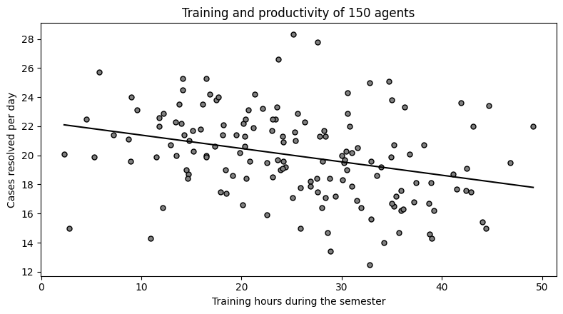
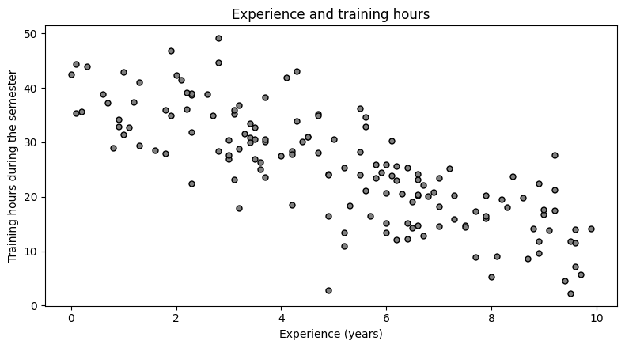
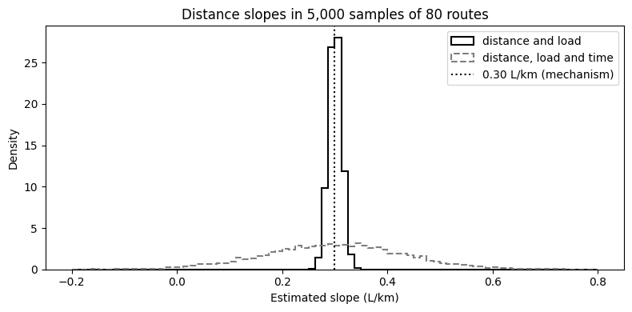
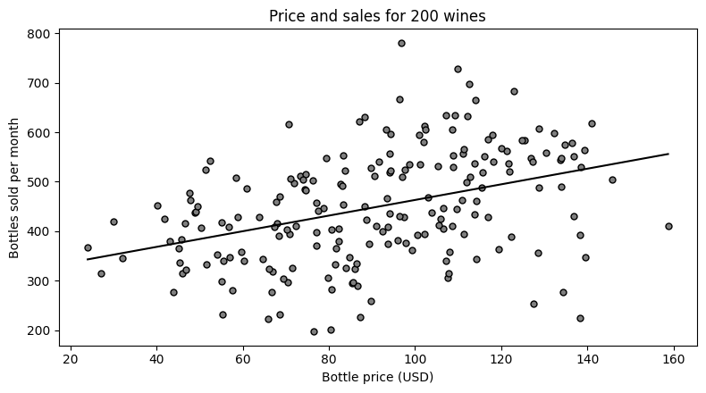
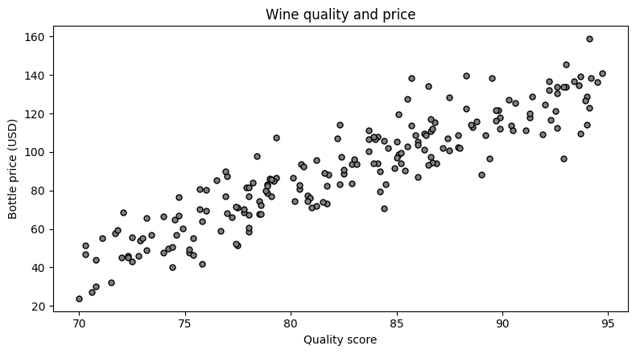

# Chapter 07 — Solutions

[Student notebook](../ch07-student.ipynb) · [exercises](../exercises/ch07.md)

Consult the solutions after attempting the exercises.

# Solutions 01–06 · Multiple Linear Regression

**Prof. Daniel de Abreu Pereira Uhr**

**Course:** Statistics and Econometrics with Python


Editorial worked solution

## The contact center

The center has records on 150 agents. Training is measured in hours over the past semester, experience in years, and productivity in cases resolved per day. New hires receive more training. Run the setup cell first.

```python
import numpy as np
import pandas as pd
import matplotlib.pyplot as plt
import statsmodels.formula.api as smf

rng = np.random.default_rng(2026)
n_atendentes = 150
team = pd.DataFrame({"experience_years": np.round(rng.uniform(0, 10, size=n_atendentes), 1)})
team["training_hours"] = np.round(np.clip(40 - 3 * team["experience_years"] + rng.normal(0, 6, size=n_atendentes), 0, None), 1)
team["productivity"] = np.round(10 + 0.15 * team["training_hours"] + 1.2 * team["experience_years"] + rng.normal(0, 2, size=n_atendentes), 1)
```

## Solution to Exercise 01 — The initial comparison

Plot productivity against training hours and fit the simple regression. What might management conclude from the slope?

Each additional training hour is associated with about 0.092 fewer cases resolved per day across agents. Concluding that training harms performance would overlook who receives it.

```python
simple = smf.ols("productivity ~ training_hours", data=team).fit()
print(simple.params.round(3))

fig, ax = plt.subplots(figsize=(8, 4.5))
ax.scatter(team["training_hours"], team["productivity"], color="#7F7F7F", edgecolor="black", s=25)
grade = np.linspace(team["training_hours"].min(), team["training_hours"].max(), 100)
ax.plot(grade, simple.params["Intercept"] + simple.params["training_hours"] * grade, color="black")
ax.set_title("Training and productivity of 150 agents")
ax.set_xlabel("Training hours during the semester")
ax.set_ylabel("Cases resolved per day")
fig.tight_layout()
plt.show()
```

```text
Intercept         22.310
training_hours    -0.092
dtype: float64
```



## Solution to Exercise 02 — Add experience

Regress productivity on training hours and years of experience. Interpret each slope in its units and state what is held fixed.

Among agents with equal experience, an extra hour of training is associated with 0.161 additional cases resolved per day. At equal training, one more year of experience is associated with about 1.246 additional daily cases.

```python
multiple = smf.ols("productivity ~ training_hours + experience_years", data=team).fit()
print(multiple.params.round(3))
print(f"R²: simple {simple.rsquared:.3f}; multiple {multiple.rsquared:.3f}")
```

```text
Intercept           9.589
training_hours      0.161
experience_years    1.246
dtype: float64
R²: simple 0.096; multiple 0.545
```

## Solution to Exercise 03 — Who receives training?

Plot training against experience and calculate their correlation. Use the allocation rule to explain the pattern.

The correlation is −0.786. The center directs training toward recent hires, who generally have less experience. The distribution of training hours carries information about tenure.

```python
print(f"Training-experience correlation: {team['training_hours'].corr(team['experience_years']):.3f}")

fig, ax = plt.subplots(figsize=(8, 4.5))
ax.scatter(team["experience_years"], team["training_hours"], color="#7F7F7F", edgecolor="black", s=25)
ax.set_title("Experience and training hours")
ax.set_xlabel("Experience (years)")
ax.set_ylabel("Training hours during the semester")
fig.tight_layout()
plt.show()
```

```text
Training-experience correlation: -0.786
```



## Solution to Exercise 04 — Account for the slope difference

Regress experience on training hours. Use that slope and the two multiple regression coefficients to reconstruct the simple slope. Explain the signs.

Each additional training hour goes with about 0.2029 fewer years of experience. The estimated relationship between experience and productivity is positive. Using unrounded estimates, 0.1610 + 1.2463 × (−0.2029) gives approximately −0.0919. Omitting experience pulls the training slope downward.

```python
delta = smf.ols("experience_years ~ training_hours", data=team).fit().params["training_hours"]
b1 = multiple.params["training_hours"]
b2 = multiple.params["experience_years"]
print(f"δ̃1 = {delta:.4f} years of experience per training hour")
print(f"β̂1 + β̂2 · δ̃1 = {b1:.4f} + {b2:.4f} × ({delta:.4f}) = {b1 + b2 * delta:.4f}")
print(f"Simple slope: {simple.params['training_hours']:.4f}")
```

```text
δ̃1 = -0.2029 years of experience per training hour
β̂1 + β̂2 · δ̃1 = 0.1610 + 1.2463 × (-0.2029) = -0.0919
Simple slope: -0.0919
```

## Solution to Exercise 05 — Brief the director

Write one sentence interpreting the adjusted training slope and another explaining the initial finding.

At equal experience, agents with an extra hour of training resolve about 0.16 more cases per day on average. The initial comparison pooled experienced agents, who receive relatively little training, with newer agents, who receive more.

## Solution to Exercise 06 — Identify a training effect

Can the director interpret 0.16 as a productivity gain caused by one training hour? Give two plausible omitted variables, the likely bias direction under your assumptions, and a more informative design.

The regression holds experience fixed. If more motivated agents seek more training and independently resolve more cases, omission tends to push the slope up. If agents handling harder cases receive extra training and complete fewer cases, omission tends to push it down. Random assignment of training access among comparable agents, with subsequent productivity measured consistently, would support a more credible effect estimate.

# Solutions 07–12 · Multiple Linear Regression

**Prof. Daniel de Abreu Pereira Uhr**

**Course:** Statistics and Econometrics with Python


Editorial worked solution

## The logistics operator

Rebuild the Chapter 6 laboratory of 30,000 routes. The mechanism uses 0.30 additional liters per kilometer at fixed load. Travel time depends strongly on distance. Use the same random generator in sequence across all exercises.

```python
import numpy as np
import pandas as pd
import matplotlib.pyplot as plt
import statsmodels.formula.api as smf

rng = np.random.default_rng(2026)
N = 30_000
km = np.round(rng.uniform(50, 600, size=N), 1)
load_t = np.round(np.clip(8 + 0.02 * km + rng.normal(0, 3, size=N), 1, None), 1)
liters = np.round(5 + 0.30 * km + 2.0 * load_t + rng.normal(0, 12, size=N), 1)
time_h = np.round(km / 70 + rng.normal(0, 0.15, size=N), 2)

routes = pd.DataFrame({"km": km, "load_t": load_t, "liters": liters, "time_h": time_h})
```

## Solution to Exercise 07 — Include load

Sample 80 routes with replacement. Fit liters on distance alone and on distance and load. Compare distance slopes with 0.30 and interpret the load coefficient.

The simple slope is 0.3376 L/km. At constant load the estimate is 0.2946 L/km. At fixed distance, one additional metric ton is associated with about 2.712 additional liters per route.

```python
n = 80
sample = routes.iloc[rng.choice(N, size=n, replace=True)]
simple = smf.ols("liters ~ km", data=sample).fit()
multiple = smf.ols("liters ~ km + load_t", data=sample).fit()

print(f"Simple: {simple.params['km']:.4f} L/km")
print(f"Multiple: {multiple.params['km']:.4f} L/km; load {multiple.params['load_t']:.3f} L per metric ton")
```

```text
Simple: 0.3376 L/km
Multiple: 0.2946 L/km; load 2.712 L per metric ton
```

## Solution to Exercise 08 — Partial out load

Regress distance on load in the same sample. Regress fuel use on the residual and compare the slope with the full model. Explain the residual.

It is the number of kilometers above or below the distance predicted by load. Its slope is 0.2946 L/km, equal to the distance coefficient in the multiple regression.

```python
sample = sample.assign(km_alem_da_load=smf.ols("km ~ load_t", data=sample).fit().resid)
dois_passos = smf.ols("liters ~ km_alem_da_load", data=sample).fit()
print(f"Two-step estimate: {dois_passos.params['km_alem_da_load']:.4f}   multiple: {multiple.params['km']:.4f}")
```

```text
Two-step estimate: 0.2946   multiple: 0.2946
```

## Solution to Exercise 09 — Repeat the fits

Draw 5,000 samples of 80 routes. In each, estimate the simple distance slope and the slope adjusted for load. Compare means and standard deviations with the known increment.

The simple slopes average 0.3403 L/km with standard deviation 0.0096. The adjusted slopes average 0.3009 with standard deviation 0.0124. Adjustment brings the center close to 0.30 while increasing dispersion.

```python
R = 5_000
indices = rng.choice(N, size=(R, n), replace=True)
inclinacao_simple = np.empty(R)
inclinacao_multiple = np.empty(R)
inclinacao_com_tempo = np.empty(R)

for r in range(R):
    sub = routes.iloc[indices[r]]
    uns = np.ones(n)
    inclinacao_simple[r] = np.linalg.lstsq(np.column_stack([uns, sub["km"]]), sub["liters"], rcond=None)[0][1]
    inclinacao_multiple[r] = np.linalg.lstsq(np.column_stack([uns, sub["km"], sub["load_t"]]), sub["liters"], rcond=None)[0][1]
    inclinacao_com_tempo[r] = np.linalg.lstsq(np.column_stack([uns, sub["km"], sub["load_t"], sub["time_h"]]), sub["liters"], rcond=None)[0][1]

print(f"Simple:  mean {inclinacao_simple.mean():.4f}; standard deviation {inclinacao_simple.std():.4f}")
print(f"Multiple: mean {inclinacao_multiple.mean():.4f}; standard deviation {inclinacao_multiple.std():.4f}")
```

```text
Simple:  mean 0.3403; standard deviation 0.0096
Multiple: mean 0.3009; standard deviation 0.0124
```

## Solution to Exercise 10 — Change the distance units

Compare R² before and after adding load. Then enter kilometers and miles together with load, using 1 mile = 1.609 km. Interpret the distance coefficients.

R² rises from 0.9381 to 0.9542. Kilometers and miles are exact transformations. Separate coefficients are unidentified; the fitted change for one kilometer accounting for both columns is 0.2946 liters.

```python
print(f"R²: simple {simple.rsquared:.4f}; multiple {multiple.rsquared:.4f}")

sample = sample.assign(miles=sample["km"] / 1.609)
redundante = smf.ols("liters ~ km + miles + load_t", data=sample).fit()
print(redundante.params.round(4))
print(f"Combined change per kilometer: {redundante.params['km'] + redundante.params['miles'] / 1.609:.4f} L")
```

```text
R²: simple 0.9381; multiple 0.9542
Intercept   -2.1170
km           0.2125
miles        0.1321
load_t       2.7115
dtype: float64
Combined change per kilometer: 0.2946 L
```

## Solution to Exercise 11 — Add travel time

Compute the distance-time correlation. In the same 5,000 samples add time to the model with distance and load. Compare the distance-slope distributions.

Distance and time correlate at 0.9979. The mean moves from 0.3009 to 0.2991, but the standard deviation rises from 0.0124 to 0.1354. Little independent distance variation remains at fixed time.

```python
print(f"Distance-time correlation: {routes['km'].corr(routes['time_h']):.4f}")
print(f"With load:          mean {inclinacao_multiple.mean():.4f}; standard deviation {inclinacao_multiple.std():.4f}")
print(f"With load and time:  mean {inclinacao_com_tempo.mean():.4f}; standard deviation {inclinacao_com_tempo.std():.4f}")

fig, ax = plt.subplots(figsize=(8, 4))
ax.hist(inclinacao_multiple, bins=80, range=(-0.2, 0.8), density=True, histtype="step", color="black", linewidth=1.5, label="distance and load")
ax.hist(inclinacao_com_tempo, bins=80, range=(-0.2, 0.8), density=True, histtype="step", color="#7F7F7F", linestyle="--", linewidth=1.5, label="distance, load and time")
ax.axvline(0.30, color="black", linestyle=":", label="0.30 L/km (mechanism)")
ax.set_title("Distance slopes in 5,000 samples of 80 routes")
ax.set_xlabel("Estimated slope (L/km)")
ax.set_ylabel("Density")
ax.legend()
fig.tight_layout()
plt.show()
```

```text
Distance-time correlation: 0.9979
With load:          mean 0.3009; standard deviation 0.0124
With load and time:  mean 0.2991; standard deviation 0.1354
```



## Solution to Exercise 12 — Choose the comparison

Should the analyst control for travel time to isolate the distance effect? Consider the question and the simulation.

For additional distance at the same load, the model with load matches the stated mechanism. At equal travel time, longer routes imply higher average speed. That is a different comparison and the available data provide little independent variation for it.

# Solutions 13–18 · Multiple Linear Regression

**Prof. Daniel de Abreu Pereira Uhr**

**Course:** Statistics and Econometrics with Python


Editorial worked solution

## Parrot Cellars

The retailer has 200 wine labels with bottle price in dollars, expert quality score (70–95) and bottles sold during the month. Management is considering its pricing policy. Generate the simulated records with the setup cell.

```python
import numpy as np
import pandas as pd
import matplotlib.pyplot as plt
import statsmodels.formula.api as smf

rng = np.random.default_rng(2026)
n_rotulos = 200
wines = pd.DataFrame({"quality": np.round(rng.uniform(70, 95, size=n_rotulos), 1)})
wines["price"] = np.round(np.clip(-240 + 4 * wines["quality"] + rng.normal(0, 12, size=n_rotulos), 20, None), 2)
wines["sales"] = np.round(-1_900 - 6 * wines["price"] + 35 * wines["quality"] + rng.normal(0, 40, size=n_rotulos)).astype(int)
```

## Solution to Exercise 13 — Do expensive wines sell more?

Plot bottle sales against price and estimate the simple sales-on-price slope. Interpret the result with units.

A label priced one dollar higher sells about 1.582 more bottles per month on average across labels. Wines at different prices can differ in quality and demand.

```python
simple = smf.ols("sales ~ price", data=wines).fit()
print(simple.params.round(3))

fig, ax = plt.subplots(figsize=(8, 4.5))
ax.scatter(wines["price"], wines["sales"], color="#7F7F7F", edgecolor="black", s=25)
grade = np.linspace(wines["price"].min(), wines["price"].max(), 100)
ax.plot(grade, simple.params["Intercept"] + simple.params["price"] * grade, color="black")
ax.set_title("Price and sales for 200 wines")
ax.set_xlabel("Bottle price (USD)")
ax.set_ylabel("Bottles sold per month")
fig.tight_layout()
plt.show()
```

```text
Intercept    304.884
price          1.582
dtype: float64
```



## Solution to Exercise 14 — Compare price and quality

Plot quality score against price and calculate their correlation. Why does this matter for pricing?

The correlation is 0.911. Higher-quality labels command higher prices and may also attract more buyers. The simple price comparison thus mixes two relationships.

```python
print(f"Price-quality correlation: {wines['price'].corr(wines['quality']):.3f}")

fig, ax = plt.subplots(figsize=(8, 4.5))
ax.scatter(wines["quality"], wines["price"], color="#7F7F7F", edgecolor="black", s=25)
ax.set_title("Wine quality and price")
ax.set_xlabel("Quality score")
ax.set_ylabel("Bottle price (USD)")
fig.tight_layout()
plt.show()
```

```text
Price-quality correlation: 0.911
```



## Solution to Exercise 15 — Hold quality constant

Regress monthly sales on price and quality. Interpret both coefficients, giving units and the comparison in each case.

At equal quality scores, a one-dollar price difference goes with about 5.854 fewer bottles sold per month. At equal price, one more quality point goes with about 34.001 more bottles sold per month.

```python
multiple = smf.ols("sales ~ price + quality", data=wines).fit()
print(multiple.params.round(3))
print(f"R²: simple {simple.rsquared:.3f}; multiple {multiple.rsquared:.3f}")
```

```text
Intercept   -1829.856
price          -5.854
quality        34.001
dtype: float64
R²: simple 0.155; multiple 0.854
```

## Solution to Exercise 16 — Explain the reversal

Use the omitted-variable identity to reconstruct the simple price slope from the adjusted model and the quality-on-price regression.

The quality-on-price slope is 0.2187 points per dollar. The adjusted price slope plus the quality contribution gives approximately −5.854 + 34.001 × 0.2187 = 1.582 using the unrounded values. The positive quality component is large enough to reverse the sign.

```python
delta = smf.ols("quality ~ price", data=wines).fit().params["price"]
b1 = multiple.params["price"]
b2 = multiple.params["quality"]
print(f"δ̃1 = {delta:.4f} quality points per dollar")
print(f"β̂1 + β̂2 · δ̃1 = {b1:.3f} + {b2:.3f} × {delta:.4f} = {b1 + b2 * delta:.3f}")
print(f"Simple slope: {simple.params['price']:.3f}")
```

```text
δ̃1 = 0.2187 quality points per dollar
β̂1 + β̂2 · δ̃1 = -5.854 + 34.001 × 0.2187 = 1.582
Simple slope: 1.582
```

## Solution to Exercise 17 — Assess the remaining uncertainty

Give three reasons why the adjusted price slope may differ from the effect of changing a particular wine’s price.

Reputation can affect both price and demand at equal expert scores. Promotions and shelf placement can coincide with price changes. Managers may anticipate demand and set prices accordingly. The available controls cannot resolve these issues.

## Solution to Exercise 18 — Recommend a pricing decision

Explain why the initial comparison is insufficient, interpret the adjusted slope, and propose a credible way to learn the response to price changes.

The simple positive slope partly reflects the quality of premium wines. At equal quality, a one-dollar higher price is associated with about 5.85 fewer bottles sold monthly across labels. Before changing prices throughout the store, compare randomized price offers for comparable products and periods, monitoring availability and promotions.

### Transfer within Exercise 18 — Support and the next decision

At score 85, compare hypothetical prices 90 and 100 using the same fit. Calculate the contrast and count wines in the score window [83, 87], reporting price endpoints. Explain why falling within these endpoints proves neither joint support nor a causal effect. Deliver a specification with four missing records, their collection timing, and the decision each informs. Propose an assignment unit, an outcome, and two threats for a future price test without running a new experiment. Explain why the three available fields cannot support an optimal-price recommendation or a contribution calculation.

```python
transfer_model = smf.ols("sales ~ price + quality", data=wines).fit()
transfer_profiles = pd.DataFrame({"price": [90., 100.], "quality": [85., 85.]})
transfer_profiles["fitted"] = transfer_model.predict(transfer_profiles)
transfer_near = wines.loc[wines["quality"].between(83, 87)]
print(transfer_profiles.round(4).to_string(index=False))
print(len(transfer_near), transfer_near["price"].min(), transfer_near["price"].max())
print(round(10*transfer_model.params["price"], 4))
```

```text
 price  quality  fitted
  90.0     85.0 533.302
 100.0     85.0 474.758
44 70.57 138.33
-58.544
```

The window is a descriptive check, not a proof of joint support. Record effective prices and their dates, availability before and during the test, quality assessments dated before assignment, and promotion schedules fixed before outcomes. A possible assignment unit is the wine for a prespecified period, with net bottles sold as the outcome; account for substitution across wines and stockouts. A repeated observation is not a new independent assignment. No optimal price follows from an observational association, and unit costs are absent. The full chapter provides the numerical comparison; an acceptable memo must state how failed measurement or availability checks would change the proposed test.
