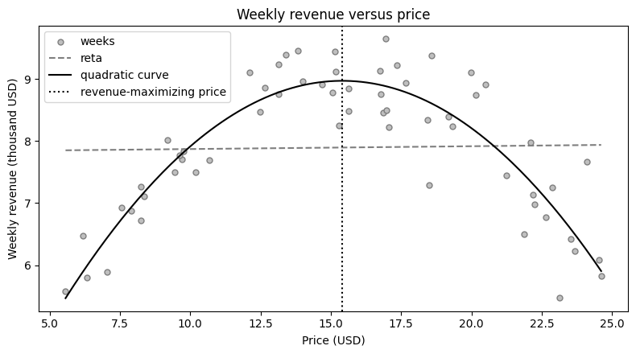
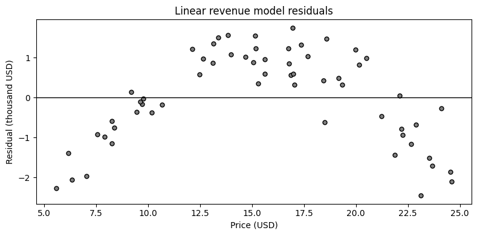

# Chapter 10 — Solutions

[Student notebook](../ch10-student.ipynb) · [exercises](../exercises/ch10.md)

Consult the solutions after attempting the exercises.

# Solutions 01–06 · Transformations, Nonlinearities, and Elasticities

**Prof. Daniel de Abreu Pereira Uhr**

**Course:** Statistics and Econometrics with Python


Editorial worked solution

## The real estate agency

Use 300 apartment listings. Monthly rent is measured in dollars, floor area in square meters, age in years and distance to downtown in kilometers. Run the setup cell first.

```python
import numpy as np
import pandas as pd
import statsmodels.formula.api as smf

rng = np.random.default_rng(2026)
n_apartments = 300
apartments = pd.DataFrame({
    "area_m2": rng.integers(30, 151, size=n_apartments),
    "age_years": rng.integers(0, 41, size=n_apartments),
    "distance_km": np.round(rng.uniform(0.5, 20, size=n_apartments), 1),
})
log_rent = (4.5 + 0.8 * np.log(apartments["area_m2"]) - 0.01 * apartments["age_years"]
               - 0.15 * np.log(apartments["distance_km"]) + rng.normal(0, 0.15, size=n_apartments))
apartments["rent"] = np.round(np.exp(log_rent), -1)
```

## Solution to Exercise 01 — A model for rents

Regress log rent on log area, age and log distance. Identify the units of each coefficient.

The area and distance coefficients are elasticities. The age coefficient measures a log difference per year. The fitted slopes are 0.8153, −0.0089 and −0.1620 for area, age and distance respectively.

```python
modelo = smf.ols("np.log(rent) ~ np.log(area_m2) + age_years + np.log(distance_km)", data=apartments).fit()
print(modelo.params.round(4))
```

```text
Intercept              4.4361
np.log(area_m2)        0.8153
age_years             -0.0089
np.log(distance_km)   -0.1620
dtype: float64
```

## Solution to Exercise 02 — Two elasticities

Holding the other characteristics fixed, compute approximate and exact rent differences for a 10% increase in area and separately in distance.

Area gives about 8.2% by approximation and 8.1% exactly. Distance gives −1.6% and −1.5%. Use the ratio 1.10 raised to the corresponding coefficient.

```python
b = modelo.params
print(f"10% more floor area: about {10 * b['np.log(area_m2)']:.1f}% higher rent (exact: {100 * (1.10 ** b['np.log(area_m2)'] - 1):.1f}%)")
print(f"10% farther away: about {10 * b['np.log(distance_km)']:.1f}% change in rent (exact: {100 * (1.10 ** b['np.log(distance_km)'] - 1):.1f}%)")
```

```text
10% more floor area: about 8.2% higher rent (exact: 8.1%)
10% farther away: about -1.6% change in rent (exact: -1.5%)
```

## Solution to Exercise 03 — Age and rent

Calculate approximate and exact fitted rent differences for apartments one year and twenty years apart in age.

The one-year values are −0.89% and −0.88%. Over twenty years the approximation gives −17.7% and exponentiation gives −16.2%.

```python
b_idade = b["age_years"]
print(f"1 year: approximate {100 * b_idade:.2f}%; exact {100 * (np.exp(b_idade) - 1):.2f}%")
print(f"20 years: approximate {100 * 20 * b_idade:.1f}%; exact {100 * (np.exp(20 * b_idade) - 1):.1f}%")
```

```text
1 year: approximate -0.89%; exact -0.88%
20 years: approximate -17.7%; exact -16.2%
```

## Solution to Exercise 04 — Distance in a level-log model

Fit rent in dollars on log distance. Calculate the fitted dollar changes for 1% and 10% greater distance.

The slope is about −209.5. A 1% increase gives approximately −\$2.09. A 10% increase gives about −\$20 using the log of 1.10.

```python
nivel_log = smf.ols("rent ~ np.log(distance_km)", data=apartments).fit()
b_dist = nivel_log.params["np.log(distance_km)"]
print(nivel_log.params.round(1))
print(f"1% farther: about USD {b_dist / 100:.2f}; 10% farther: about USD {b_dist * np.log(1.10):.0f}")
```

```text
Intercept              2440.3
np.log(distance_km)    -209.5
dtype: float64
1% farther: about USD -2.09; 10% farther: about USD -20
```

## Solution to Exercise 05 — Elasticity at mean area

Fit a straight line in levels. Evaluate its elasticity at mean area and compare it with the log model.

At 90 square meters the line gives 0.795. The log model holds the area elasticity at 0.815 across sizes, controlling for age and distance. The level regression includes only area.

```python
linear = smf.ols("rent ~ area_m2", data=apartments).fit()
area_media = apartments["area_m2"].mean()
rent_previsto = linear.params["Intercept"] + linear.params["area_m2"] * area_media
print(f"Linear elasticity at mean area ({area_media:.0f} m²): {linear.params['area_m2'] * area_media / rent_previsto:.3f}")
print(f"Log-log elasticity: {b['np.log(area_m2)']:.3f}")
```

```text
Linear elasticity at mean area (90 m²): 0.795
Log-log elasticity: 0.815
```

## Solution to Exercise 06 — Double the area

Compute the fitted rent ratio when area doubles at fixed age and distance.

Two raised to 0.8153 is about 1.76. The fitted monthly rent is about 76% higher.

```python
fator = 2 ** b["np.log(area_m2)"]
print(f"Doubling area multiplies fitted rent by {fator:.2f}: about {100 * (fator - 1):.0f}% more")
```

```text
Doubling area multiplies fitted rent by 1.76: about 76% more
```

# Solutions 07–12 · Transformations, Nonlinearities, and Elasticities

**Prof. Daniel de Abreu Pereira Uhr**

**Course:** Statistics and Econometrics with Python


Editorial worked solution

## Hummingbird Supermarkets

Use the 60 weekly observations from Chapter 5 to investigate price, quantity and revenue. Run the setup cell to reproduce the original observation sequence.

```python
import numpy as np
import pandas as pd
import matplotlib.pyplot as plt
import statsmodels.formula.api as smf

rng = np.random.default_rng(2026)
area = rng.uniform(1, 4, size=80)
fluxo = 5 * area + rng.normal(0, 1.5, size=80)
_ = rng.normal(0, 3, size=80), rng.poisson(2 * fluxo), rng.normal(0, 25, size=80)

weeks = pd.DataFrame({"price": np.round(rng.uniform(5, 25, size=60), 2)})
weeks["quantity"] = np.round(1_200 - 40 * weeks["price"] + rng.normal(0, 40, size=60))
weeks["revenue"] = weeks["price"] * weeks["quantity"]
```

## Solution to Exercise 07 — Fit a straight line

Compute the price–revenue correlation and fit revenue on price. Interpret the slope and R-squared.

The correlation is 0.022 and R-squared is 0.0005. The fitted slope of 4.55 dollars of weekly revenue per dollar of price summarizes little of the variation.

```python
print(f"Price–revenue correlation: {weeks['price'].corr(weeks['revenue']):.3f}")
linear = smf.ols("revenue ~ price", data=weeks).fit()
print(linear.params.round(2))
print(f"Linear R²: {linear.rsquared:.4f}")
```

```text
Price–revenue correlation: 0.022
Intercept    7825.72
price           4.55
dtype: float64
Linear R²: 0.0005
```

## Solution to Exercise 08 — Allow curvature

Add price squared. Report its sign and the fraction of revenue variation explained.

The price coefficient is 1,115.11 and the squared coefficient is −36.19. The fitted curve is concave with R-squared 0.800.

```python
quadratico = smf.ols("revenue ~ price + I(price**2)", data=weeks).fit()
print(quadratico.params.round(2))
print(f"Quadratic R²: {quadratico.rsquared:.3f}")
```

```text
Intercept         380.20
price            1115.11
I(price ** 2)     -36.19
dtype: float64
Quadratic R²: 0.800
```

## Solution to Exercise 09 — Local slopes

Calculate the revenue derivative at prices 10, 15 and 20. Interpret the units.

The local slopes are about 391, 29 and −332 dollars of weekly revenue per dollar of price. For an exact one-dollar increment add the quadratic coefficient to each derivative.

```python
b = quadratico.params
for price in [10, 15, 20]:
    print(f"Price in USD {price}: USD 1 more → about USD {b['price'] + 2 * b['I(price ** 2)'] * price:.0f} in weekly revenue")
```

```text
Price in USD 10: USD 1 more → about USD 391 in weekly revenue
Price in USD 15: USD 1 more → about USD 29 in weekly revenue
Price in USD 20: USD 1 more → about USD -332 in weekly revenue
```

## Solution to Exercise 10 — Revenue-maximizing price

Find the turning point, check the price range and plot the observations with both fits.

The fitted maximum is \$15.41, within the observed range of \$5.57 to \$24.61. The negative squared coefficient identifies a maximum.

```python
price_maximo = -b["price"] / (2 * b["I(price ** 2)"])
print(f"Revenue-maximizing price: USD {price_maximo:.2f}")
print(f"Observed prices from USD {weeks['price'].min():.2f} a USD {weeks['price'].max():.2f}")

grade = np.linspace(weeks["price"].min(), weeks["price"].max(), 200)
fig, ax = plt.subplots(figsize=(8, 4.5))
ax.scatter(weeks["price"], weeks["revenue"] / 1_000, color="#BFBFBF", edgecolor="#7F7F7F", s=25, label="weeks")
ax.plot(grade, (linear.params["Intercept"] + linear.params["price"] * grade) / 1_000, color="#7F7F7F", linestyle="--", label="reta")
ax.plot(grade, (b["Intercept"] + b["price"] * grade + b["I(price ** 2)"] * grade**2) / 1_000, color="black", label="quadratic curve")
ax.axvline(price_maximo, color="black", linestyle=":", label="revenue-maximizing price")
ax.set_title("Weekly revenue versus price")
ax.set_xlabel("Price (USD)")
ax.set_ylabel("Weekly revenue (thousand USD)")
ax.legend()
fig.tight_layout()
plt.show()
```

```text
Revenue-maximizing price: USD 15.41
Observed prices from USD 5.57 a USD 24.61
```



## Solution to Exercise 11 — Residual pattern

Plot residuals from the straight line against price and describe the pattern.

A concave pattern leaves systematic residual differences across low, middle and high prices. The average linear slope conceals this curvature.

```python
fig, ax = plt.subplots(figsize=(8, 4))
ax.scatter(weeks["price"], linear.resid / 1_000, color="#7F7F7F", edgecolor="black", s=25)
ax.axhline(0, color="black", linewidth=1)
ax.set_title("Linear revenue model residuals")
ax.set_xlabel("Price (USD)")
ax.set_ylabel("Residual (thousand USD)")
fig.tight_layout()
plt.show()
```



## Solution to Exercise 12 — Profit and revenue

Using a unit cost of \$6 and the fitted linear demand, solve for the profit-maximizing price. Compare it with the fitted revenue maximum.

Multiply fitted quantity by price minus unit cost. Its maximum occurs at \$18.34, versus \$15.41 for the fitted revenue curve. The two objectives value incremental units differently.

```python
demanda = smf.ols("quantity ~ price", data=weeks).fit()
a, c = demanda.params["Intercept"], -demanda.params["price"]
price_lucro = (a / c + 6) / 2
print(f"Estimated demand: quantity = {a:.0f} − {c:.1f} · price")
print(f"Profit-maximizing price: USD {price_lucro:.2f}   (revenue maximum at USD {price_maximo:.2f})")
```

```text
Estimated demand: quantity = 1178 − 38.4 · price
Profit-maximizing price: USD 18.34   (revenue maximum at USD 15.41)
```

# Solutions 13–18 · Transformations, Nonlinearities, and Elasticities

**Prof. Daniel de Abreu Pereira Uhr**

**Course:** Statistics and Econometrics with Python


Editorial worked solution

## The produce retailer

For one month 200 stores charged randomly assigned prices between \$4 and \$12. Estimate the demand response and decide whether to raise the price by 5%.

```python
import numpy as np
import pandas as pd
import statsmodels.formula.api as smf

rng = np.random.default_rng(2026)
n_stores = 200
stores = pd.DataFrame({
    "price": np.round(rng.uniform(4, 12, size=n_stores), 2),
    "income_thousands": np.round(rng.uniform(2, 8, size=n_stores), 2),
})
log_quantity = 8.0 - 1.4 * np.log(stores["price"]) + 0.5 * np.log(stores["income_thousands"]) + rng.normal(0, 0.25, size=n_stores)
stores["quantity"] = np.round(np.exp(log_quantity))
```

## Solution to Exercise 13 — Estimate elasticities

Regress log quantity on log price and log neighborhood income. Report both slopes and a 95% interval for the price elasticity.

The price elasticity is −1.501 with interval [−1.633, −1.368]. The estimated income elasticity is 0.503.

```python
modelo = smf.ols("np.log(quantity) ~ np.log(price) + np.log(income_thousands)", data=stores).fit()
print(modelo.params.round(3))
print("95% CI for price elasticity:", modelo.conf_int().loc["np.log(price)"].round(3).tolist())
```

```text
Intercept                   8.207
np.log(price)              -1.501
np.log(income_thousands)    0.503
dtype: float64
95% CI for price elasticity: [-1.633, -1.368]
```

## Solution to Exercise 14 — Interpret the design

Explain what price randomization identifies and how to interpret the income coefficient.

Assigned prices support a causal interpretation for price in the trial. Neighborhood income was observed and its slope describes a conditional association.

## Solution to Exercise 15 — Test unit elasticity

Test the price slope against −1 and interpret the direction of the difference.

The test statistic is −7.475. The entire 95% interval falls below −1, indicating elastic demand over the modelled range.

```python
print(modelo.t_test("np.log(price) = -1"))
```

```text
                             Test for Constraints                             
==============================================================================
                 coef    std err          t      P>|t|      [0.025      0.975]
------------------------------------------------------------------------------
c0            -1.5005      0.067     -7.475      0.000      -1.633      -1.368
==============================================================================
```

## Solution to Exercise 16 — A five-percent increase

Compute exact changes in quantity and revenue at the point estimate and both interval endpoints.

Quantity changes by −7.1% at the estimate, with endpoint values −7.7% and −6.5%. Revenue changes by −2.4%, with endpoints −3.0% and −1.8%. Revenue equals price times quantity.

```python
inferior, superior = modelo.conf_int().loc["np.log(price)"]
for rotulo, elasticity in [("estimate", modelo.params["np.log(price)"]), ("lower bound", inferior), ("upper bound", superior)]:
    quantity = 100 * (1.05 ** elasticity - 1)
    revenue = 100 * (1.05 ** (1 + elasticity) - 1)
    print(f"{rotulo:>15}: elasticity {elasticity:.3f}; quantity {quantity:.1f}% (approx. {5 * elasticity:.1f}%); revenue {revenue:.1f}%")
```

```text
       estimate: elasticity -1.501; quantity -7.1% (approx. -7.5%); revenue -2.4%
    lower bound: elasticity -1.633; quantity -7.7% (approx. -8.2%); revenue -3.0%
    upper bound: elasticity -1.368; quantity -6.5% (approx. -6.8%); revenue -1.8%
```

## Solution to Exercise 17 — Scope of the result

Identify the product, time horizon and price range supported by the design. Explain what additional information a profit decision needs.

The evidence concerns this product, these stores and one month. Both prices in the comparison should be supported by the trial. A profit calculation also needs costs.

## Solution to Exercise 18 — Price recommendation

Write a recommendation using the interval, the revenue objective and the conditions of the trial.

Keep the current price if the objective is to increase revenue and the alternative is a 5% increase. Even the least negative endpoint predicts a revenue decline. Revisit the decision if costs, the objective or market conditions change.

Exercise 18, continued. Assume 1,000 units at \$8, a \$4 unit cost and a \$100 implementation expense. Compare net contribution at \$8 and \$8.40 and evaluate the elasticity endpoints.

```python
unit_cost = 4
setup_cost = 100
for elasticity in [-1.633, -1.501, -1.368]:
    units = 1000 * 1.05 ** elasticity
    revenue = 8.40 * units
    gain = (8.40 - unit_cost) * units - (8 - unit_cost) * 1000 - setup_cost
    print(round(elasticity, 3), round(units, 1), round(revenue, 2), round(gain, 2))
```

```text
-1.633 923.4 7756.7 -36.97
-1.501 929.4 7806.82 -10.71
-1.368 935.4 7857.64 15.91
```

The point estimate leaves a small loss after setup. The endpoints span zero. Retain the current price under a positive expected contribution criterion using this estimate.
