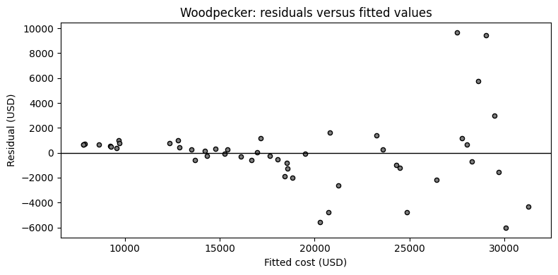
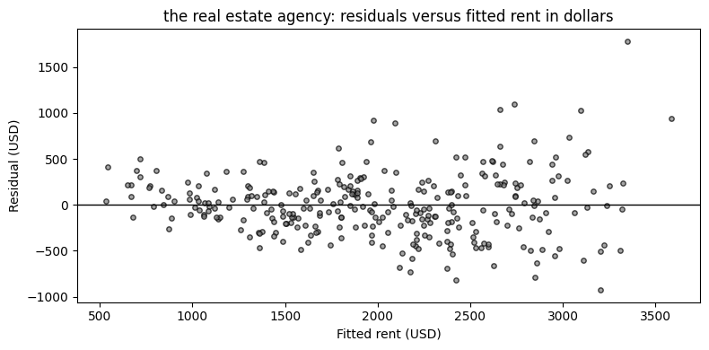
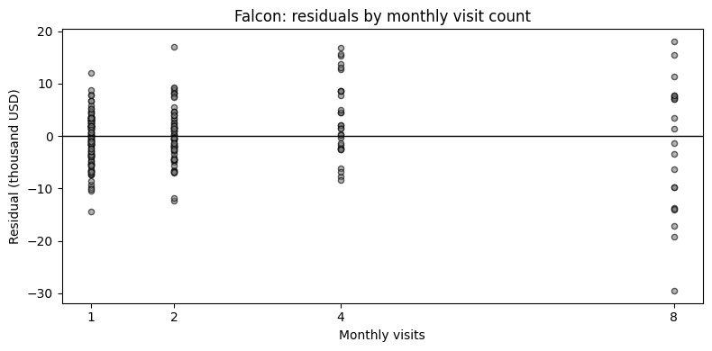

# Chapter 11 — Solutions

[Student notebook](../ch11-student.ipynb) · [exercises](../exercises/ch11.md)

Consult the solutions after attempting the exercises.

# Solutions 01–06 · Heteroskedasticity and Robust Standard Errors

**Prof. Daniel de Abreu Pereira Uhr**

**Course:** Statistics and Econometrics with Python


Editorial worked solution

## Woodpecker Furniture Works

Investigate production cost and units produced in a simulated factory. Run the setup cell and keep the same draws when comparing uncertainty estimates.

```python
import numpy as np
import pandas as pd
import matplotlib.pyplot as plt
import statsmodels.formula.api as smf
from scipy import stats

rng = np.random.default_rng(2026)
N = 20_000
units = rng.integers(200, 2_001, size=N)
choque = rng.normal(0, 1, size=N)
cost_constante = np.round(6_000 + 12 * units + 2_000 * choque, 2)
cost_crescente = np.round(6_000 + 12 * units + 0.0015 * units**2 * choque, 2)
cost_meio = np.round(6_000 + 12 * units + (3_500 - 3 * np.abs(units - 1_100)) * choque, 2)

n = 50
amostra = rng.choice(N, size=n, replace=True)
lotes = pd.DataFrame({"units": units[amostra], "cost": cost_crescente[amostra]})


def erros_padrao_simples(x, y):
    desvio_x = x - x.mean()
    soma_quadrados_x = (desvio_x**2).sum()
    inclinacao = (desvio_x * (y - y.mean())).sum() / soma_quadrados_x
    residuos = y - y.mean() - inclinacao * desvio_x
    n_obs = len(x)
    usual = np.sqrt((residuos**2).sum() / (n_obs - 2) / soma_quadrados_x)
    hc0 = np.sqrt((desvio_x**2 * residuos**2).sum() / soma_quadrados_x**2)
    hc1 = hc0 * np.sqrt(n_obs / (n_obs - 2))
    return inclinacao, usual, hc0, hc1
```

## Solution to Exercise 01 — Residual dispersion

Fit cost on units, plot residuals and calculate dispersion by production band.

Residual standard deviations rise from about 392 to 5,178 dollars between the extreme bands. The fitted slope is 13.40 dollars per additional unit.

```python
model_usual = smf.ols("cost ~ units", data=lotes).fit()
print(model_usual.params.round(2))

faixas = pd.cut(lotes["units"], bins=[200, 650, 1_100, 1_550, 2_000], include_lowest=True,
                labels=["200 to 650", "650 to 1.100", "1.100 to 1.550", "1.550 to 2.000"])
print(model_usual.resid.groupby(faixas, observed=True).agg(["count", "std"]).round(0))

fig, ax = plt.subplots(figsize=(8, 4))
ax.scatter(model_usual.fittedvalues, model_usual.resid, color="#7F7F7F", edgecolor="black", s=20)
ax.axhline(0, color="black", linewidth=1)
ax.set_title("Woodpecker: residuals versus fitted values")
ax.set_xlabel("Fitted cost (USD)")
ax.set_ylabel("Residual (USD)")
fig.tight_layout()
plt.show()
```

```text
Intercept    5020.62
units          13.40
dtype: float64
                count     std
units                        
200 to 650         14   392.0
650 to 1.100       16   817.0
1.100 to 1.550      9  2743.0
1.550 to 2.000     11  5178.0
```



## Solution to Exercise 02 — Three standard errors

Compute the conventional, HC0 and HC1 slope standard errors by hand and check them against the fitted models.

The hand and software values are 0.782, 0.972 and 0.992. The conventional interval is [11.82, 14.97] and HC1 gives [11.45, 15.34].

```python
_, usual, hc0, hc1 = erros_padrao_simples(lotes["units"].to_numpy(), lotes["cost"].to_numpy())
model_hc0 = smf.ols("cost ~ units", data=lotes).fit(cov_type="HC0")
model_hc1 = smf.ols("cost ~ units", data=lotes).fit(cov_type="HC1")
print(pd.DataFrame({"by hand": [usual, hc0, hc1],
                    "statsmodels": [model_usual.bse["units"], model_hc0.bse["units"], model_hc1.bse["units"]]},
                   index=["usual", "HC0", "HC1"]).round(3))
print("95% CI usual:", model_usual.conf_int().loc["units"].round(2).tolist())
print("95% CI HC1:  ", model_hc1.conf_int().loc["units"].round(2).tolist())
```

```text
       by hand  statsmodels
usual    0.782        0.782
HC0      0.972        0.972
HC1      0.992        0.992
95% CI usual: [11.82, 14.97]
95% CI HC1:   [11.45, 15.34]
```

## Solution to Exercise 03 — Repeated samples

Compare the average slope, population slope, empirical standard deviation and average standard errors across samples.

The mean slope is 12.050 against a population slope of 12.044. Empirical dispersion is 0.948. The mean conventional and HC1 standard errors are 0.759 and 0.897.

```python
indices = rng.choice(N, size=(5_000, n), replace=True)


def laboratorio(cost):
    beta_populacao = smf.ols("cost ~ units", data=pd.DataFrame({"units": units, "cost": cost})).fit().params["units"]
    resultados = np.array([erros_padrao_simples(units[i].astype(float), cost[i]) for i in indices])
    return beta_populacao, resultados


beta_crescente, resultados_crescente = laboratorio(cost_crescente)
print(f"Population slope: {beta_crescente:.3f}; mean estimate: {resultados_crescente[:, 0].mean():.3f}")
print(f"Empirical standard deviation of estimates: {resultados_crescente[:, 0].std():.3f}")
print(f"Mean standard errors — usual: {resultados_crescente[:, 1].mean():.3f}; HC1: {resultados_crescente[:, 3].mean():.3f}")
```

```text
Population slope: 12.044; mean estimate: 12.050
Empirical standard deviation of estimates: 0.948
Mean standard errors — usual: 0.759; HC1: 0.897
```

## Solution to Exercise 04 — Coverage

Use the stored samples to calculate the coverage rates under increasing variance.

Conventional coverage is 0.886 and HC1 coverage is 0.932. Both fall below the nominal 0.95 in this finite sample.

```python
t_critico = stats.t.ppf(0.975, n - 2)


def coberturas(beta_populacao, resultados):
    return {nome: (np.abs(resultados[:, 0] - beta_populacao) <= t_critico * resultados[:, coluna]).mean()
            for coluna, nome in [(1, "usual"), (3, "HC1")]}


print("Increasing variance:", {nome: round(float(valor), 3) for nome, valor in coberturas(beta_crescente, resultados_crescente).items()})
```

```text
Increasing variance: {'usual': 0.886, 'HC1': 0.932}
```

## Solution to Exercise 05 — Constant variance

Repeat the comparison using the constant-variance design. Explain the observed coverage.

Coverage is 0.944 for conventional intervals and 0.933 for HC1. Under homoskedasticity both procedures have a justification and finite-sample coverage may differ.

```python
beta_constante, resultados_constante = laboratorio(cost_constante)
print(f"Mean standard errors — usual: {resultados_constante[:, 1].mean():.3f}; HC1: {resultados_constante[:, 3].mean():.3f}; empirical SD: {resultados_constante[:, 0].std():.3f}")
print("Constant variance:", {nome: round(float(valor), 3) for nome, valor in coberturas(beta_constante, resultados_constante).items()})
```

```text
Mean standard errors — usual: 0.549; HC1: 0.539; empirical SD: 0.563
Constant variance: {'usual': 0.944, 'HC1': 0.933}
```

## Solution to Exercise 06 — Excessive conventional uncertainty

Make the variance largest near mean production. Compare standard errors with the observed slope dispersion.

The empirical standard deviation is 0.452. Conventional SE averages 0.635 and HC1 averages 0.440. Conventional coverage is 0.995. Large residuals near mean production carry little weight in the slope variance.

```python
beta_meio, resultados_meio = laboratorio(cost_meio)
print(f"Mean standard errors — usual: {resultados_meio[:, 1].mean():.3f}; HC1: {resultados_meio[:, 3].mean():.3f}; empirical SD: {resultados_meio[:, 0].std():.3f}")
print("Variance largest in the middle:", {nome: round(float(valor), 3) for nome, valor in coberturas(beta_meio, resultados_meio).items()})
```

```text
Mean standard errors — usual: 0.635; HC1: 0.440; empirical SD: 0.452
Variance largest in the middle: {'usual': 0.995, 'HC1': 0.946}
```

# Solutions 07–12 · Heteroskedasticity and Robust Standard Errors

**Prof. Daniel de Abreu Pereira Uhr**

**Course:** Statistics and Econometrics with Python


Editorial worked solution

## The real estate agency

Use apartment listings to model monthly rent as a function of floor area, age and distance to downtown.

```python
import numpy as np
import pandas as pd
import matplotlib.pyplot as plt
import statsmodels.formula.api as smf

rng = np.random.default_rng(2026)
n_apartamentos = 300
apartamentos = pd.DataFrame({
    "area_m2": rng.integers(30, 151, size=n_apartamentos),
    "age_years": rng.integers(0, 41, size=n_apartamentos),
    "distance_km": np.round(rng.uniform(0.5, 20, size=n_apartamentos), 1),
})
log_rent = (4.5 + 0.8 * np.log(apartamentos["area_m2"]) - 0.01 * apartamentos["age_years"]
               - 0.15 * np.log(apartamentos["distance_km"]) + rng.normal(0, 0.15, size=n_apartamentos))
apartamentos["rent"] = np.round(np.exp(log_rent), -1)
```

## Solution to Exercise 07 — Diagnose the level model

Fit the level regression and inspect residuals across floor-area bands.

Residual standard deviation rises from about 228 dollars for small apartments to 494 dollars for the largest band. Inspect the scatter within each group.

```python
formula_niveis = "rent ~ area_m2 + age_years + distance_km"
model_usual = smf.ols(formula_niveis, data=apartamentos).fit()
print(model_usual.params.round(2))

faixas_area = pd.cut(apartamentos["area_m2"], bins=[30, 60, 90, 120, 150], include_lowest=True,
                     labels=["30 to 60", "60 to 90", "90 to 120", "120 to 150"])
print(model_usual.resid.groupby(faixas_area, observed=True).agg(["count", "std"]).round(0))

fig, ax = plt.subplots(figsize=(8, 4))
ax.scatter(model_usual.fittedvalues, model_usual.resid, color="#7F7F7F", edgecolor="black", s=15, alpha=0.7)
ax.axhline(0, color="black", linewidth=1)
ax.set_title("the real estate agency: residuals versus fitted rent in dollars")
ax.set_xlabel("Fitted rent (USD)")
ax.set_ylabel("Residual (USD)")
fig.tight_layout()
plt.show()
```

```text
Intercept      1082.75
area_m2          18.68
age_years       -17.63
distance_km     -41.55
dtype: float64
            count    std
area_m2                 
30 to 60       69  228.0
60 to 90       84  300.0
90 to 120      78  314.0
120 to 150     69  494.0
```



## Solution to Exercise 08 — Compare uncertainty estimates

Tabulate conventional and HC1 standard errors for each coefficient. Check whether the coefficients change.

The area SE rises from 0.592 to 0.655, the age SE falls from 1.694 to 1.636 and the distance SE rises from 3.615 to 4.311. The fitted coefficients agree.

```python
model_hc1 = smf.ols(formula_niveis, data=apartamentos).fit(cov_type="HC1")
tabela = pd.DataFrame({"coefficient": model_usual.params, "SE usual": model_usual.bse, "SE HC1": model_hc1.bse,
                       "ratio HC1/usual": model_hc1.bse / model_usual.bse})
print(tabela.round(3))
```

```text
             coefficient  SE usual  SE HC1  ratio HC1/usual
Intercept       1082.752    72.139  66.166            0.917
area_m2           18.679     0.592   0.655            1.105
age_years        -17.630     1.694   1.636            0.966
distance_km      -41.554     3.615   4.311            1.193
```

## Solution to Exercise 09 — Distance and rent

Calculate both intervals for the distance coefficient and interpret the HC1 results.

Each additional kilometer is associated with about 41.55 dollars lower monthly rent at fixed area and age. The conventional interval is [−48.7, −34.4] and HC1 gives [−50.0, −33.1].

```python
print("95% CI for distance — usual:", model_usual.conf_int().loc["distance_km"].round(1).tolist())
print("95% CI for distance — HC1:  ", model_hc1.conf_int().loc["distance_km"].round(1).tolist())
print("p-values HC1:", model_hc1.pvalues.apply(lambda p: f"{p:.1e}").to_dict())
```

```text
95% CI for distance — usual: [-48.7, -34.4]
95% CI for distance — HC1:   [-50.0, -33.1]
p-values HC1: {'Intercept': '3.5e-60', 'area_m2': '5.4e-179', 'age_years': '4.3e-27', 'distance_km': '5.5e-22'}
```

## Solution to Exercise 10 — Rent in logarithms

Use log rent, log area and log distance, retaining age in years. Compare residual dispersion and the ratios of standard errors.

The distance SE ratio falls to about 1.04 and dispersion in log units is fairly similar across area bands. Log distance now has an elasticity interpretation.

```python
formula_log = "np.log(rent) ~ np.log(area_m2) + age_years + np.log(distance_km)"
log_usual = smf.ols(formula_log, data=apartamentos).fit()
log_hc1 = smf.ols(formula_log, data=apartamentos).fit(cov_type="HC1")
print("Ratio HC1/usual:", (log_hc1.bse / log_usual.bse).round(2).to_dict())
print(log_usual.resid.groupby(faixas_area, observed=True).std().round(3))
```

```text
Ratio HC1/usual: {'Intercept': 1.01, 'np.log(area_m2)': 1.03, 'age_years': 1.0, 'np.log(distance_km)': 1.04}
area_m2
30 to 60      0.153
60 to 90      0.150
90 to 120     0.131
120 to 150    0.154
dtype: float64
```

## Solution to Exercise 11 — Choose a scale

Explain what should determine the choice between levels and logarithms.

Choose a mean relationship and units suited to the rent question. A more uniform residual spread is informative, but a log specification changes the estimand.

## Solution to Exercise 12 — Large apartments

Compare the full fit with a sensitivity analysis restricted to at most 120 square meters. Explain what the restriction changes.

The distance coefficient changes from −41.55 to −36.76 and the area slope from 18.68 to 17.63. Excluding larger apartments changes the represented market. Report it as a sensitivity analysis.

```python
ate_120 = apartamentos[apartamentos["area_m2"] <= 120]
model_ate_120 = smf.ols(formula_niveis, data=ate_120).fit(cov_type="HC1")
print(f"Apartments excluded: {len(apartamentos) - len(ate_120)} de {len(apartamentos)}")
print(pd.DataFrame({"full sample (HC1)": model_hc1.params, "SE full sample": model_hc1.bse,
                    "up to 120 m² (HC1)": model_ate_120.params, "SE up to 120 m²": model_ate_120.bse}).round(3))
```

```text
Apartments excluded: 69 de 300
             full sample (HC1)  SE full sample  up to 120 m² (HC1)  \
Intercept             1082.752          66.166            1054.395   
area_m2                 18.679           0.655              17.634   
age_years              -17.630           1.636             -15.118   
distance_km            -41.554           4.311             -36.762   

             SE up to 120 m²  
Intercept             67.965  
area_m2                0.687  
age_years              1.425  
distance_km            3.804
```
# Solutions 13–18 · Heteroskedasticity and Robust Standard Errors

**Prof. Daniel de Abreu Pereira Uhr**

**Course:** Statistics and Econometrics with Python


Editorial worked solution

## Falcon Distribution

Prices and purchases are in dollars. Purchases in the regression are measured in thousands per month. Visits were randomly assigned to 240 customers at four frequencies.

```python
import numpy as np
import pandas as pd
import matplotlib.pyplot as plt
import statsmodels.formula.api as smf

rng = np.random.default_rng(2026)
n_clientes = 240
visits = rng.choice([1, 2, 4, 8], size=n_clientes, p=[0.5, 0.25, 0.15, 0.10])
resposta_cliente = 2.0 + rng.normal(0, 1.5, size=n_clientes)
clientes = pd.DataFrame({
    "visits": visits,
    "purchases": np.round(30 + resposta_cliente * visits + rng.normal(0, 4, size=n_clientes), 1),
})
```

## Solution to Exercise 13 — The sales report

Fit monthly purchases on visit count and compare the conventional interval with the break-even threshold.

The slope is 2.251 with SE 0.199 and interval [1.86, 2.64]. Both endpoints exceed 1.75 thousand dollars.

```python
model_usual = smf.ols("purchases ~ visits", data=clientes).fit()
print(model_usual.params.round(3))
print(f"Standard error usual: {model_usual.bse['visits']:.3f}")
print("95% CI (usual):", model_usual.conf_int().loc["visits"].round(2).tolist())
```

```text
Intercept    29.987
visits        2.251
dtype: float64
Standard error usual: 0.199
95% CI (usual): [1.86, 2.64]
```

## Solution to Exercise 14 — Diagnose dispersion

Plot residuals by assigned frequency and tabulate counts and residual standard deviations.

The groups have 121, 67, 30 and 22 customers. Residual dispersion rises from 4.47 to 12.54 thousand dollars across the four frequencies.

```python
print(model_usual.resid.groupby(clientes["visits"]).agg(["count", "std"]).round(2))

fig, ax = plt.subplots(figsize=(8, 4))
ax.scatter(clientes["visits"], model_usual.resid, color="#7F7F7F", edgecolor="black", s=20, alpha=0.6)
ax.axhline(0, color="black", linewidth=1)
ax.set_xticks([1, 2, 4, 8])
ax.set_title("Falcon: residuals by monthly visit count")
ax.set_xlabel("Monthly visits")
ax.set_ylabel("Residual (thousand USD)")
fig.tight_layout()
plt.show()
```

```text
        count    std
visits              
1         121   4.47
2          67   5.21
4          30   7.33
8          22  12.54
```



## Solution to Exercise 15 — Robust interval

Compute the HC1 slope standard error and 95% interval. Reconsider the threshold.

The slope stays at 2.251, the SE rises to 0.344 and the interval [1.58, 2.92] spans break-even.

```python
model_hc1 = smf.ols("purchases ~ visits", data=clientes).fit(cov_type="HC1")
print(f"Standard error HC1: {model_hc1.bse['visits']:.3f}   (usual: {model_usual.bse['visits']:.3f})")
print("95% CI (HC1):", model_hc1.conf_int().loc["visits"].round(2).tolist())
```

```text
Standard error HC1: 0.344   (usual: 0.199)
95% CI (HC1): [1.58, 2.92]
```

## Solution to Exercise 16 — Test break-even

Test a slope of 1.75 using the conventional and HC1 estimates. Report the two-sided p-values.

The conventional statistic is 2.52 with p = 0.012. HC1 gives 1.46 with p = 0.145. The robust evidence permits a slope at the threshold.

```python
for rotulo, model in [("usual", model_usual), ("HC1", model_hc1)]:
    teste = model.t_test("visits = 1.75")
    print(f"{rotulo:>5}: statistic = {float(np.squeeze(teste.tvalue)):.2f}; p-value = {float(np.squeeze(teste.pvalue)):.3f}")
```

```text
usual: statistic = 2.52; p-value = 0.012
  HC1: statistic = 1.46; p-value = 0.145
```

## Solution to Exercise 17 — Assignment and variation

Explain what random assignment permits and why purchases can still be more dispersed at higher frequencies.

Randomization supports comparison of assigned visit frequencies. Customers can respond differently to each visit, producing more variable purchases in the high-frequency groups.

## Solution to Exercise 18 — Expansion decision

Translate the point estimate and uncertainty into incremental gross margin net of visit cost. Make a recommendation for the trial setting.

The fitted net gain is about 100 dollars per visit. Applying the 20% margin to the HC1 endpoints and subtracting 350 dollars gives about −34 to +234 dollars. Gather more evidence before a broad expansion.

### Exercise 18 · Route decision

**Your decision.** In Exercises 13–18, reproduce the analysis and prepare a brief for a second scenario. Suppose a route costs \$400 per visit, earns a 15% margin, and has capacity for 60 additional visits. Report break-even sales, estimated contribution for the batch of visits, and the interval associated with the average slope, holding cost and margin assumptions fixed. Explain what additional information Falcon should collect before committing the route.

```python
model_hc1 = smf.ols("purchases ~ visits", data=clientes).fit(cov_type="HC1")
slope = model_hc1.params["visits"]
bounds = model_hc1.conf_int().loc["visits"].to_numpy()
margin, cost, visits_in_plan = 0.15, 400, 60
net = visits_in_plan * (1000 * margin * slope - cost)
net_bounds = visits_in_plan * (1000 * margin * bounds - cost)
print("Break-even purchases per visit (thousands):", round(cost / (1000 * margin), 3))
print("Expected net contribution:", round(net))
print("95% interval for mean contribution:", net_bounds.round().astype(int).tolist())
```

```text
Break-even purchases per visit (thousands): 2.667
Expected net contribution: -3743
95% interval for mean contribution: [-9811, 2324]
```

At 15% margin, one visit must generate about 2.667 thousand dollars in additional purchases. At the fitted slope, each extra visit loses about 62 dollars on average. The interval for the expected contribution of 60 visits spans zero. Committing all 60 would require stronger evidence or more favorable unit economics. A prediction interval for cash realized on a particular route would also require customer-level variation and dependence assumptions.
