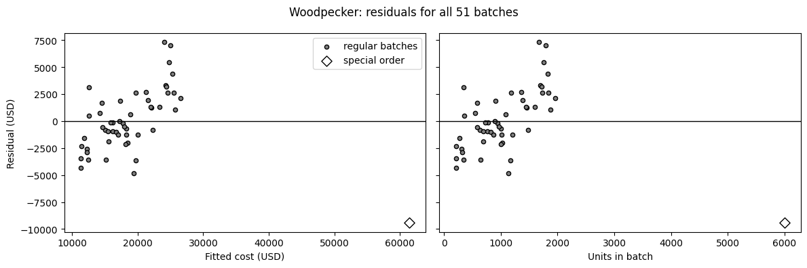

# Chapter 12 — Solutions

[Student notebook](../ch12-student.ipynb) · [exercises](../exercises/ch12.md)

Consult the solutions after attempting the exercises.

# Solutions 01–06 · Diagnostics, Specification, and Robustness

**Prof. Daniel de Abreu Pereira Uhr**

**Course:** Statistics and Econometrics with Python


Editorial worked solution

## Woodpecker Furniture Works

Inspect production costs for 50 regular batches and one special order. Regular batches range from 200 to 2,000 units. The special 6,000-unit hotel order used lumber bought under a separate negotiated contract and cost \$52,000. The analyst wants the incremental cost for regular batches.

```python
import numpy as np
import pandas as pd
import matplotlib.pyplot as plt
import statsmodels.formula.api as smf

rng = np.random.default_rng(2026)
N = 20_000
beta_0, beta_1 = 6_000, 12
units = rng.integers(200, 2_001, size=N)
erro = rng.normal(0, 2_000, size=N)
populacao = pd.DataFrame({"units": units, "cost": np.round(beta_0 + beta_1 * units + erro, 2)})
n = 50
amostra = populacao.iloc[rng.choice(N, size=n, replace=True)].reset_index(drop=True)

encomenda = pd.DataFrame({"units": [6_000], "cost": [52_000.0]})
batches = pd.concat([amostra.assign(type="regular"), encomenda.assign(type="special order")], ignore_index=True)
especial = batches["type"] == "special order"
```

## Solution to Exercise 01 — Residuals

Fit batch cost on units and rank observations by absolute externally studentized residual.

The 6,000-unit order has a residual of −7.70 in studentized units. Its production arrangement deserves investigation.

```python
modelo = smf.ols("cost ~ units", data=batches).fit()
influencia = modelo.get_influence()
batches["studentized"] = influencia.resid_studentized_external

fig, axes = plt.subplots(1, 2, figsize=(12, 4), sharey=True)
for ax, x, rotulo in [(axes[0], modelo.fittedvalues, "Fitted cost (USD)"), (axes[1], batches["units"], "Units in batch")]:
    ax.scatter(x[~especial], modelo.resid[~especial], color="#7F7F7F", edgecolor="black", s=20, label="regular batches")
    ax.scatter(x[especial], modelo.resid[especial], color="white", edgecolor="black", marker="D", s=60, label="special order")
    ax.axhline(0, color="black", linewidth=1)
    ax.set_xlabel(rotulo)
axes[0].set_ylabel("Residual (USD)")
axes[0].legend()
fig.suptitle("Woodpecker: residuals for all 51 batches")
fig.tight_layout()
plt.show()

maiores = batches["studentized"].abs().sort_values(ascending=False).index[:4]
print(batches.loc[maiores, ["type", "units", "cost", "studentized"]].round(2))
```



```text
             type  units      cost  studentized
50  special order   6000  52000.00        -7.70
21        regular   1678  31357.90         2.55
15        regular   1792  32054.76         2.44
16        regular   1761  30234.30         1.86
```

## Solution to Exercise 02 — Leverage

Calculate leverage and compare the largest values with twice mean leverage.

The special order has leverage 0.649 versus a screening threshold of 0.078. Its size is far from the regular batches.

```python
batches["leverage"] = influencia.hat_matrix_diag
k = 1
n_batches = len(batches)
print(f"Mean leverage (k + 1)/n: {(k + 1) / n_batches:.3f}; sinal 2(k + 1)/n: {2 * (k + 1) / n_batches:.3f}")
print(batches.sort_values("leverage", ascending=False)[["type", "units", "leverage"]].head(3).round(3))
```

```text
Mean leverage (k + 1)/n: 0.039; sinal 2(k + 1)/n: 0.078
             type  units  leverage
50  special order   6000     0.649
18        regular    207     0.042
41        regular    209     0.041
```

## Solution to Exercise 03 — Influence

Compare Cook’s distances and refit with and without the special order.

The slope changes from 8.65 dollars per unit for 51 batches to 12.11 for regular batches. Two regular batches also exceed 4/n.

```python
batches["cook"] = influencia.cooks_distance[0]
print(f"Sinal 4/n: {4 / n_batches:.3f}")
print(batches.sort_values("cook", ascending=False)[["type", "units", "cost", "cook"]].head(4).round(3))
print(f"Regular batches above 4/n: {(batches.loc[~especial, 'cook'] > 4 / n_batches).sum()}")
print()
sem_encomenda = smf.ols("cost ~ units", data=amostra).fit()
print(pd.DataFrame({"51 batches": modelo.params, "50 regular batches": sem_encomenda.params}).round(2))
previsto = sem_encomenda.params["Intercept"] + sem_encomenda.params["units"] * 6_000
print(f"Cost predicted by the regular-batch line for 6,000 units: USD {previsto:,.0f}".replace(",", "."))
```

```text
Sinal 4/n: 0.078
             type  units      cost    cook
50  special order   6000  52000.00  25.052
15        regular   1792  32054.76   0.088
21        regular   1678  31357.90   0.084
16        regular   1761  30234.30   0.052
Regular batches above 4/n: 2

           51 batches  50 regular batches
Intercept     9546.86             6195.19
units            8.65               12.11
Cost predicted by the regular-batch line for 6.000 units: USD 78.884
```

## Solution to Exercise 04 — Which orders belong?

Use the operating context to decide how to estimate unit cost for standard orders. Interpret a prediction at 6,000 units.

Use regular orders for the regular-cost question. The regular-batch line predicts about \$78,884 at 6,000 units, an extrapolation to a different production setting.

## Solution to Exercise 05 — Report sensitivity

Present the slope and HC1 interval for each population.

Regular batches give 12.11 [10.99, 13.24] dollars per unit. The full fit gives 8.65 [6.14, 11.16]. Report the operational reason for the principal sample.

```python
linhas = []
for rotulo, dados in [("50 regular batches — main", amostra), ("51 batches, including special order", batches)]:
    ajuste = smf.ols("cost ~ units", data=dados).fit(cov_type="HC1")
    inferior, superior = ajuste.conf_int().loc["units"]
    linhas.append({"specification": rotulo, "slope": ajuste.params["units"], "HC1 SE": ajuste.bse["units"],
                   "lower CI": inferior, "upper CI": superior})
print(pd.DataFrame(linhas).set_index("specification").round(2).to_string())
```

```text
                                     slope  HC1 SE  lower CI  upper CI
specification                                                         
50 regular batches — main            12.11    0.57     10.99     13.24
51 batches, including special order   8.65    1.28      6.14     11.16
```

## Solution to Exercise 06 — Two unusual batches

Compare adding a 6,000-unit order near the line and a 1,100-unit order \$9,000 above it.

The first has leverage 0.649, residual −0.25 and Cook’s distance 0.060. The second has leverage 0.020, residual 4.15 and distance 0.133. Potential leverage and observed influence answer different questions.

```python
print(f"Without extra batch: intercept {sem_encomenda.params['Intercept']:.0f}; slope {sem_encomenda.params['units']:.2f}; sinal 4/n = {4 / 51:.3f}")
for rotulo, (novas_units, novo_cost) in [("6,000 units close to line", (6_000, 78_000.0)),
                                              ("1,100 units, USD 9,000 above", (1_100, 28_200.0))]:
    dados = pd.concat([amostra, pd.DataFrame({"units": [novas_units], "cost": [novo_cost]})], ignore_index=True)
    ajuste = smf.ols("cost ~ units", data=dados).fit()
    medidas = ajuste.get_influence()
    print(f"{rotulo}: leverage {medidas.hat_matrix_diag[-1]:.3f}; studentized {medidas.resid_studentized_external[-1]:.2f}; "
          f"Cook {medidas.cooks_distance[0][-1]:.3f}; intercept {ajuste.params['Intercept']:.0f}; slope {ajuste.params['units']:.2f}")
```

```text
Without extra batch: intercept 6195; slope 12.11; sinal 4/n = 0.078
6,000 units close to line: leverage 0.649; studentized -0.25; Cook 0.060; intercept 6305; slope 12.00
1,100 units, USD 9,000 above: leverage 0.020; studentized 4.15; Cook 0.133; intercept 6315; slope 12.16
```

# Solutions 07–12 · Diagnostics, Specification, and Robustness

**Prof. Daniel de Abreu Pereira Uhr**

**Course:** Statistics and Econometrics with Python


Editorial worked solution

## The shoe retailer

Across 60 stores, radio and flyer budgets move together. Monthly sales and monthly media budgets are in thousands of dollars. The simulated errors have constant variance.

```python
import numpy as np
import pandas as pd
import statsmodels.formula.api as smf
from statsmodels.stats.outliers_influence import variance_inflation_factor

rng = np.random.default_rng(2026)
N = 50_000

digital = np.round(rng.uniform(2, 20, size=N), 2)
radio = np.round(rng.uniform(0, 15, size=N), 2)
flyers = np.round(np.clip(0.8 * radio + rng.normal(0, 1.0, size=N), 0, None), 2)
sales = np.round(120 + 3.0 * digital + 2.0 * radio + 2.0 * flyers + rng.normal(0, 25, size=N), 1)
populacao = pd.DataFrame({"digital": digital, "radio": radio, "flyers": flyers, "sales": sales})

n = 60
amostra = populacao.iloc[rng.choice(N, size=n, replace=True)].reset_index(drop=True)
```

## Solution to Exercise 07 — Variance inflation

Calculate each channel’s VIF by auxiliary regression and with the software function.

Digital has VIF 1.02, radio 13.03 and flyers 13.11. The latter two have little independently varying spending.

```python
modelo = smf.ols("sales ~ digital + radio + flyers", data=amostra).fit()
midias = ["digital", "radio", "flyers"]

vif_mao = {}
for midia in midias:
    outras = " + ".join(m for m in midias if m != midia)
    r2 = smf.ols(f"{midia} ~ {outras}", data=amostra).fit().rsquared
    vif_mao[midia] = 1 / (1 - r2)

exog, nomes = modelo.model.exog, modelo.model.exog_names
vif_funcao = {nome: variance_inflation_factor(exog, j) for j, nome in enumerate(nomes) if nome != "Intercept"}
print(pd.DataFrame({"Hand-calculated VIF": vif_mao, "Software VIF": vif_funcao}).round(2))
```

```text
         Hand-calculated VIF  Software VIF
digital                 1.02          1.02
radio                  13.03         13.03
flyers                 13.11         13.11
```

## Solution to Exercise 08 — Independent variation

Residualize each channel on the other two. Relate the remaining dispersion to the conventional slope standard error.

Radio’s residualized SD is 1.065 against a total SD of 3.845. Flyers retain SD 0.846 against 3.062. The squared SD ratios reproduce the VIFs.

```python
linhas = []
for midia in midias:
    outras = " + ".join(m for m in midias if m != midia)
    propria = smf.ols(f"{midia} ~ {outras}", data=amostra).fit().resid
    razao = amostra[midia].std() / propria.std()
    linhas.append({"channel": midia, "SD of X": amostra[midia].std(), "SD of residualized X": propria.std(),
                   "squared ratio": razao**2, "VIF": vif_mao[midia], "standard error": modelo.bse[midia]})
print(pd.DataFrame(linhas).set_index("channel").round(3).to_string())
```

```text
         SD of X  SD of residualized X  squared ratio     VIF  standard error
channel                                                                      
digital    5.379                 5.317          1.023   1.023           0.586
radio      3.845                 1.065         13.032  13.032           2.923
flyers     3.062                 0.846         13.111  13.111           3.683
```

## Solution to Exercise 09 — What can the data answer?

Estimate the contrast for increasing both radio and flyers by one unit. Also test whether both coefficients equal zero.

The sum is 3.87 thousand dollars in monthly sales with SE 1.19 and interval [1.48, 6.26]. The joint F statistic is 5.73 with p = 0.0055. A joint effect can be more precise than either individual effect.

```python
soma = modelo.t_test("radio + flyers = 0")
print(f"Combined effect: {float(np.squeeze(soma.effect)):.2f}; standard error {float(np.squeeze(soma.sd)):.2f}; 95% CI: {np.round(soma.conf_int(), 2).tolist()[0]}")
teste_f = modelo.f_test("radio = 0, flyers = 0")
print(f"F test for radio = flyers = 0: F = {float(np.squeeze(teste_f.fvalue)):.2f}; p-value = {float(teste_f.pvalue):.4f}")
```

```text
Combined effect: 3.87; standard error 1.19; 95% CI: [1.48, 6.26]
F test for radio = flyers = 0: F = 5.73; p-value = 0.0055
```

## Solution to Exercise 10 — Remove flyers

Fit the model without flyers and interpret the radio coefficient in light of joint planning.

The radio coefficient is 2.37 [0.72, 4.02]. In the laboratory population the reduced-model slope is 3.54. Removing flyers makes radio pick up part of the relationship with flyer spending.

```python
sem_flyers = smf.ols("sales ~ digital + radio", data=amostra).fit()
print(f"Radio without flyers: {sem_flyers.params['radio']:.2f}; 95% CI: {sem_flyers.conf_int().loc['radio'].round(2).tolist()}")
print(f"Same regression in the simulated population: {smf.ols('sales ~ digital + radio', data=populacao).fit().params['radio']:.2f}")
```

```text
Radio without flyers: 2.37; 95% CI: [0.72, 4.02]
Same regression in the simulated population: 3.54
```

## Solution to Exercise 11 — Answer the marketing director

Can the chain eliminate flyers without losing sales? Explain what its historical allocation identifies.

The joint contrast supports the bundle. Weak independent variation makes the effect of removing one channel uncertain. A large individual p-value does not establish a zero loss.

## Solution to Exercise 12 — Improve the design

Independently vary media assignments in the alternative design and compare precision.

The radio and flyer SEs fall from 2.92 and 3.68 to about 1.02 each. Independent budget variation directly informs separate channel comparisons.

```python
flyers_sorteados = np.round(rng.uniform(0, 12, size=N), 2)
sales_randomized = np.round(120 + 3.0 * digital + 2.0 * radio + 2.0 * flyers_sorteados + rng.normal(0, 25, size=N), 1)
populacao_randomized = pd.DataFrame({"digital": digital, "radio": radio, "flyers": flyers_sorteados, "sales": sales_randomized})
amostra_randomized = populacao_randomized.iloc[rng.choice(N, size=n, replace=True)].reset_index(drop=True)

modelo_randomized = smf.ols("sales ~ digital + radio + flyers", data=amostra_randomized).fit()
exog_s, nomes_s = modelo_randomized.model.exog, modelo_randomized.model.exog_names
print(f"Correlation between radio and flyers: {amostra_randomized['radio'].corr(amostra_randomized['flyers']):.2f}")
print(pd.DataFrame({
    "coeficiente": modelo_randomized.params[midias],
    "standard error — randomized": modelo_randomized.bse[midias],
    "standard error — joint allocation": modelo.bse[midias],
    "VIF — randomized": [variance_inflation_factor(exog_s, nomes_s.index(m)) for m in midias],
}).round(2).to_string())
print(modelo_randomized.conf_int().loc[["radio", "flyers"]].set_axis(["lower CI", "upper CI"], axis=1).round(2))
```

```text
Correlation between radio and flyers: 0.06
         coeficiente  standard error — randomized  standard error — joint allocation  VIF — randomized
digital         3.03                         0.56                               0.59              1.03
radio           1.73                         0.85                               2.92              1.02
flyers          1.11                         0.89                               3.68              1.02
        lower CI  upper CI
radio       0.03      3.44
flyers     -0.68      2.89
```

# Solutions 13–18 · Diagnostics, Specification, and Robustness

**Prof. Daniel de Abreu Pereira Uhr**

**Course:** Statistics and Econometrics with Python


Editorial worked solution

## The coffeehouse chain

The chain observes 150 coffeehouses, weekly cups sold, average cup price, neighborhood income and competitors within 500 meters. It is considering a 10% price increase.

```python
import numpy as np
import pandas as pd
import statsmodels.formula.api as smf

rng = np.random.default_rng(2026)
n_cafeterias = 150
income = np.round(rng.uniform(2, 12, size=n_cafeterias), 2)
competitors = rng.poisson(3, size=n_cafeterias)
price = np.round(np.exp(np.log(6) + 0.3 * np.log(income / 5) - 0.04 * (competitors - 3) + rng.normal(0, 0.06, size=n_cafeterias)), 2)
log_cups = 7.0 - 1.3 * np.log(price) + 0.7 * np.log(income) - 0.08 * competitors + rng.normal(0, 0.15, size=n_cafeterias)
cafeterias = pd.DataFrame({"price": price, "income": income, "competitors": competitors, "cups": np.round(np.exp(log_cups))})
```

## Solution to Exercise 13 — The analyst’s regression

Fit log cups on log price with an HC1 interval. Interpret the unadjusted association.

The slope is +0.56 [0.32, 0.79]. Higher-price stores sell more cups on average in this comparison.

```python
simples = smf.ols("np.log(cups) ~ np.log(price)", data=cafeterias).fit(cov_type="HC1")
print(f"Unadjusted elasticity: {simples.params['np.log(price)']:.2f}; 95% CI: {simples.conf_int().loc['np.log(price)'].round(2).tolist()}")
```

```text
Unadjusted elasticity: 0.56; 95% CI: [0.32, 0.79]
```

## Solution to Exercise 14 — How prices were set

Investigate how price varies with neighborhood income and competition. Explain why comparisons are confounded.

Price has correlation 0.72 with income and −0.37 with competitor count. Both characteristics can also predict cups sold.

```python
print(cafeterias[["price", "income", "competitors", "cups"]].corr().round(2))
```

```text
             price  income  competitors  cups
price         1.00    0.72        -0.37  0.37
income        0.72    1.00         0.20  0.53
competitors  -0.37    0.20         1.00 -0.14
cups          0.37    0.53        -0.14  1.00
```

## Solution to Exercise 15 — Four specifications

Compare no controls, income alone, competitors alone and both. Report elasticities and HC1 uncertainty.

The estimates are +0.56, −0.08, +0.57 and −1.24. With both controls the interval is [−1.61, −0.88], spanning unit elasticity.

```python
especificacoes = {
    "unadjusted": "np.log(cups) ~ np.log(price)",
    "+ income": "np.log(cups) ~ np.log(price) + np.log(income)",
    "+ competitors": "np.log(cups) ~ np.log(price) + competitors",
    "+ income + competitors": "np.log(cups) ~ np.log(price) + np.log(income) + competitors",
}
linhas = []
for rotulo, formula in especificacoes.items():
    modelo = smf.ols(formula, data=cafeterias).fit(cov_type="HC1")
    inferior, superior = modelo.conf_int().loc["np.log(price)"]
    linhas.append({"specification": rotulo, "elasticity": modelo.params["np.log(price)"], "HC1 SE": modelo.bse["np.log(price)"],
                   "lower CI": inferior, "upper CI": superior})
sensibilidade = pd.DataFrame(linhas).set_index("specification")
print(sensibilidade.round(2).to_string())
```

```text
                        elasticity  HC1 SE  lower CI  upper CI
specification                                                 
unadjusted                    0.56    0.12      0.32      0.79
+ income                     -0.08    0.13     -0.33      0.17
+ competitors                 0.57    0.12      0.33      0.81
+ income + competitors       -1.24    0.19     -1.61     -0.88
```

## Solution to Exercise 16 — Translate to revenue

For each specification transform the elasticity and its endpoints into the exact predicted change in revenue for 10% higher price.

Use 100 times the difference between 1.10 raised to one plus the elasticity and one. With both controls the estimate is −2.3%, with endpoints −5.6% and +1.1%.

```python
revenue = pd.DataFrame({
    "revenue (%)": 100 * (1.10 ** (1 + sensibilidade["elasticity"]) - 1),
    "lower bound (%)": 100 * (1.10 ** (1 + sensibilidade["lower CI"]) - 1),
    "upper bound (%)": 100 * (1.10 ** (1 + sensibilidade["upper CI"]) - 1),
})
print(revenue.round(1).to_string())
```

```text
                        revenue (%)  lower bound (%)  upper bound (%)
specification                                                        
unadjusted                     16.0             13.4             18.6
+ income                        9.1              6.5             11.8
+ competitors                  16.1             13.5             18.8
+ income + competitors         -2.3             -5.6              1.1
```

## Solution to Exercise 17 — Report sensitivity

Explain which controls alter the conclusion and what observations can establish.

The positive unadjusted association is sensitive to the pricing environment. Both plausible controls reverse the sign. Remaining unobserved differences may still confound price comparisons.

## Solution to Exercise 18 — Recommend a decision

Write a recommendation for the proposed increase and describe a way to learn more.

The adjusted interval permits revenue loss or gain. A randomized pilot across comparable shops could measure the effect before a chain-wide rollout.

### Exercise 18 — Transfer to another store

A hypothetical store sells 900 cups per week at \$6. Evaluate a 5% price increase using the full specification, against a weekly revenue target of at least 1%. Compute the predicted revenue change and transformed HC1 interval. Explain how you would check support for \$6 and \$6.30 among stores with comparable income and competition, and why this observational interval does not settle the rollout decision.

```python
full_model = smf.ols(list(especificacoes.values())[-1], data=cafeterias).fit(cov_type="HC1")
estimate = full_model.params["np.log(price)"]
lower, upper = full_model.conf_int().loc["np.log(price)"]
baseline = 900 * 6
change = baseline * (1.05 ** (1 + np.array([estimate, lower, upper])) - 1)
print(np.round(change, 2))
print(0.01 * baseline)
```

```text
[ -64.   -158.     31.69]
54.0
```

The projected weekly difference is about −\$64, with endpoints −\$158 and +\$32. The target is +\$54. The entire interval falls below the target under this specification and fixed baseline. Check local price overlap by income and competitor count before extrapolating to the store. Meeting a target in an observational model would still require a credible intervention design.
