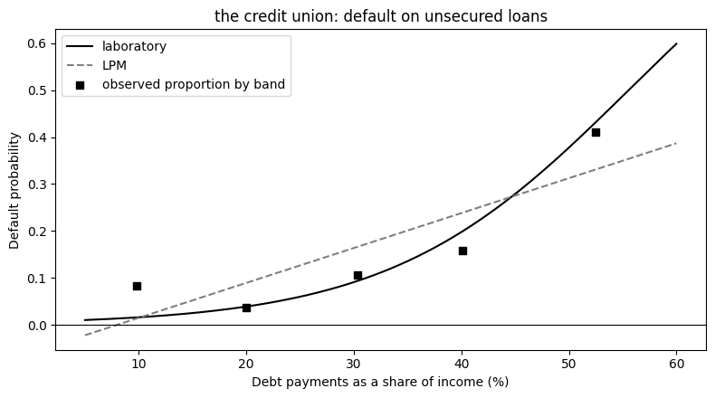

# Chapter 13 — Solutions

[Student notebook](../ch13-student.ipynb) · [exercises](../exercises/ch13.md)

Consult the solutions after attempting the exercises.

# Solutions 01–06 · Models for Binary Dependent Variables

**Prof. Daniel de Abreu Pereira Uhr**

**Course:** Statistics and Econometrics with Python


Editorial worked solution

## The credit union

Study 800 completed personal loans. The outcome is default. Predictors are debt payments as a percentage of income and whether collateral was posted. Run the setup cell first.

```python
import numpy as np
import pandas as pd
import matplotlib.pyplot as plt
import statsmodels.formula.api as smf


def logistica(indice):
    return 1 / (1 + np.exp(-indice))


rng = np.random.default_rng(2026)
n_emprestimos = 800
emprestimos = pd.DataFrame({
    "payment_share": np.round(rng.uniform(5, 60, size=n_emprestimos), 1),
    "collateral": rng.binomial(1, 0.4, size=n_emprestimos),
})
probabilidade_lab = logistica(-5.0 + 0.09 * emprestimos["payment_share"] - 1.0 * emprestimos["collateral"])
emprestimos["defaulted"] = rng.binomial(1, probabilidade_lab)
```

## Solution to Exercise 01 — Default proportions

Calculate default rates by collateral status and payment-share band. Give denominators.

Among 466 unsecured loans 19.3% defaulted, versus 10.8% of 334 secured loans. Across the four payment-share bands the rates rise from 4.7% to 36.9%.

```python
faixas = pd.cut(emprestimos["payment_share"], bins=[5, 20, 35, 50, 60], include_lowest=True,
                labels=["5 a 20%", "20 a 35%", "35 a 50%", "50 a 60%"])
print(f"Overall default rate: {emprestimos['defaulted'].mean():.3f}")
print(emprestimos.groupby("collateral")["defaulted"].agg(["size", "mean"]).rename(index={0: "without collateral", 1: "with collateral"}).round(3))
print(emprestimos.groupby(faixas, observed=True)["defaulted"].agg(["size", "mean"]).round(3))
```

```text
Overall default rate: 0.158
                    size   mean
collateral                     
without collateral   466  0.193
with collateral      334  0.108
               size   mean
payment_share             
5 a 20%         190  0.047
20 a 35%        221  0.072
35 a 50%        232  0.185
50 a 60%        157  0.369
```

## Solution to Exercise 02 — Adjusted probabilities

Fit the LPM with HC1 and translate both slopes and their intervals to percentage points.

One more percentage point of payment share is associated with 0.74 points higher default probability [0.58, 0.90]. Collateral corresponds to −8.28 points [−12.94, −3.62], holding payment share fixed.

```python
lpm = smf.ols("defaulted ~ payment_share + collateral", data=emprestimos).fit(cov_type="HC1")
intervalos = lpm.conf_int()
print(pd.DataFrame({"coefficient": lpm.params, "HC1 SE": lpm.bse, "lower CI": intervalos[0], "upper CI": intervalos[1]}).round(4))
```

```text
               coefficient  HC1 SE  lower CI  upper CI
Intercept          -0.0591  0.0263   -0.1107   -0.0075
payment_share       0.0074  0.0008    0.0058    0.0090
collateral         -0.0828  0.0238   -0.1294   -0.0362
```

## Solution to Exercise 03 — Why HC1?

Compare conventional and HC1 standard errors and explain the variance of a binary outcome.

For conditional probability p the variance is p(1−p). HC1 accommodates unequal variance across profiles. Standard errors may move in either direction.

```python
lpm_usual = smf.ols("defaulted ~ payment_share + collateral", data=emprestimos).fit()
print(pd.DataFrame({"conventional SE": lpm_usual.bse, "HC1 SE": lpm.bse}).round(4))
```

```text
               conventional SE  HC1 SE
Intercept               0.0308  0.0263
payment_share           0.0008  0.0008
collateral              0.0246  0.0238
```

## Solution to Exercise 04 — Impossible predictions

Count negative fitted probabilities. Predict for 5% with collateral and 60% without it and compare with the laboratory.

The sample has 99 negative predictions among 800 loans. For the two specified profiles the LPM gives −0.105 and 0.387, compared with laboratory probabilities of 0.004 and 0.599.

```python
print(f"Negative predictions: {(lpm.fittedvalues < 0).sum()} of {len(emprestimos)}; minimum: {lpm.fittedvalues.min():.3f}")
perfis = pd.DataFrame({"payment_share": [5.0, 60.0], "collateral": [1, 0]}, index=["5% with collateral", "60% without collateral"])
perfis["LPM"] = lpm.predict(perfis)
perfis["laboratory"] = logistica(-5.0 + 0.09 * perfis["payment_share"] - 1.0 * perfis["collateral"])
print(perfis.round(3))
```

```text
Negative predictions: 99 of 800; minimum: -0.103
                        payment_share  collateral    LPM  laboratory
5% with collateral                5.0           1 -0.105       0.004
60% without collateral           60.0           0  0.387       0.599
```

## Solution to Exercise 05 — Compare payment bands

Plot risk for unsecured loans and compare the fitted line with grouped observations and the laboratory curve.

The unsecured fitted line may be negative at low payment shares and understate risk at the upper end. Use counts alongside observed fractions to gauge variability.

```python
print(pd.DataFrame({"observed proportion": emprestimos.groupby(faixas, observed=True)["defaulted"].mean(),
                    "mean LPM prediction": lpm.fittedvalues.groupby(faixas, observed=True).mean()}).round(3))

sem_collateral = emprestimos[emprestimos["collateral"] == 0]
faixas_sem = pd.cut(sem_collateral["payment_share"], bins=[5, 15, 25, 35, 45, 60], include_lowest=True)
pontos = sem_collateral.groupby(faixas_sem, observed=True).agg(payment_share=("payment_share", "mean"), proportion=("defaulted", "mean"))
grade = np.linspace(5, 60, 200)

fig, ax = plt.subplots(figsize=(8, 4.5))
ax.plot(grade, logistica(-5.0 + 0.09 * grade), color="black", label="laboratory")
ax.plot(grade, lpm.params["Intercept"] + lpm.params["payment_share"] * grade, color="#7F7F7F", linestyle="--", label="LPM")
ax.scatter(pontos["payment_share"], pontos["proportion"], color="black", marker="s", label="observed proportion by band")
ax.axhline(0, color="black", linewidth=0.8)
ax.set_title("the credit union: default on unsecured loans")
ax.set_xlabel("Debt payments as a share of income (%)")
ax.set_ylabel("Default probability")
ax.legend()
fig.tight_layout()
plt.show()
```

```text
               observed proportion  mean LPM prediction
payment_share                                          
5 a 20%                      0.047               -0.001
20 a 35%                     0.072                0.112
35 a 50%                     0.185                0.224
50 a 60%                     0.369                0.315
```



## Solution to Exercise 06 — Price the risk

Suppose the risk premium in percentage points is 30 times default probability. Compare the premiums for the two profiles.

The LPM gives −3.14 and 11.61 points. The laboratory benchmarks are 0.12 and 17.96. Invalid or understated probabilities distort the pricing rule.

```python
perfis["LPM premium (pp)"] = 0.30 * 100 * perfis["LPM"]
perfis["laboratory premium (pp)"] = 0.30 * 100 * perfis["laboratory"]
print(perfis[["LPM premium (pp)", "laboratory premium (pp)"]].round(2))
```

```text
                        LPM premium (pp)  laboratory premium (pp)
5% with collateral                 -3.14                     0.12
60% without collateral             11.61                    17.96
```

# Solutions 07–12 · Models for Binary Dependent Variables

**Prof. Daniel de Abreu Pereira Uhr**

**Course:** Statistics and Econometrics with Python


Editorial worked solution

## The conversion-case online store

The store randomly assigned discounts of 0%, 5%, 10% or 15% to 2,000 visitors and recorded purchase and returning-customer status. Use a discount value of five for five percentage points.

```python
import numpy as np
import pandas as pd
import statsmodels.formula.api as smf


def logistica(indice):
    return 1 / (1 + np.exp(-indice))


rng = np.random.default_rng(2026)
n_visitantes = 2_000
visitantes = pd.DataFrame({
    "discount": rng.choice([0, 5, 10, 15], size=n_visitantes),
    "returning": rng.binomial(1, 0.35, size=n_visitantes),
})
probabilidade_lab = logistica(-2.2 + 0.08 * visitantes["discount"] + 0.9 * visitantes["returning"])
visitantes["purchase"] = rng.binomial(1, probabilidade_lab)
```

## Solution to Exercise 07 — Conversion rates

Calculate the overall purchase rate and the rates by assigned discount and customer type.

Overall conversion is 23.6%. At zero discount the new and returning rates are 11.7% and 20.9%. At 15% they are 26.6% and 46.4%.

```python
print(f"Overall purchase rate: {visitantes['purchase'].mean():.3f}")
print(visitantes.pivot_table(index="discount", columns="returning", values="purchase", aggfunc="mean").rename(columns={0: "new", 1: "returning"}).round(3))
print(visitantes.groupby("discount")["purchase"].mean().round(3).to_dict())
```

```text
Overall purchase rate: 0.236
returning    new  returning
discount                   
0          0.117      0.209
5          0.100      0.316
10         0.217      0.418
15         0.266      0.464
{0: 0.152, 5: 0.176, 10: 0.275, 15: 0.336}
```

## Solution to Exercise 08 — Fit three models

Fit LPM, Logit and Probit using discount and returning status. Explain the units of each discount slope.

The slopes are 0.0136, 0.0803 and 0.0466. The first is a probability change per discount point. The other two use their respective index scales.

```python
lpm = smf.ols("purchase ~ discount + returning", data=visitantes).fit(cov_type="HC1")
logit = smf.logit("purchase ~ discount + returning", data=visitantes).fit(disp=0)
probit = smf.probit("purchase ~ discount + returning", data=visitantes).fit(disp=0)
print(pd.DataFrame({"LPM": lpm.params, "Logit": logit.params, "Probit": probit.params}).round(4))
```

```text
              LPM   Logit  Probit
Intercept  0.0718 -2.2172 -1.3156
discount   0.0136  0.0803  0.0466
returning  0.1761  0.9672  0.5681
```

## Solution to Exercise 09 — Predictions by profile

For each assigned discount, tabulate fitted LPM and Logit probabilities separately by customer type.

At zero discount, Logit predicts 0.098 for new customers and 0.223 for returning customers. At 15% the probabilities are 0.267 and 0.489.

```python
grade = pd.DataFrame([(d, r) for r in (0, 1) for d in (0, 5, 10, 15)], columns=["discount", "returning"])
grade["Logit"] = logit.predict(grade)
grade["LPM"] = lpm.predict(grade)
print(grade.pivot_table(index="discount", columns="returning", values=["Logit", "LPM"]).rename(columns={0: "new", 1: "returning"}).round(3))
```

```text
             LPM            Logit          
returning    new returning    new returning
discount                                   
0          0.072     0.248  0.098     0.223
5          0.140     0.316  0.140     0.300
10         0.208     0.384  0.196     0.390
15         0.276     0.452  0.267     0.489
```

## Solution to Exercise 10 — Average discount response

Compute average local slopes and the average discrete change between zero and 15% discount in all three models.

Local slopes are about 1.36, 1.35 and 1.34 percentage points per discount point. Discrete changes are 20.4, 20.2 and 20.1 points respectively.

```python
def efeito_medio(modelo, dados, coluna, alto, baixo):
    return (modelo.predict(dados.assign(**{coluna: alto})) - modelo.predict(dados.assign(**{coluna: baixo}))).mean()


print(f"Per discount point — LPM: {lpm.params['discount']:.4f}; "
      f"Logit: {logit.get_margeff(at='overall').summary_frame().loc['discount', 'dy/dx']:.4f}; "
      f"Probit: {probit.get_margeff(at='overall').summary_frame().loc['discount', 'dy/dx']:.4f}")
print(f"15% versus no discount — LPM: {15 * lpm.params['discount']:.3f}; "
      f"Logit: {efeito_medio(logit, visitantes, 'discount', 15, 0):.3f}; Probit: {efeito_medio(probit, visitantes, 'discount', 15, 0):.3f}")
```

```text
Per discount point — LPM: 0.0136; Logit: 0.0135; Probit: 0.0134
15% versus no discount — LPM: 0.204; Logit: 0.202; Probit: 0.201
```

## Solution to Exercise 11 — Interpret odds

Calculate the odds ratio for five discount points and the probability ratio for new visitors going from zero to 5%.

The odds ratio is 1.494. The new-customer probability rises from 0.098 to 0.140, a probability ratio of 1.425.

```python
razao_chances = np.exp(5 * logit.params["discount"])
p_new = logit.predict(pd.DataFrame({"discount": [0, 5], "returning": [0, 0]}))
print(f"Odds ratio per five discount points: {razao_chances:.3f}")
print(f"New customers: probabilities at zero and 5% discount: {p_new.iloc[0]:.3f} e {p_new.iloc[1]:.3f}; probability ratio: {p_new.iloc[1] / p_new.iloc[0]:.3f}")
```

```text
Odds ratio per five discount points: 1.494
New customers: probabilities at zero and 5% discount: 0.098 e 0.140; probability ratio: 1.425
```

## Solution to Exercise 12 — Compare customer types

Calculate the fitted 15% versus zero discount difference for each customer type. Discuss what information a targeting decision needs.

The increase is 16.8 points for new visitors and 26.6 points for returning visitors. Profitability also depends on gross margin and discounts paid on purchases that would have occurred anyway.

```python
for valor, rotulo in [(0, "new"), (1, "returnings")]:
    grupo = visitantes[visitantes["returning"] == valor]
    sem = logit.predict(grupo.assign(discount=0)).mean()
    efeito = efeito_medio(logit, grupo, "discount", 15, 0)
    print(f"Customers {rotulo}: probability at zero discount {sem:.3f}; effect of a 15% discount {efeito:.3f}")
```

```text
Customers new: probability at zero discount 0.098; effect of a 15% discount 0.168
Customers returnings: probability at zero discount 0.223; effect of a 15% discount 0.266
```

# Solutions 13–18 · Models for Binary Dependent Variables

**Prof. Daniel de Abreu Pereira Uhr**

**Course:** Statistics and Econometrics with Python


Editorial worked solution

## The health-plan operator

Use the historical RAND Health Insurance Experiment extract. Keep plans with idp equal to zero. Recover coinsurance as exp(lncoins) minus one, rounded to an integer. A person-year counts as a visit year if mdvis exceeds zero. The health controls are physical limitation, chronic disease count and self-rated health indicators.

```python
import hashlib

import numpy as np
import pandas as pd
import statsmodels.formula.api as smf

caminho = "data/ch13/randhie.csv"
with open(caminho, "rb") as arquivo:
    print("File matches documented checksum:", hashlib.sha256(arquivo.read()).hexdigest() == "7ee0d2dea0ca8ecfcfbb02c31d63a88abe632318f5a110d638d6a035f4827f91")

rand = pd.read_csv(caminho)
rand["coinsurance"] = np.round(np.exp(rand["lncoins"]) - 1).astype(int)
planos = rand[rand["idp"] == 0].copy()
planos["visited"] = (planos["mdvis"] > 0).astype(int)
print("Person-years in plans without an individual deductible:", len(planos))
```

```text
File matches documented checksum: True
Person-years in plans without an individual deductible: 14941
```

## Solution to Exercise 13 — Plan-specific proportions

Tabulate person-years and the proportion with at least one outpatient physician visit for each plan.

The free plan has 6,822 person-years and a visit rate of 0.782. At 25%, 50% and 95% coinsurance the corresponding pairs are 4,065 and 0.696, 1,401 and 0.680, and 2,653 and 0.555.

```python
print(planos.groupby("coinsurance")["visited"].agg(person_years="size", proportion="mean").round(3))
```

```text
             person_years  proportion
coinsurance                          
0                    6822       0.782
25                   4065       0.696
50                   1401       0.680
95                   2653       0.555
```

## Solution to Exercise 14 — Unadjusted models

Fit three models with plan indicators alone. Use the free plan as reference and compare differences in probabilities.

Each specification reproduces the four group means. Differences from free care are −8.59, −10.17 and −22.70 points for 25%, 50% and 95% coinsurance.

```python
def efeito_plano(modelo, dados, plano):
    return (modelo.predict(dados.assign(coinsurance=plano)) - modelo.predict(dados.assign(coinsurance=0))).mean()


formula = "visited ~ C(coinsurance)"
modelos = {"LPM": smf.ols(formula, data=planos).fit(cov_type="HC1"),
           "Logit": smf.logit(formula, data=planos).fit(disp=0),
           "Probit": smf.probit(formula, data=planos).fit(disp=0)}
print(pd.DataFrame({nome: [efeito_plano(m, planos, p) for p in (25, 50, 95)] for nome, m in modelos.items()},
                   index=["25%", "50%", "95%"]).round(4))
```

```text
        LPM   Logit  Probit
25% -0.0859 -0.0859 -0.0859
50% -0.1017 -0.1017 -0.1017
95% -0.2270 -0.2270 -0.2270
```

## Solution to Exercise 15 — Adjust for health

Add the five health controls. Average the predicted plan differences over the same person-years. Inspect HC1 uncertainty for the LPM and its prediction range.

For 25% versus free, the differences are −9.00, −9.05 and −8.97 points. The LPM HC1 interval is about [−10.7, −7.3] points under independent-row inference. It predicts above one for 174 records.

```python
formula_controles = "visited ~ C(coinsurance) + physlm + disea + hlthg + hlthf + hlthp"
modelos_c = {"LPM": smf.ols(formula_controles, data=planos).fit(cov_type="HC1"),
             "Logit": smf.logit(formula_controles, data=planos).fit(disp=0),
             "Probit": smf.probit(formula_controles, data=planos).fit(disp=0)}
print(pd.DataFrame({nome: [efeito_plano(m, planos, p) for p in (25, 50, 95)] for nome, m in modelos_c.items()},
                   index=["25%", "50%", "95%"]).round(4))
lpm_c = modelos_c["LPM"]
print(f"LPM — HC1 SE for the 25% plan: {lpm_c.bse['C(coinsurance)[T.25]']:.4f}; CI: {lpm_c.conf_int().loc['C(coinsurance)[T.25]'].round(3).tolist()}")
print(f"LPM — predictions above one: {(lpm_c.fittedvalues > 1).sum()}; below zero: {(lpm_c.fittedvalues < 0).sum()}; maximum: {lpm_c.fittedvalues.max():.3f}")
```

```text
        LPM   Logit  Probit
25% -0.0900 -0.0905 -0.0897
50% -0.1038 -0.1056 -0.1058
95% -0.2225 -0.2209 -0.2209
LPM — HC1 SE for the 25% plan: 0.0086; CI: [-0.107, -0.073]
LPM — predictions above one: 174; below zero: 0; maximum: 1.327
```

## Solution to Exercise 16 — Odds versus probabilities

For 95% versus free care report the adjusted Logit odds ratio and the raw ratio of observed visit rates. Explain why the numbers differ.

The conditional odds ratio is 0.343. The observed probability ratio is 0.710. They differ in scale and in adjustment for participant health.

```python
proporcoes = planos.groupby("coinsurance")["visited"].mean()
print(f"Adjusted Logit odds ratio, 95% versus free plan: {np.exp(modelos_c['Logit'].params['C(coinsurance)[T.95]']):.3f}")
print(f"Observed probability ratio, 95% versus free plan: {proporcoes[95] / proporcoes[0]:.3f}")
```

```text
Adjusted Logit odds ratio, 95% versus free plan: 0.343
Observed probability ratio, 95% versus free plan: 0.710
```

## Solution to Exercise 17 — Study limits

Identify the randomization unit and observational unit. Explain implications of repeated records, attrition and transferring the finding.

Families were assigned plans. A row is a person-year. Family and person identifiers are unavailable in this extract, precluding clustered standard errors. Historical care patterns, sample attrition and local conditions limit generalization.

## Solution to Exercise 18 — Recommendation

Summarize the 25% comparison for the insurer. Identify what utilization alone can establish and what a coverage decision additionally needs.

The historical comparison suggests about nine fewer person-years with any outpatient visit per hundred. The outcome is annual use, not the number, value or health benefit of visits. Examine access, health outcomes and local evidence before setting coverage.

### Transfer within Exercise 18

Using the adjusted Logit and the same reference person-years, calculate mean probabilities under free care and 25% coinsurance. Report expected event counts and their difference for 1,000 and 5,000 comparable person-years. Explain why the calculation does not give visit counts, savings, or unique people across repeated years. State the identifiers and operational evidence needed before applying the result to a current portfolio.

Interpretation note: HC1 does not account for family or person dependence. The extract cannot determine the direction or magnitude of the resulting uncertainty error. Health-control timing must be checked before a causal interpretation; randomization does not guarantee exact balance or that all later health measurements are valid controls.

```python
import hashlib
from pathlib import Path
j_path = Path("data/ch13/randhie.csv")
assert hashlib.sha256(j_path.read_bytes()).hexdigest() == "7ee0d2dea0ca8ecfcfbb02c31d63a88abe632318f5a110d638d6a035f4827f91"
j_raw = pd.read_csv(j_path)
j_data = j_raw.loc[j_raw["idp"].eq(0)].copy()
j_data["plan"] = np.rint(np.expm1(j_data["lncoins"])).astype(int)
j_data["any_visit"] = j_data["mdvis"].gt(0).astype(int)
assert len(j_data) == 14941
assert set(j_data["plan"]) == {0,25,50,95}
assert not j_data[["plan","any_visit","physlm","disea","hlthg","hlthf","hlthp"]].isna().any().any()
print(j_data.groupby("plan")["any_visit"].agg(["size","mean"]).round(4).to_string())
j_formula = "any_visit ~ C(plan) + physlm + disea + hlthg + hlthf + hlthp"
j_models = {"LPM": smf.ols(j_formula, data=j_data).fit(cov_type="HC1"),
            "Logit": smf.logit(j_formula, data=j_data).fit(disp=0),
            "Probit": smf.probit(j_formula, data=j_data).fit(disp=0)}
assert all(m.nobs == len(j_data) for m in j_models.values())
j_zero = j_data.assign(plan=0)
j_25 = j_data.assign(plan=25)
j_rows = []
for name, model_j in j_models.items():
    p0, p25 = model_j.predict(j_zero), model_j.predict(j_25)
    j_rows.append({"model": name, "p0": p0.mean(), "p25": p25.mean(),
        "difference_pp": 100*(p25-p0).mean(),
        "outside0": ((p0<0)|(p0>1)).sum(), "outside25": ((p25<0)|(p25>1)).sum()})
j_table = pd.DataFrame(j_rows)
print(j_table.round(4).to_string(index=False))
j_sizes = np.array([1000,5000,10000])
j_p0 = float(j_models["Logit"].predict(j_zero).mean())
j_p25 = float(j_models["Logit"].predict(j_25).mean())
j_scenarios = pd.DataFrame({"person_years":j_sizes,
    "any_visit_free":j_sizes*j_p0, "any_visit_25":j_sizes*j_p25,
    "difference":j_sizes*(j_p25-j_p0)})
print(j_scenarios.round(2).to_string(index=False))
assert np.isclose((j_models["Logit"].predict(j_25)-j_models["Logit"].predict(j_zero)).sum(), len(j_data)*(j_p25-j_p0))
```

```text
      size    mean
plan              
0     6822  0.7819
25    4065  0.6959
50    1401  0.6802
95    2653  0.5548
 model     p0    p25  difference_pp  outside0  outside25
   LPM 0.7824 0.6924        -8.9999       294         70
 Logit 0.7825 0.6920        -9.0465         0          0
Probit 0.7822 0.6925        -8.9706         0          0
 person_years  any_visit_free  any_visit_25  difference
         1000          782.48        692.02      -90.47
         5000         3912.41       3460.09     -452.33
        10000         7824.82       6920.17     -904.65
```

Multiply standardized mean probabilities by the scenario exposure. These are expected person-year occurrences of any visit; repeated years cannot be counted as distinct people. The difference is not a number of visits avoided and cannot be priced as if it were. No valid design-based confidence interval is supplied by HC1 alone. Require identifiers, comparable coverage and period, counts, costs, and access/health evidence.
