# Chapter 15 — Solutions

[Student notebook](../ch15-student.ipynb) · [exercises](../exercises/ch15.md)

Consult the solutions after attempting the exercises.

# Solutions 01–05

**Prof. Daniel de Abreu Pereira Uhr**

**Course:** Statistics and Econometrics with Python


Editorial worked solution

The case-study supermarket chain monitors weekly sales in thousands of dollars at one store for 156 weeks. Management wants to know whether a strong week tends to be followed by another.

```python
import numpy as np
import pandas as pd
import matplotlib.pyplot as plt
from statsmodels.tsa.stattools import acf

rng = np.random.default_rng(2026)
aquecimento, T = 300, 156

choques = rng.normal(0, 15, size=aquecimento + T)
y = np.empty(aquecimento + T)
y[0] = 200.0
for t in range(1, aquecimento + T):
    y[t] = 100 + 0.5 * y[t - 1] + choques[t]

loja = pd.DataFrame({
    "week": pd.period_range("2023-01-02", periods=T, freq="W"),
    "sales": np.round(y[aquecimento:], 1),
})
```

## Solution to Exercise 01 — Organizing weekly sales

Check chronological order and gaps. Compute mean, standard deviation, minimum, and maximum. Plot sales with a line at the mean and describe the pattern.

The 156 weeks are consecutive. Mean sales are 199.9 thousand dollars, standard deviation 17.8, and the range is 149.5–244.9. Runs above or below the mean suggest checking serial dependence.

```python
consecutivas = pd.period_range(loja["week"].iloc[0], periods=len(loja), freq="W")
print("Consecutive weeks in chronological order:", (loja["week"] == consecutivas).all())
print(f"Sales — mean {loja['sales'].mean():.1f}; standard deviation {loja['sales'].std():.1f}; minimum {loja['sales'].min()}; maximum {loja['sales'].max()}")

fig, ax = plt.subplots(figsize=(11, 4))
ax.plot(loja["week"].dt.start_time, loja["sales"], color="black", linewidth=1)
ax.axhline(loja["sales"].mean(), color="#7F7F7F", linestyle="--", linewidth=1, label="156-week mean")
ax.set_title("the case-study supermarket chain — weekly sales at one store")
ax.set_ylabel("USD thousands")
ax.legend()
fig.tight_layout()
plt.show()
```

```text
Consecutive weeks in chronological order: True
Sales — mean 199.9; standard deviation 17.8; minimum 149.5; maximum 244.9
```

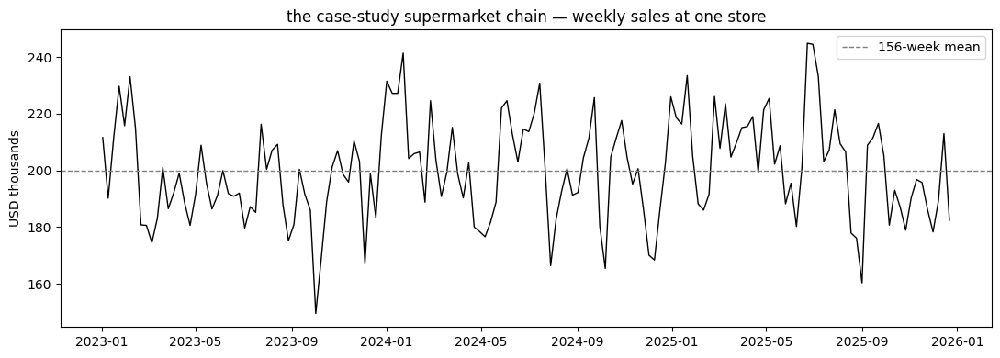

## Solution to Exercise 02 — Constructing lags

Create the first and second sales lags. Count missing values and correlate current sales with each lag.

The first lag loses one row and the second loses two. Pairwise correlations are 0.533 and 0.197.

```python
loja["sales_lag1"] = loja["sales"].shift(1)
loja["sales_lag2"] = loja["sales"].shift(2)
print(loja.head(3))
print()
print("Missing rows:", loja[["sales_lag1", "sales_lag2"]].isna().sum().to_dict())
print(f"Correlation with the previous week: {loja['sales'].corr(loja['sales_lag1']):.3f}")
print(f"Correlation with the two-week lag: {loja['sales'].corr(loja['sales_lag2']):.3f}")
```

```text
                    week  sales  sales_lag1  sales_lag2
0  2023-01-02/2023-01-08  211.6         NaN         NaN
1  2023-01-09/2023-01-15  190.2       211.6         NaN
2  2023-01-16/2023-01-22  211.4       190.2       211.6

Missing rows: {'sales_lag1': 1, 'sales_lag2': 2}
Correlation with the previous week: 0.533
Correlation with the two-week lag: 0.197
```

## Solution to Exercise 03 — Computing autocovariances

Use the full-series mean and denominator T to calculate autocovariances at lags zero through two and autocorrelations at one and two. Check with acf and explain any difference from Exercise 02.

Autocovariances are 314.78, 166.89, and 61.54. Dividing by 314.78 gives 0.530 and 0.195. Pearson correlation centers and scales the available pairs separately.

```python
desvio = loja["sales"] - loja["sales"].mean()
gamas = [(desvio * desvio.shift(k)).sum() / T for k in range(3)]
print("Autocovariances at lags 0, 1, and 2:", np.round(gamas, 2))
print("Autocorrelations at lags 1 and 2, by hand:", np.round([gamas[1] / gamas[0], gamas[2] / gamas[0]], 3))
print("Autocorrelations at lags 1 and 2, using acf:", np.round(acf(loja["sales"], nlags=2)[1:], 3))
```

```text
Autocovariances at lags 0, 1, and 2: [314.78 166.89  61.54]
Autocorrelations at lags 1 and 2, by hand: [0.53  0.195]
Autocorrelations at lags 1 and 2, using acf: [0.53  0.195]
```

## Solution to Exercise 04 — Reading the correlogram

Draw eight lags with the approximate pointwise white-noise band. Which lags suggest a strong week is informative about subsequent sales?

The band is ±0.157. The first two positive bars exceed it. The association fades quickly beyond two weeks.

```python
def correlograma(ax, valores, titulo, lags=8):
    autocorr = acf(valores, nlags=lags)[1:]
    band = 1.96 / np.sqrt(len(valores))
    ax.axhspan(-band, band, color="#E0E0E0")
    ax.bar(range(1, lags + 1), autocorr, color="#595959", width=0.4)
    ax.axhline(0, color="black", linewidth=0.8)
    ax.set_xticks(range(1, lags + 1))
    ax.set_ylim(-1, 1)
    ax.set_title(titulo)
    ax.set_xlabel("Lag")
```

```python
fig, ax = plt.subplots(figsize=(8, 4))
correlograma(ax, loja["sales"], "the case-study supermarket chain — sales correlogram")
ax.set_ylabel("Autocorrelation")
fig.tight_layout()
plt.show()

print(f"Band: ±{1.96 / np.sqrt(T):.3f}")
print(pd.Series(acf(loja["sales"], nlags=8)[1:], index=pd.RangeIndex(1, 9, name="lag"), name="autocorrelation").round(3))
```

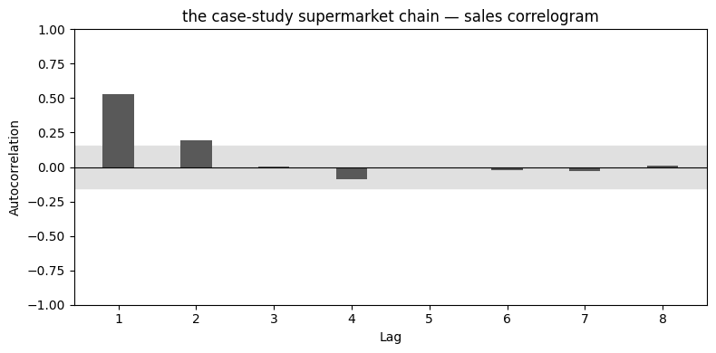

```text
Band: ±0.157
lag
1    0.530
2    0.195
3    0.005
4   -0.088
5   -0.010
6   -0.025
7   -0.029
8    0.010
Name: autocorrelation, dtype: float64
```

## Solution to Exercise 05 — Shuffling the weeks

Use the data generator’s random stream to permute the sales values. Compare the distribution, time plot, and ACF with the original. Explain what changes for a manager forecasting next week.

The mean and standard deviation remain 199.9 and 17.8. The first shuffled autocorrelation is −0.153 and the first six are within the band. Permutation preserves observed values while destroying their original sequence.

```python
embaralhada = loja[["week"]].assign(sales=rng.permutation(loja["sales"].to_numpy()))
print(f"Original — mean {loja['sales'].mean():.1f}; standard deviation {loja['sales'].std():.1f}")
print(f"Shuffled — mean {embaralhada['sales'].mean():.1f}; standard deviation {embaralhada['sales'].std():.1f}")
print("Autocorrelations of shuffled series, 1 through 6:", np.round(acf(embaralhada["sales"], nlags=6)[1:], 3))

fig, axes = plt.subplots(2, 1, figsize=(11, 6), sharex=True, sharey=True)
for ax, dados, titulo in [(axes[0], loja, "Original series"), (axes[1], embaralhada, "Shuffled series")]:
    ax.plot(dados["week"].dt.start_time, dados["sales"], color="black", linewidth=1)
    ax.set_title(titulo)
    ax.set_ylabel("USD thousands")
fig.tight_layout()
plt.show()

fig, axes = plt.subplots(1, 2, figsize=(12, 4), sharey=True)
correlograma(axes[0], loja["sales"], "Original series")
correlograma(axes[1], embaralhada["sales"], "Shuffled series")
axes[0].set_ylabel("Autocorrelation")
fig.tight_layout()
plt.show()
```

```text
Original — mean 199.9; standard deviation 17.8
Shuffled — mean 199.9; standard deviation 17.8
Autocorrelations of shuffled series, 1 through 6: [-0.153 -0.012  0.033  0.024 -0.102  0.037]
```

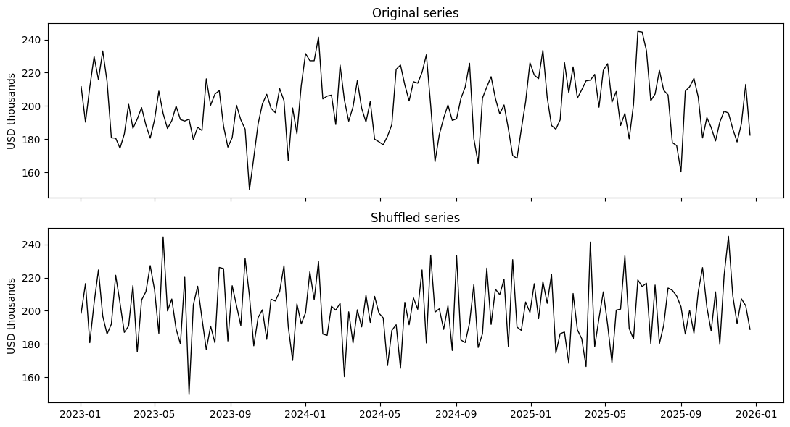

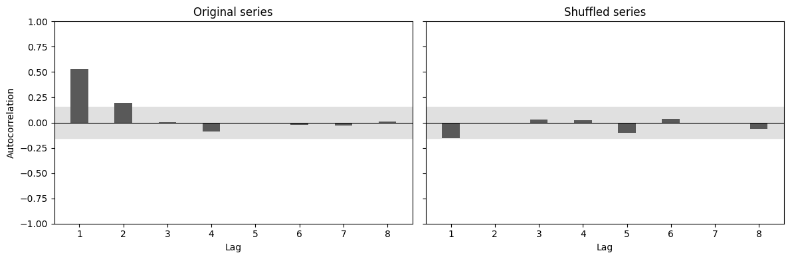

# Solutions 06–12

**Prof. Daniel de Abreu Pereira Uhr**

**Course:** Statistics and Econometrics with Python


Editorial worked solution

The hotel tracks seasonally adjusted monthly room occupancy. Management wants to know how long a negative surprise will affect its booking outlook.

```python
import numpy as np
import pandas as pd
import matplotlib.pyplot as plt
import statsmodels.formula.api as smf
from statsmodels.stats.diagnostic import acorr_ljungbox
from statsmodels.tsa.ar_model import AutoReg
from statsmodels.tsa.stattools import acf

rng = np.random.default_rng(2026)
aquecimento, T = 300, 120

choques = rng.normal(0, 3, size=aquecimento + T)
y = np.empty(aquecimento + T)
y[0] = 70.0
for t in range(1, aquecimento + T):
    y[t] = 14 + 0.8 * y[t - 1] + choques[t]

hotel = pd.DataFrame({
    "mes": pd.period_range("2015-01", periods=T, freq="M"),
    "occupancy": np.round(y[aquecimento:], 1),
})
```

## Solution to Exercise 06 — Monthly occupancy

Plot occupancy over time, draw a 12-lag correlogram, and create the first lag. Describe persistence in this seasonally adjusted series.

Mean occupancy is 69.9%. The first six autocorrelations are 0.778, 0.563, 0.395, 0.249, 0.189, and 0.112. Positive deviations tend to carry over.

```python
def correlograma(ax, valores, titulo, lags=12):
    autocorr = acf(valores, nlags=lags)[1:]
    band = 1.96 / np.sqrt(len(valores))
    ax.axhspan(-band, band, color="#E0E0E0")
    ax.bar(range(1, lags + 1), autocorr, color="#595959", width=0.4)
    ax.axhline(0, color="black", linewidth=0.8)
    ax.set_xticks(range(1, lags + 1))
    ax.set_ylim(-1, 1)
    ax.set_title(titulo)
    ax.set_xlabel("Lag")
```

```python
fig, axes = plt.subplots(1, 2, figsize=(13, 4), gridspec_kw={"width_ratios": [3, 2]})
axes[0].plot(hotel["mes"].dt.start_time, hotel["occupancy"], color="black", linewidth=1)
axes[0].axhline(hotel["occupancy"].mean(), color="#7F7F7F", linestyle="--", linewidth=1, label="120-month mean")
axes[0].set_title("the hotel — monthly occupancy")
axes[0].set_ylabel("% of rooms")
axes[0].legend()
correlograma(axes[1], hotel["occupancy"], "Occupancy correlogram")
fig.tight_layout()
plt.show()

print(f"Occupancy — mean {hotel['occupancy'].mean():.1f}%; minimum {hotel['occupancy'].min()}%; maximum {hotel['occupancy'].max()}%")
print("Autocorrelations 1 through 6:", np.round(acf(hotel["occupancy"], nlags=6)[1:], 3), f"— band ±{1.96 / np.sqrt(T):.3f}")

hotel["occupancy_lag1"] = hotel["occupancy"].shift(1)
```

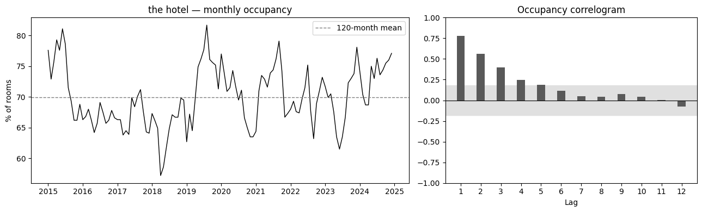

```text
Occupancy — mean 69.9%; minimum 57.2%; maximum 81.7%
Autocorrelations 1 through 6: [0.778 0.563 0.395 0.249 0.189 0.112] — band ±0.179
```

## Solution to Exercise 07 — Estimating an AR(1)

Use OLS with lagged occupancy and fit AutoReg with a constant. Compare coefficients and report the 95% interval for persistence.

Both fits use 119 observations and give an intercept of 14.481 and a lag coefficient of 0.793. Its OLS standard error is 0.056 and interval is 0.681–0.904.

```python
ar1 = smf.ols("occupancy ~ occupancy_lag1", data=hotel).fit()
intervalos = ar1.conf_int()
print(pd.DataFrame({
    "coefficient": ar1.params, "SE": ar1.bse, "CI 2.5%": intervalos[0], "CI 97.5%": intervalos[1],
}).round(3))
print(f"\nMonths used: {int(ar1.nobs)}")
print("AutoReg:", AutoReg(hotel["occupancy"], lags=1).fit().params.round(3).to_dict())
```

```text
                coefficient     SE  CI 2.5%  CI 97.5%
Intercept            14.481  3.933    6.693    22.269
occupancy_lag1        0.793  0.056    0.681     0.904

Months used: 119
AutoReg: {'const': 14.481, 'occupancy.L1': 0.793}
```

## Solution to Exercise 08 — Persistence and half-life

Calculate the fitted long-run mean and half-life. Compare with the generating mechanism and interpret the horizon in months.

The fitted mean is 69.84% versus 70% in the laboratory. Half the impact of an innovation dissipates in about 2.98 months versus 3.11 in the generating model.

```python
c_hat, phi_hat = ar1.params["Intercept"], ar1.params["occupancy_lag1"]
media_longo_prazo = c_hat / (1 - phi_hat)
print(f"Long-run mean: {media_longo_prazo:.2f}% (laboratory: {14 / (1 - 0.8):.0f}%)")
print(f"Half-life: {np.log(0.5) / np.log(phi_hat):.2f} months (laboratory: {np.log(0.5) / np.log(0.8):.2f})")
```

```text
Long-run mean: 69.84% (laboratory: 70%)
Half-life: 2.98 months (laboratory: 3.11)
```

## Solution to Exercise 09 — Residual diagnostics

Examine 12 residual autocorrelations and apply Ljung–Box at 6 and 12 lags with model_df=1. Assess whether one lag captures the linear dependence.

The largest absolute bar is 0.1795 at lag nine against a band of 0.1797. Joint p-values are 0.432 and 0.307. These diagnostics provide little evidence of remaining serial correlation.

```python
fig, ax = plt.subplots(figsize=(8, 4))
correlograma(ax, ar1.resid, "Residuals of AR(1)")
ax.set_ylabel("Autocorrelation")
fig.tight_layout()
plt.show()

autocorr_residuos = acf(ar1.resid, nlags=12)[1:]
print(f"Largest absolute residual autocorrelation: {np.abs(autocorr_residuos).max():.4f} (lag {np.abs(autocorr_residuos).argmax() + 1}); band ±{1.96 / np.sqrt(len(ar1.resid)):.4f}")
print(f"Standard deviation of residuals: {np.sqrt(ar1.scale):.2f} points")
print(acorr_ljungbox(ar1.resid, lags=[6, 12], model_df=1).round(3))
```

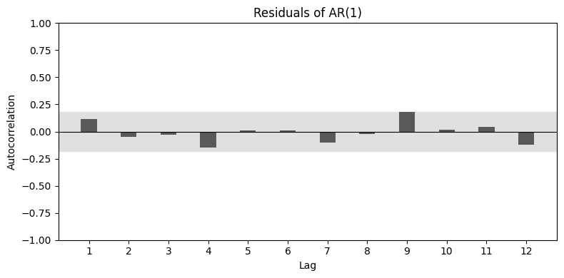

```text
Largest absolute residual autocorrelation: 0.1795 (lag 9); band ±0.1797
Standard deviation of residuals: 2.96 points
    lb_stat  lb_pvalue
6     4.872      0.432
12   12.794      0.307
```

## Solution to Exercise 10 — A canceled convention

Occupancy unexpectedly drops ten percentage points for one month. Calculate how much of the shortfall remains after 1, 3, 6, and 12 months.

Multiply −10 by the fitted persistence raised to each horizon. The expected differences are −7.93, −4.98, −2.48, and −0.62 percentage points.

```python
months = np.array([1, 3, 6, 12])
print(pd.DataFrame({"shock effect (points)": -10 * phi_hat ** months}, index=pd.Index(months, name="months later")).round(2))
```

```text
              shock effect (points)
months later                       
1                             -7.93
3                             -4.98
6                             -2.48
12                            -0.62
```

## Solution to Exercise 11 — Forecasting from December

December 2024 occupancy was 77.1%. Use the AR(1) in deviations from its mean. Report the remaining deviation and expected occupancy after 1, 3, 6, and 12 months.

The initial deviation is 7.26 points. The remaining deviations are 5.76, 3.62, 1.80, and 0.45 points. Expected occupancy is 75.59%, 73.45%, 71.64%, and 70.28%.

```python
ultima = hotel["occupancy"].iloc[-1]
desvio_atual = ultima - media_longo_prazo
print(f"Last month ({hotel['mes'].iloc[-1]}): {ultima}%; deviation from the long-run mean: {desvio_atual:.2f} points")
print(pd.DataFrame({
    "remaining deviation (points)": desvio_atual * phi_hat ** months,
    "expected occupancy (%)": media_longo_prazo + desvio_atual * phi_hat ** months,
}, index=pd.Index(months, name="months ahead")).round(2))
```

```text
Last month (2024-12): 77.1%; deviation from the long-run mean: 7.26 points
              remaining deviation (points)  expected occupancy (%)
months ahead                                                      
1                                     5.76                   75.59
3                                     3.62                   73.45
6                                     1.80                   71.64
12                                    0.45                   70.28
```

## Solution to Exercise 12 — Is a second lag warranted?

Compare AR(2) with AR(1) on common dates. Consider the second lag, residual diagnostics, AIC, and BIC. Recommend a specification.

The second coefficient is −0.132 with p-value 0.153. AIC differs by only 0.1, while BIC favors one lag. Given the AR(1) residual diagnostics, retain the simpler model.

```python
hotel["occupancy_lag2"] = hotel["occupancy"].shift(2)
mesma_amostra = hotel.dropna()
ar1_mesma_amostra = smf.ols("occupancy ~ occupancy_lag1", data=mesma_amostra).fit()
ar2 = smf.ols("occupancy ~ occupancy_lag1 + occupancy_lag2", data=mesma_amostra).fit()
print(pd.DataFrame({"coefficient": ar2.params, "SE": ar2.bse, "p-value": ar2.pvalues}).round(3))
print()
print(pd.DataFrame({
    "AIC": [ar1_mesma_amostra.aic, ar2.aic], "BIC": [ar1_mesma_amostra.bic, ar2.bic],
}, index=["AR(1)", "AR(2)"]).round(1))
```

```text
                coefficient     SE  p-value
Intercept            15.790  4.168    0.000
occupancy_lag1        0.906  0.092    0.000
occupancy_lag2       -0.132  0.092    0.153

         AIC    BIC
AR(1)  592.9  598.4
AR(2)  592.8  601.1
```

# Solutions 13–19

**Prof. Daniel de Abreu Pereira Uhr**

**Course:** Statistics and Econometrics with Python


Editorial worked solution

The economic consultancy advises on wage reviews and hiring plans. Use the historical US quarterly data in data/ch15/macrodata.csv to compare how inflation and unemployment respond to a surprise.

```python
import hashlib

import numpy as np
import pandas as pd
pd.set_option("display.max_columns", None)
pd.set_option("display.width", 150)
import matplotlib.pyplot as plt
import statsmodels.formula.api as smf
from statsmodels.stats.diagnostic import acorr_ljungbox
from statsmodels.tsa.ar_model import AutoReg
from statsmodels.tsa.stattools import acf

caminho = "data/ch15/macrodata.csv"
with open(caminho, "rb") as arquivo:
    print("Checksum matches source note:", hashlib.sha256(arquivo.read()).hexdigest() == "7853fcc0d92a9b89b627cb6eb2d27faf4a00c7515e3b37a9a24001ef597ca8f0")

macro = pd.read_csv(caminho)
macro["quarter"] = pd.PeriodIndex.from_fields(year=macro["year"], quarter=macro["quarter"], freq="Q")
macro = macro.set_index("quarter")[["cpi", "infl", "unemp"]]
print(macro.head(3))
print(macro.tail(3))
```

```text
Checksum matches source note: True
           cpi  infl  unemp
quarter                    
1959Q1   28.98  0.00    5.8
1959Q2   29.15  2.34    5.1
1959Q3   29.35  2.74    5.3
             cpi  infl  unemp
quarter                      
2009Q1   212.671  0.94    8.1
2009Q2   214.469  3.37    9.2
2009Q3   216.385  3.56    9.6
```

## Solution to Exercise 13 — Preparing quarterly data

Check dates, frequency, and record count. Reconstruct annualized inflation as 400 times the log ratio of consecutive CPI observations. Decide how to treat the first quarter and plot both series.

The 203 consecutive quarters run from 1959Q1 to 2009Q3. Starting in 1959Q2 the largest discrepancy is 0.005 percentage points owing to rounding. Drop the initial inflation placeholder and retain the full unemployment series.

```python
print(f"Period: {macro.index[0]} to {macro.index[-1]}; {len(macro)} quarters")
print("Consecutive quarters:", (macro.index == pd.period_range(macro.index[0], periods=len(macro), freq="Q")).all())

recalculada = 400 * np.log(macro["cpi"] / macro["cpi"].shift(1))
print(f"Largest difference between inflation and 400 times the quarterly log CPI change from 1959Q2 onward: {(macro['infl'] - recalculada).iloc[1:].abs().max():.3f}")
print()
print(macro.head(2).assign(recalculada=recalculada.head(2).round(2)))
```

```text
Period: 1959Q1 to 2009Q3; 203 quarters
Consecutive quarters: True
Largest difference between inflation and 400 times the quarterly log CPI change from 1959Q2 onward: 0.005

           cpi  infl  unemp  recalculada
quarter                                 
1959Q1   28.98  0.00    5.8          NaN
1959Q2   29.15  2.34    5.1         2.34
```

```python
inflacao = macro["infl"].iloc[1:]
unemployment = macro["unemp"]

fig, axes = plt.subplots(2, 1, figsize=(11, 6), sharex=True)
for ax, serie, titulo in [(axes[0], inflacao, "Annualized inflation (%)"), (axes[1], unemployment, "Unemployment rate (%)")]:
    ax.plot(serie.index.start_time, serie, color="black", linewidth=1)
    ax.axhline(serie.mean(), color="#7F7F7F", linestyle="--", linewidth=1)
    ax.set_title(titulo)
fig.tight_layout()
plt.show()

print(f"Inflation — mean {inflacao.mean():.2f}%; de {inflacao.min()}% ({inflacao.idxmin()}) to {inflacao.max()}% ({inflacao.idxmax()})")
print(f"Unemployment — mean {unemployment.mean():.2f}%; de {unemployment.min()}% ({unemployment.idxmin()}) to {unemployment.max()}% ({unemployment.idxmax()})")
```

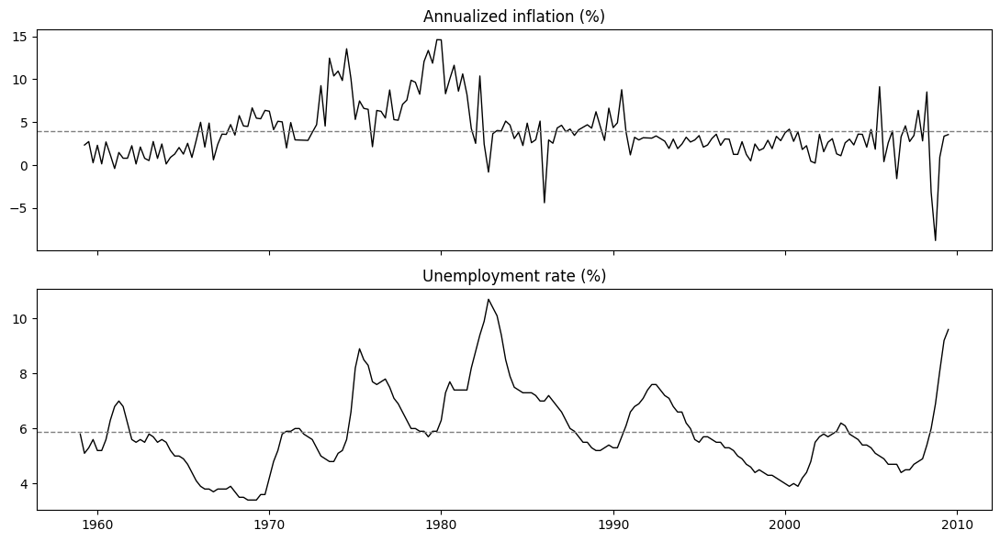

```text
Inflation — mean 3.98%; de -8.79% (2008Q4) to 14.62% (1979Q4)
Unemployment — mean 5.88%; de 3.4% (1968Q4) to 10.7% (1982Q4)
```

## Solution to Exercise 14 — Comparing persistence visually

Plot 12 autocorrelations for inflation and unemployment. Which starts higher and how quickly do the two decay?

Unemployment starts at 0.956 versus 0.644 for inflation and remains above 0.7 through lag four. At lag twelve the correlations are closer, 0.260 and 0.236.

```python
def correlograma(ax, valores, titulo, lags=12):
    autocorr = acf(valores, nlags=lags)[1:]
    band = 1.96 / np.sqrt(len(valores))
    ax.axhspan(-band, band, color="#E0E0E0")
    ax.bar(range(1, lags + 1), autocorr, color="#595959", width=0.4)
    ax.axhline(0, color="black", linewidth=0.8)
    ax.set_xticks(range(1, lags + 1))
    ax.set_ylim(-1, 1)
    ax.set_title(titulo)
    ax.set_xlabel("Lag")
```

```python
fig, axes = plt.subplots(1, 2, figsize=(13, 4), sharey=True)
correlograma(axes[0], inflacao, "Inflation")
correlograma(axes[1], unemployment, "Unemployment")
axes[0].set_ylabel("Autocorrelation")
fig.tight_layout()
plt.show()

print(pd.DataFrame({
    "inflation": acf(inflacao, nlags=12)[1:], "unemployment": acf(unemployment, nlags=12)[1:],
}, index=pd.RangeIndex(1, 13, name="lag")).round(3).T)
print(f"Bands: ±{1.96 / np.sqrt(len(inflacao)):.3f} (inflation) and ±{1.96 / np.sqrt(len(unemployment)):.3f} (unemployment)")
```

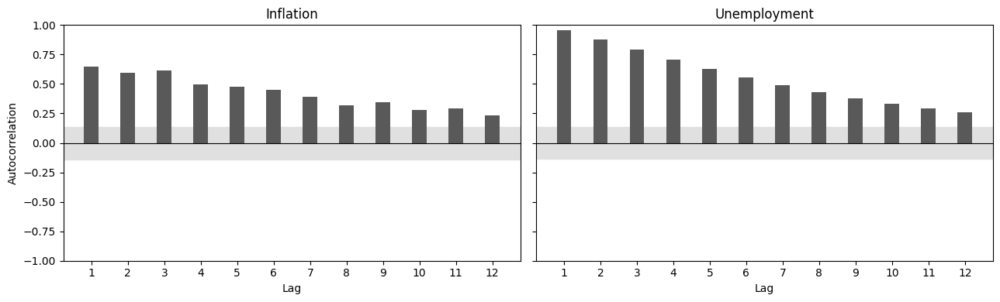

```text
lag              1      2      3      4      5      6      7      8      9      10     11     12
inflation     0.644  0.597  0.614  0.493  0.478  0.450  0.392  0.319  0.347  0.279  0.295  0.236
unemployment  0.956  0.880  0.793  0.706  0.627  0.556  0.491  0.429  0.376  0.332  0.292  0.260
Bands: ±0.138 (inflation) and ±0.138 (unemployment)
```

## Solution to Exercise 15 — First-order models

Fit an AR(1) for each series. Report lag estimates, intervals, and implied half-lives. Examine residual correlograms and joint tests.

Inflation gives 0.644 (0.537–0.751), implying 1.6 quarters. Unemployment gives 0.988 (0.955–1.021), implying 57.6 quarters at the point estimate. Its interval includes one. Both fits leave strong residual dependence, making the half-lives unreliable summaries.

```python
def lags(serie, p):
    tabela = pd.DataFrame({"y": serie})
    for k in range(1, p + 1):
        tabela[f"y_{k}"] = serie.shift(k)
    return tabela


modelos_ar1 = {}
for nome, serie in [("inflation", inflacao), ("unemployment", unemployment)]:
    modelo = smf.ols("y ~ y_1", data=lags(serie, 1)).fit()
    modelos_ar1[nome] = modelo
    phi_hat = modelo.params["y_1"]
    inferior, superior = modelo.conf_int().loc["y_1"]
    print(f"{nome}: persistence {phi_hat:.3f} (SE {modelo.bse['y_1']:.3f}; CI {inferior:.3f} to {superior:.3f}); half-life {np.log(0.5) / np.log(phi_hat):.1f} quarters")
    print(f"   autocorrelations of residuals, 1 through 4: {np.round(acf(modelo.resid, nlags=4)[1:], 3)}")
    print(f"   Ljung–Box, p-values at lags 4 and 8: {acorr_ljungbox(modelo.resid, lags=[4, 8], model_df=1)['lb_pvalue'].round(4).tolist()}")

fig, axes = plt.subplots(1, 2, figsize=(13, 4), sharey=True)
correlograma(axes[0], modelos_ar1["inflation"].resid, "Residuals of AR(1) — inflation")
correlograma(axes[1], modelos_ar1["unemployment"].resid, "Residuals of AR(1) — unemployment")
axes[0].set_ylabel("Autocorrelation")
fig.tight_layout()
plt.show()
```

```text
inflation: persistence 0.644 (SE 0.054; CI 0.537 to 0.751); half-life 1.6 quarters
   autocorrelations of residuals, 1 through 4: [-0.202  0.056  0.284 -0.012]
   Ljung–Box, p-values at lags 4 and 8: [0.0, 0.0]
unemployment: persistence 0.988 (SE 0.017; CI 0.955 to 1.021); half-life 57.6 quarters
   autocorrelations of residuals, 1 through 4: [0.649 0.36  0.182 0.011]
   Ljung–Box, p-values at lags 4 and 8: [0.0, 0.0]
```

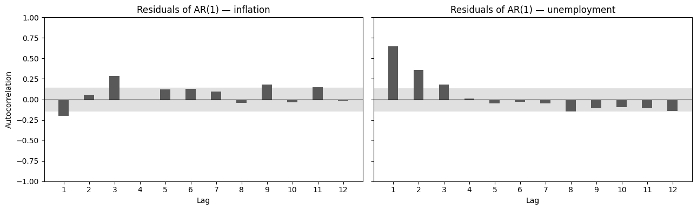

## Solution to Exercise 16 — Additional lags

Fit AR(2) for unemployment and AR(4) for inflation with explicit lags and AutoReg. Examine long-run means and residuals. Compare orders 1–8 on common dates within each series using AIC and BIC.

The two estimation methods agree when windows match. For inflation the four lag coefficients sum to 0.818, implying a mean of 4.09%. The joint residual p-values are 0.254 and 0.256 at lags eight and twelve. Inspect the corresponding unemployment diagnostics and the common-window criteria before selecting an order; the lowest criterion need not occur at the order used for illustration.

```python
ar2_unemployment = smf.ols("y ~ y_1 + y_2", data=lags(unemployment, 2)).fit()
ar4_inflacao = smf.ols("y ~ y_1 + y_2 + y_3 + y_4", data=lags(inflacao, 4)).fit()

for nome, modelo, p, serie in [("Unemployment, AR(2)", ar2_unemployment, 2, unemployment), ("Inflation, AR(4)", ar4_inflacao, 4, inflacao)]:
    soma = modelo.params.iloc[1:].sum()
    print(f"{nome} — {int(modelo.nobs)} quarters")
    print(pd.DataFrame({"coefficient": modelo.params, "SE": modelo.bse}).round(3).T)
    print(f"   AutoReg: {np.round(AutoReg(serie, lags=p).fit().params.to_numpy(), 3)}")
    print(f"   sum of lag coefficients {soma:.3f}; long-run mean {modelo.params['Intercept'] / (1 - soma):.2f}%; standard deviation of residuals {np.sqrt(modelo.scale):.3f}")
    print(f"   autocorrelations of residuals, 1 through 8: {np.round(acf(modelo.resid, nlags=8)[1:], 3)}")
    print(f"   Ljung–Box, p-values at lags 8 and 12: {acorr_ljungbox(modelo.resid, lags=[8, 12], model_df=p)['lb_pvalue'].round(3).tolist()}")
    print()

fig, axes = plt.subplots(1, 2, figsize=(13, 4), sharey=True)
correlograma(axes[0], ar4_inflacao.resid, "Residuals of AR(4) — inflation")
correlograma(axes[1], ar2_unemployment.resid, "Residuals of AR(2) — unemployment")
axes[0].set_ylabel("Autocorrelation")
fig.tight_layout()
plt.show()
```

```text
Unemployment, AR(2) — 201 quarters
             Intercept    y_1    y_2
coefficient      0.249  1.639 -0.680
SE               0.076  0.052  0.053
   AutoReg: [ 0.249  1.639 -0.68 ]
   sum of lag coefficients 0.959; long-run mean 6.14%; standard deviation of residuals 0.253
   autocorrelations of residuals, 1 through 8: [ 0.064 -0.039  0.036 -0.071 -0.049  0.113  0.129 -0.168]
   Ljung–Box, p-values at lags 8 and 12: [0.02, 0.103]

Inflation, AR(4) — 198 quarters
             Intercept    y_1    y_2    y_3    y_4
coefficient      0.742  0.361  0.189  0.294 -0.026
SE               0.290  0.073  0.074  0.073  0.077
   AutoReg: [ 0.742  0.361  0.189  0.294 -0.026]
   sum of lag coefficients 0.818; long-run mean 4.09%; standard deviation of residuals 2.298
   autocorrelations of residuals, 1 through 8: [ 0.002 -0.024 -0.019 -0.042  0.063  0.017  0.037 -0.132]
   Ljung–Box, p-values at lags 8 and 12: [0.254, 0.256]
```

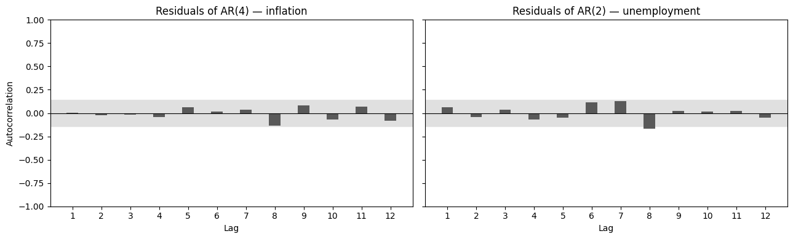

```python
criterios = {}
for nome, serie in [("unemployment", unemployment), ("inflation", inflacao)]:
    tabela = lags(serie, 8).dropna()
    modelos = [smf.ols("y ~ " + " + ".join(f"y_{k}" for k in range(1, p + 1)), data=tabela).fit() for p in range(1, 9)]
    criterios[f"{nome}: AIC"] = [modelo.aic for modelo in modelos]
    criterios[f"{nome}: BIC"] = [modelo.bic for modelo in modelos]
print(f"Quarters in comparison: {len(tabela)} (inflation) and {len(lags(unemployment, 8).dropna())} (unemployment)")
print(pd.DataFrame(criterios, index=[f"AR({p})" for p in range(1, 9)]).round(1))
```

```text
Quarters in comparison: 194 (inflation) and 195 (unemployment)
       unemployment: AIC  unemployment: BIC  inflation: AIC  inflation: BIC
AR(1)              135.0              141.5           909.6           916.1
AR(2)                6.4               16.3           892.6           902.4
AR(3)                7.9               20.9           878.0           891.0
AR(4)                9.8               26.2           879.8           896.2
AR(5)               10.4               30.1           881.0           900.6
AR(6)               11.1               34.0           882.9           905.7
AR(7)               10.0               36.2           884.8           911.0
AR(8)               11.3               40.8           883.5           912.9
```

## Solution to Exercise 17 — Responses to innovations

Recursively compute the response to a one-point shock through 20 quarters, starting at one with zero prehistory. Verify the AR(1) power formula. Compare inflation AR(4) and unemployment AR(2), checking sensitivity to unemployment AR(4).

The unemployment response peaks at 2.20 points in quarter four and first drops below 0.5 in quarter sixteen. AR(4) gives a similar peak of 2.27. Inflation peaks on impact and first falls below 0.5 after one quarter. A first crossing need not imply monotone decay.

```python
def resposta(coefficients, horizonte=20):
    psi = [1.0]
    for h in range(1, horizonte + 1):
        psi.append(sum(phi_j * psi[h - 1 - j] for j, phi_j in enumerate(coefficients) if h - 1 - j >= 0))
    return np.array(psi)


phi_inflacao_ar1 = modelos_ar1["inflation"].params["y_1"]
print("Recursion matches the AR(1) power formula for inflation:", np.allclose(resposta([phi_inflacao_ar1]), phi_inflacao_ar1 ** np.arange(21)))

ar4_unemployment = smf.ols("y ~ y_1 + y_2 + y_3 + y_4", data=lags(unemployment, 4)).fit()
respostas = pd.DataFrame({
    "unemployment, AR(2)": resposta(ar2_unemployment.params.iloc[1:].to_numpy()),
    "unemployment, AR(4)": resposta(ar4_unemployment.params.iloc[1:].to_numpy()),
    "inflation, AR(4)": resposta(ar4_inflacao.params.iloc[1:].to_numpy()),
}, index=pd.RangeIndex(0, 21, name="quarters later"))
print(respostas.iloc[[0, 1, 2, 3, 4, 8, 12, 16, 20]].round(3))
print()
for nome in respostas:
    r = respostas[nome]
    print(f"{nome}: peak response {r.max():.2f}, at quarter {r.idxmax()}; first below one-half in quarter {r[r < 0.5].index.min()}")

fig, ax = plt.subplots(figsize=(10, 4))
for nome, estilo in [("unemployment, AR(2)", "-"), ("unemployment, AR(4)", ":"), ("inflation, AR(4)", "--")]:
    ax.plot(respostas.index, respostas[nome], color="black", linestyle=estilo, label=nome)
ax.axhline(0.5, color="#7F7F7F", linewidth=0.8)
ax.axhline(0, color="black", linewidth=0.6)
ax.set_title("Response to a one-point shock")
ax.set_xlabel("Quarters after the shock")
ax.set_ylabel("Percentage points")
ax.set_xticks(range(0, 21, 2))
ax.legend()
fig.tight_layout()
plt.show()
```

```text
Recursion matches the AR(1) power formula for inflation: True
                unemployment, AR(2)  unemployment, AR(4)  inflation, AR(4)
quarters later                                                            
0                             1.000                1.000             1.000
1                             1.639                1.702             0.361
2                             2.008                2.070             0.319
3                             2.177                2.239             0.478
4                             2.204                2.272             0.313
8                             1.633                1.716             0.219
12                            0.898                0.965             0.146
16                            0.404                0.444             0.095
20                            0.146                0.164             0.062

unemployment, AR(2): peak response 2.20, at quarter 4; first below one-half in quarter 16
unemployment, AR(4): peak response 2.27, at quarter 4; first below one-half in quarter 16
inflation, AR(4): peak response 1.00, at quarter 0; first below one-half in quarter 1
```

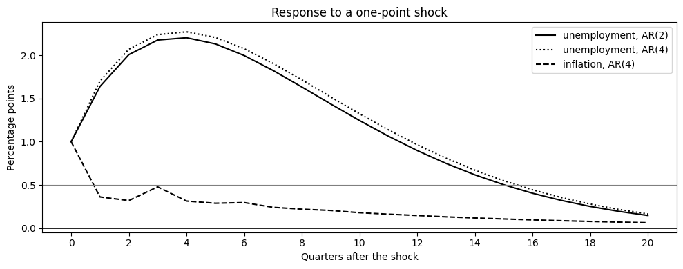

## Solution to Exercise 18 — One-quarter forecasts

Using the last available observations, forecast both series for 2009Q4 under the models in Exercise 16. Verify with AutoReg forecast(1).

The unemployment forecast is 9.73% and annualized inflation is 3.17%. The direct calculations use the most recent lags in reverse chronological order and agree with AutoReg.

```python
for nome, modelo, serie in [("Unemployment", ar2_unemployment, unemployment), ("Inflation", ar4_inflacao, inflacao)]:
    coefficients = modelo.params.iloc[1:].to_numpy()
    p = len(coefficients)
    ultimos = serie.iloc[-p:]
    previsao = modelo.params["Intercept"] + coefficients @ ultimos.to_numpy()[::-1]
    conferencia = AutoReg(serie, lags=p).fit().forecast(1).iloc[0]
    print(f"{nome}: last observations {ultimos.tolist()} ({ultimos.index[0]} to {ultimos.index[-1]})")
    print(f"   forecast for 2009Q4: {previsao:.2f}% (AutoReg: {conferencia:.2f}%)")
```

```text
Unemployment: last observations [9.2, 9.6] (2009Q2 to 2009Q3)
   forecast for 2009Q4: 9.73% (AutoReg: 9.73%)
Inflation: last observations [-8.79, 0.94, 3.37, 3.56] (2008Q4 to 2009Q3)
   forecast for 2009Q4: 3.17% (AutoReg: 3.17%)
```

## Solution to Exercise 19 — Advising the clients

Past inflation informs adjustment scenarios, but the estimated response loses strength rapidly. AR(4) incorporates four lags; that set should not be replaced by the latest quarter alone. An unemployment innovation can build over several quarters, so planning should examine multiyear scenarios.

The projections describe US data through 2009Q3, depend on the selected order, and are subject to parameter uncertainty. The series spans different economic regimes. Unemployment retains residual dependence and high persistence, limiting a mechanical interpretation of its decay horizon. The innovations do not identify the effects of specific policies. The extract contains the vintage available in December 2009; it does not reconstruct what was known at all earlier origins. Hiring or price adjustment decisions require the company’s own indicators and regular scenario reviews.

### Transfer within Exercise 19

A client wants to freeze hiring for the number of quarters suggested by the unemployment response. Explain why that rule is not identified by this model. Specify two company indicators, the data vintages needed to evaluate a historical forecast, and a quarterly review routine.

The innovation is a univariate forecast surprise, not an identified intervention. National unemployment does not determine local staffing needs. Track time to fill vacancies and retention, together with the demand and capacity plan. Reconstruct releases and vintages available at each origin, including publication lags; the supplied revised extract cannot do this. Each quarter, compare the scenario with new releases and the company indicators, document changes, and reassess hiring rather than imposing a fixed freeze.
