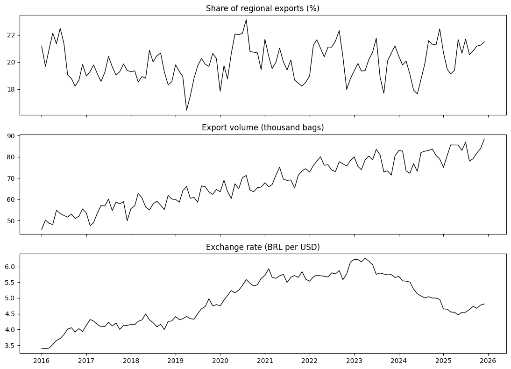
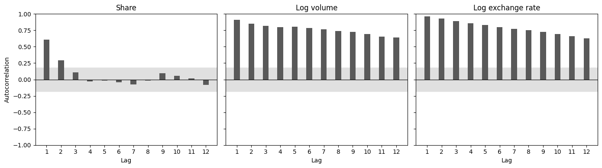
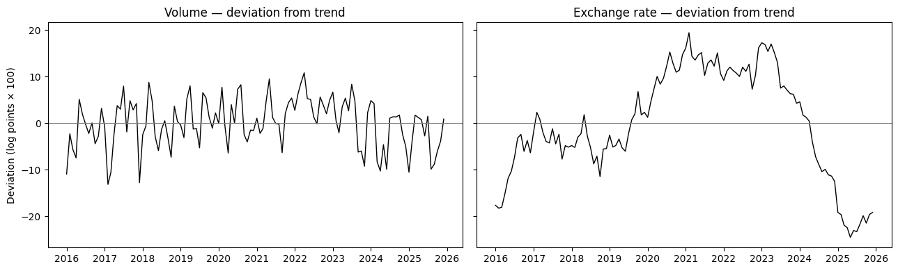
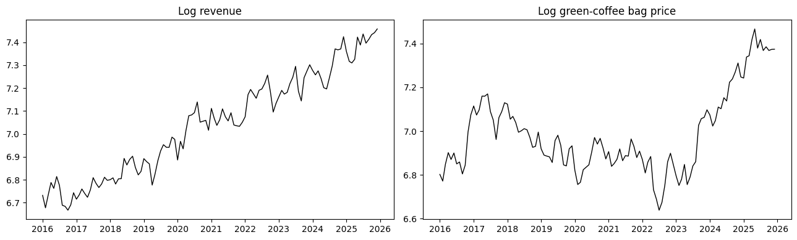
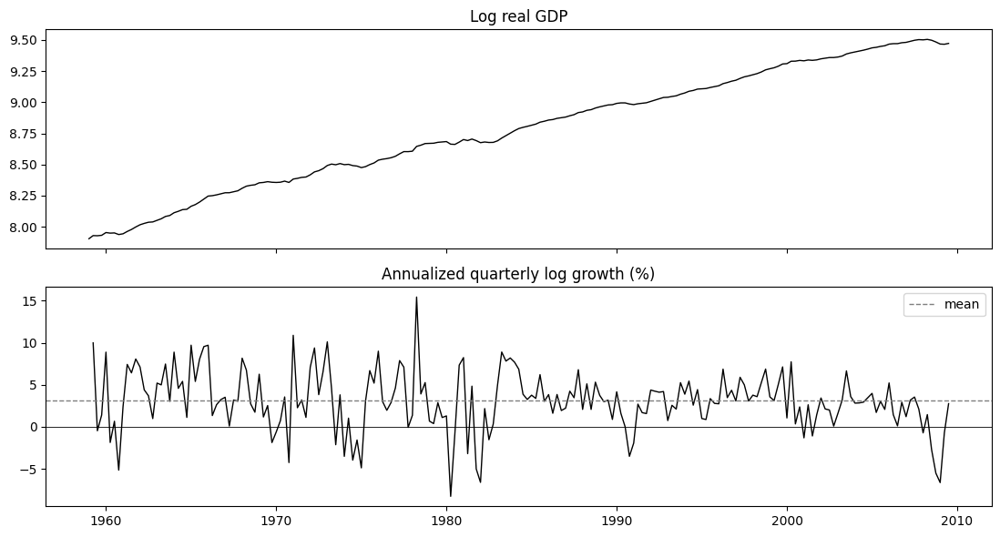
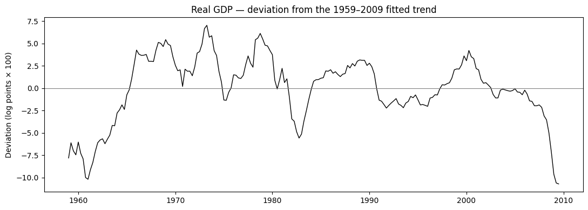

# Chapter 16 — Solutions

[Student notebook](../ch16-student.ipynb) · [exercises](../exercises/ch16.md)

Consult the solutions after attempting the exercises.

# Solutions 01–06

**Prof. Daniel de Abreu Pereira Uhr**

**Course:** Statistics and Econometrics with Python


Editorial worked solution

## The exporter — Brazilian exporter

The company tracks its share of regional exports (%), volume (thousands of 60-kg bags), and exchange rate (BRL per USD), monthly from 2016 to 2025. Data are simulated and mechanisms are visible in the generator. Use laboratory knowledge to evaluate the procedure, while distinguishing it from what an analyst could infer from an unknown path. Both editions retain Brazil and BRL/USD.

```python
import numpy as np
import pandas as pd
import matplotlib.pyplot as plt
import statsmodels.formula.api as smf
from statsmodels.tsa.stattools import acf

rng = np.random.default_rng(2026)
aquecimento, T = 300, 120
months = np.arange(T)


def ar1(persistencia, desvio):
    choques = rng.normal(0, desvio, size=aquecimento + T)
    u = np.zeros(aquecimento + T)
    for t in range(1, aquecimento + T):
        u[t] = persistencia * u[t - 1] + choques[t]
    return u[aquecimento:]


exportadora = pd.DataFrame({
    "mes": pd.period_range("2016-01", periods=T, freq="M"),
    "participacao": np.round(20 + ar1(0.6, 1.0), 2),
    "volume": np.round(np.exp(np.log(50) + 0.005 * months + ar1(0.5, 0.05)), 2),
    "cambio": np.round(np.exp(np.log(3.4) + np.cumsum(np.r_[0, rng.normal(0.0015, 0.025, size=T - 1)])), 3),
})
```

## Solution to Exercise 01 — The graphs

Plot all three series with units and dates. Describe levels, trends, and persistent movements. Which conclusion is descriptive and which requires knowing the generator?

```python
datas = exportadora["mes"].dt.start_time
fig, axes = plt.subplots(3, 1, figsize=(11, 8), sharex=True)
for ax, coluna, titulo in [
    (axes[0], "participacao", "Share of regional exports (%)"),
    (axes[1], "volume", "Export volume (thousand bags)"),
    (axes[2], "cambio", r"Exchange rate (BRL per USD)"),
]:
    ax.plot(datas, exportadora[coluna], color="black", linewidth=1)
    ax.set_title(titulo)
fig.tight_layout()
plt.show()

print(exportadora[["participacao", "volume", "cambio"]].describe().round(2))
```



```text
       participacao  volume  cambio
count        120.00  120.00  120.00
mean          19.98   67.85    4.92
std            1.25   10.95    0.75
min           16.45   45.85    3.39
25%           19.09   58.74    4.27
50%           19.86   67.57    4.87
75%           20.87   77.01    5.66
max           23.12   88.40    6.26
```

Share fluctuates around 20%; volume grows; the exchange rate has prolonged movements. The executed table quantifies levels and dispersion. Knowing the DGP, we can link share to an AR, log volume to a trend with AR deviations, and log exchange rate to a random walk. With an unknown generator, the plots would be descriptive evidence rather than proof of that classification.

## Solution to Exercise 02 — The two halves

Compare means and standard deviations of share, log volume, and log exchange rate across the two halves. Why do similar means not establish stationarity?

```python
series = pd.DataFrame({
    "participacao": exportadora["participacao"],
    "log_volume": np.log(exportadora["volume"]),
    "log_cambio": np.log(exportadora["cambio"]),
})
metades = {"2016–2020": series.iloc[:60], "2021–2025": series.iloc[60:]}
print("Means")
print(pd.DataFrame({nome: parte.mean() for nome, parte in metades.items()}).round(3))
print()
print("Standard deviations")
print(pd.DataFrame({nome: parte.std() for nome, parte in metades.items()}).round(3))
```

```text
Means
              2016–2020  2021–2025
participacao     19.801     20.157
log_volume        4.065      4.343
log_cambio        1.471      1.691

Standard deviations
              2016–2020  2021–2025
participacao      1.272      1.212
log_volume        0.105      0.072
log_cambio        0.124      0.097
```

Share has similar means across halves; the other series have higher mean logs in the second half. Sample statistics fluctuate even under stationarity. Conversely, similar means can occur under nonstationarity. Distinguish the mechanism’s population moments from statistics computed on a finite path.

## Solution to Exercise 03 — The correlograms

Compute ACF through 12 months and highlight 1, 6, and 12. Does the correlogram distinguish a deterministic trend from a unit root? Explain the plotted bands.

```python
def correlograma(ax, valores, titulo, defasagens=12):
    autocorr = acf(valores, nlags=defasagens)[1:]
    faixa = 1.96 / np.sqrt(len(valores))
    ax.axhspan(-faixa, faixa, color="#E0E0E0")
    ax.bar(range(1, defasagens + 1), autocorr, color="#595959", width=0.4)
    ax.axhline(0, color="black", linewidth=0.8)
    ax.set_xticks(range(1, defasagens + 1))
    ax.set_ylim(-1, 1)
    ax.set_title(titulo)
    ax.set_xlabel("Lag")
```

```python
fig, axes = plt.subplots(1, 3, figsize=(14, 4), sharey=True)
for ax, coluna, titulo in [(axes[0], "participacao", "Share"), (axes[1], "log_volume", "Log volume"), (axes[2], "log_cambio", "Log exchange rate")]:
    correlograma(ax, series[coluna], titulo)
axes[0].set_ylabel("Autocorrelation")
fig.tight_layout()
plt.show()

defasagens = [1, 6, 12]
print(pd.DataFrame({coluna: acf(series[coluna], nlags=12)[defasagens] for coluna in series}, index=pd.Index(defasagens, name="defasagem")).round(3))
```



```text
           participacao  log_volume  log_cambio
defasagem                                      
1                 0.611       0.907       0.964
6                -0.041       0.787       0.801
12               -0.079       0.640       0.627
```

Share’s ACF declines; volume and exchange rates remain persistent. These different mechanisms produce visually similar ACFs. Bands are approximate white-noise references, not universal limits for a trending process. Do not choose a treatment from ACF alone.

## Solution to Exercise 04 — Removing the trend

Fit linear trends to log volume and log exchange rate. Compare residuals and ACF at 1, 6, and 12. Identify what 100 times a residual means.

```python
com_tempo = series.assign(tempo=months)
tendencias = {}
for coluna in ["log_volume", "log_cambio"]:
    modelo = smf.ols(f"{coluna} ~ tempo", data=com_tempo).fit()
    tendencias[coluna] = modelo
    print(f"{coluna}: log trend of {100 * modelo.params['tempo']:.2f}% per month; residual autocorrelations at lags 1, 6, and 12: {np.round(acf(modelo.resid, nlags=12)[[1, 6, 12]], 3)}")

fig, axes = plt.subplots(1, 2, figsize=(13, 4), sharey=True)
for ax, coluna, titulo in [(axes[0], "log_volume", "Volume — deviation from trend"), (axes[1], "log_cambio", "Exchange rate — deviation from trend")]:
    ax.plot(datas, 100 * tendencias[coluna].resid, color="black", linewidth=1)
    ax.axhline(0, color="#7F7F7F", linewidth=0.8)
    ax.set_title(titulo)
axes[0].set_ylabel("Deviation (log points × 100)")
fig.tight_layout()
plt.show()
```

```text
log_volume: log trend of 0.45% per month; residual autocorrelations at lags 1, 6, and 12: [ 0.394  0.162 -0.035]
log_cambio: log trend of 0.30% per month; residual autocorrelations at lags 1, 6, and 12: [0.952 0.718 0.395]
```



Volume residuals retain short AR dynamics in this DGP; exchange-rate residuals remain persistent. The line is fitted ex post. One hundred times a residual is a log-point deviation; the exact percentage is 100*expm1(residual). This is neither potential capacity nor proof that a real series would return to the line.

## Solution to Exercise 05 — Shocks and half-lives

Fit AR(1) models to share and log-volume deviations. Compute half-lives and responses at 1, 3, and 6 months to −2 percentage points in share and −10% in volume. Compare with −10% in the exchange rate.

```python
desvios = pd.DataFrame({"participacao": series["participacao"], "desvio_volume": tendencias["log_volume"].resid})
rho_by_series = {}
for coluna in desvios:
    tabela = pd.DataFrame({"y": desvios[coluna], "y_anterior": desvios[coluna].shift(1)})
    persistencia = smf.ols("y ~ y_anterior", data=tabela).fit().params["y_anterior"]
    rho_by_series[coluna] = float(persistencia)
    print(f"{coluna}: persistence {persistencia:.3f}; half-life {np.log(0.5) / np.log(persistencia):.2f} months; remaining shock after 1, 3, and 6 months: {np.round(persistencia ** np.array([1, 3, 6]), 3)}")
h = np.array([1,3,6])
print(pd.DataFrame({"h":h, "share_pp":-2*rho_by_series["participacao"]**h, "volume_exact_pct":100*np.expm1(np.log(.9)*rho_by_series["desvio_volume"]**h)}).round(4).to_string(index=False))
```

```text
participacao: persistence 0.619; half-life 1.44 months; remaining shock after 1, 3, and 6 months: [0.619 0.237 0.056]
desvio_volume: persistence 0.394; half-life 0.75 months; remaining shock after 1, 3, and 6 months: [0.394 0.061 0.004]
 h  share_pp  volume_exact_pct
 1   -1.2373           -4.0709
 3   -0.4736           -0.6446
 6   -0.1121           -0.0397
```

With persistence between zero and one, log(0.5)/log(phi) measures shock half-life on the modeled scale. Share uses −2*phi^h percentage points. Volume uses 100*expm1(log(0.9)*phi^h), not −10*phi^h as an exact equality. In the exchange-rate random walk, the relative decline remains under the same future innovations. These are model-conditional predictions, not a financial policy recommendation.

## Solution to Exercise 06 — Challenge: dispersion across paths

Simulate the prescribed 1,000 paths. Compare dispersion at months 12, 60, and 119 and final exchange-rate percentiles 5/95. Distinguish the band from a confidence interval and a conditional forecast interval.

```python
R = 1_000
choques_volume = rng.normal(0, 0.05, size=(R, aquecimento + T))
desvios_volume = np.zeros((R, aquecimento + T))
for t in range(1, aquecimento + T):
    desvios_volume[:, t] = 0.5 * desvios_volume[:, t - 1] + choques_volume[:, t]
trajetorias_volume = np.log(50) + 0.005 * months + desvios_volume[:, aquecimento:]
trajetorias_cambio = np.log(3.4) + np.cumsum(np.c_[np.zeros(R), rng.normal(0.0015, 0.025, size=(R, T - 1))], axis=1)

marcos = [12, 60, 119]
print("Log standard deviation across 1,000 paths")
print(pd.DataFrame({
    "volume": trajetorias_volume[:, marcos].std(axis=0),
    "exchange rate": trajetorias_cambio[:, marcos].std(axis=0),
}, index=pd.Index(marcos, name="month")).round(3))
inferior, superior = np.exp(np.percentile(trajetorias_cambio[:, -1], [5, 95]))
print(f"\nFinal-month exchange rate — 90% of paths between BRL {inferior:.2f} and BRL {superior:.2f} per USD")
```

```text
Log standard deviation across 1,000 paths
       volume  exchange rate
month                       
12      0.061          0.085
60      0.056          0.189
119     0.056          0.262

Final-month exchange rate — 90% of paths between BRL 2.62 and BRL 6.11 per USD
```

Parameters are known and innovations vary. Volume’s warmed-up AR component has approximately constant marginal log dispersion; the random walk accumulates variance. Percentiles describe the simulated distribution under specified initialization, not confidence limits for a parameter. Level uncertainty includes the exponential transformation; the band does not guarantee coverage for a real company.

# Solutions 07–13

**Prof. Daniel de Abreu Pereira Uhr**

**Course:** Statistics and Econometrics with Python


Editorial worked solution

## The time-series coffee roaster — Coffee roaster

The roaster records monthly revenue (USD thousands) and the price of a 60-kg bag of green coffee (USD), from 2016 to 2025. Data are simulated. The task is to measure growth and develop purchasing scenarios; the data contain no margin, purchased quantity, or inventory policy. Do not invent these values.

```python
import numpy as np
import pandas as pd
import matplotlib.pyplot as plt
import statsmodels.formula.api as smf
from statsmodels.tsa.stattools import acf, adfuller

rng = np.random.default_rng(2026)
aquecimento, T = 300, 120
months = np.arange(T)

choques = rng.normal(0, 0.04, size=aquecimento + T)
u = np.zeros(aquecimento + T)
for t in range(1, aquecimento + T):
    u[t] = 0.6 * u[t - 1] + choques[t]
u = u[aquecimento:]

torrefacao = pd.DataFrame({
    "mes": pd.period_range("2016-01", periods=T, freq="M"),
    "faturamento": np.round(np.exp(np.log(800) + 0.006 * months + u), 1),
    "preco_cafe": np.round(np.exp(np.log(900) + np.cumsum(np.r_[0, rng.normal(0.004, 0.05, size=T - 1)])), 1),
})
```

## Solution to Exercise 07 — Growth rates

Compare monthly log and exact growth and their largest difference. Compute log annualization, compounded annualization, and observed 12-month growth. Identify units and overlapping windows.

```python
logs = np.log(torrefacao[["faturamento", "preco_cafe"]])
crescimento_log = 100 * logs.diff()
crescimento_exato = 100 * torrefacao[["faturamento", "preco_cafe"]].pct_change()
print(pd.DataFrame({
    "monthly mean, log (%)": crescimento_log.mean(),
    "monthly mean, exact (%)": crescimento_exato.mean(),
    "largest difference (pp)": (crescimento_exato - crescimento_log).abs().max(),
    "annualized, 12 × log (%)": 12 * crescimento_log.mean(),
    "12-month log mean (%)": (100 * logs.diff(12)).mean(),
    "monthly standard deviation (%)": crescimento_log.std(),
}).round(2).T)
print("annual_compound_pct", (100*np.expm1(12*logs.diff().mean())).round(3).to_dict())
```

```text
                                faturamento  preco_cafe
monthly mean, log (%)                  0.61        0.48
monthly mean, exact (%)                0.71        0.63
largest difference (pp)                0.57        1.45
annualized, 12 × log (%)               7.32        5.76
12-month log mean (%)                  7.36        5.51
monthly standard deviation (%)         4.37        5.47
annual_compound_pct {'faturamento': 7.599, 'preco_cafe': 5.932}
```

The calculation shows that larger movements widen the difference between log and exact rates. Multiplying mean log growth by 12 gives log annualization; expm1(12*mean) gives the corresponding compounded rate. Mean diff(12) need not be identical because it uses different, overlapping windows. None of these extrapolations is guaranteed future growth.

## Solution to Exercise 08 — Deterministic terms

Examine the logs and justify c or ct before inspecting p-values. Which alternative is relevant? What limitations remain?

```python
datas = torrefacao["mes"].dt.start_time
fig, axes = plt.subplots(1, 2, figsize=(13, 4))
for ax, coluna, titulo in [(axes[0], "faturamento", "Log revenue"), (axes[1], "preco_cafe", "Log green-coffee bag price")]:
    ax.plot(datas, logs[coluna], color="black", linewidth=1)
    ax.set_title(titulo)
fig.tight_layout()
plt.show()
```



We use ct to compare log levels with trend stationarity as the relevant alternative. The choice does not mechanically follow from an upward line: indicator knowledge, intercept, period, and economic hypothesis enter the protocol. Breaks or more complex trends remain possible. Do not choose terms to obtain rejection.

## Solution to Exercise 09 — ADF in logs

Apply ADF with the proposed terms. Record maximum and selected lags, effective n, statistic, p, and critical values; interpret without accepting H0 because it is not rejected.

```python
adf_records = []
def adf(serie, termos):
    values = np.asarray(serie, dtype=float)
    result = adfuller(values, regression=termos, autolag="AIC")
    ntrend = 1 if termos == "c" else 2
    maxlag = min(int(np.ceil(12*(len(values)/100)**0.25)), len(values)//2-ntrend-1)
    record = dict(id=len(adf_records)+1, input_n=len(values), terms=termos,
                  statistic=float(result[0]), p=float(result[1]), lag=int(result[2]),
                  n=int(result[3]), maxlag=maxlag, cv1=result[4]["1%"],
                  cv5=result[4]["5%"], cv10=result[4]["10%"], AIC=float(result[5]))
    adf_records.append(record)
    return {"id":record["id"], "terms":termos, "stat":round(result[0],3),
            "p":f"{result[1]:.3g}", "lag":result[2], "n":result[3]}

def adf_details(count):
    print(pd.DataFrame(adf_records[-count:])[["id","input_n","maxlag","cv1","cv5","cv10","AIC"]].round(3).to_string(index=False))
```

```python
print(pd.DataFrame({
    "faturamento": adf(logs["faturamento"], "ct"),
    "coffee price": adf(logs["preco_cafe"], "ct"),
}).T)
adf_details(2)
```

```text
             id terms   stat         p lag    n
faturamento   1    ct -5.408  3.49e-05   1  118
coffee price  2    ct -1.423     0.854   0  119
 id  input_n  maxlag    cv1    cv5   cv10      AIC
  1      120      13 -4.038 -3.448 -3.149 -384.579
  2      120      13 -4.037 -3.448 -3.149 -318.021
```

In the supplied sample, revenue rejects a unit root with a trend; price does not. Evidence is specification-dependent and power can be low. The solution displays small p-values without rounding them to zero and records effective lags. The price result does not prove that every economic shock has a permanent effect.

## Solution to Exercise 10 — ADF in differences

Test log differences with an intercept. Record lost observations and explain why rejection in differences does not automatically choose the business transformation.

```python
print(pd.DataFrame({
    "revenue log growth": adf(logs["faturamento"].diff().dropna(), "c"),
    "coffee-price log growth": adf(logs["preco_cafe"].diff().dropna(), "c"),
}).T)
adf_details(2)
```

```text
                        id terms   stat         p lag    n
revenue log growth       3     c -6.685  4.24e-09   7  111
coffee-price log growth  4     c -9.915   3.1e-17   0  118
 id  input_n  maxlag    cv1    cv5   cv10      AIC
  3      119      13 -3.491 -2.888 -2.581 -365.986
  4      119      13 -3.487 -2.886 -2.580 -312.491
```

Both differences reject in this sample. That does not make growth and levels the same variable. For price, differencing fits the simulated mechanism; for revenue it also yields stationarity but loses the explicit representation of reversion to trend. The management question determines which object to report.

## Solution to Exercise 11 — Differencing or detrending

Compare ACF at 1, 2, and 12 for detrended log revenue and its differences. Interpret dependence introduced by the transformation.

```python
modelo_tendencia = smf.ols("faturamento ~ tempo", data=logs.assign(tempo=months)).fit()
print(f"Estimated log trend: {100 * modelo_tendencia.params['tempo']:.3f}% per month")
print(pd.DataFrame({
    "trend residuals": acf(modelo_tendencia.resid, nlags=12)[[1, 2, 12]],
    "differences": acf(logs["faturamento"].diff().dropna(), nlags=12)[[1, 2, 12]],
}, index=pd.Index([1, 2, 12], name="defasagem")).round(3))
```

```text
Estimated log trend: 0.627% per month
           trend residuals  differences
defasagem                              
1                    0.597       -0.081
2                    0.272       -0.180
12                  -0.119       -0.160
```

Residuals have positive persistence; differences show negative autocorrelation at some lags. The latter represents growth but does not explicitly retain distance from the path. Observed values vary across samples: the theoretical identity belongs to the DGP and does not force sample ACF to match.

## Solution to Exercise 12 — Shocks and the central path

Compute the remaining exact revenue decline after −20% at 1, 3, 6, and 12 months. For a 20% price increase, calculate the one-year central path using estimated drift. Why is it not automatically the arithmetic mean?

```python
desvios = pd.DataFrame({"y": modelo_tendencia.resid, "y_anterior": modelo_tendencia.resid.shift(1)})
persistencia = smf.ols("y ~ y_anterior", data=desvios).fit().params["y_anterior"]
horizontes = np.array([1, 3, 6, 12])
print(f"Revenue-deviation persistence: {persistencia:.3f}; half-life de {np.log(0.5) / np.log(persistencia):.2f} months")
print("Remaining revenue decline, percent below trend:", np.round(100 * np.expm1(np.log(.8)*persistencia**horizontes), 2))

ultimo_preco = torrefacao["preco_cafe"].iloc[-1]
deriva = logs["preco_cafe"].diff().mean()
preco_apos_choque = 1.2 * ultimo_preco
print(f"\nLast price: USD {ultimo_preco:.1f}; after a 20% increase: USD {preco_apos_choque:.1f}")
print(f"Central path (conditional median under log normality) in one year, with drift of {100 * deriva:.2f}% per month: USD {preco_apos_choque * np.exp(12 * deriva):.1f}")
print(pd.DataFrame({"h":horizontes,"approx_pct":-20*persistencia**horizontes,"exact_pct":100*np.expm1(np.log(.8)*persistencia**horizontes)}).round(4).to_string(index=False))
```

```text
Revenue-deviation persistence: 0.601; half-life de 1.36 months
Remaining revenue decline, percent below trend: [-12.55  -4.73  -1.05  -0.05]

Last price: USD 1593.8; after a 20% increase: USD 1912.6
Central path (conditional median under log normality) in one year, with drift of 0.48% per month: USD 2026.0
 h  approx_pct  exact_pct
 1    -12.0221   -12.5526
 3     -4.3439    -4.7310
 6     -0.9435    -1.0471
12     -0.0445    -0.0496
```

We use log(0.8) as the revenue shock; the table compares exact transformation with the original approximation. For price, multiplying the post-increase level by exp(12*drift) gives a central path and, under Gaussian log innovations with fixed parameters, a conditional median. The mean would require forecast variance. Purchasing and pass-through also depend on missing quantities, margins, and contracts.

## Solution to Exercise 13 — Challenge: specification and sample

Compare the three prespecified tests: c/120 months, ct/120, and ct/36. Interpret sensitivity and power without selecting a preferred test after seeing results.

```python
print(pd.DataFrame({
    "revenue, intercept": adf(logs["faturamento"], "c"),
    "revenue, 120 months, ct": adf(logs["faturamento"], "ct"),
    "revenue, 36 months, ct": adf(logs["faturamento"].iloc[:36], "ct"),
}).T)
adf_details(3)
```

```text
                        id terms   stat         p lag    n
revenue, intercept       5     c  0.436     0.983   8  111
revenue, 120 months, ct  6    ct -5.408  3.49e-05   1  118
revenue, 36 months, ct   7    ct -3.049     0.119   0   35
 id  input_n  maxlag    cv1    cv5   cv10      AIC
  5      120      13 -3.491 -2.888 -2.581 -368.598
  6      120      13 -4.038 -3.448 -3.149 -384.579
  7       36      10 -4.244 -3.544 -3.205 -106.418
```

Omitting the trend and shortening the sample changes the result. The laboratory knows the mechanism, but an analyst must not confuse this advantage with certainty from the data. A sound memo records all tests and samples, retains the initial rationale, and explains why nonrejection may reflect low power.

# Solutions 14–19

**Prof. Daniel de Abreu Pereira Uhr**

**Course:** Statistics and Econometrics with Python


Editorial worked solution

## The economic consultancy — Macroeconomic scenarios

Use the historical macrodata CSV: United States, 1959Q1–2009Q3, 203 quarters. Real GDP is in billions of chained 2005 dollars, seasonally adjusted at an annual rate; annualized inflation and unemployment are percentages. Exclude only the initial inflation value as documented. These are real data used for teaching, not company records or a current forecast. Keep the dados folder when extracting the package.

```python
import hashlib
from pathlib import Path

import numpy as np
import pandas as pd
import matplotlib.pyplot as plt
import statsmodels.formula.api as smf
from statsmodels.tsa.stattools import acf, adfuller

caminho = "data/ch16/macrodata.csv"
with open(caminho, "rb") as arquivo:
    print("File matches source note:", hashlib.sha256(arquivo.read()).hexdigest() == "7853fcc0d92a9b89b627cb6eb2d27faf4a00c7515e3b37a9a24001ef597ca8f0")

macro = pd.read_csv(caminho)
macro["trimestre"] = pd.PeriodIndex.from_fields(year=macro["year"], quarter=macro["quarter"], freq="Q")
macro = macro.set_index("trimestre")[["realgdp", "infl", "unemp"]]
log_pib = np.log(macro["realgdp"])
inflacao = macro["infl"].iloc[1:]
unemployment = macro["unemp"]
print(macro.head(3))
print(macro.tail(3))
assert len(macro)==203 and len(inflacao)==202
assert hashlib.sha256(Path(caminho).read_bytes()).hexdigest()=="7853fcc0d92a9b89b627cb6eb2d27faf4a00c7515e3b37a9a24001ef597ca8f0"
```

```text
File matches source note: True
            realgdp  infl  unemp
trimestre                       
1959Q1     2710.349  0.00    5.8
1959Q2     2778.801  2.34    5.1
1959Q3     2775.488  2.74    5.3
             realgdp  infl  unemp
trimestre                        
2009Q1     12925.410  0.94    8.1
2009Q2     12901.504  3.37    9.2
2009Q3     12990.341  3.56    9.6
```

## Solution to Exercise 14 — GDP growth

Compute annualized quarterly log/exact growth, four-quarter log/exact growth, statistics, and dates of extremes. Explain why annual-rate GDP should not be multiplied by four again.

```python
crescimento = 400 * log_pib.diff().dropna()
crescimento_12m = 100 * log_pib.diff(4).dropna()
print(f"Annualized log growth — mean {crescimento.mean():.2f}%; standard deviation {crescimento.std():.2f}; minimum {crescimento.min():.2f}% ({crescimento.idxmin()}); maximum {crescimento.max():.2f}% ({crescimento.idxmax()})")
print(f"12-month log growth — mean {crescimento_12m.mean():.2f}%; last quarter ({crescimento_12m.index[-1]}): {crescimento_12m.iloc[-1]:.2f}%")

fig, axes = plt.subplots(2, 1, figsize=(11, 6), sharex=True)
axes[0].plot(log_pib.index.start_time, log_pib, color="black", linewidth=1)
axes[0].set_title("Log real GDP")
axes[1].plot(crescimento.index.start_time, crescimento, color="black", linewidth=1)
axes[1].axhline(crescimento.mean(), color="#7F7F7F", linestyle="--", linewidth=1, label="mean")
axes[1].axhline(0, color="black", linewidth=0.6)
axes[1].set_title("Annualized quarterly log growth (%)")
axes[1].legend()
fig.tight_layout()
plt.show()
assert len(crescimento)==202 and len(crescimento_12m)==199
print(pd.DataFrame({"quarterly_annualized_exact_pct":100*np.expm1(4*log_pib.diff()), "four_quarter_exact_pct":100*np.expm1(log_pib.diff(4))}).tail(3).round(4).to_string())
```

```text
Annualized log growth — mean 3.10%; standard deviation 3.52; minimum -8.28% (1980Q2); maximum 15.43% (1978Q2)
12-month log growth — mean 3.11%; last quarter (2009Q3): -2.54%
```



```text
           quarterly_annualized_exact_pct  four_quarter_exact_pct
trimestre                                                        
2009Q1                            -6.4288                 -3.3026
2009Q2                            -0.7378                 -3.8297
2009Q3                             2.7829                 -2.5086
```

The level is already at an annual rate, and ratios between quarterly levels retain growth. Annualizing the rate uses four times the log change or exponential compounding. Four-quarter rates compare levels one year apart. Outputs and dates describe this historical vintage; they are neither forecasts nor current economic updates.

## Solution to Exercise 15 — GDP trend

Fit the trend, calculate log/exact deviations and ACF at 1, 8, and 20. What future information entered the line? Is it correct to call the residual an output gap?

```python
tendencia = smf.ols("log_pib ~ tempo", data=pd.DataFrame({"log_pib": log_pib, "tempo": np.arange(len(log_pib))})).fit()
desvios = 100 * tendencia.resid
print(f"Log trend: {100 * tendencia.params['tempo']:.3f}% per quarter; about {400 * tendencia.params['tempo']:.2f}% per year")
print(f"Deviation ACF at lags 1, 8, and 20: {np.round(acf(desvios, nlags=20)[[1, 8, 20]], 3)}")
print(f"Final-quarter log deviation ({desvios.index[-1]}): {desvios.iloc[-1]:.1f} log points × 100; minimum log deviation: {desvios.min():.1f} log points × 100 ({desvios.idxmin()}); maximum: {desvios.max():.1f} log points × 100 ({desvios.idxmax()})")

fig, ax = plt.subplots(figsize=(11, 4))
ax.plot(desvios.index.start_time, desvios, color="black", linewidth=1)
ax.axhline(0, color="#7F7F7F", linewidth=0.8)
ax.set_title("Real GDP — deviation from the 1959–2009 fitted trend")
ax.set_ylabel("Deviation (log points × 100)")
fig.tight_layout()
plt.show()
print("final_log_deviation",float(desvios.iloc[-1]))
print("final_exact_deviation_pct",float(100*np.expm1(tendencia.resid.iloc[-1])))
```

```text
Log trend: 0.790% per quarter; about 3.16% per year
Deviation ACF at lags 1, 8, and 20: [ 0.939  0.421 -0.028]
Final-quarter log deviation (2009Q3): -10.7 log points × 100; minimum log deviation: -10.7 log points × 100 (2009Q3); maximum: 7.0 log points × 100 (1973Q2)
```



```text
final_log_deviation -10.70826202216768
final_exact_deviation_pct -10.154856033335017
```

The line uses all 203 quarters, including observations later than each intermediate date. The residual is not a measure of potential output. The final log deviation differs in magnitude from its exact percentage counterpart; both are computed. Persistent deviations diagnose a specification rather than identify a recession’s causal response.

## Solution to Exercise 16 — A unit root in GDP

Compare ADF for log GDP with ct and for growth with c. Write a conclusion that does not turn nonrejection into proof of a permanent loss.

```python
adf_records = []
def adf(serie, termos):
    values = np.asarray(serie, dtype=float)
    result = adfuller(values, regression=termos, autolag="AIC")
    ntrend = 1 if termos == "c" else 2
    maxlag = min(int(np.ceil(12*(len(values)/100)**0.25)), len(values)//2-ntrend-1)
    record = dict(id=len(adf_records)+1, input_n=len(values), terms=termos,
                  statistic=float(result[0]), p=float(result[1]), lag=int(result[2]),
                  n=int(result[3]), maxlag=maxlag, cv1=result[4]["1%"],
                  cv5=result[4]["5%"], cv10=result[4]["10%"], AIC=float(result[5]))
    adf_records.append(record)
    return {"id":record["id"], "terms":termos, "stat":round(result[0],3),
            "p":f"{result[1]:.3g}", "lag":result[2], "n":result[3]}

def adf_details(count):
    print(pd.DataFrame(adf_records[-count:])[["id","input_n","maxlag","cv1","cv5","cv10","AIC"]].round(3).to_string(index=False))
```

```python
print(pd.DataFrame({
    "log GDP": adf(log_pib, "ct"),
    "annualized log growth": adf(crescimento, "c"),
}).T)
adf_details(2)
```

```text
                      id terms   stat         p lag    n
log GDP                1    ct -2.383     0.389   2  200
annualized log growth  2     c -6.973  8.58e-10   1  200
 id  input_n  maxlag    cv1    cv5   cv10       AIC
  1      203      15 -4.005 -3.433 -3.140 -1279.782
  2      202      15 -3.463 -2.876 -2.575   967.385
```

The specified test does not reject a unit root in log GDP and rejects in growth. The combination is consistent with first-order integration, but low power, breaks, and deterministic specifications limit the conclusion. It does not prove that the economy never returns to a path or identify the causal effect of a particular recession.

## Solution to Exercise 17 — Unemployment and inflation

Apply ADF with an intercept to both series. Explain initial inflation treatment, the limits of the bounded-rate argument, and the connection with Chapter 15.

```python
print(pd.DataFrame({
    "unemployment": adf(unemployment, "c"),
    "inflation": adf(inflacao, "c"),
}).T)
adf_details(2)
```

```text
             id terms   stat      p lag    n
unemployment  3     c -2.536  0.107   9  193
inflation     4     c -3.093  0.027   2  199
 id  input_n  maxlag    cv1    cv5   cv10     AIC
  3      203      15 -3.465 -2.877 -2.575   4.767
  4      202      15 -3.464 -2.876 -2.575 848.461
```

Initial inflation is excluded as documented; unemployment retains 203 rows. In the source sample, inflation rejects at 5% and unemployment does not. A bounded rate can undergo regime changes and need not be stationary. Summing AR(p) coefficients does not replace root analysis. Diagnosis should follow the dynamics, not a rule of accepting H0.

## Solution to Exercise 18 — Memo and business transfer

Write a memo for the economic consultancy: recovery scenarios and limits for hiring. Separate expansion, replacement, and existing vacancies; list required data and a review trigger. Do not invent a headcount.

Example: do not assume a guaranteed return to the fitted line; compare paths from the observed level and document the recovery hypothesis, vintage, and possible breaks. Before deciding vacancies, request contracted demand, productivity, hours, capacity, turnover, open positions, wages, and recruitment lead times. Define an observable review trigger with management, such as a documented change in the pipeline or assumptions, without inventing a numerical threshold. GDP does not directly identify company employment.

## Solution to Exercise 19 — Challenge: a spurious relationship

Reproduce the prespecified independent random walk and regressions in levels, with HAC, and in growth. Interpret R² and tests, distinguishing this experiment from a cointegration investigation.

```python
rng = np.random.default_rng(2026)
serie_independente = np.cumsum(rng.normal(0.008, 0.02, size=len(log_pib)))
dados = pd.DataFrame({"log_pib": log_pib.to_numpy(), "independente": serie_independente})

nivel = smf.ols("log_pib ~ independente", data=dados).fit()
nivel_hac = smf.ols("log_pib ~ independente", data=dados).fit(cov_type="HAC", cov_kwds={"maxlags": 4})
crescimentos = 400 * dados.diff().dropna()
em_crescimento = smf.ols("log_pib ~ independente", data=crescimentos).fit()

print(f"In levels: R² {nivel.rsquared:.3f}; slope {nivel.params['independente']:.3f}; t {nivel.tvalues['independente']:.1f} (HAC: {nivel_hac.tvalues['independente']:.1f})")
print(f"In growth: R² {em_crescimento.rsquared:.4f}; slope {em_crescimento.params['independente']:.3f}; t {em_crescimento.tvalues['independente']:.2f}; p-value {em_crescimento.pvalues['independente']:.3f}")
```

```text
In levels: R² 0.982; slope 0.832; t 106.1 (HAC: 53.9)
In growth: R² 0.0012; slope 0.014; t 0.48; p-value 0.629
```

The strong level relationship comes from an independent simulated path combined with historical GDP; HAC does not fix the problem. In growth, the association is small in this realization. The experiment neither proves that every level relationship is false nor tests cointegration. Require economic grounding and appropriate dynamics before using a fit in a business decision.
