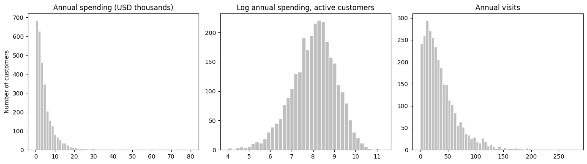
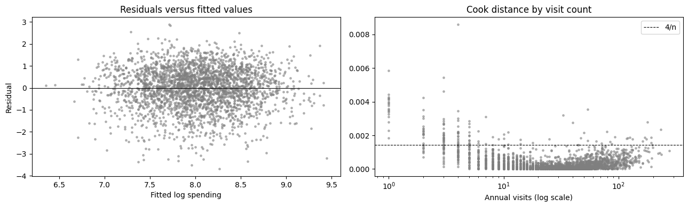
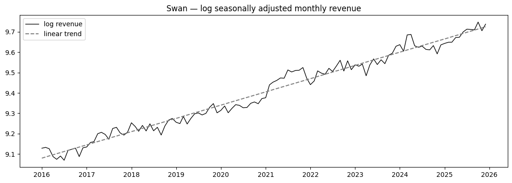

# Chapter 17 — Solutions

[Student notebook](../ch17-student.ipynb) · [exercises](../exercises/ch17.md)

Consult the solutions after attempting the exercises.

# Commented solution — Final project

**Prof. Daniel de Abreu Pereira Uhr**

**Course:** Statistics and Econometrics with Python


Editorial worked solution

This reference provides a second reading of the Swan project. A different recommendation may be defensible. Compare questions, samples, assumptions, and evidence before comparing conclusions. Sections 0–12 use information available to the analyst; Section 13 reveals the mechanism known only in the laboratory.

## 0. Data

We verify integrity before loading. A hash mismatch stops execution; transformations do not alter the CSV files.

```python
import hashlib
from pathlib import Path
import numpy as np
import pandas as pd

pasta = Path("data/ch17")
esperados = {'customers_swan.csv': '55ab66e43714208b571c7c451e028051dfb23343c23747083125c4a3bb51a231', 'monthly_revenue_swan.csv': '19fabb9bde915d21a1efddaa46730594c82c59924f76e928e5c035751e0fdf23'}
for arquivo, sha in esperados.items():
    actual = hashlib.sha256((pasta / arquivo).read_bytes()).hexdigest()
    if actual != sha:
        raise ValueError("SHA-256 mismatch: " + arquivo)
    print(arquivo, "SHA-256 OK")
clientes = pd.read_csv(pasta / "customers_swan.csv")
receita = pd.read_csv(pasta / "monthly_revenue_swan.csv")
clientes["store"] = pd.Categorical(clientes["store"], categories=['Downtown', 'East', 'North', 'West', 'South'])
clientes["signup_channel"] = pd.Categorical(clientes["signup_channel"], categories=['app', 'store', 'website'])

pd.set_option("display.max_columns", None)
pd.set_option("display.width", 88)
import matplotlib.pyplot as plt
import statsmodels.formula.api as smf
from statsmodels.tsa.stattools import acf, adfuller

def reais(valor):
    return "USD " + f"{valor:,.0f}"
```

```text
customers_swan.csv SHA-256 OK
monthly_revenue_swan.csv SHA-256 OK
```

## 1. Objective and questions

Marketing considers app adoption; commercial management considers coupon expansion; finance requests a description of revenue. P1 compares observed choices. P2 evaluates randomized assignment of an offer. The extension uses another unit: a month of chain revenue. We do not use aggregate performance to attribute effects to coupons.

The observed outcome is card-identified purchases during 2025. Changes in recording may accompany changes in purchases but do not automatically measure all customer consumption.

## 2. Understanding the data

We check units, categories, period, and variable origins. The summary describes the sample, not the market.

```python
print(f"Customers: {len(clientes)}; unique identifiers: {clientes['customer_id'].is_unique}")
print(clientes.describe().round(2).T)
print()
print("Stores:", clientes["store"].value_counts().to_dict())
print("Signup channel:", clientes["signup_channel"].value_counts().to_dict())
print(f"App use: {clientes['uses_app'].mean():.1%}; assigned coupons: {clientes['coupon'].mean():.1%}; renewed: {clientes['renewed'].mean():.1%}")
```

```text
Customers: 3000; unique identifiers: True
                   count     mean      std   min     25%      50%      75%       max
age               3000.0    45.53    13.63  18.0    36.0    46.00    55.00     85.00
household_income  2877.0     6.02     3.98   0.4     3.2     5.10     7.60     44.20
distance_km       3000.0     4.07     3.73   0.2     1.7     3.00     5.10     30.00
uses_app          3000.0     0.53     0.50   0.0     0.0     1.00     1.00      1.00
coupon            3000.0     0.49     0.50   0.0     0.0     0.00     1.00      1.00
visits            3000.0    36.62    32.37   0.0    14.0    28.00    50.00    276.00
annual_spend      3000.0  4767.65  5389.96   0.0  1459.6  3132.57  6018.41  80087.16
renewed           3000.0     0.70     0.46   0.0     0.0     1.00     1.00      1.00

Stores: {'Downtown': 733, 'North': 628, 'East': 609, 'South': 580, 'West': 450}
Signup channel: {'store': 1253, 'app': 967, 'website': 780}
App use: 52.8%; assigned coupons: 49.2%; renewed: 70.4%
```

There are 3,000 customers with unique IDs. Store, distance, income, and channel come from registration; age describes the customer; app use is a choice in 2025. Coupons were assigned before outcomes. Visits, spending, and renewal are outcomes.

The coupon fraction is 49.2%, consistent with independent assignments at probability 1/2; exactly 1,500 per group were not required. About 52.8% used the app and 70.4% renewed. These proportions do not yet answer the comparisons.

## 3. Data quality

We investigate missingness, zeros, extremes, and consistency, recording affected observations before choosing treatments.

```python
faixas_idade = pd.cut(clientes["age"], [17, 35, 50, 65, 85])
print(f"Unreported income: {clientes['household_income'].isna().sum()} customers ({clientes['household_income'].isna().mean():.1%})")
print("Missing-income fraction by age group:", clientes.groupby(faixas_idade, observed=True)["household_income"].apply(lambda s: s.isna().mean()).round(3).to_dict())

sem_visitas = clientes["visits"] == 0
print(f"\nCustomers with zero visits: {sem_visitas.sum()}; zero spending for exactly these customers: {((clientes['annual_spend'] == 0) == sem_visitas).all()}")

ticket = clientes["annual_spend"] / clientes["visits"].where(clientes["visits"] > 0)
print(f"\nMean ticket per purchase (USD) — median {ticket.median():.0f}; percentile 99 {ticket.quantile(0.99):.0f}; percentilee 99.5 {ticket.quantile(0.995):.0f}; maximum {ticket.max():.0f}")
print(f"Customers with ticket above USD 400: {(ticket > 400).sum()}")
print(clientes.assign(ticket=ticket.round(0)).nlargest(5, "ticket")[["customer_id", "household_income", "visits", "annual_spend", "ticket"]])
```

```text
Unreported income: 123 customers (4.1%)
Missing-income fraction by age group: {Interval(17, 35, closed='right'): 0.021, Interval(35, 50, closed='right'): 0.035, Interval(50, 65, closed='right'): 0.061, Interval(65, 85, closed='right'): 0.063}

Customers with zero visits: 100; zero spending for exactly these customers: True

Mean ticket per purchase (USD) — median 117; percentile 99 344; percentilee 99.5 432; maximum 1220
Customers with ticket above USD 400: 18
     customer_id  household_income  visits  annual_spend  ticket
1427       M1428               5.4      33      40243.52  1220.0
857        M0858               7.4       9       9047.54  1005.0
430        M0431               8.8      17      16031.00   943.0
2542       M2543              14.0      35      30875.68   882.0
1336       M1337              11.0      47      37799.18   804.0
```

Income is missing for 123 customers (4.1%); missingness increases with age. This association challenges missing completely at random but does not alone distinguish MAR from MNAR. P1 uses reported income in the reference. Median imputation with an indicator will be sensitivity analysis, not a guarantee of recovering a complete-data result.

One hundred customers have zero visits and spending. Logging P1 spending requires restricting to active customers and changes the population described. In P2, coupons may change activity: excluding inactive customers would select on a subsequent outcome. They remain in the main comparison.

There are 18 tickets above USD 400 overall, plausible given small-business purchases. An extreme does not prove error. The reference retains all; sensitivity analysis records exclusions and the affected sample.

## 4. Outcome variables

The scale should serve the question. We examine spending, its log among active customers, and visits before relating them to coupons.

```python
ativos = clientes["annual_spend"] > 0
fig, axes = plt.subplots(1, 3, figsize=(14, 4))
axes[0].hist(clientes["annual_spend"] / 1000, bins=60, color="#BFBFBF", edgecolor="white")
axes[0].set_title("Annual spending (USD thousands)")
axes[1].hist(np.log(clientes.loc[ativos, "annual_spend"]), bins=40, color="#BFBFBF", edgecolor="white")
axes[1].set_title("Log annual spending, active customers")
axes[2].hist(clientes["visits"], bins=np.arange(0, 281, 5), color="#BFBFBF", edgecolor="white")
axes[2].set_title("Annual visits")
axes[0].set_ylabel("Number of customers")
fig.tight_layout()
plt.show()

print(f"Spending — mean {reais(clientes['annual_spend'].mean())}; median {reais(clientes['annual_spend'].median())}")
print(f"Visits — mean {clientes['visits'].mean():.1f}; variance {clientes['visits'].var():.1f}; ratio {clientes['visits'].var() / clientes['visits'].mean():.1f}")
print(f"Renewal: {clientes['renewed'].mean():.1%}")
```



```text
Spending — mean USD 4,768; median USD 3,133
Visits — mean 36.6; variance 1048.1; ratio 28.6
Renewal: 70.4%
```

Spending is skewed: mean USD 4,768 and median USD 3,133. Logs facilitate proportional comparisons among active customers but do not replace dollars in business calculations. Visits have mean 36.6 and variance 1,048.1: marginal dispersion requires attention to inference without proving a conditional distribution. Renewal is binary.

We use OLS/HC1 for spending and the linear renewal comparison, and Poisson/HC1 for visits. Negative binomial and Logit are previously studied alternatives with usual covariance explicitly identified.

## 5. P1 — Specification and estimation

We compare profiles. Spending differences accompany age, income, distance, and channel; the raw comparison does not isolate the consequence of use.

```python
print(clientes.assign(app_signup=(clientes["signup_channel"] == "app").astype(int))
      .groupby("uses_app")[["annual_spend", "visits", "age", "household_income", "distance_km", "app_signup"]].mean().round(2))
```

```text
          annual_spend  visits    age  household_income  distance_km  app_signup
uses_app                                                                        
0              3770.77   30.34  49.06              5.87         4.11        0.16
1              5657.61   42.22  42.38              6.14         4.04        0.47
```

Users spend an average USD 5,658 versus USD 3,771 and are younger. The reference compares log spending among active customers with reported income, adjusting for app use, log income, age, log distance, and store, with Downtown as reference. Income approximates purchasing capacity; age and distance describe habits and access; store captures differences across locations. These justify adjustment, not absence of confounding.

$$
E[\log G_i\mid A_i,X_i]=\alpha+\beta A_i+\gamma\log R_i+\delta H_i+\eta\log D_i+\sum_{s\ne 0}\lambda_s I_{is}.
$$

$G_i$ is spending, $A_i$ indicates app use, $R_i$ is monthly income, $H_i$ age, $D_i$ distance, and $I_{is}$ indicates store; $X_i$ collects controls. The sum represents indicators. The exponentiated comparison is:

$$
100[\exp(\hat\beta)-1].
$$

It compares conditional geometric means under the specification, not automatically arithmetic means. Visits are excluded because they may follow use; channel enters an alternative, without claiming that its exclusion from the reference proves irrelevance.

```python
p1 = clientes[ativos & clientes["household_income"].notna()].assign(
    log_spend=lambda d: np.log(d["annual_spend"]),
    log_income=lambda d: np.log(d["household_income"]),
    log_dist=lambda d: np.log(d["distance_km"]),
)
formula_referencia = "log_spend ~ uses_app + log_income + age + log_dist + C(store)"
referencia = smf.ols(formula_referencia, data=p1).fit(cov_type="HC1")
intervalos = referencia.conf_int()
print(pd.DataFrame({"coefficient": referencia.params, "SE (HC1)": referencia.bse, "CI 2.5%": intervalos[0], "CI 97.5%": intervalos[1]}).round(3))
print(f"\nCustomers: {int(referencia.nobs)}; R² {referencia.rsquared:.3f}")
b, (inferior, superior) = referencia.params["uses_app"], intervalos.loc["uses_app"]
print(f"App use: {100 * (np.exp(b) - 1):.1f}% geometrically (CI {100 * (np.exp(inferior) - 1):.1f}% to {100 * (np.exp(superior) - 1):.1f}%)")
```

```text
                   coefficient  SE (HC1)  CI 2.5%  CI 97.5%
Intercept                7.218     0.090    7.042     7.393
C(store)[T.East]        -0.089     0.052   -0.191     0.013
C(store)[T.North]       -0.121     0.053   -0.225    -0.017
C(store)[T.West]        -0.011     0.058   -0.125     0.102
C(store)[T.South]        0.061     0.055   -0.047     0.169
uses_app                 0.454     0.037    0.382     0.525
log_income               0.454     0.029    0.397     0.511
age                      0.005     0.001    0.003     0.008
log_dist                -0.354     0.022   -0.397    -0.310

Customers: 2780; R² 0.204
App use: 57.4% geometrically (CI 46.5% to 69.1%)
```

There are 2,780 customers. The app coefficient is 0.454, HC1 SE 0.037, and interval 0.382–0.525. Transformation yields 57.4%, CI 46.5%–69.1%, for the conditional geometric comparison. This is not a campaign revenue forecast.

Income and distance describe conditional elasticities of the modeled quantity; age has a semi-elasticity. About 20% of sample log variation is explained. This does not identify a causal app effect.

## 6. P1 — Diagnostics and robustness

We inspect residuals and influence, then alternatives with their samples. Diagnostics guide investigation, not automatic deletion.

```python
modelo_usual = smf.ols(formula_referencia, data=p1).fit()
influencia = modelo_usual.get_influence()
cook = pd.Series(influencia.cooks_distance[0], index=p1.index)
print(f"App standard error — usual {modelo_usual.bse['uses_app']:.4f}; HC1 {referencia.bse['uses_app']:.4f}")
print(f"Customers with Cook distance above 4/n: {(cook > 4 / len(p1)).sum()}")
print(p1.loc[cook.nlargest(5).index, ["customer_id", "visits", "annual_spend"]].assign(cook=cook.nlargest(5).round(4)))

fig, axes = plt.subplots(1, 2, figsize=(13, 4))
axes[0].scatter(modelo_usual.fittedvalues, modelo_usual.resid, s=6, color="#7F7F7F", alpha=0.5)
axes[0].axhline(0, color="black", linewidth=0.8)
axes[0].set_title("Residuals versus fitted values")
axes[0].set_xlabel("Fitted log spending")
axes[0].set_ylabel("Residual")
axes[1].scatter(p1["visits"], cook, s=6, color="#7F7F7F", alpha=0.5)
axes[1].axhline(4 / len(p1), color="black", linestyle="--", linewidth=0.8, label="4/n")
axes[1].set_xscale("log")
axes[1].set_title("Cook distance by visit count")
axes[1].set_xlabel("Annual visits (log scale)")
axes[1].legend()
fig.tight_layout()
plt.show()
```

```text
App standard error — usual 0.0366; HC1 0.0367
Customers with Cook distance above 4/n: 131
     customer_id  visits  annual_spend    cook
1626       M1627       4        513.60  0.0086
1256       M1257       1         86.19  0.0058
2366       M2367       3        188.37  0.0054
538        M0539       3        338.54  0.0046
702        M0703       1        127.24  0.0044
```



Usual and HC1 SEs are close: 0.0366 and 0.0367. Similarity for one coefficient does not prove homoskedasticity. The lower residual tail and customers with few purchases deserve attention.

Cook 4/n flags 131 observations. This is screening, not proof that no observation changes the conclusion. The next table evaluates specific alternatives, not individual deletion of every influential case.

```python
todos_ativos = clientes[ativos].assign(
    log_spend=lambda d: np.log(d["annual_spend"]),
    log_dist=lambda d: np.log(d["distance_km"]),
    income_missing=lambda d: d["household_income"].isna().astype(int),
    log_income=lambda d: np.log(d["household_income"].fillna(d["household_income"].median())),
)
tiquete_p1 = p1["annual_spend"] / p1["visits"]
alternativas = {
    "unadjusted": ("log_spend ~ uses_app", p1),
    "reference": (formula_referencia, p1),
    "+ signup channel": (formula_referencia + " + C(signup_channel)", p1),
    "linear distance": ("log_spend ~ uses_app + log_income + age + distance_km + C(store)", p1),
    "missing-income indicator": ("log_spend ~ uses_app + log_income + income_missing + age + log_dist + C(store)", todos_ativos),
    "excluding tickets above USD 400": (formula_referencia, p1[tiquete_p1 <= 400]),
    "+ log visits (different question)": (formula_referencia + " + np.log(visits)", p1),
}
linhas = {}
for nome, (formula, dados) in alternativas.items():
    modelo = smf.ols(formula, data=dados).fit(cov_type="HC1")
    inferior, superior = modelo.conf_int().loc["uses_app"]
    linhas[nome] = {"coefficient": modelo.params["uses_app"], "CI 2.5%": inferior, "CI 97.5%": superior,
                    "geometric association (%)": 100 * (np.exp(modelo.params["uses_app"]) - 1), "customers": int(modelo.nobs)}
print(pd.DataFrame(linhas).T.round(3))

nivel = smf.ols("annual_spend ~ uses_app + np.log(household_income) + age + np.log(distance_km) + C(store)",
                data=clientes.dropna(subset=["household_income"])).fit(cov_type="HC1")
inferior, superior = nivel.conf_int().loc["uses_app"]
media_sem_app = clientes.loc[clientes["uses_app"] == 0, "annual_spend"].mean()
print(f"\nSpending in USD including zeros: app +{reais(nivel.params['uses_app'])} (CI {reais(inferior)} to {reais(superior)}); mean among nonusers: {reais(media_sem_app)}")
```

```text
                                   coefficient  CI 2.5%  CI 97.5%  \
unadjusted                               0.439    0.363     0.515   
reference                                0.454    0.382     0.525   
+ signup channel                         0.464    0.389     0.538   
linear distance                          0.448    0.376     0.521   
missing-income indicator                 0.449    0.379     0.520   
excluding tickets above USD 400          0.459    0.387     0.530   
+ log visits (different question)        0.069    0.039     0.099   

                                   geometric association (%)  customers  
unadjusted                                            55.078     2780.0  
reference                                             57.392     2780.0  
+ signup channel                                      58.974     2780.0  
linear distance                                       56.593     2780.0  
missing-income indicator                              56.713     2900.0  
excluding tickets above USD 400                       58.233     2763.0  
+ log visits (different question)                      7.150     2780.0  

Spending in USD including zeros: app +USD 1,922 (CI USD 1,558 to USD 2,285); mean among nonusers: USD 3,771
```

Without controlling visits, coefficients range approximately 0.439–0.464. The missingness indicator expands the sample to 2,900 active customers. Excluding tickets above USD 400 removes 17 from the reference, not all 18 overall, leaving 2,763. Report these changes alongside coefficients.

In levels, with zeros and reported income, the association is USD 1,922 (CI USD 1,558–2,285). This is another quantity and sample; qualitative agreement does not establish estimand invariance.

Adding log visits reduces the coefficient to 0.069. It compares spending conditional on visits and controls without automatically identifying a causal direct effect or mediation. It does not equal a regression of log ticket size without an appropriate visits-coefficient restriction. The decline does not measure a causal fraction transmitted through visits.

### P1 — Recommendation to marketing

App use is associated with greater spending in the modeled quantity. Unmeasured engagement or preferences may affect use and purchases. Observed data do not determine the direction or size of this confounding. Do not apply 57.4% to expected campaign revenue.

A future evaluation could randomize an adoption incentive. It would identify the effect of **offering the incentive**, under the design, not automatically the effect of using the app. Monitor adoption, costs, and purchases. Converting incentive effects into use effects requires assumptions and methods not developed here.

## 7. P2 — Randomization

The design gives comparability in expectation, not exact equality in the realized sample. We examine pre-pilot characteristics.

```python
pre_piloto = clientes.assign(app_signup=(clientes["signup_channel"] == "app").astype(int))
linhas = {}
for variavel in ["age", "household_income", "distance_km", "app_signup"]:
    modelo = smf.ols(f"{variavel} ~ coupon", data=pre_piloto).fit(cov_type="HC1")
    medias = pre_piloto.groupby("coupon")[variavel].mean()
    linhas[variavel] = {"no coupon": medias[0], "coupon": medias[1], "difference": modelo.params["coupon"], "p-value": modelo.pvalues["coupon"]}
print(pd.DataFrame(linhas).T.round(3))
print("\nCustomers by group:", clientes["coupon"].value_counts().sort_index().to_dict())
```

```text
                  no coupon  coupon  difference  p-value
age                  45.374  45.695       0.321    0.519
household_income      6.215   5.811      -0.404    0.006
distance_km           4.082   4.062      -0.020    0.882
app_signup            0.315   0.330       0.015    0.394

Customers by group: {0: 1523, 1: 1477}
```

There are 1,523 without coupons and 1,477 with coupons. The income difference is about −USD 404 monthly, p=0.006. A significant difference does not prove failed randomization; absence of differences would not certify the design either. Protocol and implementation provide the foundation.

Causal interpretation requires independent assignment, comparable measurement, no subsequent selection undermining comparison, and attention to interference. Coupon sharing and unidentified purchases would be real issues. The target is offer assignment, not redemption effects among those choosing to redeem.

## 8. P2 — Coupon effects

We start with visits. The exponentiated coefficient compares count means, not probabilities. HC1 relaxes the Poisson variance restriction for inference without repairing an inadequate design.

```python
print(clientes.groupby("coupon")["visits"].agg(["mean", "var"]).round(1).rename(columns={"mean": "mean", "var": "variance"}))

visitas_robusto = smf.poisson("visits ~ coupon", data=clientes).fit(disp=0, cov_type="HC1")
visitas_usual = smf.poisson("visits ~ coupon", data=clientes).fit(disp=0)
binomial_negativa = smf.negativebinomial("visits ~ coupon", data=clientes).fit(disp=0, maxiter=100)


def percentual(modelo):
    inferior, superior = modelo.conf_int().loc["coupon"]
    return np.round(100 * (np.exp([modelo.params["coupon"], inferior, superior]) - 1), 1)


print(f"\nPoisson — effect {percentual(visitas_robusto)[0]}% (robust CI {percentual(visitas_robusto)[1]}% to {percentual(visitas_robusto)[2]}%); robust SE {visitas_robusto.bse['coupon']:.4f} × usual {visitas_usual.bse['coupon']:.4f}")
print(f"Negative binomial — effect {percentual(binomial_negativa)[0]}% (CI {percentual(binomial_negativa)[1]}% to {percentual(binomial_negativa)[2]}%); α {binomial_negativa.params['alpha']:.3f}")
```

```text
        mean  variance
coupon                
0       34.0     894.4
1       39.3    1193.2

Poisson — effect 15.5% (robust CI 8.5% to 23.0%); robust SE 0.0321 × usual 0.0060
Negative binomial — effect 15.5% (CI 8.4% to 23.2%); α 0.771
```

Poisson estimates 15.5%, HC1 CI 8.5%–23.0%. The usual coefficient SE, 0.0060, is smaller than HC1, 0.0321. Negative binomial gives 15.5% and dispersion 0.771; covariance here is usual under model assumptions, not HC1.

Spending will be analyzed in monetary units. We compare all customers and then the same reported-income sample with and without pre-pilot controls, separating sample change from adjustment.

```python
controles = "age + np.log(household_income) + np.log(distance_km) + C(store) + C(signup_channel)"
com_renda = clientes.dropna(subset=["household_income"])
media_sem_cupom = clientes.loc[clientes["coupon"] == 0, "annual_spend"].mean()

efeitos = {}
for nome, formula, dados in [
    ("spending, unadjusted", "annual_spend ~ coupon", clientes),
    ("spending, unadjusted, reported income", "annual_spend ~ coupon", com_renda),
    ("spending, pre-pilot controls", "annual_spend ~ coupon + " + controles, com_renda),
]:
    modelo = smf.ols(formula, data=dados).fit(cov_type="HC1")
    inferior, superior = modelo.conf_int().loc["coupon"]
    efeitos[nome] = {"effect (USD)": modelo.params["coupon"], "CI 2.5%": inferior, "CI 97.5%": superior, "SE": modelo.bse["coupon"], "customers": int(modelo.nobs)}
print(pd.DataFrame(efeitos).T.round(0))
print(f"\nMean spending without coupons: {reais(media_sem_cupom)}")

visitas_controles = smf.poisson("visits ~ coupon + " + controles, data=com_renda).fit(disp=0, cov_type="HC1")
print(f"Adjusted visits: {percentual(visitas_controles)[0]}% (CI {percentual(visitas_controles)[1]}% to {percentual(visitas_controles)[2]}%)")
```

```text
                                       effect (USD)  CI 2.5%  CI 97.5%     SE  \
spending, unadjusted                          635.0    249.0    1020.0  197.0   
spending, unadjusted, reported income         616.0    221.0    1010.0  201.0   
spending, pre-pilot controls                  708.0    339.0    1076.0  188.0   

                                       customers  
spending, unadjusted                      3000.0  
spending, unadjusted, reported income     2877.0  
spending, pre-pilot controls              2877.0  

Mean spending without coupons: USD 4,455
Adjusted visits: 15.1% (CI 8.4% to 22.2%)
```

The difference is USD 635 (CI USD 249–1,020) for 3,000 customers. Among 2,877 with income, it is USD 616 without controls and USD 708 with controls (CI USD 339–1,076). The difference between 635 and 708 is not just adjustment: the sample changed.

Controls reduce the SE here, not universally. Randomization supports the main comparison; adjustment requires attention to specification and selection by income. We do not control visits for total spending effects or exclude post-assignment zeros.

```python
renovacao_lpm = smf.ols("renewed ~ coupon", data=clientes).fit(cov_type="HC1")
inferior, superior = renovacao_lpm.conf_int().loc["coupon"]
print("Renewal by group:", clientes.groupby("coupon")["renewed"].mean().round(3).to_dict())
print(f"LPM: {100 * renovacao_lpm.params['coupon']:.1f} percentage points (CI {100 * inferior:.1f} to {100 * superior:.1f})")

renovacao_logit = smf.logit("renewed ~ coupon + " + controles, data=com_renda).fit(disp=0)
efeito_medio = (renovacao_logit.predict(com_renda.assign(coupon=1)) - renovacao_logit.predict(com_renda.assign(coupon=0))).mean()
print(f"Adjusted Logit — average discrete contrast: {100 * efeito_medio:.1f} percentage points")
```

```text
Renewal by group: {0: 0.669, 1: 0.74}
LPM: 7.1 percentage points (CI 3.8 to 10.3)
Adjusted Logit — average discrete contrast: 7.3 percentage points
```

Renewal rises from 66.9% to 74.0%. LPM estimates 7.1 percentage points (HC1 CI 3.8–10.3). For Logit, we calculate the average discrete difference for the same customers:

$$
\widehat\Delta_p=\frac{1}{n}\sum_{i=1}^{n}\{\hat p(C_i=1,X_i)-\hat p(C_i=0,X_i)\}.
$$

$C_i$ indicates assignment, $X_i$ are controls, and $\hat p$ is predicted probability. The result is 7.3 points in the reported-income sample, not a continuous dummy derivative. Covariance is usual and we calculate no CI for this contrast; primary uncertainty remains with the LPM.

## 9. P2 — Heterogeneity and economic decision

Distance is an exploratory split. Different estimates alone do not establish different effects.

```python
for nome, grupo in [("within 3 km", clientes[clientes["distance_km"] <= 3]), ("beyond 3 km", clientes[clientes["distance_km"] > 3])]:
    modelo = smf.poisson("visits ~ coupon", data=grupo).fit(disp=0, cov_type="HC1")
    efeito, inferior, superior = percentual(modelo)
    print(f"Visits, customers {nome} ({len(grupo)}): {efeito}% (CI {inferior}% to {superior}%)")
interacao = smf.poisson("visits ~ coupon * np.log(distance_km / 3)", data=clientes).fit(disp=0, cov_type="HC1")
print(f"Coupon × log(distance/3) interaction: {interacao.params['coupon:np.log(distance_km / 3)']:.3f} (p-value {interacao.pvalues['coupon:np.log(distance_km / 3)']:.3f})")
```

```text
Visits, customers within 3 km (1532): 19.2% (CI 9.8% to 29.4%)
Visits, customers beyond 3 km (1468): 8.7% (CI -0.1% to 18.2%)
Coupon × log(distance/3) interaction: -0.062 (p-value 0.092)
```

Estimates are 19.2% within 3 km and 8.7% beyond. The interaction is −0.062 (p=0.092): suggestive and imprecise, establishing neither equality nor optimal targeting. Overlapping CIs are not an equality test; exploratory splits require attention to multiplicity.

The calculation uses a 20% margin and USD 120 incremental cost per assignment, not previously deducted from margin. We show current contribution before a future renewal scenario.

```python
margem, custo = 0.20, 120
gasto_simples = smf.ols("annual_spend ~ coupon", data=clientes).fit(cov_type="HC1")
gasto_controles = smf.ols("annual_spend ~ coupon + " + controles, data=com_renda).fit(cov_type="HC1")
for nome, modelo in [("unadjusted", gasto_simples), ("adjusted", gasto_controles)]:
    efeito, (inferior, superior) = modelo.params["coupon"], modelo.conf_int().loc["coupon"]
    print(f"Additional margin per customer ({nome}): USD {margem * efeito:.0f} (CI USD {margem * inferior:.0f} to USD {margem * superior:.0f}) versus cost of USD {custo}")

valor_renovacao = renovacao_lpm.params["coupon"] * margem * media_sem_cupom
print(f"\nRenewal scenario: {100 * renovacao_lpm.params['coupon']:.1f} points × one-year margin of an average customer (USD {margem * media_sem_cupom:.0f}) = USD {valor_renovacao:.0f} per customer")
print("Current net contribution; fixed margin and cost")
for name, model in [("unadjusted", gasto_simples), ("adjusted", gasto_controles)]:
    ci = model.conf_int().loc["coupon"].to_numpy()
    print(name, np.round(margem * np.r_[model.params["coupon"], ci] - custo, 2))
print("break-even", custo / margem)
```

```text
Additional margin per customer (unadjusted): USD 127 (CI USD 50 to USD 204) versus cost of USD 120
Additional margin per customer (adjusted): USD 142 (CI USD 68 to USD 215) versus cost of USD 120

Renewal scenario: 7.1 points × one-year margin of an average customer (USD 891) = USD 63 per customer
Current net contribution; fixed margin and cost
unadjusted [  6.91 -70.15  83.98]
adjusted [ 21.5  -52.15  95.16]
break-even 600.0
```

For additional spending $\Delta_G$, margin $m$, and incremental cost $c$, net contribution is:

$$
\hat N=m\widehat\Delta_G-c,\qquad IC_N=[mL_G-c,\ mU_G-c]\quad(m>0).
$$

$L_G,U_G$ bound the spending CI. Transformation conditions on fixed margin and cost: it excludes accounting, implementation, or transport uncertainty for 2026. The reference gives **USD 7 net, CI −USD 70 to USD 84**; adjustment gives USD 22, CI −USD 52 to USD 95. Positive spending growth does not guarantee positive net return. Covering USD 120 at a 20% margin requires USD 600 additional spending.

Renewal adds a scenario: multiplying its estimated difference by one year's margin on an average no-coupon customer's purchases gives about USD 63 per assignment. It requires additional future purchases, transportable margins, and no overlap with spending already counted. Renewal is not observed future revenue; the scenario neither inherits the current CI nor represents assured benefit.

**Recommendation:** current contribution is slightly positive but compatible with loss. Expansion conditional on accounting and operational confirmation, with prospective evaluation and randomized control, is defensible. Retaining 10% without coupons would illustrate a design, not a size validated by power or optimization. Postponing to reduce cost or measure return is also defensible.

Verify redemption, embedded discounts, group margins, inventory, and service. Separate variable costs from capacity changes. Visits do not determine hiring: service time, hours, productivity, and wages are missing. Assign responsibility for information and a reassessment condition.

## 10. Extension — Chain revenue

We examine seasonally adjusted revenue and the ADF protocol. Intercept and trend follow the question rather than being selected solely for rejection. We do not estimate out-of-sample forecasts.

```python
receita["periodo"] = pd.PeriodIndex(receita["month"], freq="M")
log_receita = np.log(receita["revenue_thousands"])
tempo = np.arange(len(receita))
tendencia = smf.ols("log_receita ~ tempo", data=pd.DataFrame({"log_receita": log_receita, "tempo": tempo})).fit()

fig, ax = plt.subplots(figsize=(11, 4))
ax.plot(receita["periodo"].dt.start_time, log_receita, color="black", linewidth=1, label="log revenue")
ax.plot(receita["periodo"].dt.start_time, tendencia.fittedvalues, color="#7F7F7F", linestyle="--", label="linear trend")
ax.set_title("Swan — log seasonally adjusted monthly revenue")
ax.legend()
fig.tight_layout()
plt.show()

adf_result = adfuller(log_receita, regression="ct", autolag="AIC")
print("ADF ct / AIC", adf_result)
print("n_input / maxlag", len(log_receita), int(np.ceil(12*(len(log_receita)/100)**0.25)))
log_growth = np.diff(log_receita)
print("mean monthly log points", 100*log_growth.mean())
print("annualized log points", 1200*log_growth.mean())
print("exact annualized geometric growth (%)", 100*np.expm1(12*log_growth.mean()))
print("mean monthly exact growth (%)", 100*np.expm1(log_growth).mean())
print("mean 12-month log points", 100*log_receita.diff(12).mean())
print("mean 12-month exact growth (%)", 100*np.expm1(log_receita.diff(12)).mean())
print("trend log slope / exact annual (%)", tendencia.params["tempo"], 100*np.expm1(12*tendencia.params["tempo"]))
desvios = pd.DataFrame({"desvio": tendencia.resid, "anterior": tendencia.resid.shift(1)})
persistencia = smf.ols("desvio ~ anterior", data=desvios).fit().params["anterior"]
print("persistence / conditional half-life (months)", persistencia, np.log(.5)/np.log(persistencia))
print("ACF 1/6/12", acf(tendencia.resid,nlags=12)[[1,6,12]])
```



```text
ADF ct / AIC (np.float64(-3.71446069306269), np.float64(0.021422460467537107), 5, 114, {'1%': np.float64(-4.0404611509884285), '5%': np.float64(-3.449728197718056), '10%': np.float64(-3.1500478236218434)}, np.float64(-478.1779409345644))
n_input / maxlag 120 13
mean monthly log points 0.5117409512612391
annualized log points 6.140891415134869
exact annualized geometric growth (%) 6.333363747085334
mean monthly exact growth (%) 0.5514819996355544
mean 12-month log points 6.493525247988827
mean 12-month exact growth (%) 6.837466073221076
trend log slope / exact annual (%) 0.0054171193360447595 6.71648212424797
persistence / conditional half-life (months) 0.5914800495415063 1.3199602228502796
ACF 1/6/12 [ 0.59065016  0.02192499 -0.19383816]
```

ADF with intercept and trend, AIC, and five used lags gives −3.71 (p=0.021). Rejection at 5% is evidence against a unit root under this specification, not universal proof of stationarity, absence of breaks, or future stability. We record maximum lags, effective sample, critical values, and AIC.

For revenue $R_t$ and monthly log-trend slope $b$:

$$
g_t=100\left(\frac{R_t}{R_{t-1}}-1\right),\qquad \ell_t=100\log\left(\frac{R_t}{R_{t-1}}\right),\qquad g_b^{(12)}=100[\exp(12b)-1].
$$

The monthly mean is 0.51 log point; multiplying by 12 gives 6.1 annual log points, not exact percentages or mean 12-month growth. The estimated slope is 0.00542 log unit per month; the calculation shows its exact transformation.

Deviation persistence is approximately 0.59, conditional half-life 1.3 months. This describes expected decay without new shocks, not guaranteed realized revenue recovery or compensation for losses. The series covers the whole chain, not the pilot. Finance can organize monitoring, not guarantee cash flow.

## 11. Conclusions and recommendations

**Marketing:** the 57.4% geometric association is not causal campaign return. An incentive offer can be evaluated with an appropriate design, monitoring adoption and cost.

**Commercial:** assignment increases pilot outcomes under its assumptions. Current net contribution is small relative to uncertainty. Conditional expansion is possible, not dictated by a p-value. Separate future renewal from current margin.

**Finance:** trend and persistence describe history. ADF depends on protocol; log and exact percentage growth differ. Recovery after a weak month is not guaranteed.

## 12. Limitations and reproducibility

Synthetic data, one chain, and one customer year limit transport. Purchases without a card are absent; income is reported and partially missing. Active customers with income are not all customers. Robustness eliminates neither confounding nor guarantees ignorable missingness. HC1, usual covariance, and a contrast without an interval have distinct roles.

Costs and margins are fixed assumptions; capacity, employment, and future returns were not measured. Restarting and running reproduces calculations, not assumptions' validity. Preserve files, versions, and decisions and revise recommendations with new information.

## 13. What the laboratory knew

Only now do we use the private mechanism. Analysts lack this information in a real company. The laboratory clarifies what each comparison measures without automatically certifying causality.

| Quantity | Mechanism | Analyst's comparison |
|---|---|---|
| App and spending | Expected-mean ratio under app intervention: +25.9%, integrating shocks at fixed profiles | Log association among active customers with income: +57.4% geometrically; different target |
| Coupons and visits | Expected-mean ratio: +15.4%, over 3,000 latent profiles | Unadjusted Poisson: +15.5%; observed means |
| Visits by distance | +18.5% within 3 km; +10.4% beyond | +19.2% and +8.7%; uncertain exploration |
| Coupons and spending | Expected unrounded mean ratio: +18.9331%; difference USD 833.77 | Observed difference about USD 635, with CI; adjustment uses another sample |
| Coupons and renewal | +6.4 percentage points, Monte Carlo integration with 400 repetitions | +7.1 LPM points; +7.3 Logit on another sample |
| Revenue trend | 0.005 log unit per month | Estimated slope 0.00542 |

If $v_i(c)$ is expected visits under assignment $c$ and $t_i$ expected no-coupon ticket size, integrating independent ticket heterogeneity:

$$
\mu_G(c)=\frac1n\sum_{i=1}^{n}t_i\exp(0.03c)v_i(c),\qquad \theta_G=100\left[\frac{\mu_G(1)}{\mu_G(0)}-1\right].
$$

The earlier calculation multiplied the aggregate visits ratio by the ticket factor without individual weighting: 18.9493%. Weighting gives 18.9331%. Both round to 18.9%, but the target requires correction. This is expected unrounded spending integrated over shocks at fixed latent profiles, not realized counterfactual CSV spending.

App use affects visits and tickets; latent engagement affects adoption and purchases. The laboratory knows a confounding mechanism. However, 25.9% and 57.4% differ in scale, selection, and target: their difference is not a pure bias measure. The log CI does not assess coverage of another estimand; one realization does not measure long-run coverage either.

Income missingness depends on age: MAR conditional on age in the mechanism, not MCAR. This was not deducible solely from observed association. Small-business participation makes large purchases plausible without identifying every high ticket as a business customer by threshold. Generator and technical parameters remain outside the pre-attempt package.
