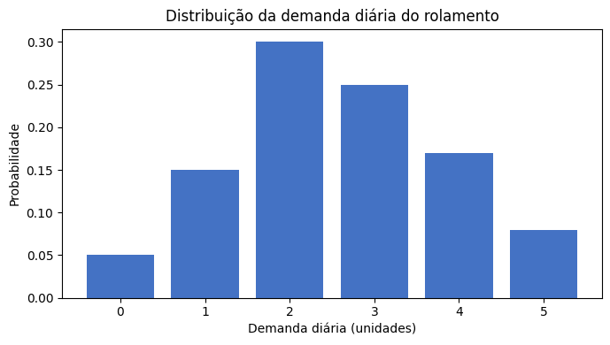
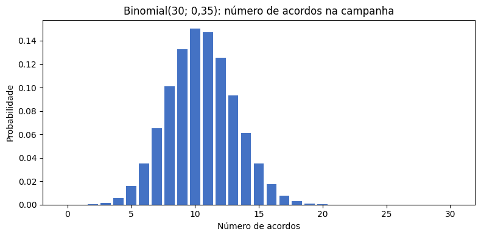

# Capítulo 02 — Resoluções

[Notebook do estudante](../ch02-student.ipynb) · [exercícios](../exercises/ch02.md)

Consulte as resoluções depois da tentativa.

# Materiais complementares — Capítulo 2

**Prof. Daniel de Abreu Pereira Uhr**

**Curso:** Estatística e Econometria com Python


Probabilidade e variáveis aleatórias

## Contexto — Loja virtual

A loja virtual, loja virtual fictícia, registrou 2.000 pedidos no mês. O mecanismo aleatório considerado em todo o bloco é **sortear ao acaso um pedido entre os 2.000**.

**Tabela 1 — Canal de venda e devolução**

| Canal | Devolvido | Não devolvido | Total |
|---|---:|---:|---:|
| App | 40 | 760 | 800 |
| Site | 50 | 650 | 700 |
| Marketplace | 60 | 440 | 500 |
| **Total** | **150** | **1.850** | **2.000** |

**Tabela 2 — Forma de pagamento e devolução**

| Pagamento | Devolvido | Não devolvido | Total |
|---|---:|---:|---:|
| Cartão | 90 | 1.110 | 1.200 |
| Pix | 60 | 740 | 800 |
| **Total** | **150** | **1.850** | **2.000** |

Use os eventos $D$: o pedido sorteado foi devolvido; $K$: o pedido sorteado foi feito pelo marketplace.

```python
import pandas as pd

canais = pd.DataFrame({
    "canal": ["app", "site", "marketplace"],
    "devolvidos": [40, 50, 60],
    "nao_devolvidos": [760, 650, 440],
})
canais["pedidos"] = canais["devolvidos"] + canais["nao_devolvidos"]

pagamentos = pd.DataFrame({
    "pagamento": ["cartão", "pix"],
    "devolvidos": [90, 60],
    "nao_devolvidos": [1_110, 740],
})
pagamentos["pedidos"] = pagamentos["devolvidos"] + pagamentos["nao_devolvidos"]

total_pedidos = canais["pedidos"].sum()
print(canais.to_string(index=False))
print(pagamentos.to_string(index=False))
print("Total de pedidos:", total_pedidos)
```

```text
      canal  devolvidos  nao_devolvidos  pedidos
        app          40             760      800
       site          50             650      700
marketplace          60             440      500
pagamento  devolvidos  nao_devolvidos  pedidos
   cartão          90            1110     1200
      pix          60             740      800
Total de pedidos: 2000
```

## Resolução do Exercício 01 — Mecanismo e eventos

Descreva o mecanismo aleatório e o espaço amostral. Depois calcule quantos pedidos pertencem a $D$, $K$, $D^c$, $D \cap K$ e $D \cup K$.

```python
marketplace = canais["canal"] == "marketplace"

n_d = canais["devolvidos"].sum()
n_k = canais.loc[marketplace, "pedidos"].sum()
n_d_e_k = canais.loc[marketplace, "devolvidos"].sum()
n_d_ou_k = n_d + n_k - n_d_e_k

print("D:", n_d)
print("K:", n_k)
print("Complemento de D:", total_pedidos - n_d)
print("D ∩ K:", n_d_e_k)
print("D ∪ K:", n_d_ou_k)
```

```text
D: 150
K: 500
Complemento de D: 1850
D ∩ K: 60
D ∪ K: 590
```

**Raciocínio:** o mecanismo é sortear ao acaso um dos 2.000 pedidos; o espaço amostral é o conjunto desses pedidos. Contamos cada evento nas tabelas; a união não pode contar duas vezes os pedidos que estão em $D$ e em $K$.
**Resultado e interpretação:** 150 pedidos foram devolvidos e 500 vieram do marketplace; 60 estão nos dois eventos. A união tem $150 + 500 - 60 = 590$ pedidos, e 1.850 pedidos não foram devolvidos.

## Resolução do Exercício 02 — Probabilidades

Calcule $P(D)$, $P(D^c)$, $P(K)$, $P(D \cap K)$ e $P(D \cup K)$. Confira $P(D \cup K)$ de duas formas: pela contagem direta e pela regra geral da união.

```python
p_d = n_d / total_pedidos
p_k = n_k / total_pedidos
p_d_e_k = n_d_e_k / total_pedidos

contagem_direta_uniao = n_k + canais.loc[~marketplace, "devolvidos"].sum()

print(f"P(D) = {p_d:.3f}")
print(f"P(D^c) = {1 - p_d:.3f}")
print(f"P(K) = {p_k:.3f}")
print(f"P(D ∩ K) = {p_d_e_k:.3f}")
print(f"P(D ∪ K) pela contagem direta = {contagem_direta_uniao / total_pedidos:.3f}")
print(f"P(D ∪ K) pela regra geral = {p_d + p_k - p_d_e_k:.3f}")
```

```text
P(D) = 0.075
P(D^c) = 0.925
P(K) = 0.250
P(D ∩ K) = 0.030
P(D ∪ K) pela contagem direta = 0.295
P(D ∪ K) pela regra geral = 0.295
```

**Raciocínio:** dividimos as contagens pelo total. Para a união, a contagem direta seria somar os 500 pedidos do marketplace às 90 devoluções dos demais canais; a regra geral deve dar o mesmo valor.
**Resultado e interpretação:** a probabilidade de sortear um pedido devolvido é 0,075; de sortear um pedido do marketplace, 0,25; de sortear um pedido devolvido do marketplace, 0,03. As duas formas dão $P(D \cup K) = 0{,}295$.

**Erro comum:** somar $P(D) + P(K) = 0{,}325$, esquecendo que $D$ e $K$ não são disjuntos.

## Resolução do Exercício 03 — Probabilidade condicional

Calcule a probabilidade de devolução em cada canal e a probabilidade $P(K \mid D)$. Explique, com os valores obtidos, por que $P(D \mid K)$ e $P(K \mid D)$ respondem a perguntas diferentes.

```python
canais["p_devolucao_dado_canal"] = canais["devolvidos"] / canais["pedidos"]
p_k_dado_d = n_d_e_k / n_d

print(canais[["canal", "pedidos", "devolvidos", "p_devolucao_dado_canal"]].round(3).to_string(index=False))
print(f"P(K | D) = {p_k_dado_d:.2f}")
```

```text
      canal  pedidos  devolvidos  p_devolucao_dado_canal
        app      800          40                   0.050
       site      700          50                   0.071
marketplace      500          60                   0.120
P(K | D) = 0.40
```

**Raciocínio:** dentro de cada canal, a probabilidade condicional de devolução é a proporção de devolvidos entre os pedidos do canal. Para $P(K \mid D)$, o universo passa a ser o conjunto dos 150 pedidos devolvidos.
**Resultado e interpretação:** a probabilidade de devolução é 0,050 no app, 0,071 no site e 0,120 no marketplace. $P(D \mid K) = 0{,}12$ diz que 12% dos pedidos do marketplace foram devolvidos. $P(K \mid D) = 0{,}40$ diz que 40% das devoluções vieram do marketplace. A primeira pergunta é sobre o canal; a segunda, sobre a composição das devoluções. As duas usam o mesmo numerador, 60 pedidos, e denominadores diferentes: 500 e 150.

## Resolução do Exercício 04 — Independência

Verifique, pelas duas formas da definição, se $D$ é independente de “pagamento por pix” e se $D$ é independente de $K$. Interprete cada conclusão em uma frase.

```python
pix = pagamentos["pagamento"] == "pix"
n_pix = pagamentos.loc[pix, "pedidos"].sum()
n_d_e_pix = pagamentos.loc[pix, "devolvidos"].sum()
p_pix = n_pix / total_pedidos

print(f"P(D | pix) = {n_d_e_pix / n_pix:.3f}   P(D) = {p_d:.3f}")
print(f"P(D ∩ pix) = {n_d_e_pix / total_pedidos:.4f}   P(D) × P(pix) = {p_d * p_pix:.4f}")
print(f"P(D | K) = {n_d_e_k / n_k:.3f}   P(D) = {p_d:.3f}")
print(f"P(D ∩ K) = {p_d_e_k:.4f}   P(D) × P(K) = {p_d * p_k:.4f}")
```

```text
P(D | pix) = 0.075   P(D) = 0.075
P(D ∩ pix) = 0.0300   P(D) × P(pix) = 0.0300
P(D | K) = 0.120   P(D) = 0.075
P(D ∩ K) = 0.0300   P(D) × P(K) = 0.0187
```

**Raciocínio:** comparamos $P(D \mid B)$ com $P(D)$ e $P(D \cap B)$ com $P(D)\,P(B)$, para $B$ igual a pix e a marketplace.
**Resultado e interpretação:** a devolução é independente do pagamento por pix: $P(D \mid \text{pix}) = P(D) = 0{,}075$ e a fatoração vale, $0{,}0300 = 0{,}0300$. Saber que o pedido foi pago por pix não muda a chance de devolução nesta base. Já devolução e marketplace são dependentes: $P(D \mid K) = 0{,}120$, maior que 0,075, e $P(D \cap K) = 0{,}0300$ é maior que $P(D)\,P(K) \approx 0{,}0187$.

**Limite:** as tabelas são didáticas e as igualdades são exatas. Em dados reais, a pergunta seria se a diferença observada é compatível com variação amostral — tema das Capítulos 3 e 4.

## Resolução do Exercício 05 — Disjuntos ou independentes?

Os eventos “pagamento por cartão” e “pagamento por pix” são disjuntos? São independentes? Justifique com probabilidades.

```python
n_cartao = pagamentos.loc[~pix, "pedidos"].sum()
p_cartao = n_cartao / total_pedidos
n_cartao_e_pix = 0  # cada pedido tem uma única forma de pagamento

print(f"P(cartão ∩ pix) = {n_cartao_e_pix / total_pedidos:.2f}")
print(f"P(cartão) × P(pix) = {p_cartao * p_pix:.2f}")
print(f"P(pix | cartão) = {n_cartao_e_pix / n_cartao:.2f}   P(pix) = {p_pix:.2f}")
```

```text
P(cartão ∩ pix) = 0.00
P(cartão) × P(pix) = 0.24
P(pix | cartão) = 0.00   P(pix) = 0.40
```

**Raciocínio:** cada pedido tem uma única forma de pagamento, então cartão e pix não ocorrem juntos. Verificamos a fatoração.
**Resultado e interpretação:** os eventos são disjuntos, pois $P(\text{cartão} \cap \text{pix}) = 0$. Por isso mesmo, não são independentes: a fatoração exigiria 0,24. Saber que o pedido foi pago com cartão torna a probabilidade de pix igual a zero.

**Erro comum:** tratar “disjuntos” e “independentes” como sinônimos. Eventos disjuntos com probabilidade positiva são sempre dependentes.

## Resolução do Exercício 06 — Desafio — O marketplace causa devoluções?

Em reunião, a gerente comercial afirma: “o marketplace causa devoluções; devemos encerrar esse canal”.

Escreva uma avaliação curta que contenha:

1. o que as probabilidades mostram, comparando a participação do marketplace nos pedidos e nas devoluções;
2. por que esses números não demonstram que o canal causa devoluções, com ao menos duas explicações alternativas plausíveis;
3. que informação adicional ajudaria a decidir.

```python
participacao_pedidos = n_k / total_pedidos
participacao_devolucoes = p_k_dado_d

print(f"Participação do marketplace nos pedidos: {participacao_pedidos:.0%}")
print(f"Participação do marketplace nas devoluções: {participacao_devolucoes:.0%}")
print(f"Taxa de devolução no marketplace: {n_d_e_k / n_k:.1%}")
print(f"Taxa de devolução nos demais canais: {canais.loc[~marketplace, 'devolvidos'].sum() / canais.loc[~marketplace, 'pedidos'].sum():.1%}")
```

```text
Participação do marketplace nos pedidos: 25%
Participação do marketplace nas devoluções: 40%
Taxa de devolução no marketplace: 12.0%
Taxa de devolução nos demais canais: 6.0%
```

**Raciocínio:** separamos o que os dados descrevem do que seria necessário para uma afirmação causal.
**Avaliação:**

1. **O que os dados mostram.** O marketplace responde por 25% dos pedidos e por 40% das devoluções. A probabilidade de devolução é 12,0% no marketplace e 6,0% nos demais canais. Há uma associação clara entre canal e devolução nesta base.
2. **Por que isso não demonstra causalidade.** Os pedidos do marketplace podem diferir dos demais em aspectos que também afetam devoluções. Duas explicações alternativas plausíveis: o marketplace pode concentrar categorias com devolução naturalmente maior, como vestuário; e pode atender clientes com perfil diferente, ou depender de vendedores parceiros com prazos de entrega mais longos. Em qualquer desses casos, encerrar o canal não eliminaria, por si, as causas das devoluções.
3. **Informação adicional.** Taxas de devolução por categoria de produto dentro de cada canal, motivos registrados das devoluções, prazos de entrega por canal e a margem líquida do marketplace depois das devoluções. A decisão também depende da receita que o canal traz.

**Conclusão responsável:** a probabilidade condicional de devolução é maior no marketplace, mas os dados não sustentam que o canal cause as devoluções nem que encerrá-lo as reduziria na mesma proporção.

[Consultar os exercícios](../exercises/ch02.md)

# Materiais complementares — Capítulo 2

**Prof. Daniel de Abreu Pereira Uhr**

**Curso:** Estatística e Econometria com Python


Probabilidade e variáveis aleatórias

## Contexto — Distribuidora do exemplo de demanda

A distribuidora do exemplo de demanda, empresa fictícia, vende um rolamento de reposição. A equipe de planejamento modela a demanda diária $X$, em unidades, pela distribuição abaixo:

| Demanda diária $x$ | 0 | 1 | 2 | 3 | 4 | 5 |
|---|---:|---:|---:|---:|---:|---:|
| $P(X = x)$ | 0,05 | 0,15 | 0,30 | 0,25 | 0,17 | 0,08 |

O preço de venda é R\$ 180 por unidade e o custo fixo diário de armazenagem do item é R\$ 60.

```python
import numpy as np
import pandas as pd
import matplotlib.pyplot as plt
```

## Resolução do Exercício 07 — Distribuição

Organize a distribuição em um DataFrame, verifique se ela é uma função de probabilidade válida e represente-a em um gráfico de barras com título e eixos identificados.

```python
demanda = pd.DataFrame({
    "unidades": [0, 1, 2, 3, 4, 5],
    "probabilidade": [0.05, 0.15, 0.30, 0.25, 0.17, 0.08],
})

print(demanda.to_string(index=False))
print("Probabilidades não negativas:", (demanda["probabilidade"] >= 0).all())
print("Soma das probabilidades:", round(demanda["probabilidade"].sum(), 10))

fig, ax = plt.subplots(figsize=(7, 4))
ax.bar(demanda["unidades"], demanda["probabilidade"], color="#4472C4")
ax.set_title("Distribuição da demanda diária do rolamento")
ax.set_xlabel("Demanda diária (unidades)")
ax.set_ylabel("Probabilidade")
fig.tight_layout()
plt.show()
```

```text
 unidades  probabilidade
        0           0.05
        1           0.15
        2           0.30
        3           0.25
        4           0.17
        5           0.08
Probabilidades não negativas: True
Soma das probabilidades: 1.0
```



**Raciocínio:** uma função de probabilidade é válida quando todas as probabilidades são não negativas e somam 1.
**Resultado e interpretação:** a distribuição é válida. A demanda de 2 unidades é a mais provável, e demandas de 0 ou 5 unidades são as menos prováveis.

## Resolução do Exercício 08 — Centro e dispersão

Calcule $E(X)$, $\operatorname{Var}(X)$ e $\sigma_X$ pela definição. Interprete a esperança e o desvio-padrão em unidades de demanda. A esperança é um valor que a demanda diária pode assumir?

```python
esperanca = (demanda["unidades"] * demanda["probabilidade"]).sum()
variancia = ((demanda["unidades"] - esperanca) ** 2 * demanda["probabilidade"]).sum()
desvio_padrao = np.sqrt(variancia)

print(f"E(X) = {esperanca:.2f} unidades")
print(f"Var(X) = {variancia:.4f} unidades²")
print(f"σ = {desvio_padrao:.3f} unidades")
```

```text
E(X) = 2.58 unidades
Var(X) = 1.6636 unidades²
σ = 1.290 unidades
```

**Raciocínio:** aplicamos $E(X) = \sum_x x\,p(x)$ e $\operatorname{Var}(X) = \sum_x (x - \mu)^2\,p(x)$.
**Resultado e interpretação:** a demanda esperada é 2,58 unidades por dia, com desvio-padrão de cerca de 1,29 unidade. Sob o modelo, ao longo de muitos dias a demanda média ficaria próxima de 2,58, e uma distância típica de pouco mais de uma unidade em torno desse valor é normal. A esperança não é um valor possível: a demanda de um dia é sempre um número inteiro.

**Erro comum:** arredondar a esperança para 3 e tratá-la como a demanda “prevista” de cada dia.

## Resolução do Exercício 09 — Risco de falta

O depósito começa o dia com 3 unidades em estoque. Calcule a probabilidade de faltar produto, isto é, de a demanda superar o estoque. Calcule também a probabilidade de a demanda ser de no máximo 1 unidade. O que cada probabilidade informa ao gestor?

```python
p_falta_estoque_3 = demanda.loc[demanda["unidades"] > 3, "probabilidade"].sum()
p_ate_1 = demanda.loc[demanda["unidades"] <= 1, "probabilidade"].sum()

print(f"P(X > 3) = {p_falta_estoque_3:.2f}")
print(f"P(X ≤ 1) = {p_ate_1:.2f}")
```

```text
P(X > 3) = 0.25
P(X ≤ 1) = 0.20
```

**Raciocínio:** com estoque 3, falta produto quando $X > 3$, isto é, $X = 4$ ou $X = 5$. Somamos as probabilidades desses valores.
**Resultado e interpretação:** com 3 unidades em estoque, a probabilidade de falta em um dia é 0,25 — sob o modelo, cerca de um em cada quatro dias. A probabilidade de demanda de no máximo 1 unidade é 0,20: em cerca de um a cada cinco dias, ao menos duas das três unidades sobrariam. A primeira probabilidade mede o risco de perder vendas; a segunda, o risco de manter estoque parado.

## Resolução do Exercício 10 — Receita líquida como transformação

Suponha que o estoque seja sempre suficiente para atender a demanda. A receita líquida diária é $L = 180X - 60$, em reais. Calcule $E(L)$ e $\sigma_L$ de duas formas: construindo a distribuição de $L$ e aplicando as regras de transformação linear. Explique o papel de cada número da fórmula.

```python
preco = 180
custo_fixo = 60

demanda["receita_liquida"] = preco * demanda["unidades"] - custo_fixo
e_l = (demanda["receita_liquida"] * demanda["probabilidade"]).sum()
var_l = ((demanda["receita_liquida"] - e_l) ** 2 * demanda["probabilidade"]).sum()

print(demanda[["unidades", "receita_liquida", "probabilidade"]].to_string(index=False))
print(f"Pela distribuição: E(L) = {e_l:.2f}; σ(L) = {np.sqrt(var_l):.2f}")
print(f"Pelas regras:      E(L) = {preco * esperanca - custo_fixo:.2f}; σ(L) = {preco * desvio_padrao:.2f}")
```

```text
 unidades  receita_liquida  probabilidade
        0              -60           0.05
        1              120           0.15
        2              300           0.30
        3              480           0.25
        4              660           0.17
        5              840           0.08
Pela distribuição: E(L) = 404.40; σ(L) = 232.17
Pelas regras:      E(L) = 404.40; σ(L) = 232.17
```

**Raciocínio:** $L = a + bX$ com $a = -60$ e $b = 180$. Calculamos pela distribuição de $L$ e conferimos com as regras.
**Resultado e interpretação:** a receita líquida esperada é R\$ 404,40 por dia, com desvio-padrão de cerca de R\$ 232,17. O preço, R\$ 180, multiplica tanto a esperança quanto o desvio-padrão da demanda. O custo fixo, R\$ 60, reduz a esperança, mas não muda o desvio-padrão: ele é pago todos os dias, qualquer que seja a demanda.

**Limite:** a fórmula supõe estoque sempre suficiente. Se o estoque for limitado, a receita deixa de ser uma transformação linear da demanda, porque as vendas ficam limitadas ao estoque.

## Resolução do Exercício 11 — Mudança de unidade

Expresse a receita líquida em milhares de reais. Como mudam a esperança, a variância e o desvio-padrão? Explique por que a variância muda mais que o desvio-padrão.

```python
print(f"E(L) = {e_l / 1_000:.4f} mil reais")
print(f"Var(L) = {var_l / 1_000**2:.4f} (mil reais)²")
print(f"σ(L) = {np.sqrt(var_l) / 1_000:.4f} mil reais")
```

```text
E(L) = 0.4044 mil reais
Var(L) = 0.0539 (mil reais)²
σ(L) = 0.2322 mil reais
```

**Raciocínio:** em milhares de reais, $L_{mil} = L / 1.000$, isto é, $b = 1/1.000$.
**Resultado e interpretação:** a esperança passa a R\$ 0,4044 mil e o desvio-padrão a R\$ 0,2322 mil — os mesmos valores, em outra unidade. A variância, porém, fica dividida por $1.000^2$, porque está em unidades ao quadrado. Por isso o desvio-padrão é a medida de dispersão mais fácil de comunicar.

## Resolução do Exercício 12 — Demanda de dois dias

Seja $T = X_1 + X_2$ a demanda de dois dias, supondo que as demandas dos dois dias são independentes e seguem a distribuição acima. Calcule $E(T)$, $\operatorname{Var}(T)$ e $\sigma_T$. Compare $\sigma_T$ com $2\sigma_X$ e explique a diferença. Descreva uma situação da distribuidora em que a hipótese de independência entre dias seria duvidosa.

```python
e_t = 2 * esperanca
var_t = 2 * variancia

pares_total = []
pares_probabilidade = []
for x1, p1 in zip(demanda["unidades"], demanda["probabilidade"]):
    for x2, p2 in zip(demanda["unidades"], demanda["probabilidade"]):
        pares_total.append(x1 + x2)
        pares_probabilidade.append(p1 * p2)

pares_total = np.array(pares_total)
pares_probabilidade = np.array(pares_probabilidade)
e_t_pares = (pares_total * pares_probabilidade).sum()
var_t_pares = ((pares_total - e_t_pares) ** 2 * pares_probabilidade).sum()

print(f"Pelas regras: E(T) = {e_t:.2f}; Var(T) = {var_t:.4f}; σ(T) = {np.sqrt(var_t):.3f}")
print(f"Pelos 36 pares: E(T) = {e_t_pares:.2f}; Var(T) = {var_t_pares:.4f}")
print(f"2σ(X) = {2 * desvio_padrao:.3f}")
```

```text
Pelas regras: E(T) = 5.16; Var(T) = 3.3272; σ(T) = 1.824
Pelos 36 pares: E(T) = 5.16; Var(T) = 3.3272
2σ(X) = 2.580
```

**Raciocínio:** pela regra de soma, $E(T) = 2E(X)$. Com independência, a covariância é zero e $\operatorname{Var}(T) = 2\operatorname{Var}(X)$. Conferimos enumerando os 36 pares de demandas, com probabilidade dada pela fatoração $P(X_1 = x_1)\,P(X_2 = x_2)$.
**Resultado e interpretação:** a demanda esperada em dois dias é 5,16 unidades, com desvio-padrão de cerca de 1,82. A enumeração dos pares confirma as regras. O desvio-padrão do total é menor que $2\sigma_X \approx 2{,}58$: com dias independentes, um dia de demanda alta pode ser compensado por um de demanda baixa, e os desvios não se somam integralmente.

**Limite:** a independência seria duvidosa em semanas de promoção, quando a demanda tende a ficar alta em vários dias seguidos, ou quando um cliente grande divide uma compra em dias consecutivos. Nesses casos, a covariância seria positiva e $\sigma_T$ ficaria maior.

## Resolução do Exercício 13 — Desafio — Estoque mínimo

A gerência quer o menor estoque inicial $s$ que mantenha a probabilidade de falta em um dia, $P(X > s)$, em no máximo 10%. Determine $s$ mostrando as probabilidades de falta para os estoques possíveis. Depois comente, em duas ou três frases, o que a empresa ganha e o que perde ao adotar esse critério.

```python
risco = pd.DataFrame({"estoque": demanda["unidades"]})
risco["p_falta"] = [
    demanda.loc[demanda["unidades"] > s, "probabilidade"].sum() for s in risco["estoque"]
]

print(risco.round(2).to_string(index=False))

atende_criterio = risco[risco["p_falta"] <= 0.10]
print("Menor estoque que atende ao critério:", atende_criterio["estoque"].min())
```

```text
 estoque  p_falta
       0     0.95
       1     0.80
       2     0.50
       3     0.25
       4     0.08
       5     0.00
Menor estoque que atende ao critério: 4
```

**Raciocínio:** para cada estoque possível $s$, a falta ocorre quando $X > s$. Calculamos essa probabilidade e escolhemos o menor $s$ com probabilidade de falta de no máximo 0,10.
**Resultado e interpretação:** com 3 unidades, a probabilidade de falta é 0,25; com 4, cai para 0,08. O menor estoque que atende ao critério de 10% é $s = 4$.

O ganho é reduzir os dias de venda perdida de cerca de um em quatro para menos de um em dez. O custo é manter mais uma unidade parada com frequência: sob o modelo, a demanda é de no máximo 3 unidades com probabilidade 0,75. O critério de 10% é uma escolha de gestão, que deveria considerar a margem perdida em uma falta e o custo de armazenagem.

[Consultar os exercícios](../exercises/ch02.md)

# Materiais complementares — Capítulo 2

**Prof. Daniel de Abreu Pereira Uhr**

**Curso:** Estatística e Econometria com Python


Probabilidade e variáveis aleatórias

## Contexto — Central de cobrança

A central de cobrança, empresa fictícia, prepara uma campanha de renegociação:

- 30 contratos em atraso serão contatados;
- cada contato termina em acordo com probabilidade 0,35;
- cada acordo recupera R\$ 1.200;
- a campanha custa R\$ 9.000.

Nos Exercícios 14–18, adote o modelo em que os 30 contatos são independentes e têm a mesma probabilidade de acordo.

```python
import numpy as np
import matplotlib.pyplot as plt
from scipy import stats
```

## Resolução do Exercício 14 — Um contato

Defina a variável aleatória que representa o resultado de um único contato. Qual é sua distribuição, seu suporte, sua esperança e sua variância?

```python
p_acordo = 0.35

print("Suporte: {0, 1}")
print(f"E(X) = p = {p_acordo:.2f}")
print(f"Var(X) = p(1 − p) = {p_acordo * (1 - p_acordo):.4f}")
```

```text
Suporte: {0, 1}
E(X) = p = 0.35
Var(X) = p(1 − p) = 0.2275
```

**Raciocínio:** o resultado de um contato tem dois valores possíveis. Definimos $X = 1$ se houver acordo e $X = 0$ caso contrário; então $X$ é Bernoulli($p$), com $E(X) = p$ e $\operatorname{Var}(X) = p(1 - p)$.
**Resultado e interpretação:** cada contato é uma Bernoulli com $p = 0{,}35$: esperança 0,35 e variância 0,2275. A esperança é a probabilidade de acordo; ela não é um resultado possível de um contato isolado.

## Resolução do Exercício 15 — Condições do modelo Binomial

Liste as quatro condições do modelo Binomial e discuta, para cada uma, se ela é plausível nesta campanha. Dê ao menos um motivo concreto pelo qual alguma condição poderia falhar.

**Raciocínio:** verificamos cada condição à luz da operação da central.

1. **Número fixo de tentativas:** plausível — a campanha contatará exatamente 30 contratos.
2. **Dois resultados por tentativa:** plausível — acordo ou não acordo, desde que “acordo” seja definido de forma única, por exemplo acordo assinado no prazo da campanha.
3. **Mesma probabilidade:** duvidosa — contratos com atraso maior, valor mais alto ou histórico de inadimplência podem ter chances menores de acordo.
4. **Independência:** pode falhar — vários contratos podem pertencer ao mesmo devedor, ou um mesmo operador em um dia ruim pode afetar vários contatos.

**Conclusão:** a Binomial(30; 0,35) é uma hipótese de trabalho razoável para um primeiro cálculo, mas as condições 3 e 4 precisam ser verificadas. O Exercício 20 mostra o efeito de violar a condição 3.

## Resolução do Exercício 16 — Número de acordos

Seja $S$ o número de acordos. Calcule $E(S)$, $\sigma_S$ e $P(S = 10)$ e represente a distribuição de $S$ em um gráfico. Interprete os resultados.

```python
n_contratos = 30
acordos = stats.binom(n_contratos, p_acordo)

print(f"E(S) = {acordos.mean():.2f} acordos")
print(f"σ(S) = {acordos.std():.3f} acordos")
print(f"P(S = 10) = {acordos.pmf(10):.3f}")

valores_s = np.arange(0, n_contratos + 1)
fig, ax = plt.subplots(figsize=(8, 4))
ax.bar(valores_s, acordos.pmf(valores_s), color="#4472C4")
ax.set_title("Binomial(30; 0,35): número de acordos na campanha")
ax.set_xlabel("Número de acordos")
ax.set_ylabel("Probabilidade")
fig.tight_layout()
plt.show()
```

```text
E(S) = 10.50 acordos
σ(S) = 2.612 acordos
P(S = 10) = 0.150
```



**Raciocínio:** sob as quatro condições, $S \sim$ Binomial(30; 0,35), com $E(S) = np$ e $\operatorname{Var}(S) = np(1 - p)$.
**Resultado e interpretação:** espera-se 10,5 acordos, com desvio-padrão de cerca de 2,6. A probabilidade de exatamente 10 acordos é 0,150 — mesmo o valor mais provável tem probabilidade baixa, porque a probabilidade se distribui entre muitos valores. Cerca de 95% da probabilidade fica entre 6 e 15 acordos.

## Resolução do Exercício 17 — Resultado líquido

O resultado líquido da campanha é $L = 1.200\,S - 9.000$, em reais. Calcule $E(L)$ e $\sigma_L$ e interprete os dois valores para a diretoria.

```python
valor_acordo = 1_200
custo_campanha = 9_000

e_l = valor_acordo * acordos.mean() - custo_campanha
sigma_l = valor_acordo * acordos.std()

print(f"E(L) = R$ {e_l:.2f}")
print(f"σ(L) = R$ {sigma_l:.2f}")
```

```text
E(L) = R$ 3600.00
σ(L) = R$ 3134.96
```

**Raciocínio:** $L = a + bS$ com $a = -9.000$ e $b = 1.200$; aplicamos as regras de transformação linear.
**Resultado e interpretação:** o resultado líquido esperado é R\$ 3.600, com desvio-padrão de cerca de R\$ 3.135. Para a diretoria: em média, campanhas como esta deixariam R\$ 3.600 positivos, mas a variabilidade é da mesma ordem de grandeza do resultado esperado — uma campanha isolada pode terminar com resultado bem menor, inclusive negativo.

## Resolução do Exercício 18 — Probabilidade de não haver prejuízo

Calcule $P(L \ge 0)$, mostrando a qual evento sobre $S$ ela corresponde. Depois confira o resultado por simulação, com `rng = np.random.default_rng(2026)` e $R = 10.000$ repetições. Explique por que os dois valores não coincidem exatamente.

```python
p_sem_prejuizo = acordos.pmf(valores_s[valores_s >= 8]).sum()

rng = np.random.default_rng(2026)
R = 10_000
acordos_simulados = rng.binomial(n=n_contratos, p=p_acordo, size=R)
resultado_simulado = valor_acordo * acordos_simulados - custo_campanha

print(f"P(L ≥ 0) = P(S ≥ 8) = {p_sem_prejuizo:.3f}")
print(f"Proporção simulada sem prejuízo: {(resultado_simulado >= 0).mean():.3f}")
```

```text
P(L ≥ 0) = P(S ≥ 8) = 0.876
Proporção simulada sem prejuízo: 0.881
```

**Raciocínio:** $L \ge 0 \Leftrightarrow 1.200\,S \ge 9.000 \Leftrightarrow S \ge 7{,}5$. Como $S$ é inteiro, o evento é $S \ge 8$. Somamos as probabilidades de 8 a 30 e conferimos por simulação.
**Resultado e interpretação:** sob o modelo, a probabilidade de a campanha não dar prejuízo é cerca de 0,876; a simulação produz um valor próximo. Os dois não coincidem exatamente porque a simulação usa um número finito de repetições: outra seed daria uma proporção ligeiramente diferente.

**Erro comum:** escrever o evento como $S > 8$ ou $S \ge 7$. O limite de equilíbrio é 7,5 acordos, então o primeiro inteiro sem prejuízo é 8.

## Resolução do Exercício 19 — Duração das ligações

A equipe modela a duração de uma ligação de cobrança, em minutos, como $N(6; 1{,}5^2)$. Calcule:

1. a probabilidade de uma ligação durar mais de 9 minutos;
2. a probabilidade de durar entre 4 e 8 minutos;
3. a probabilidade, segundo o modelo, de uma duração negativa.

Comente se a Normal parece um modelo plausível para durações de ligações e que verificação você faria com dados reais antes de adotá-la.

```python
duracao = stats.norm(loc=6, scale=1.5)

print(f"P(D > 9) = {1 - duracao.cdf(9):.3f}")
print(f"P(4 ≤ D ≤ 8) = {duracao.cdf(8) - duracao.cdf(4):.3f}")
print(f"P(D < 0) = {duracao.cdf(0):.5f}")
```

```text
P(D > 9) = 0.023
P(4 ≤ D ≤ 8) = 0.818
P(D < 0) = 0.00003
```

**Raciocínio:** usamos `stats.norm(loc=6, scale=1.5)` e calculamos áreas com `cdf`.
**Resultado e interpretação:** sob o modelo, cerca de 2,3% das ligações duram mais de 9 minutos e cerca de 81,8% duram entre 4 e 8 minutos. A probabilidade de duração negativa é praticamente nula, cerca de 0,00003, então esse defeito formal do modelo tem pouca importância prática aqui.

**Limite:** durações de ligações costumam ser assimétricas, com muitas ligações curtas e algumas muito longas. Uma Normal simétrica poderia subestimar a frequência de ligações longas. Antes de adotá-la, seria preciso examinar um histograma de durações reais e comparar proporções observadas, como a de ligações acima de 9 minutos, com as do modelo.

## Resolução do Exercício 20 — Desafio — Probabilidades diferentes por faixa de atraso

Um levantamento indica que a probabilidade de acordo não é a mesma para todos os contratos: 12 contratos têm até 60 dias de atraso, com probabilidade de acordo 0,50, e 18 têm mais de 60 dias, com probabilidade 0,25. Mantenha a independência entre contatos.

1. Calcule a esperança e a variância do número de acordos usando a regra de soma.
2. Estime $P(L \ge 0)$ por simulação, com `np.random.default_rng(2027)` e $R = 10.000$.
3. Compare com os resultados do modelo Binomial(30; 0,35) e explique por que ele deixa de ser o modelo adequado, mesmo que a probabilidade média de acordo continue 0,35.

```python
e_grupos = 12 * 0.50 + 18 * 0.25
var_grupos = 12 * 0.50 * 0.50 + 18 * 0.25 * 0.75

rng_desafio = np.random.default_rng(2027)
acordos_grupos = rng_desafio.binomial(12, 0.50, size=R) + rng_desafio.binomial(18, 0.25, size=R)
resultado_grupos = valor_acordo * acordos_grupos - custo_campanha

print(f"Dois grupos:     E(S) = {e_grupos:.2f}; Var(S) = {var_grupos:.3f}; σ(S) = {np.sqrt(var_grupos):.3f}")
print(f"Binomial única:  E(S) = {acordos.mean():.2f}; Var(S) = {acordos.var():.3f}; σ(S) = {acordos.std():.3f}")
print(f"P(L ≥ 0) simulada com dois grupos: {(resultado_grupos >= 0).mean():.3f}")
print(f"P(L ≥ 0) na Binomial única: {p_sem_prejuizo:.3f}")
```

```text
Dois grupos:     E(S) = 10.50; Var(S) = 6.375; σ(S) = 2.525
Binomial única:  E(S) = 10.50; Var(S) = 6.825; σ(S) = 2.612
P(L ≥ 0) simulada com dois grupos: 0.889
P(L ≥ 0) na Binomial única: 0.876
```

**Raciocínio:** o número de acordos é a soma de dois grupos independentes, Binomial(12; 0,50) e Binomial(18; 0,25). Pela regra de soma, as esperanças e — com independência — as variâncias se somam.
**Resultado e interpretação:** com dois grupos, o número esperado de acordos continua 10,5, mas a variância cai de 6,825 para 6,375. Sem a condição de probabilidade constante, $S$ deixa de ser Binomial(30; 0,35): a soma de grupos com probabilidades diferentes varia menos do que uma Binomial com a probabilidade média. A probabilidade simulada de não haver prejuízo fica um pouco acima de 0,876.

Nesta campanha, a diferença prática é pequena. A lição é mais geral: um modelo pode acertar a esperança e errar a variabilidade. Como riscos e probabilidades de eventos dependem da variabilidade, o modelo deve corresponder ao mecanismo — aqui, a probabilidade de acordo diferente por faixa de atraso.

[Consultar os exercícios](../exercises/ch02.md)

### Transferência do Exercício 20 — Custo e composição da carteira

Mantenha os grupos independentes de 12 contratos com p=0,50 e 18 com p=0,25 e a recuperação de R\$ 1.200 por acordo. O custo agora é R\$ 10.500, hipótese alternativa. Determine o mínimo de acordos, o saldo esperado e a probabilidade exata de prejuízo. Para obter a distribuição da soma, multiplique as probabilidades de cada par de contagens e some os pares com o mesmo total; np.convolve implementa essa operação. Compare com a Binomial(30;0,35), usando o mesmo custo. Aplique o critério hipotético de esperança positiva e risco de até 15% e escreva uma recomendação com os limites de recebimento e independência.

```python
group_a = stats.binom.pmf(np.arange(13), 12, 0.50)
group_b = stats.binom.pmf(np.arange(19), 18, 0.25)
total_pmf = np.convolve(group_a, group_b)
transfer_cost, transfer_recovery = 10500, 1200
transfer_minimum = int(np.ceil(transfer_cost / transfer_recovery))
transfer_mean = transfer_recovery * np.dot(np.arange(31), total_pmf) - transfer_cost
transfer_risk = total_pmf[:transfer_minimum].sum()
pooled_risk = stats.binom.cdf(transfer_minimum - 1, 30, 0.35)
assert np.isclose(total_pmf.sum(), 1)
print(transfer_minimum, round(transfer_mean, 2))
print(round(float(transfer_risk), 4), round(float(pooled_risk), 4))
print(bool(transfer_mean > 0 and transfer_risk <= 0.15))
```

```text
9 2100.0
0.216 0.2247
False
```

São necessários nove acordos e o saldo esperado permanece R\$ 2.100. Use as probabilidades exatas impressas para avaliar a regra: ambas superam 15%, de modo que nenhum dos modelos atende a esse limite hipotético. Contagens esperadas iguais não implicam probabilidades de cauda iguais. Trata-se de rejeição do cenário sob uma regra escolhida, não de um julgamento geral sobre cobrança. O cálculo supõe recebimento integral no prazo, recuperação fixa por acordo e independência dentro e entre grupos. Agrupamento por devedor ou falhas de pagamento exigem rever o modelo.
