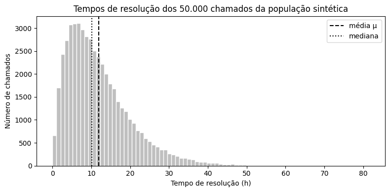
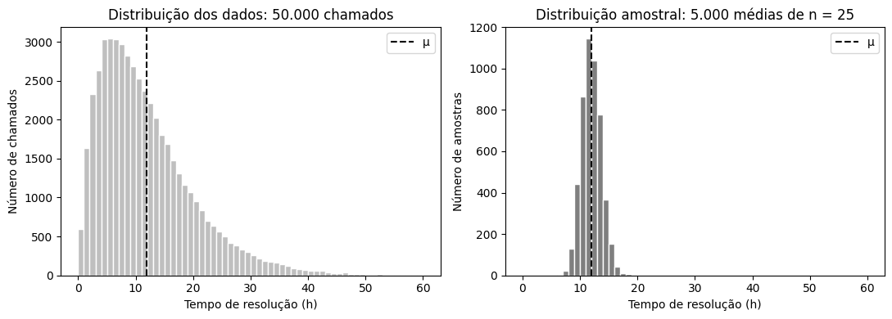
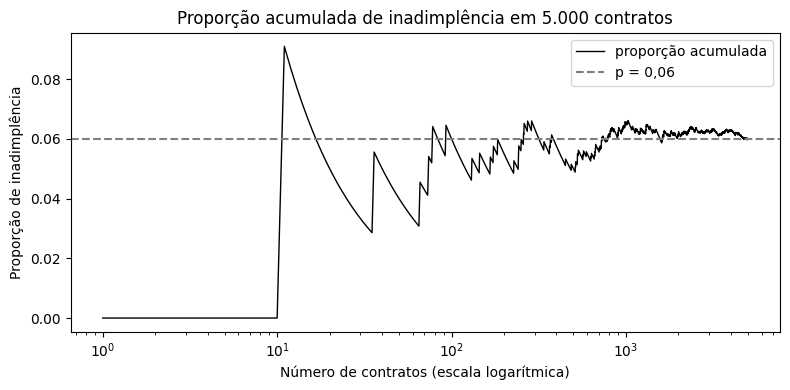
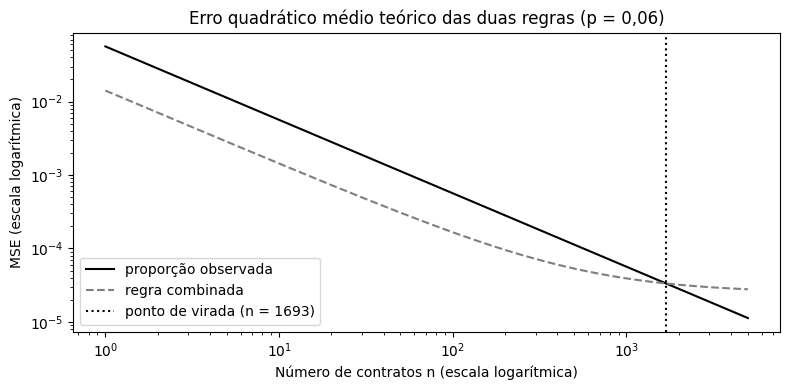
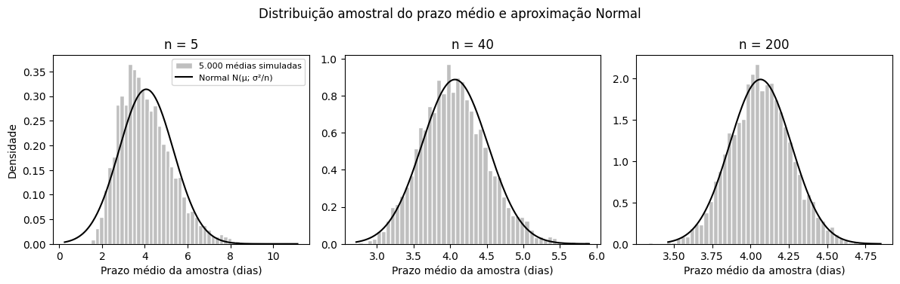
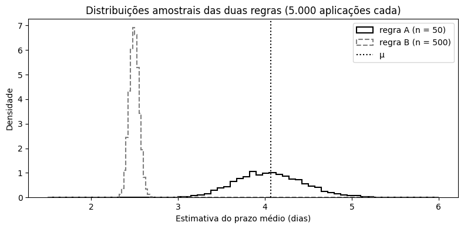

# Capítulo 03 — Resoluções

[Notebook do estudante](../ch03-student.ipynb) · [exercícios](../exercises/ch03.md)

Consulte as resoluções depois da tentativa.

# Resoluções 01–06

**Prof. Daniel de Abreu Pereira Uhr**

**Curso:** Estatística e Econometria com Python


Daniel de Abreu Pereira Uhr

Capítulo 3

## Contexto — Plataforma de software

A plataforma de software, plataforma de software fictícia, quer estimar o **tempo médio de resolução** dos chamados de suporte, em horas. Para estudar os estimadores, usamos uma população sintética de 50.000 chamados. A distribuição gama é usada apenas para gerar tempos positivos e assimétricos; suas propriedades não são objeto de estudo.

Execute a célula abaixo antes de começar. Use o mesmo gerador `rng` em todas as questões, na ordem em que aparecem: assim, seus resultados coincidirão com os da resolução.

```python
import numpy as np
import pandas as pd
import matplotlib.pyplot as plt

rng = np.random.default_rng(2026)
chamados = pd.Series(np.round(rng.gamma(shape=2, scale=6, size=50_000), 2), name="horas")
horas = chamados.to_numpy()
```

## Resolução do Exercício 01 — Parâmetros da população

Calcule o tempo médio $\mu$, o desvio-padrão $\sigma$ (dividindo pelo tamanho da população), a mediana e a assimetria dos tempos. Faça um histograma dos tempos. Explique por que $\mu$ e $\sigma$ só são conhecidos neste laboratório.

**Raciocínio:** a população inteira está disponível; logo, $\mu$ e $\sigma$ são calculados, não estimados. Dividimos por 50.000 (`ddof=0`).

```python
mu = chamados.mean()
sigma = chamados.std(ddof=0)

print(f"Tempo médio μ: {mu:.2f} h")
print(f"Desvio-padrão σ: {sigma:.2f} h")
print(f"Mediana: {chamados.median():.2f} h")
print(f"Assimetria: {chamados.skew():.2f}")

fig, ax = plt.subplots(figsize=(8, 4))
ax.hist(chamados, bins=80, color="#BFBFBF", edgecolor="white")
ax.axvline(mu, color="black", linestyle="--", label="média μ")
ax.axvline(chamados.median(), color="black", linestyle=":", label="mediana")
ax.set_title("Tempos de resolução dos 50.000 chamados da população sintética")
ax.set_xlabel("Tempo de resolução (h)")
ax.set_ylabel("Número de chamados")
ax.legend()
fig.tight_layout()
plt.show()
```

```text
Tempo médio μ: 11.97 h
Desvio-padrão σ: 8.44 h
Mediana: 10.09 h
Assimetria: 1.43
```



**Resultado e interpretação:** o tempo médio é $\mu =$ 11,97 h e o desvio-padrão, $\sigma =$ 8,44 h. A mediana, 10,09 h, fica abaixo da média, e a assimetria, 1,43, confirma a cauda à direita: a maioria dos chamados é resolvida em poucas horas, e alguns demoram muito.

Conhecemos $\mu$ e $\sigma$ porque criamos a população. Na plataforma de software real, eles seriam desconhecidos; o laboratório permite verificar se os estimadores acertam.

## Resolução do Exercício 02 — Uma amostra, uma estimativa

Sorteie, com reposição, uma amostra de $n = 25$ chamados. Calcule a estimativa do tempo médio, o desvio-padrão amostral $s$ e o erro-padrão estimado $s/\sqrt{n}$. Compare com $\mu$ e com o erro-padrão teórico $\sigma/\sqrt{n}$. O que um analista que só tivesse essa amostra poderia reportar?

**Raciocínio:** sorteamos 25 chamados com reposição, o que torna a amostra `iid`. O analista calcularia $\bar{x}$, $s$ e $s/\sqrt{n}$; $\mu$ e $\sigma/\sqrt{n}$ servem apenas para validar.

```python
n = 25
amostra = rng.choice(horas, size=n, replace=True)

media_amostra = amostra.mean()
s = amostra.std(ddof=1)
se_estimado = s / np.sqrt(n)
se_25 = sigma / np.sqrt(n)

print(f"Estimativa do tempo médio: {media_amostra:.2f} h   (μ = {mu:.2f} h)")
print(f"Desvio-padrão amostral s: {s:.2f} h   (σ = {sigma:.2f} h)")
print(f"Erro-padrão estimado s/√n: {se_estimado:.2f} h   (σ/√n = {se_25:.2f} h)")
```

```text
Estimativa do tempo médio: 11.81 h   (μ = 11.97 h)
Desvio-padrão amostral s: 9.19 h   (σ = 8.44 h)
Erro-padrão estimado s/√n: 1.84 h   (σ/√n = 1.69 h)
```

**Resultado e interpretação:** esta amostra estima o tempo médio em 11,81 h, com erro-padrão estimado de 1,84 h. Com uma única amostra, o analista reportaria esses dois números: a estimativa e uma medida de quanto ela costuma variar de amostra para amostra. Aqui, a estimativa ficou a 0,16 h de $\mu$ e o erro-padrão estimado, perto do teórico, 1,69 h; outra amostra produziria outros valores.

## Resolução do Exercício 03 — Distribuição amostral

Repita o sorteio $R = 5.000$ vezes com $n = 25$. Calcule a média e o desvio-padrão das 5.000 estimativas e compare-os com $\mu$ e $\sigma/\sqrt{n}$. Construa, lado a lado e com a mesma escala horizontal, o histograma dos tempos dos chamados e o histograma das 5.000 médias. Descreva as diferenças entre as duas distribuições.

**Raciocínio:** uma matriz de $R = 5.000$ linhas por $n = 25$ colunas representa 5.000 amostras; a média de cada linha é uma estimativa.

```python
R = 5_000
amostras_25 = rng.choice(horas, size=(R, 25), replace=True)
medias_25 = amostras_25.mean(axis=1)

print(f"Média das {R} estimativas: {medias_25.mean():.3f} h   (μ = {mu:.3f} h)")
print(f"Viés estimado por simulação: {medias_25.mean() - mu:+.3f} h")
print(f"Desvio-padrão das estimativas: {medias_25.std():.3f} h   (σ/√n = {se_25:.3f} h)")

fig, axes = plt.subplots(1, 2, figsize=(11, 4), sharex=True)
axes[0].hist(chamados, bins=60, range=(0, 60), color="#BFBFBF", edgecolor="white")
axes[0].set_title("Distribuição dos dados: 50.000 chamados")
axes[0].set_ylabel("Número de chamados")
axes[1].hist(medias_25, bins=60, range=(0, 60), color="#7F7F7F", edgecolor="white")
axes[1].set_title("Distribuição amostral: 5.000 médias de n = 25")
axes[1].set_ylabel("Número de amostras")
for ax in axes:
    ax.axvline(mu, color="black", linestyle="--", label="μ")
    ax.set_xlabel("Tempo de resolução (h)")
    ax.legend()
fig.tight_layout()
plt.show()
```

```text
Média das 5000 estimativas: 11.973 h   (μ = 11.966 h)
Viés estimado por simulação: +0.007 h
Desvio-padrão das estimativas: 1.690 h   (σ/√n = 1.689 h)
```



**Resultado e interpretação:** a média das 5.000 estimativas fica a 0,007 h de $\mu$, como esperado para um estimador não viesado. O desvio das estimativas, 1,690 h, praticamente coincide com $\sigma/\sqrt{25} = 1{,}689$ h.

Os tempos individuais se espalham de quase zero a mais de 50 horas, com cauda longa à direita. As médias de 25 chamados se concentram entre cerca de 7 e 18 horas e são muito menos assimétricas. A primeira distribuição descreve chamados; a segunda, a regra “média de 25 chamados”.

## Resolução do Exercício 04 — Mais chamados por amostra

Repita a simulação com $n = 100$. Compare viés, desvio das estimativas e $\sigma/\sqrt{n}$ com os resultados de $n = 25$. Por que o erro-padrão caiu aproximadamente pela metade? O desvio-padrão dos tempos dos chamados mudou?

**Raciocínio:** com $n = 100$, a teoria prevê erro-padrão $\sigma/\sqrt{100}$, metade de $\sigma/\sqrt{25}$, porque $\sqrt{100/25} = 2$.

```python
amostras_100 = rng.choice(horas, size=(R, 100), replace=True)
medias_100 = amostras_100.mean(axis=1)
se_100 = sigma / np.sqrt(100)

comparacao = pd.DataFrame({
    "n": [25, 100],
    "media_estimativas": [medias_25.mean(), medias_100.mean()],
    "vies": [medias_25.mean() - mu, medias_100.mean() - mu],
    "desvio_estimativas": [medias_25.std(), medias_100.std()],
    "erro_padrao_teorico": [se_25, se_100],
})
print(comparacao.round(3).to_string(index=False))
print(f"Razão entre os desvios simulados (n = 25 / n = 100): {medias_25.std() / medias_100.std():.2f}")
print(f"Desvio-padrão dos tempos σ: {sigma:.2f} h (não depende de n)")
```

```text
  n  media_estimativas   vies  desvio_estimativas  erro_padrao_teorico
 25             11.973  0.007               1.690                1.689
100             11.962 -0.004               0.838                0.844
Razão entre os desvios simulados (n = 25 / n = 100): 2.02
Desvio-padrão dos tempos σ: 8.44 h (não depende de n)
```

**Resultado e interpretação:** nos dois tamanhos, o viés simulado é praticamente nulo. O desvio das estimativas cai de 1,69 h para 0,84 h, uma razão de 2,02. Pela regra de soma, $\operatorname{Var}(\bar{X}) = \sigma^2/n$: quadruplicar $n$ divide a variância por 4 e o erro-padrão por $\sqrt{4} = 2$.

O desvio-padrão dos tempos, $\sigma =$ 8,44 h, não mudou: ele descreve a população, não o estimador.

## Resolução do Exercício 05 — Desvio-padrão ou erro-padrão?

Um relatório da área de suporte, baseado em 100 chamados, afirma: “o tempo médio de resolução é de 12 horas, com desvio-padrão de 8,5 horas; portanto, nossa estimativa do tempo médio pode errar em até 8,5 horas”.

Avalie a frase. O que o valor 8,5 descreve? Que número descreveria a incerteza sobre o tempo médio? Calcule-o.

**Raciocínio:** o valor 8,5 h está na escala de $\sigma$: descreve a variação entre chamados. A incerteza sobre o tempo médio é medida pelo erro-padrão, $\sigma/\sqrt{100}$, estimado por $s/\sqrt{100}$.

```python
print(f"Variação entre chamados (σ): {sigma:.2f} h")
print(f"Erro-padrão do tempo médio com n = 100 (σ/√n): {se_100:.2f} h")
print(f"Em quantas das 5.000 amostras de 100 a estimativa errou por mais de 2 h: {(np.abs(medias_100 - mu) > 2).mean():.2%}")
```

```text
Variação entre chamados (σ): 8.44 h
Erro-padrão do tempo médio com n = 100 (σ/√n): 0.84 h
Em quantas das 5.000 amostras de 100 a estimativa errou por mais de 2 h: 1.68%
```

**Avaliação:** a frase confunde desvio-padrão com erro-padrão. O valor 8,5 h diz que um chamado individual costuma se afastar cerca de 8,5 h do tempo médio; não diz quanto a média de 100 chamados pode errar.

O relatório implica erro-padrão estimado de 8,5/√100 = 0,85 h. No laboratório, usando a dispersão populacional, o erro-padrão é cerca de 0,84 h com 100 chamados — dez vezes menor que o desvio-padrão dos tempos, porque $\sqrt{100} = 10$. Nas simulações de Exercício 04, a estimativa errou por mais de 2 h em apenas 1,68% das amostras. Na prática, o relatório deveria apresentar a estimativa e seu erro-padrão estimado, $s/\sqrt{100}$, e manter o desvio-padrão para descrever a variação entre chamados.

**Erro comum:** usar o desvio-padrão dos dados como medida da incerteza sobre a média. Com amostras grandes, isso exagera muito a incerteza; o contrário — apresentar o erro-padrão como se descrevesse os chamados — subestima a variação que os clientes realmente enfrentam.

## Resolução do Exercício 06 — A regra rápida

Um supervisor propõe estimar o tempo médio pelo **ponto médio** entre o menor e o maior tempo da amostra, $(\text{mínimo} + \text{máximo})/2$: “é simples e usa os extremos, que conhecemos bem”.

Para $n = 25$ e $n = 100$, use as 5.000 amostras de Exercício 03 e Exercício 04 e calcule, para a regra rápida e para a média amostral: média das estimativas, viés, desvio-padrão das estimativas e erro quadrático médio. A regra rápida melhora com mais chamados? Explique por quê e diga se ela é consistente.

**Raciocínio:** reaproveitamos as mesmas amostras de Exercício 03 e Exercício 04. Para cada uma, calculamos o ponto médio entre o menor e o maior tempo. Uma função resume média, viés, desvio e MSE de qualquer conjunto de estimativas.

```python
def resumir(estimativas, regra, tamanho):
    return {
        "regra": regra,
        "n": tamanho,
        "media_estimativas": estimativas.mean(),
        "vies": estimativas.mean() - mu,
        "desvio": estimativas.std(),
        "mse": np.mean((estimativas - mu) ** 2),
    }

ponto_medio_25 = (amostras_25.min(axis=1) + amostras_25.max(axis=1)) / 2
ponto_medio_100 = (amostras_100.min(axis=1) + amostras_100.max(axis=1)) / 2

desafio = pd.DataFrame([
    resumir(medias_25, "média amostral", 25),
    resumir(ponto_medio_25, "ponto médio", 25),
    resumir(medias_100, "média amostral", 100),
    resumir(ponto_medio_100, "ponto médio", 100),
])
print(desafio.round(3).to_string(index=False))
print(f"Maior tempo médio nas amostras: {amostras_25.max(axis=1).mean():.1f} h (n = 25) e {amostras_100.max(axis=1).mean():.1f} h (n = 100)")
```

```text
         regra   n  media_estimativas   vies  desvio     mse
média amostral  25             11.973  0.007   1.690   2.855
   ponto médio  25             17.897  5.931   4.544  55.824
média amostral 100             11.962 -0.004   0.838   0.702
   ponto médio 100             22.284 10.318   4.401 125.833
Maior tempo médio nas amostras: 34.1 h (n = 25) e 43.8 h (n = 100)
```

**Resultado e interpretação:** a regra rápida superestima o tempo médio em 5,9 h com 25 chamados e em 10,3 h com 100. Seu viés **aumenta** com $n$, e o MSE também, de 55,8 para 125,8; a média amostral tem viés praticamente nulo e MSE de 2,9 e 0,7.

A razão está na cauda longa. O menor tempo fica sempre perto de zero, mas o maior cresce com $n$ — em média, 34,1 h com 25 chamados e 43,8 h com 100: quanto mais chamados, maior a chance de incluir um chamado muito demorado. O ponto médio acompanha esse máximo e se afasta de $\mu$. Os sorteios usam um cadastro finito de 50.000 chamados. Com reposição, os extremos amostrais convergem aos extremos desse cadastro. O ponto médio converge à média desses dois extremos, diferente da média de todos os chamados.

A regra rápida, portanto, **não é consistente**: mais dados a levam para longe do parâmetro. Usar os extremos não é usar a informação da amostra inteira — os outros 23 ou 98 tempos são ignorados.

# Resoluções 07–12

**Prof. Daniel de Abreu Pereira Uhr**

**Curso:** Estatística e Econometria com Python


Daniel de Abreu Pereira Uhr

Capítulo 3

## Contexto — Financeira

A financeira, empresa fictícia, concede crédito pessoal. Cada contrato fica inadimplente com probabilidade $p = 0{,}06$, de modo independente dos demais. A empresa conhece apenas a taxa histórica de inadimplência dos anos anteriores, 5%.

A equipe discute duas regras para estimar $p$ com uma carteira de $n$ contratos com $k$ inadimplências:

- **proporção observada:** $\hat{p} = k/n$;
- **regra combinada:** $\tilde{p} = 0{,}5\,\hat{p} + 0{,}5 \times 0{,}05$, média entre a proporção observada e a taxa histórica.

Execute a célula abaixo antes de começar e use o mesmo gerador `rng` em todas as questões, na ordem em que aparecem.

```python
import numpy as np
import pandas as pd
import matplotlib.pyplot as plt

rng = np.random.default_rng(2026)
p = 0.06
taxa_historica = 0.05
```

## Resolução do Exercício 07 — Lei dos Grandes Números

Simule 5.000 contratos, cada um inadimplente com probabilidade $p$. Calcule a proporção acumulada de inadimplência e informe seu valor após 20, 100, 500 e 5.000 contratos. Faça o gráfico da proporção acumulada com uma linha em $p$. Enuncie, com suas palavras, a Lei dos Grandes Números e suas condições, e diga se elas são razoáveis neste contexto.

**Raciocínio:** cada contrato é uma Bernoulli com $p = 0{,}06$; a proporção de inadimplência é a média dessas variáveis. A proporção acumulada após $k$ contratos é a soma das inadimplências dividida por $k$.

```python
contratos = rng.binomial(n=1, p=p, size=5_000)
proporcao_acumulada = contratos.cumsum() / np.arange(1, len(contratos) + 1)

for k in [20, 100, 500, 5_000]:
    print(f"Após {k:>5} contratos: proporção {proporcao_acumulada[k - 1]:.4f}")

fig, ax = plt.subplots(figsize=(8, 4))
ax.plot(np.arange(1, len(contratos) + 1), proporcao_acumulada, color="black", linewidth=1, label="proporção acumulada")
ax.axhline(p, color="#7F7F7F", linestyle="--", label="p = 0,06")
ax.set_xscale("log")
ax.set_title("Proporção acumulada de inadimplência em 5.000 contratos")
ax.set_xlabel("Número de contratos (escala logarítmica)")
ax.set_ylabel("Proporção de inadimplência")
ax.legend()
fig.tight_layout()
plt.show()
```

```text
Após    20 contratos: proporção 0.0500
Após   100 contratos: proporção 0.0600
Após   500 contratos: proporção 0.0500
Após  5000 contratos: proporção 0.0600
```



**Resultado e interpretação:** nos primeiros contratos não houve inadimplência; depois, a proporção acumulada oscila bastante e se estabiliza perto de 0,06 à medida que a carteira cresce.

Os valores redondos são coincidência desta seed: 1 inadimplência em 20 contratos, 6 em 100, 25 em 500 e 300 em 5.000. O afastamento de 0,01 após 500 contratos é da ordem do erro-padrão da proporção nesse tamanho, cerca de 0,011 (Exercício 08); após 20 contratos, qualquer resultado é muito impreciso, pois as proporções possíveis variam de 0,05 em 0,05.

**Lei dos Grandes Números:** se as observações são independentes, seguem a mesma distribuição e têm esperança finita, a média de $n$ observações se aproxima da esperança quando $n$ cresce — a probabilidade de ela ficar longe da esperança tende a zero.

**Condições neste contexto:** a esperança de uma Bernoulli é finita. Independência e distribuição idêntica são hipóteses: na prática, crises econômicas afetam muitos contratos ao mesmo tempo, e a probabilidade de inadimplência pode variar entre perfis de clientes. Na simulação, as condições valem por construção.

## Resolução do Exercício 08 — A falácia da compensação

Um analista observa três inadimplências nos últimos dez contratos e afirma: “a taxa está acima de 6%; os próximos contratos devem ter menos inadimplência para compensar”.

1. Na sequência simulada em Exercício 07, calcule a proporção de inadimplência entre os contratos que vêm logo após um contrato inadimplente e entre os que vêm logo após um contrato adimplente.
2. Para $n = 20, 100, 500$ e $5.000$, calcule o desvio-padrão do **número** de inadimplências, $\sqrt{np(1-p)}$, e o erro-padrão da **proporção**, $\sqrt{p(1-p)/n}$.
3. Use os dois resultados para avaliar a afirmação.

**Raciocínio:** se houvesse compensação, um contrato inadimplente tornaria o seguinte menos propenso à inadimplência. Comparamos as duas proporções condicionais na sequência simulada. Depois, contrastamos a escala do número de inadimplências com a da proporção.

```python
anterior = contratos[:-1]
seguinte = contratos[1:]

print(f"Inadimplência após um contrato inadimplente: {seguinte[anterior == 1].mean():.4f}")
print(f"Inadimplência após um contrato adimplente: {seguinte[anterior == 0].mean():.4f}")

escala = pd.DataFrame({"n": [20, 100, 500, 5_000]})
escala["desvio_numero"] = np.sqrt(escala["n"] * p * (1 - p))
escala["erro_padrao_proporcao"] = np.sqrt(p * (1 - p) / escala["n"])
print(escala.round(4).to_string(index=False))
```

```text
Inadimplência após um contrato inadimplente: 0.0600
Inadimplência após um contrato adimplente: 0.0600
   n  desvio_numero  erro_padrao_proporcao
  20         1.0621                 0.0531
 100         2.3749                 0.0237
 500         5.3104                 0.0106
5000        16.7929                 0.0034
```

**Resultado e interpretação:**

1. As duas proporções condicionais são 0,0600: um contrato inadimplente não torna o seguinte menos propenso à inadimplência. Os contratos são independentes, e não há memória a compensar.
2. O desvio-padrão do número de inadimplências **cresce** com $n$ — de cerca de 1,1 com 20 contratos para cerca de 16,8 com 5.000 —, enquanto o erro-padrão da proporção **cai** de cerca de 0,053 para 0,0034.
3. A proporção se aproxima de $p$ não porque os desvios sejam corrigidos, mas porque são **diluídos**: o afastamento no número de inadimplências cresce com $\sqrt{n}$, mais devagar que o divisor $n$. Três inadimplências em dez contratos não mudam a probabilidade dos próximos; com milhares de contratos, elas apenas pesam pouco na proporção.

## Resolução do Exercício 09 — Duas regras, três tamanhos de carteira

Para $n = 20$, $500$ e $5.000$ contratos, simule $R = 5.000$ carteiras. Em cada carteira, calcule $\hat{p}$ e $\tilde{p}$. Para cada regra e cada $n$, informe média das estimativas, viés, variância e erro quadrático médio. Qual regra tem menor MSE em cada tamanho?

**Raciocínio:** o número de inadimplências em uma carteira de $n$ contratos independentes segue uma Binomial($n$; $p$). Sorteamos 5.000 carteiras de cada tamanho e calculamos as duas regras em cada uma.

```python
R = 5_000
tamanhos = [20, 500, 5_000]

linhas = []
for n in tamanhos:
    inadimplencias = rng.binomial(n=n, p=p, size=R)
    p_observada = inadimplencias / n
    p_combinada = 0.5 * p_observada + 0.5 * taxa_historica
    for regra, estimativas in [("observada", p_observada), ("combinada", p_combinada)]:
        linhas.append({
            "n": n,
            "regra": regra,
            "media_estimativas": estimativas.mean(),
            "vies": estimativas.mean() - p,
            "variancia": estimativas.var(),
            "mse": np.mean((estimativas - p) ** 2),
        })
simulacao = pd.DataFrame(linhas)
print(simulacao.round(6).to_string(index=False))
```

```text
   n     regra  media_estimativas      vies  variancia      mse
  20 observada           0.061330  0.001330   0.002936 0.002938
  20 combinada           0.055665 -0.004335   0.000734 0.000753
 500 observada           0.059939 -0.000061   0.000115 0.000115
 500 combinada           0.054969 -0.005031   0.000029 0.000054
5000 observada           0.060032  0.000032   0.000011 0.000011
5000 combinada           0.055016 -0.004984   0.000003 0.000028
```

**Resultado e interpretação:**

- A proporção observada tem viés praticamente nulo em todos os tamanhos; a regra combinada tem viés entre −0,0043 e −0,0050 — teoricamente −0,005 —, porque metade de seu peso está na taxa histórica de 5%, abaixo da verdadeira.
- Em compensação, a regra combinada tem um quarto da variância da proporção observada.
- Com 20 e 500 contratos, a redução de variância supera o viés, e a regra combinada tem MSE menor (0,00075 contra 0,00294; 0,000054 contra 0,000115). Com 5.000 contratos, a variância da proporção observada já é pequena, e o viés da regra combinada passa a dominar: a proporção observada vence.

## Resolução do Exercício 10 — Conferência teórica e ponto de virada

Com as regras de esperança e variância do Capítulo 2, mostre que $E(\tilde{p}) = 0{,}5p + 0{,}025$ e $\operatorname{Var}(\tilde{p}) = 0{,}25\,p(1-p)/n$. Calcule o viés, a variância e o MSE teóricos das duas regras para os três tamanhos de Exercício 09 e compare-os com a simulação. A partir de quantos contratos a proporção observada passa a ter MSE menor? Faça um gráfico do MSE teórico das duas regras para $n$ de 1 a 5.000.

**Raciocínio:** pela linearidade da esperança, $E(\tilde{p}) = 0{,}5\,E(\hat{p}) + 0{,}5 \times 0{,}05 = 0{,}5p + 0{,}025$. Pela transformação linear, $\operatorname{Var}(\tilde{p}) = 0{,}5^2 \operatorname{Var}(\hat{p}) = 0{,}25\,p(1-p)/n$. Para $\hat{p}$, o viés é zero e a variância é $p(1-p)/n$. Em cada caso, $MSE = \operatorname{Var} + \text{viés}^2$.

```python
def mse_teorico(n, p_verdadeira, taxa=taxa_historica):
    var_observada = p_verdadeira * (1 - p_verdadeira) / n
    vies_combinada = 0.5 * p_verdadeira + 0.5 * taxa - p_verdadeira
    mse_observada = var_observada
    mse_combinada = 0.25 * var_observada + vies_combinada**2
    return mse_observada, mse_combinada, vies_combinada

teoria = []
for n in tamanhos:
    mse_obs, mse_comb, vies_comb = mse_teorico(n, p)
    teoria.append({"n": n, "vies_combinada": vies_comb, "mse_observada": mse_obs, "mse_combinada": mse_comb})
print(pd.DataFrame(teoria).round(6).to_string(index=False))

n_grade = np.arange(1, 5_001)
mse_obs_grade, mse_comb_grade, _ = mse_teorico(n_grade, p)
virada = n_grade[mse_obs_grade < mse_comb_grade][0]
print(f"A proporção observada passa a ter MSE menor a partir de n = {virada} contratos")

fig, ax = plt.subplots(figsize=(8, 4))
ax.plot(n_grade, mse_obs_grade, color="black", label="proporção observada")
ax.plot(n_grade, mse_comb_grade, color="#7F7F7F", linestyle="--", label="regra combinada")
ax.axvline(virada, color="black", linestyle=":", label=f"ponto de virada (n = {virada})")
ax.set_xscale("log")
ax.set_yscale("log")
ax.set_title("Erro quadrático médio teórico das duas regras (p = 0,06)")
ax.set_xlabel("Número de contratos n (escala logarítmica)")
ax.set_ylabel("MSE (escala logarítmica)")
ax.legend()
fig.tight_layout()
plt.show()
```

```text
   n  vies_combinada  mse_observada  mse_combinada
  20          -0.005       0.002820       0.000730
 500          -0.005       0.000113       0.000053
5000          -0.005       0.000011       0.000028
A proporção observada passa a ter MSE menor a partir de n = 1693 contratos
```



**Resultado e interpretação:** os valores teóricos — MSE de 0,00282 e 0,00073 com 20 contratos, 0,000113 e 0,000053 com 500, e 0,0000113 e 0,0000278 com 5.000 — reproduzem a simulação de Exercício 09 dentro do ruído das 5.000 repetições.

O MSE da proporção observada cai continuamente, pois é só variância. O da regra combinada para de cair: sua variância também vai a zero, mas o viés ao quadrado, $0{,}005^2 = 0{,}000025$, permanece. As curvas se cruzam em 1.693 contratos; a partir daí, a proporção observada é preferível pelo critério do MSE.

## Resolução do Exercício 11 — Consistência

Para onde cada regra se aproxima quando $n$ cresce? Sorteie uma carteira de cada tamanho — $10.000$, $100.000$ e $1.000.000$ de contratos — e calcule $\hat{p}$ e $\tilde{p}$. Qual regra é consistente para $p$? Por quê?

**Raciocínio:** para carteiras muito grandes, a variância das duas regras é praticamente nula; cada uma fica perto de sua esperança. Sorteamos uma carteira de cada tamanho.

```python
for n in [10_000, 100_000, 1_000_000]:
    p_observada = rng.binomial(n=n, p=p) / n
    p_combinada = 0.5 * p_observada + 0.5 * taxa_historica
    print(f"n = {n:>9}: observada {p_observada:.4f}   combinada {p_combinada:.4f}")
print(f"Esperança da regra combinada: {0.5 * p + 0.5 * taxa_historica:.4f}")
```

```text
n =     10000: observada 0.0603   combinada 0.0552
n =    100000: observada 0.0601   combinada 0.0551
n =   1000000: observada 0.0602   combinada 0.0551
Esperança da regra combinada: 0.0550
```

**Resultado e interpretação:** com carteiras cada vez maiores, a proporção observada fica em torno de 0,060, e a regra combinada, de 0,055. A proporção observada é **consistente**: sua esperança é $p$ e seu erro-padrão vai a zero. A regra combinada **não é consistente**: sua variância vai a zero, mas em torno de $0{,}5p + 0{,}025 = 0{,}055$, e nenhum volume de dados elimina o peso fixo da taxa histórica.

## Resolução do Exercício 12 — Quando usar a taxa histórica?

1. Em que situação a gestão da financeira preferiria a regra combinada? E a proporção observada?
2. Suponha que a taxa histórica esteja desatualizada: a inadimplência verdadeira subiu para $p = 0{,}09$, mas a regra combinada continua usando 5%. Calcule o MSE teórico das duas regras para $n = 20$ e $n = 500$.
3. Que risco a empresa corre ao usar a regra combinada sem revisar a taxa histórica?

**Raciocínio:** usamos a mesma função de Exercício 10, agora com $p = 0{,}09$ e a taxa histórica mantida em 5%.

```python
for n in [20, 500]:
    mse_obs, mse_comb, vies_comb = mse_teorico(n, 0.09)
    print(f"n = {n:>3}, p = 0,09: MSE observada {mse_obs:.6f}   MSE combinada {mse_comb:.6f}   viés da combinada {vies_comb:+.3f}")
```

```text
n =  20, p = 0,09: MSE observada 0.004095   MSE combinada 0.001424   viés da combinada -0.020
n = 500, p = 0,09: MSE observada 0.000164   MSE combinada 0.000441   viés da combinada -0.020
```

**Avaliação:**

1. **Quando cada regra é preferível.** A regra combinada é atraente para carteiras pequenas — um produto novo, uma agência recém-aberta —, em que a proporção observada oscila muito e a taxa histórica é uma boa referência. A proporção observada é preferível em carteiras grandes, em que sua variância já é pequena, e sempre que a taxa histórica for duvidosa.
2. **Taxa histórica desatualizada.** Com $p = 0{,}09$, o viés da regra combinada sobe para −0,02. Com 20 contratos, ela ainda tem MSE menor (0,00142 contra 0,00410), porque a proporção observada é muito instável. Com 500 contratos, o quadro se inverte com folga: 0,00044 contra 0,00016.
3. **Risco.** A regra combinada subestima sistematicamente a inadimplência quando a realidade se afasta da taxa histórica — justamente quando a empresa mais precisaria perceber a mudança. Aumentar a carteira não corrige esse viés. Qualquer regra que use informação externa precisa de revisão periódica dessa informação, e a escolha entre as regras depende do tamanho da carteira e da confiança na taxa histórica, não apenas de qual delas é não viesada.

# Resoluções 13–18

**Prof. Daniel de Abreu Pereira Uhr**

**Curso:** Estatística e Econometria com Python


Daniel de Abreu Pereira Uhr

Capítulo 3

## Contexto — Transportadora Gaivota

A Transportadora Gaivota, empresa fictícia, precisa informar à diretoria o **prazo médio de entrega** de sua operação, em dias. A população sintética tem 100.000 entregas: cerca de 30% em rotas curtas e 70% em rotas longas. O prazo é um dia de manuseio mais o tempo de transporte, maior nas rotas longas; a distribuição gama é usada apenas para gerar tempos positivos e assimétricos.

A equipe discute duas regras:

- **Regra A:** sortear 50 entregas de toda a operação e calcular o prazo médio;
- **Regra B:** usar 500 entregas registradas pelo centro de distribuição central, que atende apenas rotas curtas.

Execute a célula abaixo antes de começar e use o mesmo gerador `rng` em todas as questões, na ordem em que aparecem.

```python
import numpy as np
import pandas as pd
import matplotlib.pyplot as plt
from scipy import stats

rng = np.random.default_rng(2026)
N = 100_000
rota_curta = rng.random(N) < 0.30
prazo = np.where(
    rota_curta,
    1 + rng.gamma(shape=1.5, scale=1.0, size=N),
    1 + rng.gamma(shape=1.5, scale=2.5, size=N),
)
entregas = pd.DataFrame({"rota_curta": rota_curta, "prazo_dias": np.round(prazo, 1)})
prazos = entregas["prazo_dias"].to_numpy()
```

## Resolução do Exercício 13 — A população e o parâmetro de interesse

Calcule o prazo médio $\mu$, o desvio-padrão $\sigma$ (dividindo pelo tamanho da população) e a assimetria dos prazos, a proporção de entregas em rotas curtas e o prazo médio em cada tipo de rota. Qual é o parâmetro de interesse da diretoria?

**Raciocínio:** o parâmetro de interesse é o prazo médio de **toda a operação**, $\mu$. Calculamos também as médias por tipo de rota, que serão úteis para entender a regra B.

```python
mu = entregas["prazo_dias"].mean()
sigma = entregas["prazo_dias"].std(ddof=0)

print(f"Prazo médio μ: {mu:.3f} dias")
print(f"Desvio-padrão σ: {sigma:.3f} dias")
print(f"Assimetria: {entregas['prazo_dias'].skew():.2f}")
print(f"Proporção de entregas em rotas curtas: {entregas['rota_curta'].mean():.3f}")
print(entregas.groupby("rota_curta")["prazo_dias"].mean().round(3))
```

```text
Prazo médio μ: 4.065 dias
Desvio-padrão σ: 2.842 dias
Assimetria: 1.91
Proporção de entregas em rotas curtas: 0.303
rota_curta
False    4.746
True     2.497
Name: prazo_dias, dtype: float64
```

**Resultado e interpretação:** o prazo médio da operação é $\mu =$ 4,07 dias, com desvio-padrão de 2,84 dias e assimetria de 1,91. Cerca de 30% das entregas são de rotas curtas, com prazo médio de cerca de 2,5 dias; as rotas longas têm prazo médio próximo de 4,7 dias.

O parâmetro de interesse da diretoria é o prazo médio de todas as entregas, $\mu$ — não o das rotas curtas.

## Resolução do Exercício 14 — Distribuição amostral da média

Para $n = 5$, $40$ e $200$ entregas sorteadas de toda a operação, simule $R = 5.000$ amostras e calcule as médias. Em três painéis, sobreponha a cada histograma a Normal $N(\mu;\ \sigma^2/n)$. Calcule a assimetria das médias em cada tamanho. O que muda com $n$? Os prazos das entregas ficaram menos assimétricos?

**Raciocínio:** para cada $n$, uma matriz $R \times n$ gera 5.000 médias. A Normal prevista pelo TCL tem média $\mu$ e desvio $\sigma/\sqrt{n}$.

```python
R = 5_000
tamanhos = [5, 40, 200]
medias_por_n = {t: rng.choice(prazos, size=(R, t), replace=True).mean(axis=1) for t in tamanhos}

fig, axes = plt.subplots(1, 3, figsize=(12, 3.8))
for ax, tamanho in zip(axes, tamanhos):
    estimativas = medias_por_n[tamanho]
    normal = stats.norm(loc=mu, scale=sigma / np.sqrt(tamanho))
    grade = np.linspace(mu - 3 * sigma / np.sqrt(tamanho), estimativas.max(), 300)
    ax.hist(estimativas, bins=50, density=True, color="#BFBFBF", edgecolor="white", label="5.000 médias simuladas")
    ax.plot(grade, normal.pdf(grade), color="black", label="Normal N(μ; σ²/n)")
    ax.set_title(f"n = {tamanho}")
    ax.set_xlabel("Prazo médio da amostra (dias)")
axes[0].set_ylabel("Densidade")
axes[0].legend(fontsize=8)
fig.suptitle("Distribuição amostral do prazo médio e aproximação Normal")
fig.tight_layout()
plt.show()

for tamanho in tamanhos:
    print(f"n = {tamanho:>3}: assimetria das médias = {pd.Series(medias_por_n[tamanho]).skew():.2f}")
print(f"Assimetria dos prazos das entregas: {entregas['prazo_dias'].skew():.2f}")
```



```text
n =   5: assimetria das médias = 0.82
n =  40: assimetria das médias = 0.32
n = 200: assimetria das médias = 0.10
Assimetria dos prazos das entregas: 1.91
```

**Resultado e interpretação:** com $n = 5$, as médias ainda são claramente assimétricas (assimetria de 0,82), e a Normal erra a forma. Com $n = 40$ e $n = 200$, a assimetria das médias cai para 0,32 e 0,10, e a curva acompanha cada vez melhor o histograma.

Os prazos das entregas não mudaram: sua assimetria continua em torno de 1,9. O TCL descreve a distribuição do estimador, não a dos dados.

## Resolução do Exercício 15 — Avaliar a aproximação Normal

Para cada $n$ de Exercício 14, calcule $P(\bar{X} > 5 \text{ dias})$ pela Normal e pela frequência nas 5.000 médias simuladas. Com $n = 40$, a aproximação é boa? Por que a qualidade da aproximação depende da pergunta?

**Raciocínio:** $P(\bar{X} > 5)$ pela Normal é `1 - norm.cdf(5)`; na simulação, é a fração das 5.000 médias acima de 5 dias.

```python
linhas = []
for tamanho in tamanhos:
    normal = stats.norm(loc=mu, scale=sigma / np.sqrt(tamanho))
    linhas.append({
        "n": tamanho,
        "simulada": (medias_por_n[tamanho] > 5).mean(),
        "normal": 1 - normal.cdf(5),
    })
print(pd.DataFrame(linhas).round(4).to_string(index=False))
```

```text
  n  simulada  normal
  5    0.2032  0.2311
 40    0.0288  0.0188
200    0.0000  0.0000
```

**Resultado e interpretação:** com $n = 5$, a Normal dá 0,2311 e a simulação, 0,2032. Com $n = 40$, as duas indicam um evento pouco provável, mas a Normal, com 0,0188, subestima em cerca de um terço a frequência simulada, 0,0288: a cauda direita das médias ainda é mais pesada que a da Normal. Com $n = 200$, ambas indicam probabilidade praticamente nula.

A qualidade da aproximação depende da pergunta. Perguntas sobre o centro da distribuição — por exemplo, a probabilidade de a média ficar abaixo de $\mu$ — são bem aproximadas com amostras menores; probabilidades de eventos raros, na cauda, exigem amostras maiores, sobretudo com populações assimétricas.

## Resolução do Exercício 16 — Comparar as duas regras

Simule $R = 5.000$ aplicações de cada regra: a regra A sorteia 50 entregas de toda a operação; a regra B sorteia 500 entregas apenas entre as de rotas curtas. Para cada regra, calcule média das estimativas, viés, erro-padrão (desvio das estimativas) e erro quadrático médio. Faça um gráfico com as duas distribuições amostrais e uma linha em $\mu$. Qual regra é mais precisa? Qual é mais acurada?

**Raciocínio:** a regra A sorteia de todas as entregas; a regra B, apenas das entregas de rotas curtas. Ambas são avaliadas em relação ao mesmo parâmetro, $\mu$.

```python
regra_a = rng.choice(prazos, size=(R, 50), replace=True).mean(axis=1)
regra_b = rng.choice(prazos[rota_curta], size=(R, 500), replace=True).mean(axis=1)

regras = pd.DataFrame([
    {
        "regra": nome,
        "media_estimativas": estimativas.mean(),
        "vies": estimativas.mean() - mu,
        "erro_padrao": estimativas.std(),
        "mse": np.mean((estimativas - mu) ** 2),
    }
    for nome, estimativas in [("A: 50 de toda a operação", regra_a), ("B: 500 de rotas curtas", regra_b)]
])
print(regras.round(4).to_string(index=False))

fig, ax = plt.subplots(figsize=(8, 4))
ax.hist(regra_a, bins=60, range=(1.5, 6), density=True, histtype="step", color="black", linewidth=1.5, label="regra A (n = 50)")
ax.hist(regra_b, bins=180, range=(1.5, 6), density=True, histtype="step", color="#7F7F7F", linewidth=1.5, linestyle="--", label="regra B (n = 500)")
ax.axvline(mu, color="black", linestyle=":", label="μ")
ax.set_title("Distribuições amostrais das duas regras (5.000 aplicações cada)")
ax.set_xlabel("Estimativa do prazo médio (dias)")
ax.set_ylabel("Densidade")
ax.legend()
fig.tight_layout()
plt.show()
```

```text
                   regra  media_estimativas    vies  erro_padrao    mse
A: 50 de toda a operação             4.0616 -0.0036       0.3933 0.1547
  B: 500 de rotas curtas             2.4959 -1.5694       0.0562 2.4661
```



**Resultado e interpretação:**

- A **regra A** tem viés praticamente nulo e erro-padrão de 0,39 dia; seu MSE é 0,15.
- A **regra B** tem erro-padrão sete vezes menor, 0,056 dia — é muito mais **precisa** —, mas suas estimativas se concentram em torno de 2,5 dias, o prazo das rotas curtas. Seu viés é de −1,57 dia, e seu MSE, 2,47, é 16 vezes maior que o da regra A.

A regra A é a mais **acurada**: erra mais de amostra para amostra, mas mira o parâmetro certo. A regra B mira outro parâmetro. As 500 entregas reduzem a variação, não o viés.

## Resolução do Exercício 17 — O erro-padrão estimado na regra B

Sorteie uma única aplicação de cada regra, como a equipe faria na prática. Calcule a estimativa e o erro-padrão estimado $s/\sqrt{n}$ de cada uma. Por que o erro-padrão estimado da regra B transmite uma falsa sensação de precisão?

**Raciocínio:** na prática, a equipe teria uma única aplicação de cada regra. Calculamos a estimativa e $s/\sqrt{n}$ como faria o analista.

```python
amostra_a = rng.choice(prazos, size=50, replace=True)
amostra_b = rng.choice(prazos[rota_curta], size=500, replace=True)

for nome, amostra in [("Regra A", amostra_a), ("Regra B", amostra_b)]:
    erro_padrao_estimado = amostra.std(ddof=1) / np.sqrt(len(amostra))
    print(f"{nome}: estimativa {amostra.mean():.2f} dias   erro-padrão estimado {erro_padrao_estimado:.3f} dia")
print(f"Prazo médio verdadeiro μ: {mu:.2f} dias")
```

```text
Regra A: estimativa 3.88 dias   erro-padrão estimado 0.328 dia
Regra B: estimativa 2.58 dias   erro-padrão estimado 0.058 dia
Prazo médio verdadeiro μ: 4.07 dias
```

**Resultado e interpretação:** a regra B produz a estimativa de 2,58 dias, com erro-padrão estimado de 0,058 dia — um número que sugere grande precisão. Mas o erro-padrão mede apenas quanto a estimativa varia entre amostras de **rotas curtas**; ele não sabe que as rotas longas ficaram de fora.

A regra A produz a estimativa de 3,88 dias, mais próxima de $\mu$, com erro-padrão estimado maior, 0,33 dia. O erro-padrão estimado só descreve a incerteza sobre $\mu$ quando a amostra vem da população de interesse. Na regra B, o erro de cerca de 1,6 dia é viés de seleção, invisível no erro-padrão.

## Resolução do Exercício 18 — Recomendação à diretoria

Escreva uma recomendação curta à diretoria da Gaivota que contenha:

1. a regra recomendada e a justificativa, com base em viés, erro-padrão e MSE;
2. a estimativa do prazo médio obtida em Exercício 17 com essa regra e seu erro-padrão estimado, em linguagem acessível;
3. um limite da estimativa e o que a equipe poderia fazer com os registros do centro de distribuição central sem repetir o erro da regra B.

**Raciocínio:** a recomendação usa a regra com menor MSE e sem viés de seleção, apresenta estimativa e incerteza e explicita os limites.

**Recomendação (exemplo):**

> Recomendamos estimar o prazo médio de entrega com uma amostra aleatória de toda a operação (regra A). Os registros do centro de distribuição central cobrem apenas rotas curtas e subestimam o prazo médio em cerca de 1,6 dia, embora pareçam muito precisos.
>
> Com a amostra aleatória de 50 entregas, o prazo médio estimado é de 3,9 dias. O erro-padrão estimado, de cerca de 0,3 dia, indica quanto essa estimativa costuma variar de uma amostra para outra: outra amostra de 50 entregas poderia facilmente produzir um valor algumas décimas de dia acima ou abaixo. Para reduzir essa incerteza à metade, seria preciso uma amostra de cerca de 200 entregas.
>
> Limites: a estimativa vale para a operação no período amostrado e supõe que as entregas sorteadas representam todas as rotas. Os registros do centro de distribuição central podem ser usados para descrever as rotas curtas; para estimar o prazo médio da operação, eles precisariam ser complementados por informações das rotas longas, com cada tipo de rota pesando conforme sua participação nas entregas.

No Capítulo 4, aprenderemos a transformar a estimativa e o erro-padrão em um intervalo de confiança para $\mu$.

### Transferência do Exercício 18 — Orçamento e precisão

A direção dispõe, hipoteticamente, de R\$ 1.000 para conferir registros, ao custo de R\$ 8 por entrega, sem custo fixo. Deseja erro-padrão de no máximo 0,25 dia para a média da operação. Mantendo amostragem iid com reposição e usando apenas no laboratório o desvio-padrão populacional conhecido, determine o maior n financiável e o menor n que atende à meta. Use a relação SE = sigma/sqrt(n) e arredonde o tamanho necessário para cima. Compare o custo necessário com o orçamento e escreva uma recomendação. Explique por que usar os registros gratuitos das rotas curtas não resolve a falta de orçamento para o mesmo alvo, e o que mudaria se sigma tivesse de ser estimado. A meta é erro-padrão, não margem de um intervalo de confiança.

```python
transfer_budget = 1000
transfer_unit_cost = 8
transfer_target_se = 0.25
transfer_max_n = transfer_budget // transfer_unit_cost
transfer_required_n = int(np.ceil((sigma / transfer_target_se)**2))
transfer_required_cost = transfer_unit_cost * transfer_required_n
transfer_se = sigma / np.sqrt(transfer_max_n)
print("n_max, n_required:", transfer_max_n, transfer_required_n)
print("cost_required:", transfer_required_cost)
print("SE_at_budget:", round(float(transfer_se), 4))
print("feasible:", transfer_required_n <= transfer_max_n)
assert sigma / np.sqrt(transfer_required_n) <= transfer_target_se
assert sigma / np.sqrt(transfer_required_n - 1) > transfer_target_se
```

```text
n_max, n_required: 125 130
cost_required: 1040
SE_at_budget: 0.2542
feasible: False
```

O mínimo calculado excede a amostra financiável. Solicite a diferença de custo ou comunique a precisão atingível; não declare cumprida a meta original. Registros gratuitos de rotas curtas não substituem a cobertura de todas as rotas. A conta do laboratório supõe dispersão conhecida, custo unitário constante e sorteios iid. Um desvio-padrão estimado para planejamento introduz incerteza; o erro-padrão observado não tem garantia de coincidir com o planejado.
