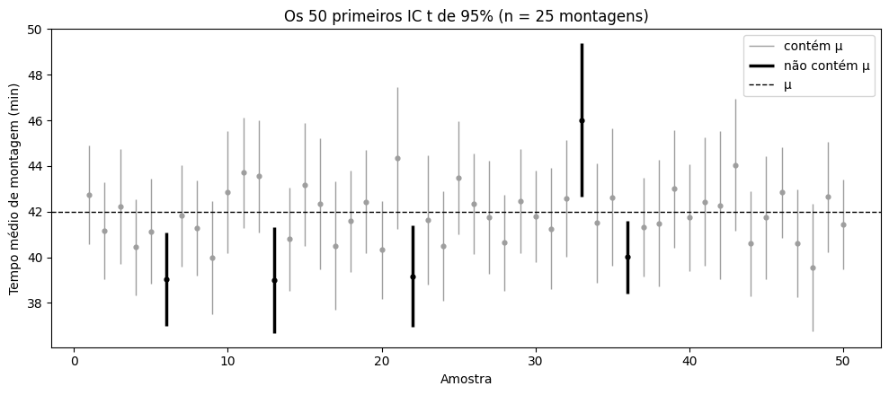
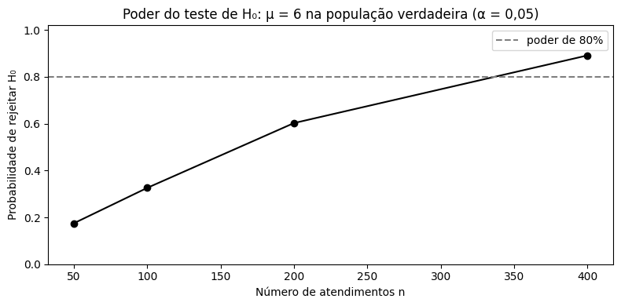

# Capítulo 04 — Resoluções

[Notebook do estudante](../ch04-student.ipynb) · [exercícios](../exercises/ch04.md)

Consulte as resoluções depois da tentativa.

# Resoluções 01–06

**Prof. Daniel de Abreu Pereira Uhr**

**Curso:** Estatística e Econometria com Python


Daniel de Abreu Pereira Uhr · Capítulo 4

## Contexto — Marcenaria

A marcenaria, empresa fictícia, quer estimar o **tempo médio de montagem** de um modelo de estante, em minutos, para planejar a produção. Um analista cronometrou 25 montagens sorteadas.

Como no capítulo, há duas camadas: o **analista** vê apenas a amostra; o **laboratório** conhece a população sintética de 20.000 montagens e verifica o comportamento do procedimento. A distribuição gama é usada apenas para gerar tempos positivos; suas propriedades não são objeto de estudo.

Execute a célula abaixo antes de começar. Use o mesmo gerador `rng` em todas as questões, na ordem em que aparecem: assim, seus resultados coincidirão com os da resolução.

```python
import numpy as np
import pandas as pd
import matplotlib.pyplot as plt
from scipy import stats

rng = np.random.default_rng(2026)
tempos_montagem = np.round(rng.gamma(shape=49, scale=6 / 7, size=20_000), 1)
```

## Resolução do Exercício 01 — Uma amostra e seu intervalo

No laboratório, calcule o tempo médio $\mu$ e o desvio-padrão $\sigma$ da população (dividindo pelo tamanho da população). Depois, como o analista, sorteie com reposição 25 montagens e calcule a estimativa do tempo médio, o desvio-padrão amostral e o erro-padrão estimado. Construa o IC de 95% com a distribuição $t$ à mão e confira com `stats.t.interval`. O intervalo contém $\mu$?

**Raciocínio:** o laboratório calcula os parâmetros; o analista calcula $\bar{x}$, $s$ e $s/\sqrt{n}$ e usa o quantil 0,975 da $t$ com $n - 1 = 24$ graus de liberdade.

```python
mu = tempos_montagem.mean()
sigma = tempos_montagem.std()
print(f"Laboratório: μ = {mu:.2f} min; σ = {sigma:.2f} min; assimetria = {pd.Series(tempos_montagem).skew():.2f}")

n = 25
amostra = rng.choice(tempos_montagem, size=n, replace=True)
media_amostral = amostra.mean()
erro_padrao = amostra.std(ddof=1) / np.sqrt(n)

t_critico = stats.t.ppf(0.975, df=n - 1)
ic = (media_amostral - t_critico * erro_padrao, media_amostral + t_critico * erro_padrao)
ic_biblioteca = stats.t.interval(0.95, df=n - 1, loc=media_amostral, scale=erro_padrao)

print(f"Analista: x̄ = {media_amostral:.2f} min; s = {amostra.std(ddof=1):.2f} min; erro-padrão = {erro_padrao:.2f} min")
print(f"IC de 95% à mão: {ic[0]:.2f} a {ic[1]:.2f} min")
print(f"IC de 95% com stats.t.interval: {ic_biblioteca[0]:.2f} a {ic_biblioteca[1]:.2f} min")
print(f"O intervalo contém μ? {ic[0] <= mu <= ic[1]}")
```

```text
Laboratório: μ = 41.99 min; σ = 5.96 min; assimetria = 0.27
Analista: x̄ = 40.74 min; s = 4.36 min; erro-padrão = 0.87 min
IC de 95% à mão: 38.94 a 42.54 min
IC de 95% com stats.t.interval: 38.94 a 42.54 min
O intervalo contém μ? True
```

**Resultado e interpretação:** a população tem $\mu \approx 42{,}0$ min e $\sigma \approx 6{,}0$ min, com assimetria pequena. O analista estima o tempo médio em 40,74 min, com IC de 95% de 38,94 a 42,54 min; o cálculo à mão coincide com a biblioteca. Neste caso, o intervalo contém $\mu$ — o que o analista não poderia verificar.

## Resolução do Exercício 02 — Comunicar o intervalo

Classifique cada frase como correta ou incorreta e justifique:

1. “Há 95% de probabilidade de o tempo médio de montagem estar dentro do intervalo calculado.”
2. “Se repetíssemos o procedimento muitas vezes, cerca de 95% dos intervalos conteriam o tempo médio verdadeiro.”
3. “95% das montagens levam um tempo dentro do intervalo.”
4. “Com outra amostra de 25 montagens, obteríamos outro intervalo.”

Em seguida, escreva uma frase para a gerente de produção que comunique a estimativa, a unidade e o intervalo.

**Raciocínio:** o nível de confiança é uma propriedade do procedimento; o intervalo é sobre a média, não sobre montagens individuais.

1. **Incorreta.** Depois de calculado, o intervalo contém ou não contém $\mu$; o 95% descreve o procedimento, não este intervalo.
2. **Correta.** É a interpretação frequentista da cobertura.
3. **Incorreta.** O intervalo descreve a incerteza sobre o tempo **médio**. Montagens individuais variam muito mais: o desvio-padrão é de cerca de 6 minutos.
4. **Correta.** O intervalo é aleatório antes da amostragem; outra amostra produziria outra estimativa e outro intervalo.

**Frase para a gerente:** “Estimamos o tempo médio de montagem da estante em 40,7 minutos. Com 95% de confiança, ele está entre 38,9 e 42,5 minutos — ou seja, o procedimento que usamos produz intervalos que contêm o tempo médio verdadeiro em cerca de 95% das amostras.”

## Resolução do Exercício 03 — Cobertura

Repita $R = 5.000$ vezes o procedimento do analista ($n = 25$, IC $t$ de 95%) e calcule a proporção de intervalos que contêm $\mu$. Faça um gráfico com os 50 primeiros intervalos, destacando os que não contêm $\mu$. O resultado confirma o nível de confiança?

**Raciocínio:** repetimos o procedimento completo — amostra, estimativa, erro-padrão estimado e intervalo — 5.000 vezes.

```python
R = 5_000
amostras = rng.choice(tempos_montagem, size=(R, n), replace=True)
medias = amostras.mean(axis=1)
margens = t_critico * amostras.std(axis=1, ddof=1) / np.sqrt(n)
contem_mu = np.abs(medias - mu) <= margens
print(f"Cobertura do IC t de 95% com n = 25: {contem_mu.mean():.4f}")

primeiros = np.arange(50)
fig, ax = plt.subplots(figsize=(10, 4.5))
for contem, cor, espessura, rotulo in [(True, "#9E9E9E", 1.0, "contém μ"), (False, "black", 2.5, "não contém μ")]:
    selecao = primeiros[contem_mu[primeiros] == contem]
    ax.vlines(selecao + 1, medias[selecao] - margens[selecao], medias[selecao] + margens[selecao], color=cor, linewidth=espessura, label=rotulo)
    ax.scatter(selecao + 1, medias[selecao], color=cor, s=12, zorder=3)
ax.axhline(mu, color="black", linestyle="--", linewidth=1, label="μ")
ax.set_title("Os 50 primeiros IC t de 95% (n = 25 montagens)")
ax.set_xlabel("Amostra")
ax.set_ylabel("Tempo médio de montagem (min)")
ax.legend(loc="upper right")
fig.tight_layout()
plt.show()
```

```text
Cobertura do IC t de 95% com n = 25: 0.9488
```



**Resultado e interpretação:** 94,9% dos 5.000 intervalos contêm $\mu$. A população é pouco assimétrica, e a $t$ com 24 graus de liberdade descreve bem a estatística padronizada; por isso, o nível declarado se confirma. O gráfico mostra que a largura dos intervalos também varia, porque cada amostra tem seu próprio $s$. Entre os 50 primeiros, 5 não contêm $\mu$ — mais que 5%, por acaso; a cobertura se avalia no conjunto das 5.000 repetições.

## Resolução do Exercício 04 — Nível de confiança e tamanho da amostra

Com a amostra de Exercício 01, calcule os IC de 90% e 99% e compare suas larguras com a do IC de 95%. Depois, usando $\sigma = 6$ minutos como valor de planejamento, calcule quantas montagens seriam necessárias para uma margem de erro de 2 minutos e de 1 minuto, com 95% de confiança.

**Raciocínio:** um nível maior exige quantil maior e intervalo mais largo. Para o tamanho, usamos $n \approx (1{,}96\,\sigma/m)^2$, arredondado para cima.

```python
for nivel in [0.90, 0.95, 0.99]:
    inferior, superior = stats.t.interval(nivel, df=n - 1, loc=media_amostral, scale=erro_padrao)
    print(f"IC de {nivel:.0%}: {inferior:.2f} a {superior:.2f} min   largura {superior - inferior:.2f} min")

sigma_planejamento = 6
for margem in [2, 1]:
    print(f"Margem de {margem} min: cerca de {int(np.ceil((stats.norm.ppf(0.975) * sigma_planejamento / margem) ** 2))} montagens")
```

```text
IC de 90%: 39.25 a 42.24 min   largura 2.98 min
IC de 95%: 38.94 a 42.54 min   largura 3.60 min
IC de 99%: 38.31 a 43.18 min   largura 4.88 min
Margem de 2 min: cerca de 35 montagens
Margem de 1 min: cerca de 139 montagens
```

**Resultado e interpretação:** com a mesma amostra, a largura do intervalo passa de 2,98 min (90%) para 3,60 min (95%) e 4,88 min (99%): mais confiança custa precisão. Para uma margem de 2 minutos, bastam cerca de 35 montagens; para 1 minuto, cerca de 139. Reduzir a margem à metade exige quadruplicar a amostra.

## Resolução do Exercício 05 — O que o intervalo não captura

Para facilitar a cronometragem, a gerente sugere medir apenas montagens do turno da manhã, feitas pela equipe mais experiente. Explique o que um IC calculado com essa amostra estimaria e por que ele poderia ser estreito e, ainda assim, enganoso para planejar a produção de toda a fábrica.

**Raciocínio:** o IC mede a variação de amostra para amostra **dentro da população que foi amostrada**.

Com montagens apenas do turno da manhã e da equipe mais experiente, o intervalo estimaria o tempo médio **desse grupo**, e não o da fábrica. Se a equipe experiente for mais rápida, o intervalo ficaria deslocado para baixo. Poderia, ainda assim, ser estreito: equipes homogêneas variam pouco, e $s$ seria pequeno. Um intervalo estreito em torno do valor errado transmite uma falsa sensação de precisão, como na seção 3.13 do Capítulo 3. Para planejar a produção, a amostra precisa representar todos os turnos e equipes.

## Resolução do Exercício 06 — Montagens com retrabalho

Em uma linha nova, 10% das montagens exigem retrabalho, que acrescenta um tempo extra com distribuição exponencial de média 25 minutos. No laboratório, crie essa população com o comando abaixo, logo após Exercício 04:

A geração dessa população está incluída no bloco de resolução a seguir. Execute-a uma única vez para preservar a sequência aleatória.

Calcule a média e a assimetria dessa população. Para $n = 10$, $40$ e $160$, estime por simulação ($R = 5.000$) a cobertura do IC $t$ de 95%. O que acontece com o “95%” e por quê?

**Raciocínio:** o retrabalho cria uma cauda longa à direita. A $t$ é exata apenas para dados Normais; com assimetria forte, verificamos a cobertura no laboratório.

```python
retrabalho = rng.random(20_000) < 0.10
tempos_retrabalho = np.round(tempos_montagem + np.where(retrabalho, rng.exponential(25, size=20_000), 0), 1)
mu_retrabalho = tempos_retrabalho.mean()
print(f"População com retrabalho: μ = {mu_retrabalho:.2f} min; assimetria = {pd.Series(tempos_retrabalho).skew():.2f}")

for tamanho in [10, 40, 160]:
    repeticoes = rng.choice(tempos_retrabalho, size=(R, tamanho), replace=True)
    margem = stats.t.ppf(0.975, df=tamanho - 1) * repeticoes.std(axis=1, ddof=1) / np.sqrt(tamanho)
    cobertura = (np.abs(repeticoes.mean(axis=1) - mu_retrabalho) <= margem).mean()
    print(f"n = {tamanho:>3}: cobertura do IC t de 95% = {cobertura:.4f}")
```

```text
População com retrabalho: μ = 44.61 min; assimetria = 4.43
n =  10: cobertura do IC t de 95% = 0.8900
n =  40: cobertura do IC t de 95% = 0.8914
n = 160: cobertura do IC t de 95% = 0.9216
```

**Resultado e interpretação:** com retrabalho, o tempo médio sobe para 44,61 min e a assimetria passa de cerca de 0,3 para 4,43. A cobertura do IC $t$ “de 95%” fica em 89,0% com 10 montagens, 89,1% com 40 e 92,2% com 160 — ainda abaixo do nível declarado.

Em amostras pequenas, a maioria não contém nenhuma ou quase nenhuma montagem com retrabalho; nelas, $\bar{x}$ e $s$ saem baixos ao mesmo tempo, e o intervalo fica estreito e abaixo de $\mu$. A aproximação melhora com $n$, mas devagar, como vimos na seção 3.12 do Capítulo 3.

O “95%” é uma propriedade do procedimento **sob pressupostos**. Quando eles falham — aqui, pela forte assimetria —, a cobertura real pode ficar abaixo da nominal. Com dados assim, vale examinar a distribuição, usar amostras maiores e reportar o resultado com cautela.

# Resoluções 07–12

**Prof. Daniel de Abreu Pereira Uhr**

**Curso:** Estatística e Econometria com Python


Daniel de Abreu Pereira Uhr · Capítulo 4

## Contexto — Central de atendimento do experimento

A Central central de atendimento do experimento, empresa fictícia de atendimento ao cliente, tem como meta um **tempo médio de atendimento de 6 minutos**. A gerente quer saber se o tempo médio atual é compatível com a meta. O analista sorteou 50 atendimentos.

O laboratório conhece a população sintética de 50.000 atendimentos. A distribuição gama é usada apenas para gerar tempos positivos e assimétricos.

Execute a célula abaixo antes de começar e use o mesmo gerador `rng` em todas as questões, na ordem em que aparecem.

```python
import numpy as np
import pandas as pd
import matplotlib.pyplot as plt
from scipy import stats

rng = np.random.default_rng(2026)
tempos_atendimento = np.round(rng.gamma(shape=(6.4 / 2.5) ** 2, scale=2.5**2 / 6.4, size=50_000), 2)
meta = 6
```

## Resolução do Exercício 07 — Hipóteses e estatística de teste

Formule as hipóteses nula e alternativa para a pergunta da gerente e justifique a escolha de um teste bilateral. Como o analista, sorteie com reposição 50 atendimentos e calcule a estimativa do tempo médio, o erro-padrão estimado e a estatística de teste à mão.

**Raciocínio:** a pergunta é se o tempo médio é compatível com a meta, sem direção definida previamente: tempos acima da meta prejudicam o cliente, e tempos muito abaixo podem indicar atendimento apressado. Por isso,

$$H_0: \mu = 6 \qquad \text{contra} \qquad H_1: \mu \neq 6$$

```python
n = 50
amostra = rng.choice(tempos_atendimento, size=n, replace=True)
media_amostral = amostra.mean()
erro_padrao = amostra.std(ddof=1) / np.sqrt(n)
t_observado = (media_amostral - meta) / erro_padrao

print(f"Estimativa do tempo médio: {media_amostral:.3f} min")
print(f"Erro-padrão estimado: {erro_padrao:.3f} min")
print(f"Estatística de teste: t = {t_observado:.3f}")
```

```text
Estimativa do tempo médio: 6.173 min
Erro-padrão estimado: 0.346 min
Estatística de teste: t = 0.499
```

**Resultado e interpretação:** o tempo médio estimado é de 6,17 min, com erro-padrão de cerca de 0,35 min. A estimativa está cerca de meio erro-padrão acima da meta.

## Resolução do Exercício 08 — P-valor e intervalo

Calcule o p-valor bilateral pela distribuição $t$ e confira com `stats.ttest_1samp`. Calcule também o IC de 95%. Interprete o p-valor em uma frase, indique duas interpretações incorretas que devem ser evitadas e verifique a relação entre o intervalo e o teste.

**Raciocínio:** o p-valor bilateral soma as áreas da $t$ com 49 graus de liberdade além de $|t_{obs}|$ nas duas caudas.

```python
p_valor = 2 * (1 - stats.t.cdf(abs(t_observado), df=n - 1))
teste = stats.ttest_1samp(amostra, popmean=meta)
ic = teste.confidence_interval(confidence_level=0.95)

print(f"P-valor pela distribuição t: {p_valor:.4f}")
print(f"ttest_1samp: t = {teste.statistic:.3f}; p-valor = {teste.pvalue:.4f}")
print(f"IC de 95%: {ic.low:.2f} a {ic.high:.2f} min")
print(f"A meta está dentro do IC? {ic.low <= meta <= ic.high}")
```

```text
P-valor pela distribuição t: 0.6200
ttest_1samp: t = 0.499; p-valor = 0.6200
IC de 95%: 5.48 a 6.87 min
A meta está dentro do IC? True
```

**Resultado e interpretação:** o p-valor é 0,62: se o tempo médio fosse exatamente 6 minutos, cerca de 62% das amostras de 50 atendimentos produziriam uma estatística tão ou mais distante de zero quanto a observada. Os dados são compatíveis com a meta.

Interpretações incorretas a evitar: “há 62% de probabilidade de a meta estar sendo cumprida” (o p-valor não é a probabilidade de $H_0$) e “a diferença foi causada pelo acaso” (o p-valor não diz por que os dados são como são).

O IC de 95%, de 5,48 a 6,87 min, contém a meta, como esperado para um p-valor bilateral acima de 0,05. Mas o intervalo também contém tempos quase 1 minuto acima da meta: os dados são compatíveis com valores bem diferentes de 6.

## Resolução do Exercício 09 — Unilateral depois de ver os dados?

Depois de ver a estimativa, um supervisor propõe: “como a média deu acima de 6, vamos testar só se o tempo **aumentou**; assim o p-valor fica menor”. Calcule o p-valor do teste unilateral (`alternative="greater"`) e avalie a proposta. Em que situação um teste unilateral seria justificável?

**Raciocínio:** o teste unilateral conta só uma cauda; por isso, quando a estimativa está na direção escolhida, seu p-valor é metade do bilateral.

```python
teste_unilateral = stats.ttest_1samp(amostra, popmean=meta, alternative="greater")
print(f"P-valor unilateral (H₁: μ > 6): {teste_unilateral.pvalue:.4f}")
print(f"P-valor bilateral: {teste.pvalue:.4f}")
```

```text
P-valor unilateral (H₁: μ > 6): 0.3100
P-valor bilateral: 0.6200
```

**Avaliação:** o p-valor unilateral é 0,31, metade do bilateral. A proposta é inadequada: a direção foi escolhida **depois** de ver que a média ficou acima de 6. Se o analista sempre escolhesse a direção que os dados indicam, rejeitaria $H_0$ com mais frequência que o $\alpha$ declarado quando $H_0$ fosse verdadeira. Aqui, além disso, a mudança não altera a conclusão.

Um teste unilateral seria justificável se, **antes** da coleta, a central tivesse definido que apenas um aumento do tempo levaria a alguma ação — por exemplo, contratar atendentes — e que tempos abaixo da meta seriam irrelevantes para a decisão.

## Resolução do Exercício 10 — Erros tipo I e II

No laboratório, crie um mundo em que a meta é exatamente cumprida, deslocando todos os tempos para que a média seja 6. Simule $R = 5.000$ amostras de 50 atendimentos desse mundo e calcule a proporção de rejeições de $H_0$ com $\alpha = 0{,}05$. Depois, faça o mesmo com a população verdadeira. Interprete os dois resultados em termos de erro tipo I, erro tipo II e poder.

**Raciocínio:** no mundo deslocado, $H_0$ é verdadeira, e toda rejeição é erro tipo I. Na população verdadeira, $H_0$ é falsa, e toda não rejeição é erro tipo II.

```python
mu = tempos_atendimento.mean()
print(f"Laboratório: tempo médio verdadeiro μ = {mu:.3f} min")

R = 5_000

def taxa_rejeicao(populacao, tamanho):
    repeticoes = rng.choice(populacao, size=(R, tamanho), replace=True)
    t = (repeticoes.mean(axis=1) - meta) / (repeticoes.std(axis=1, ddof=1) / np.sqrt(tamanho))
    return (np.abs(t) > stats.t.ppf(0.975, df=tamanho - 1)).mean()

mundo_meta = tempos_atendimento + (meta - mu)
erro_tipo_1 = taxa_rejeicao(mundo_meta, n)
poder_50 = taxa_rejeicao(tempos_atendimento, n)

print(f"Rejeição quando μ = 6 (erro tipo I): {erro_tipo_1:.4f}")
print(f"Rejeição quando μ = {mu:.2f} (poder): {poder_50:.4f}")
print(f"Erro tipo II: {1 - poder_50:.4f}")
```

```text
Laboratório: tempo médio verdadeiro μ = 6.392 min
Rejeição quando μ = 6 (erro tipo I): 0.0532
Rejeição quando μ = 6.39 (poder): 0.1748
Erro tipo II: 0.8252
```

**Resultado e interpretação:** no laboratório, o tempo médio verdadeiro é de cerca de 6,39 min — a meta **não** está sendo cumprida. Quando a meta é exatamente cumprida, o teste rejeita $H_0$ em cerca de 5% das amostras, perto de $\alpha$: é a taxa de erro tipo I. Na população verdadeira, o teste rejeita em apenas cerca de 17% das amostras; em cerca de 83%, comete erro tipo II. Uma diferença de 0,4 min é pequena perto do erro-padrão com 50 atendimentos.

## Resolução do Exercício 11 — Poder e tamanho da amostra

Na população verdadeira, estime por simulação o poder do teste para $n = 50$, $100$, $200$ e $400$ atendimentos. Faça um gráfico do poder em função de $n$ e explique de que fatores o poder depende.

**Raciocínio:** usamos a mesma função de Exercício 10 para vários tamanhos.

```python
tamanhos = [50, 100, 200, 400]
poder = [poder_50] + [taxa_rejeicao(tempos_atendimento, tamanho) for tamanho in tamanhos[1:]]
print(pd.DataFrame({"n": tamanhos, "poder": poder}).round(3).to_string(index=False))

fig, ax = plt.subplots(figsize=(8, 4))
ax.plot(tamanhos, poder, color="black", marker="o")
ax.axhline(0.8, color="#7F7F7F", linestyle="--", label="poder de 80%")
ax.set_ylim(0, 1.02)
ax.set_title("Poder do teste de H₀: μ = 6 na população verdadeira (α = 0,05)")
ax.set_xlabel("Número de atendimentos n")
ax.set_ylabel("Probabilidade de rejeitar H₀")
ax.legend()
fig.tight_layout()
plt.show()
```

```text
  n  poder
 50  0.175
100  0.326
200  0.603
400  0.892
```



**Resultado e interpretação:** o poder cresce de cerca de 17% com 50 atendimentos para cerca de 33%, 60% e 89% com 100, 200 e 400. Ele depende da magnitude da diferença verdadeira (cerca de 0,4 min), da variabilidade dos tempos (desvio de cerca de 2,5 min), do tamanho da amostra, de $\alpha$ e do desenho do estudo.

## Resolução do Exercício 12 — “O tempo médio não mudou”

Com base no p-valor de Exercício 08, a gerente conclui: “o tempo médio continua em 6 minutos; não precisamos agir”.

1. Avalie a conclusão usando o IC de Exercício 08 e o poder estimado em Exercício 11.
2. Encontre por simulação, testando tamanhos entre 250 e 350, o menor número de atendimentos entre os tamanhos testados que dá poder de pelo menos 80% para detectar a diferença existente no laboratório.
3. Reescreva a conclusão da gerente de forma responsável.

**Raciocínio:** combinamos o IC, que mostra os valores compatíveis com os dados, e o poder, que mostra se o teste era capaz de detectar a diferença existente.

```python
for tamanho in [250, 275, 300, 325, 350]:
    print(f"n = {tamanho}: poder = {taxa_rejeicao(tempos_atendimento, tamanho):.3f}")
```

```text
n = 250: poder = 0.713
n = 275: poder = 0.753
n = 300: poder = 0.793
n = 325: poder = 0.819
n = 350: poder = 0.845
```

**Avaliação:**

1. **A conclusão não se sustenta.** O p-valor alto indica que os dados são compatíveis com a meta, não que o tempo médio seja 6 minutos. O IC vai de cerca de 5,5 a 6,9 min: inclui tempos quase 1 minuto acima da meta. Além disso, com 50 atendimentos, o teste tinha apenas cerca de 17% de chance de detectar a diferença existente no laboratório.
2. **Tamanho necessário.** Na grade testada, o poder passa de 80% entre 300 e 325 atendimentos (79,3% e 81,9%); o menor tamanho da grade com poder de pelo menos 80% é 325. O valor exato varia um pouco com o ruído da simulação. É mais de seis vezes a amostra atual.
3. **Conclusão responsável:** “Com 50 atendimentos, estimamos o tempo médio em 6,2 minutos, com IC de 95% de 5,5 a 6,9 minutos. Os dados não permitem afirmar que a meta está sendo descumprida, mas também não mostram que ela está sendo cumprida: tempos até cerca de 1 minuto acima da meta são compatíveis com a amostra. Para uma conclusão mais precisa, recomendamos cronometrar cerca de 325 atendimentos.”

# Resoluções 13–18

**Prof. Daniel de Abreu Pereira Uhr**

**Curso:** Estatística e Econometria com Python


Daniel de Abreu Pereira Uhr · Capítulo 4

## Contexto — Livraria

A livraria, livraria online fictícia, testou um novo checkout. Durante o teste, 2.000 visitantes foram **sorteados** para a versão atual (A) e 2.000 para a nova (B). Para cada visitante, a empresa registrou se comprou e o valor do pedido (zero para quem não comprou). O novo checkout tem custo de licença e só compensa se elevar a conversão em **pelo menos 1 ponto percentual**.

No laboratório, as taxas de conversão verdadeiras são 8,0% na versão A e 9,5% na versão B. O analista não conhece esses valores; ele vê apenas a tabela `visitantes`.

Execute a célula abaixo antes de começar e use o mesmo gerador `rng` em todas as questões, na ordem em que aparecem.

```python
import numpy as np
import pandas as pd
import matplotlib.pyplot as plt
from scipy import stats
from statsmodels.stats.proportion import confint_proportions_2indep, proportions_ztest

rng = np.random.default_rng(2026)
visitas_por_versao = 2_000
comprou_a = rng.random(visitas_por_versao) < 0.080
comprou_b = rng.random(visitas_por_versao) < 0.095
valores_a = np.round(rng.gamma(shape=(120 / 50) ** 2, scale=50**2 / 120, size=comprou_a.sum()), 2)
valores_b = np.round(rng.gamma(shape=(115 / 50) ** 2, scale=50**2 / 115, size=comprou_b.sum()), 2)

visitantes = pd.DataFrame({
    "versao": np.repeat(["A", "B"], visitas_por_versao),
    "comprou": np.concatenate([comprou_a, comprou_b]),
})
visitantes["valor_pedido"] = 0.0
visitantes.loc[visitantes["comprou"], "valor_pedido"] = np.concatenate([valores_a, valores_b])
```

## Resolução do Exercício 13 — Diferença de conversão

Calcule a taxa de conversão de cada versão e a diferença B − A em pontos percentuais. Construa o IC de 95% da diferença à mão e confira com `confint_proportions_2indep`; faça o teste de $H_0: p_B = p_A$ com `proportions_ztest`. Compare o intervalo com o limiar de 1 ponto percentual.

**Raciocínio:** cada versão é um grupo independente de visitantes. O IC usa a soma das variâncias das duas proporções; o teste usa a proporção combinada, porque sob $H_0$ as taxas são iguais.

```python
conversao = visitantes.groupby("versao")["comprou"].agg(["sum", "count", "mean"])
print(conversao)

p_a, p_b = conversao.loc["A", "mean"], conversao.loc["B", "mean"]
diferenca = p_b - p_a
erro = np.sqrt(p_a * (1 - p_a) / visitas_por_versao + p_b * (1 - p_b) / visitas_por_versao)
z_critico = stats.norm.ppf(0.975)

print(f"Diferença B − A: {100 * diferenca:.2f} pontos percentuais")
print(f"IC de 95% à mão: {100 * (diferenca - z_critico * erro):.2f} a {100 * (diferenca + z_critico * erro):.2f} p.p.")
ic_lib = confint_proportions_2indep(conversao.loc["B", "sum"], visitas_por_versao, conversao.loc["A", "sum"], visitas_por_versao, method="wald", compare="diff")
print(f"IC de 95% com confint_proportions_2indep: {100 * ic_lib[0]:.2f} a {100 * ic_lib[1]:.2f} p.p.")
z, p_valor = proportions_ztest([conversao.loc["B", "sum"], conversao.loc["A", "sum"]], [visitas_por_versao, visitas_por_versao])
print(f"Teste: z = {z:.3f}; p-valor = {p_valor:.4f}")
```

```text
        sum  count    mean
versao                    
A       150   2000  0.0750
B       181   2000  0.0905
Diferença B − A: 1.55 pontos percentuais
IC de 95% à mão: -0.16 a 3.26 p.p.
IC de 95% com confint_proportions_2indep: -0.16 a 3.26 p.p.
Teste: z = 1.779; p-valor = 0.0752
```

**Resultado e interpretação:** a conversão foi de 7,50% na versão A e 9,05% na B, uma diferença de 1,55 ponto percentual. O IC de 95% vai de cerca de −0,16 a 3,26 pontos, e o p-valor é 0,075.

O intervalo inclui zero — os dados não descartam ausência de efeito — e também valores bem acima do limiar de 1 ponto. A estimativa central supera o limiar, mas a incerteza é grande demais para concluir que o ganho é relevante.

## Resolução do Exercício 14 — Valor dos pedidos

Entre os visitantes que compraram, compare o valor médio do pedido nas duas versões com o teste de Welch: diferença B − A, IC de 95% e p-valor. Por que usar Welch?

**Raciocínio:** comparamos as médias de dois grupos independentes de compradores; Welch não exige variâncias iguais.

```python
compradores = visitantes[visitantes["comprou"]]
valor_a = compradores.loc[compradores["versao"] == "A", "valor_pedido"]
valor_b = compradores.loc[compradores["versao"] == "B", "valor_pedido"]

print(compradores.groupby("versao")["valor_pedido"].agg(["count", "mean", "std"]).round(2))
welch_valor = stats.ttest_ind(valor_b, valor_a, equal_var=False)
ic_valor = welch_valor.confidence_interval(confidence_level=0.95)
print(f"Diferença B − A: R$ {valor_b.mean() - valor_a.mean():.2f}; IC de 95%: R$ {ic_valor.low:.2f} a R$ {ic_valor.high:.2f}; p-valor = {welch_valor.pvalue:.4f}")
```

```text
        count    mean    std
versao                      
A         150  125.24  55.38
B         181  116.84  49.89
Diferença B − A: R$ -8.40; IC de 95%: R$ -19.90 a R$ 3.11; p-valor = 0.1521
```

**Resultado e interpretação:** o valor médio do pedido foi R\$ 125,24 na versão A e R\$ 116,84 na B, uma diferença de −R\$ 8,40, com IC de 95% de cerca de −R\$ 19,90 a R\$ 3,11 e p-valor de 0,15. Os dados são compatíveis com nenhuma diferença, mas também com uma redução de quase R\$ 20 por pedido. Welch é o padrão porque os dois grupos podem ter variâncias diferentes e tamanhos diferentes.

Note que os compradores de cada versão não são mais grupos sorteados: se o novo checkout atrai compradores diferentes, a comparação do valor do pedido mistura o efeito sobre o valor com quem passou a comprar.

## Resolução do Exercício 15 — Receita por visitante

A receita por visitante é a média de `valor_pedido` entre **todos** os visitantes, incluindo os que não compraram. Estime a diferença B − A com Welch e interprete o resultado em conjunto com Exercício 13 e Exercício 14.

**Raciocínio:** a receita por visitante combina conversão e valor do pedido. Como é a média de uma variável medida em todos os visitantes sorteados, a comparação preserva o sorteio.

```python
receita_a = visitantes.loc[visitantes["versao"] == "A", "valor_pedido"]
receita_b = visitantes.loc[visitantes["versao"] == "B", "valor_pedido"]

welch_receita = stats.ttest_ind(receita_b, receita_a, equal_var=False)
ic_receita = welch_receita.confidence_interval(confidence_level=0.95)
print(f"Receita por visitante: A = R$ {receita_a.mean():.2f}; B = R$ {receita_b.mean():.2f}")
print(f"Diferença B − A: R$ {receita_b.mean() - receita_a.mean():.2f}; IC de 95%: R$ {ic_receita.low:.2f} a R$ {ic_receita.high:.2f}; p-valor = {welch_receita.pvalue:.4f}")
```

```text
Receita por visitante: A = R$ 9.39; B = R$ 10.57
Diferença B − A: R$ 1.18; IC de 95%: R$ -1.08 a R$ 3.44; p-valor = 0.3062
```

**Resultado e interpretação:** a receita por visitante foi de R\$ 9,39 na versão A e R\$ 10,57 na B. A diferença estimada, R\$ 1,18, é positiva, mas o IC de 95%, de −R\$ 1,08 a R\$ 3,44, inclui zero (p-valor de 0,31): a maior conversão parece compensar o pedido um pouco menor, sem precisão suficiente para afirmar ganho de receita. A distribuição de `valor_pedido` é muito assimétrica — a maioria dos valores é zero —, mas, com 2.000 visitantes por versão, a média tem distribuição aproximadamente Normal (Capítulo 3).

## Resolução do Exercício 16 — O que o sorteio permite concluir

Explique por que o sorteio dos visitantes permite ler a diferença de conversão como estimativa do efeito do novo checkout. Cite dois limites dessa leitura.

**Raciocínio:** o sorteio cria dois grupos que, em média, só diferem pela versão do checkout.

Como cada visitante teve a mesma chance de ver A ou B, características como renda, interesse em livros ou dispositivo usado se distribuem de forma semelhante nos dois grupos. Por isso, a diferença de conversão estima o **efeito** do novo checkout — e o IC descreve a incerteza dessa estimativa. É o desenho, não o p-valor, que sustenta essa leitura.

Limites:

- o efeito vale para os visitantes e o período do teste; outros públicos ou épocas do ano podem reagir de forma diferente;
- efeitos de novidade podem desaparecer com o tempo;
- o valor do pedido (Exercício 14) compara apenas compradores, que deixam de ser grupos sorteados;
- comparar muitas métricas aumenta a chance de encontrar alguma diferença “significativa” por acaso.

## Resolução do Exercício 17 — O teste foi informativo?

No laboratório, estime por simulação ($R = 5.000$) o poder do teste de Exercício 13 com 2.000 visitantes por versão, usando as taxas verdadeiras. Depois, estime o poder com 4.000, 5.000, 6.000 e 7.000 visitantes por versão. Quantos visitantes seriam necessários para poder de cerca de 80%?

**Raciocínio:** no laboratório, simulamos muitas repetições do teste A/B com as taxas verdadeiras e contamos as rejeições. Usamos a mesma estatística de `proportions_ztest`, com a proporção combinada, calculada de forma vetorizada.

```python
R = 5_000

def poder_teste_ab(visitas, p_a=0.080, p_b=0.095):
    conv_a = rng.binomial(visitas, p_a, size=R) / visitas
    conv_b = rng.binomial(visitas, p_b, size=R) / visitas
    combinada = (conv_a + conv_b) / 2
    z = (conv_b - conv_a) / np.sqrt(combinada * (1 - combinada) * 2 / visitas)
    return (np.abs(z) > z_critico).mean()

for visitas in [2_000, 4_000, 5_000, 6_000, 7_000]:
    print(f"{visitas} visitantes por versão: poder = {poder_teste_ab(visitas):.3f}")
```

```text
2000 visitantes por versão: poder = 0.401
4000 visitantes por versão: poder = 0.666
5000 visitantes por versão: poder = 0.767
6000 visitantes por versão: poder = 0.833
7000 visitantes por versão: poder = 0.877
```

**Resultado e interpretação:** com 2.000 visitantes por versão, o teste tinha apenas 40,1% de chance de detectar a diferença verdadeira de 1,5 ponto. O poder sobe para 66,6% com 4.000, 76,7% com 5.000 e 83,3% com 6.000 visitantes por versão: cerca de 80% exige entre 5.000 e 6.000 — quase três vezes o tamanho usado. O resultado inconclusivo era o mais provável desde o início.

O poder acima se refere ao teste de igualdade contra uma diferença verdadeira de 1,5 ponto. Demonstrar que o ganho supera o limiar de 1 ponto exigiria planejar a análise em torno desse limiar.

## Resolução do Exercício 18 — Recomendação à diretoria

Escreva uma recomendação curta à diretoria da livraria que contenha:

1. as estimativas de conversão, valor do pedido e receita por visitante, com seus intervalos e na unidade adequada;
2. a comparação com o limiar de 1 ponto percentual;
3. a decisão recomendada — adotar, manter em teste ou descartar — e sua justificativa;
4. os limites da conclusão.

**Recomendação (exemplo):**

> **Resultado.** No teste com 2.000 visitantes sorteados por versão, o novo checkout elevou a conversão de 7,50% para 9,05%: diferença estimada de 1,55 ponto percentual, com IC de 95% de −0,16 a 3,26 pontos. O valor médio do pedido caiu R\$ 8,40 (IC de −R\$ 19,90 a R\$ 3,11), e a receita por visitante subiu de R\$ 9,39 para R\$ 10,57 (IC da diferença de −R\$ 1,08 a R\$ 3,44), sem precisão suficiente para afirmar ganho.
>
> **Relevância.** A estimativa central supera o limiar de 1 ponto, mas o intervalo inclui tanto ausência de efeito quanto ganhos de mais de 3 pontos. O teste não permite afirmar que o ganho compensa a licença.
>
> **Decisão.** Recomendamos **manter o teste**, sem adotar nem descartar o novo checkout. O teste atual tinha poder de cerca de 40%; para poder de 80%, são necessários cerca de 6.000 visitantes por versão. O tamanho e a regra de decisão devem ser definidos antes de retomar a coleta.
>
> **Limites.** O sorteio sustenta a leitura da diferença como efeito do checkout para este público e este período. Efeitos de novidade, sazonalidade e mudanças no perfil dos visitantes podem alterar o resultado; a comparação do valor do pedido envolve apenas compradores e não preserva o sorteio.

Uma nova coleta exige protocolo definido previamente. O poder simulado no Exercício17 refere-se à diferença zero, não ao limiar comercial de um ponto. Não acrescente observações até obter significância.

### Transferência do Exercício 18 — Licença e limiar comercial

Mantenha os dados observados e seu IC de 95% para a diferença de conversão. Considere, como hipóteses de planejamento, 10.000 visitantes no próximo período e contribuição constante de R\$ 20 por compra adicional. Compare licenças de R\$ 1.000, R\$ 2.000 e R\$ 6.000, sem novos sorteios. Calcule o limiar de conversão C/(V*m), em pontos percentuais, e transforme a estimativa e os extremos do intervalo por G=V*m*Delta-C. Classifique a evidência pelo critério de intervalo da aula: inteiramente acima do limiar, inteiramente abaixo ou inconclusiva. Explique por que saldo central positivo não garante aprovação, por que o p-valor contra zero não muda com a licença e quais hipóteses impedem interpretar os limites como previsão do caixa.

```python
transfer_a = comprou_a.mean()
transfer_b = comprou_b.mean()
transfer_delta = transfer_b-transfer_a
transfer_se = np.sqrt(
    transfer_a*(1-transfer_a)/2000 + transfer_b*(1-transfer_b)/2000)
transfer_ci = transfer_delta + np.array([-1, 1])*stats.norm.ppf(.975)*transfer_se
transfer_volume, transfer_margin = 10000, 20
transfer_rows = []
for fee in [1000, 2000, 6000]:
    threshold = fee/(transfer_volume*transfer_margin)
    decision = ("ABOVE" if transfer_ci[0] > threshold else
                "BELOW" if transfer_ci[1] < threshold else "INCONCLUSIVE")
    net = transfer_volume*transfer_margin*transfer_delta-fee
    bounds = transfer_volume*transfer_margin*transfer_ci-fee
    transfer_rows.append({
        "fee": fee, "threshold_pp": 100*threshold,
        "net": net, "lower": bounds[0], "upper": bounds[1],
        "decision": decision,
    })
print(pd.DataFrame(transfer_rows).round(2).to_string(index=False))
```

```text
 fee  threshold_pp     net    lower   upper     decision
1000           0.5  2100.0 -1313.77 5513.77 INCONCLUSIVE
2000           1.0  1100.0 -2313.77 4513.77 INCONCLUSIVE
6000           3.0 -2900.0 -6313.77  513.77 INCONCLUSIVE
```

Os três cenários permanecem inconclusivos: o intervalo atravessa cada limiar. Os saldos centrais são 2.100, 1.100 e -2.900 unidades monetárias; seus sinais isolados não encerram a decisão. A informação amostral e o p-valor do teste de igualdade não mudam. Volume futuro fixo, contribuição constante, validade do efeito para o novo público e custos omitidos limitam a transformação econômica; ela não é intervalo de previsão do caixa realizado.
