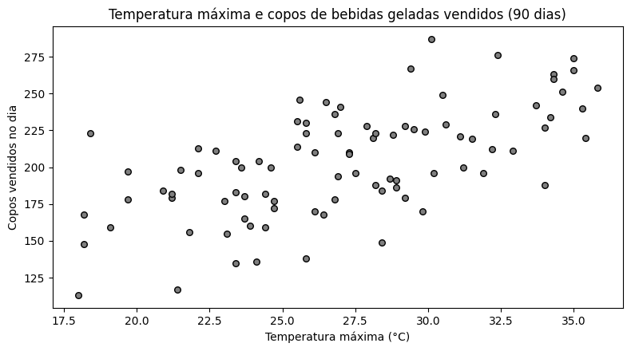
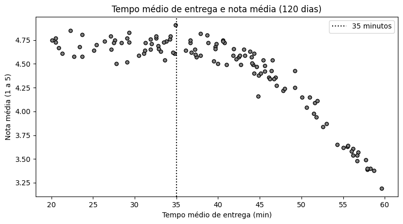
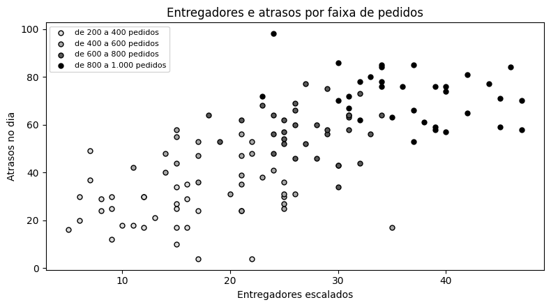
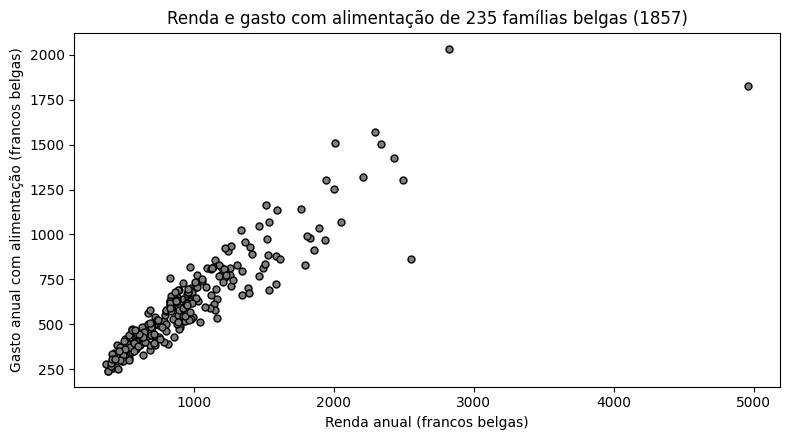
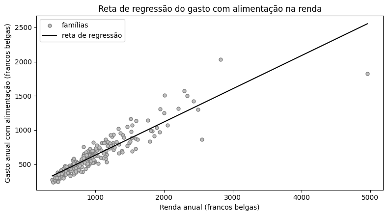
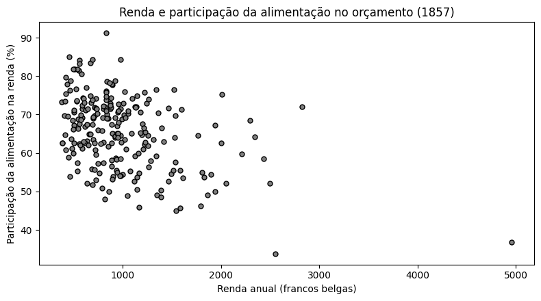

# Capítulo 05 — Resoluções

[Notebook do estudante](../ch05-student.ipynb) · [exercícios](../exercises/ch05.md)

Consulte as resoluções depois da tentativa.

# Resoluções 01–06

**Prof. Daniel de Abreu Pereira Uhr**

**Curso:** Estatística e Econometria com Python


Daniel de Abreu Pereira Uhr · Capítulo 5

## Contexto — Cafeteria do exemplo

A cafeteria do exemplo, empresa fictícia, quer entender a relação entre a **temperatura máxima do dia**, em graus Celsius, e o **número de copos de bebidas geladas vendidos**. Ela registrou os dois valores em 90 dias. Os dados são didáticos.

Execute a célula abaixo antes de começar.

```python
import numpy as np
import pandas as pd
import matplotlib.pyplot as plt

rng = np.random.default_rng(2026)
dias = pd.DataFrame({"temperatura_c": np.round(rng.uniform(18, 36, size=90), 1)})
dias["copos"] = np.round(40 + 6 * dias["temperatura_c"] + rng.normal(0, 25, size=90)).astype(int)
```

## Resolução do Exercício 01 — O gráfico primeiro

Faça o gráfico de dispersão da temperatura (eixo horizontal) e dos copos vendidos (eixo vertical). Descreva direção, forma, intensidade e pontos atípicos.

**Raciocínio:** cada dia é um ponto; a leitura do gráfico vem antes de qualquer medida.

```python
fig, ax = plt.subplots(figsize=(8, 4.5))
ax.scatter(dias["temperatura_c"], dias["copos"], color="#7F7F7F", edgecolor="black", s=30)
ax.set_title("Temperatura máxima e copos de bebidas geladas vendidos (90 dias)")
ax.set_xlabel("Temperatura máxima (°C)")
ax.set_ylabel("Copos vendidos no dia")
fig.tight_layout()
plt.show()
```



**Resultado e interpretação:** a direção é positiva — dias mais quentes tendem a vender mais copos. A forma é aproximadamente linear. A intensidade é moderada: para a mesma temperatura, as vendas variam bastante, o que sugere outros fatores, como dia da semana ou movimento da região. Não há dia muito diferente dos demais.

## Resolução do Exercício 02 — Covariância

Calcule a covariância à mão, a partir dos desvios em relação às médias, e confira com `Series.cov`. Conte quantos dias ficam em cada quadrante em torno das médias. Qual é a unidade da covariância?

**Raciocínio:** a covariância é a soma dos produtos dos desvios dividida por $n - 1$. Produtos positivos aparecem quando o dia está acima ou abaixo das duas médias ao mesmo tempo.

```python
x = dias["temperatura_c"]
y = dias["copos"]
desvio_x = x - x.mean()
desvio_y = y - y.mean()

print("Acima nas duas médias:", ((desvio_x > 0) & (desvio_y > 0)).sum())
print("Abaixo nas duas médias:", ((desvio_x < 0) & (desvio_y < 0)).sum())
print("Sinais opostos:", ((desvio_x * desvio_y) < 0).sum())

covariancia = (desvio_x * desvio_y).sum() / (len(dias) - 1)
print(f"Covariância à mão: {covariancia:.2f}")
print(f"Covariância com pandas: {x.cov(y):.2f}")
```

```text
Acima nas duas médias: 30
Abaixo nas duas médias: 32
Sinais opostos: 28
Covariância à mão: 107.12
Covariância com pandas: 107.12
```

**Resultado e interpretação:** 62 dos 90 dias ficam nos quadrantes de mesmo sinal (30 acima das duas médias e 32 abaixo), e 28 nos de sinais opostos. A covariância é positiva, cerca de 107. Sua unidade é “°C × copos”: o sinal indica a direção, mas a magnitude depende das unidades e não informa a intensidade.

Nos quadrantes de sinais opostos, 13 dias ficaram acima da temperatura média e abaixo da média de vendas. Nos outros 15, a temperatura ficou abaixo da média e as vendas acima.

## Resolução do Exercício 03 — Correlação

Calcule a correlação de Pearson à mão e confira com `Series.corr`.

**Raciocínio:** dividindo a covariância pelos dois desvios-padrão, eliminamos as unidades.

```python
correlacao = covariancia / (x.std() * y.std())
print(f"Correlação à mão: {correlacao:.4f}")
print(f"Correlação com pandas: {x.corr(y):.4f}")
```

```text
Correlação à mão: 0.6319
Correlação com pandas: 0.6319
```

**Resultado e interpretação:** a correlação é de 0,63: associação positiva, aproximadamente linear e com bastante variação em torno do padrão.

## Resolução do Exercício 04 — Graus Fahrenheit

Converta a temperatura para graus Fahrenheit ($F = 1{,}8\,C + 32$) e recalcule a covariância e a correlação com os copos vendidos. O que mudou, o que não mudou e por quê?

**Raciocínio:** somar 32 desloca todos os valores e não altera os desvios; multiplicar por 1,8 multiplica os desvios e o desvio-padrão por 1,8.

```python
temperatura_f = 1.8 * x + 32
print(f"Covariância em °C: {x.cov(y):.2f}   em °F: {temperatura_f.cov(y):.2f}   razão: {temperatura_f.cov(y) / x.cov(y):.2f}")
print(f"Correlação em °C: {x.corr(y):.4f}   em °F: {temperatura_f.corr(y):.4f}")
```

```text
Covariância em °C: 107.12   em °F: 192.82   razão: 1.80
Correlação em °C: 0.6319   em °F: 0.6319
```

**Resultado e interpretação:** a covariância fica 1,8 vezes maior em Fahrenheit, porque os desvios de temperatura são multiplicados por 1,8. A correlação não muda: o fator 1,8 aparece também no desvio-padrão da temperatura e se cancela. A soma de 32 não altera nenhuma das duas medidas. A relação entre temperatura e vendas é a mesma; só a escala mudou.

## Resolução do Exercício 05 — O que a correlação diz

Um sócio pergunta se a correlação obtida é “forte”. Responda sem usar faixas fixas: o que o número, o gráfico e o contexto permitem dizer? Cite algo que a correlação **não** permite concluir.

**Raciocínio:** combinamos o número, o gráfico e o contexto, sem faixas fixas.

**Resposta:** a correlação de 0,63 indica que dias mais quentes tendem a ter mais vendas, com uma relação aproximadamente linear, mas com bastante dispersão: para a mesma temperatura, as vendas variam muito. Isso é útil para o planejamento geral — esperar mais vendas em semanas quentes —, mas não basta para prever com precisão as vendas de um dia específico.

A correlação **não** permite concluir quanto as vendas aumentam por grau — essa pergunta pede uma inclinação, com unidade (seção 5.8) —, nem garante que a relação valha fora da faixa de 18 a 36 °C. Também não demonstra, sozinha, que a temperatura causa as vendas, embora a explicação seja plausível; dias quentes podem coincidir com férias ou fins de semana.

## Resolução do Exercício 06 — O dia do festival

Em um dia de 21 °C, um festival na praça em frente à cafeteria levou a 520 copos vendidos. Acrescente esse dia aos dados e recalcule as correlações de Pearson e de Spearman (`method="spearman"`). Como esse dia deveria ser tratado e comunicado na análise?

**Raciocínio:** acrescentamos o ponto e comparamos as duas medidas de correlação.

```python
com_festival = pd.concat([dias, pd.DataFrame({"temperatura_c": [21.0], "copos": [520]})], ignore_index=True)

print(f"Sem o festival: Pearson {x.corr(y):.3f}; Spearman {x.corr(y, method='spearman'):.3f}")
print(f"Com o festival: Pearson {com_festival['temperatura_c'].corr(com_festival['copos']):.3f}; "
      f"Spearman {com_festival['temperatura_c'].corr(com_festival['copos'], method='spearman'):.3f}")
```

```text
Sem o festival: Pearson 0.632; Spearman 0.623
Com o festival: Pearson 0.370; Spearman 0.579
```

**Resultado e interpretação:** um único dia entre 91 derruba a correlação de Pearson de 0,63 para 0,37; a de Spearman, baseada nas posições, cai muito menos, de 0,62 para 0,58.

**Como tratar:** o dia do festival não é erro de registro — as vendas foram reais —, mas tem uma causa conhecida e excepcional. O recomendado é:

1. não apagar o dia em silêncio;
2. registrar o motivo e reportar a correlação com e sem ele;
3. para entender a relação habitual entre temperatura e vendas, usar a análise sem o festival, deixando claro que eventos especiais ficam fora dela;
4. tratar eventos especiais como um tema próprio de planejamento.

# Resoluções 07–12

**Prof. Daniel de Abreu Pereira Uhr**

**Curso:** Estatística e Econometria com Python


Daniel de Abreu Pereira Uhr · Capítulo 5

## Contexto — Empresa de entregas

O empresa de entregas, aplicativo fictício de entregas, registrou em 120 dias: o tempo médio de entrega (minutos), a nota média dada pelos clientes (de 1 a 5), o número de pedidos, o número de entregadores escalados e o número de atrasos. Os dados são didáticos.

Execute a célula abaixo antes de começar. Use o mesmo gerador `rng` em todas as questões, na ordem em que aparecem.

```python
import numpy as np
import pandas as pd
import matplotlib.pyplot as plt

rng = np.random.default_rng(2026)
n_dias = 120
dias = pd.DataFrame({"tempo_medio_min": np.round(rng.uniform(20, 60, size=n_dias), 1)})
dias["nota_media"] = np.round(4.7 - 0.0025 * np.maximum(dias["tempo_medio_min"] - 35, 0) ** 2 + rng.normal(0, 0.08, size=n_dias), 2)
dias["pedidos"] = np.round(rng.uniform(200, 1000, size=n_dias)).astype(int)
dias["entregadores"] = np.round(dias["pedidos"] / 25 + rng.normal(0, 4, size=n_dias)).astype(int)
dias["atrasos"] = np.round(np.maximum(0.08 * dias["pedidos"] - 1.5 * (dias["entregadores"] - dias["pedidos"] / 25) + rng.normal(0, 6, size=n_dias), 0)).astype(int)
```

## Resolução do Exercício 07 — Tempo de entrega e nota

Faça o gráfico de dispersão do tempo médio de entrega e da nota média e calcule a correlação de Pearson. A relação parece linear?

**Raciocínio:** começamos pelo gráfico e só depois resumimos com a correlação.

```python
fig, ax = plt.subplots(figsize=(8, 4.5))
ax.scatter(dias["tempo_medio_min"], dias["nota_media"], color="#7F7F7F", edgecolor="black", s=25)
ax.axvline(35, color="black", linestyle=":", label="35 minutos")
ax.set_title("Tempo médio de entrega e nota média (120 dias)")
ax.set_xlabel("Tempo médio de entrega (min)")
ax.set_ylabel("Nota média (1 a 5)")
ax.legend()
fig.tight_layout()
plt.show()

print(f"Correlação de Pearson: {dias['tempo_medio_min'].corr(dias['nota_media']):.3f}")
```



```text
Correlação de Pearson: -0.828
```

**Resultado e interpretação:** a correlação é de cerca de −0,83, mas o gráfico não mostra uma reta: a nota fica praticamente estável até cerca de 35 minutos e cai cada vez mais rápido a partir daí.

## Resolução do Exercício 08 — Dois regimes

Calcule a correlação separadamente para os dias com tempo médio abaixo de 35 minutos e a partir de 35 minutos. Calcule também a correlação de Spearman para todos os dias. O que a correlação de Pearson para todos os dias esconde?

**Raciocínio:** calculamos a correlação em cada trecho e a de Spearman, que mede associações monotônicas.

```python
rapidos = dias[dias["tempo_medio_min"] < 35]
lentos = dias[dias["tempo_medio_min"] >= 35]

print(f"Abaixo de 35 min ({len(rapidos)} dias): r = {rapidos['tempo_medio_min'].corr(rapidos['nota_media']):.3f}")
print(f"A partir de 35 min ({len(lentos)} dias): r = {lentos['tempo_medio_min'].corr(lentos['nota_media']):.3f}")
print(f"Spearman, todos os dias: {dias['tempo_medio_min'].corr(dias['nota_media'], method='spearman'):.3f}")
```

```text
Abaixo de 35 min (43 dias): r = 0.006
A partir de 35 min (77 dias): r = -0.951
Spearman, todos os dias: -0.837
```

**Resultado e interpretação:** abaixo de 35 minutos, praticamente não há associação; a partir de 35 minutos, a associação é muito forte e negativa. A correlação de todos os dias, −0,83, mistura dois regimes e sugere uma relação linear que não existe: para a empresa, reduzir o tempo de 30 para 25 minutos não melhora a nota, enquanto reduzi-lo de 55 para 45 melhora bastante. A correlação de Spearman fica próxima da de Pearson porque a relação é monotônica, mas também não descreve a mudança de regime. Só o gráfico mostra a forma.

## Resolução do Exercício 09 — Mais entregadores, mais atrasos?

Calcule a correlação entre o número de entregadores escalados e o número de atrasos. Um gerente propõe: “quanto mais entregadores escalamos, mais atrasos temos; vamos reduzir a escala”. Que terceira variável pode explicar essa correlação?

**Raciocínio:** antes de interpretar, perguntamos o que faz as duas variáveis aumentarem juntas.

```python
print(f"Correlação entre entregadores e atrasos: {dias['entregadores'].corr(dias['atrasos']):.3f}")
print(f"Correlação entre pedidos e entregadores: {dias['pedidos'].corr(dias['entregadores']):.3f}")
print(f"Correlação entre pedidos e atrasos: {dias['pedidos'].corr(dias['atrasos']):.3f}")
```

```text
Correlação entre entregadores e atrasos: 0.683
Correlação entre pedidos e entregadores: 0.913
Correlação entre pedidos e atrasos: 0.895
```

**Resultado e interpretação:** entregadores e atrasos têm correlação positiva, cerca de 0,68. Mas o **número de pedidos** está fortemente associado às duas: em dias de muitos pedidos, a empresa escala mais entregadores e, ainda assim, há mais atrasos. O volume de pedidos é uma terceira variável candidata.

## Resolução do Exercício 10 — Comparar dias parecidos

Divida os dias em quatro faixas de número de pedidos (200–400, 400–600, 600–800 e 800–1.000) e calcule a correlação entre entregadores e atrasos dentro de cada faixa. Faça um gráfico de dispersão com uma cor ou tom por faixa. O que muda em relação a Exercício 09?

**Raciocínio:** dentro de cada faixa de pedidos, os dias têm volume semelhante; a terceira variável varia pouco.

```python
dias["faixa_pedidos"] = pd.cut(
    dias["pedidos"], bins=[200, 400, 600, 800, 1000], include_lowest=True,
    labels=["200 a 400", "400 a 600", "600 a 800", "800 a 1.000"],
)

for faixa, grupo in dias.groupby("faixa_pedidos", observed=True):
    print(f"De {faixa} pedidos: {len(grupo)} dias; correlação entre entregadores e atrasos = {grupo['entregadores'].corr(grupo['atrasos']):.3f}")

fig, ax = plt.subplots(figsize=(8, 4.5))
tons = ["#D9D9D9", "#A6A6A6", "#595959", "black"]
for tom, (faixa, grupo) in zip(tons, dias.groupby("faixa_pedidos", observed=True)):
    ax.scatter(grupo["entregadores"], grupo["atrasos"], color=tom, edgecolor="black", s=25, label=f"de {faixa} pedidos")
ax.set_title("Entregadores e atrasos por faixa de pedidos")
ax.set_xlabel("Entregadores escalados")
ax.set_ylabel("Atrasos no dia")
ax.legend(fontsize=8)
fig.tight_layout()
plt.show()
```

```text
De 200 a 400 pedidos: 28 dias; correlação entre entregadores e atrasos = -0.342
De 400 a 600 pedidos: 26 dias; correlação entre entregadores e atrasos = -0.644
De 600 a 800 pedidos: 33 dias; correlação entre entregadores e atrasos = -0.076
De 800 a 1.000 pedidos: 33 dias; correlação entre entregadores e atrasos = -0.340
```



**Resultado e interpretação:** dentro de cada faixa de pedidos, a correlação entre entregadores e atrasos é **negativa**: entre dias de volume semelhante, escalar mais entregadores acompanha **menos** atrasos. O gráfico mostra que cada faixa ocupa uma região diferente: as faixas de mais pedidos ficam acima e à direita, e é essa diferença entre faixas que produz a correlação positiva de Exercício 09. A proposta do gerente inverteria a decisão correta.

## Resolução do Exercício 11 — Medidas relativas

Calcule os pedidos por entregador e os atrasos por 100 pedidos em cada dia e a correlação entre essas duas medidas. Interprete o resultado e compare com a proposta do gerente.

**Raciocínio:** medidas por unidade de volume comparam dias de tamanhos diferentes.

```python
dias["pedidos_por_entregador"] = dias["pedidos"] / dias["entregadores"]
dias["atrasos_por_100_pedidos"] = 100 * dias["atrasos"] / dias["pedidos"]
print(f"Correlação: {dias['pedidos_por_entregador'].corr(dias['atrasos_por_100_pedidos']):.3f}")
```

```text
Correlação: 0.618
```

**Resultado e interpretação:** dias com mais pedidos por entregador têm mais atrasos por 100 pedidos (correlação de cerca de 0,62). A medida relativa aponta para a carga de trabalho: o problema não é ter entregadores demais, mas pedidos demais por entregador. A proposta do gerente, reduzir a escala, aumentaria essa carga.

Ainda assim, trata-se de uma associação. Para saber quanto os atrasos cairiam com mais entregadores, seria preciso um desenho que isolasse essa decisão — por exemplo, variar a escala de forma planejada em dias semelhantes.

## Resolução do Exercício 12 — O piloto de oito dias

Em um piloto de 8 dias, a equipe calculou correlação de 0,6 entre o bônus pago aos entregadores e a nota média, e concluiu que “o bônus melhora a avaliação”. Simule $R = 5.000$ amostras de 8 pares de variáveis **independentes** ($\rho = 0$) e calcule a frequência de $|r| \geq 0{,}6$. Use o resultado para avaliar a conclusão.

**Raciocínio:** simulamos correlações entre variáveis independentes com $n = 8$ e verificamos com que frequência $|r|$ chega a 0,6 por acaso.

```python
R = 5_000
x_sim = rng.normal(size=(R, 8))
y_sim = rng.normal(size=(R, 8))
dx = x_sim - x_sim.mean(axis=1, keepdims=True)
dy = y_sim - y_sim.mean(axis=1, keepdims=True)
r_sim = (dx * dy).sum(axis=1) / np.sqrt((dx**2).sum(axis=1) * (dy**2).sum(axis=1))

print(f"Frequência de |r| ≥ 0,6 com n = 8 e ρ = 0: {(np.abs(r_sim) >= 0.6).mean():.3f}")
```

```text
Frequência de |r| ≥ 0,6 com n = 8 e ρ = 0: 0.115
```

**Resultado e interpretação:** mesmo sem nenhuma relação entre as variáveis, cerca de uma em cada nove amostras de 8 dias produz $|r| \geq 0{,}6$. Uma correlação de 0,6 com 8 observações é, portanto, pouco informativa: pode ser acaso.

A conclusão “o bônus melhora a avaliação” tem ainda outro problema: mesmo uma correlação bem estimada não mostraria que o bônus **causa** notas maiores — dias de bônus podem coincidir com dias de menos pedidos ou de clima melhor. A equipe deveria coletar mais dias e, se possível, sortear os dias com bônus, como no teste A/B da Aula 4.

# Resoluções 13–18

**Prof. Daniel de Abreu Pereira Uhr**

**Curso:** Estatística e Econometria com Python


Daniel de Abreu Pereira Uhr · Capítulo 5

## Contexto — A lei de Engel

Esta aplicação usa **dados reais**: a renda anual e o gasto anual com alimentação, em francos belgas, de 235 famílias de trabalhadores na Bélgica, em 1857. A ficha `data/ch05/engel_1857_FONTE.md` registra fonte, condição de uso (domínio público), proveniência e limites.

Engel observou que famílias mais ricas gastam mais com alimentação, mas destinam a ela uma parcela menor da renda. Vamos examinar a relação nesses dados.

Execute a célula abaixo antes de começar; ela confere a integridade do arquivo e carrega a base.

```python
import hashlib

import numpy as np
import pandas as pd
import matplotlib.pyplot as plt

caminho = "data/ch05/engel_1857.csv"
with open(caminho, "rb") as arquivo:
    print("Arquivo confere com a ficha:", hashlib.sha256(arquivo.read()).hexdigest() == "05b60e091325bc170cb6803ce78f80c029bfe2ae072891ec577f1ebe8deefd61")

engel = pd.read_csv(caminho)
```

```text
Arquivo confere com a ficha: True
```

## Resolução do Exercício 13 — Conhecer a base

Leia a ficha da base. Qual é a unidade de observação? Quais são as variáveis e suas unidades? Use `describe()` para resumir as duas variáveis. Que população esses dados representam — e qual não representam?

**Raciocínio:** antes de qualquer cálculo, identificamos unidade de observação, variáveis, unidades e população.

```python
print("Famílias:", len(engel))
print(engel.describe().round(1))
```

```text
Famílias: 235
       income  foodexp
count   235.0    235.0
mean    982.5    624.2
std     519.2    276.5
min     377.1    242.3
25%     638.9    429.7
50%     884.0    582.5
75%    1164.0    743.9
max    4957.8   2032.7
```

**Resultado e interpretação:** a unidade de observação é a **família**. Há duas variáveis, ambas em francos belgas por ano: `income`, a renda, e `foodexp`, o gasto com alimentação. A renda média é de cerca de 983 francos e varia de 377 a quase 5.000; o gasto médio com alimentação é de cerca de 624 francos.

Os dados representam famílias de trabalhadores belgas em 1857. Não representam famílias de outras classes sociais, outros países ou o consumo atual; também não trazem tamanho da família, preços ou região. A leitura será descritiva.

## Resolução do Exercício 14 — Dispersão, covariância e correlação

Faça o gráfico de dispersão da renda e do gasto com alimentação. Calcule a covariância e a correlação. Recalcule a covariância e a correlação com as duas variáveis em milhares de francos e explique as diferenças.

**Raciocínio:** gráfico primeiro; depois, as duas medidas, em duas escalas.

```python
renda = engel["income"]
alimentacao = engel["foodexp"]

fig, ax = plt.subplots(figsize=(8, 4.5))
ax.scatter(renda, alimentacao, color="#7F7F7F", edgecolor="black", s=25)
ax.set_title("Renda e gasto com alimentação de 235 famílias belgas (1857)")
ax.set_xlabel("Renda anual (francos belgas)")
ax.set_ylabel("Gasto anual com alimentação (francos belgas)")
fig.tight_layout()
plt.show()

print(f"Covariância (francos²): {renda.cov(alimentacao):.1f}")
print(f"Covariância (mil francos)²: {(renda / 1_000).cov(alimentacao / 1_000):.4f}")
print(f"Correlação: {renda.corr(alimentacao):.4f}   em mil francos: {(renda / 1_000).corr(alimentacao / 1_000):.4f}")
```



```text
Covariância (francos²): 130804.4
Covariância (mil francos)²: 0.1308
Correlação: 0.9112   em mil francos: 0.9112
```

**Resultado e interpretação:** o gráfico mostra uma relação positiva e aproximadamente linear, com mais dispersão entre as famílias de renda alta e algumas famílias muito acima das demais em renda. A covariância é de cerca de 130.800 francos²; em milhares de francos, cai para cerca de 0,13, porque cada variável foi dividida por 1.000 e a covariância por 1.000 × 1.000. A correlação, 0,91, não muda: não depende das unidades.

## Resolução do Exercício 15 — Inclinação

Calcule $b_1 = s_{XY}/s_X^2$ e $b_0 = \bar{y} - b_1\bar{x}$, com a renda como $X$ e o gasto com alimentação como $Y$. Desenhe a reta sobre o gráfico de dispersão e interprete $b_1$ com unidades. Por que essa inclinação não diz quanto uma família específica passaria a gastar se sua renda aumentasse?

**Raciocínio:** a inclinação expressa a relação em francos de alimentação por franco de renda.

```python
b1 = renda.cov(alimentacao) / renda.var()
b0 = alimentacao.mean() - b1 * renda.mean()
print(f"b1 = {b1:.4f} franco de alimentação por franco de renda")
print(f"b0 = {b0:.2f} francos")

grade = np.linspace(renda.min(), renda.max(), 100)
fig, ax = plt.subplots(figsize=(8, 4.5))
ax.scatter(renda, alimentacao, color="#BFBFBF", edgecolor="#7F7F7F", s=25, label="famílias")
ax.plot(grade, b0 + b1 * grade, color="black", label="reta de regressão")
ax.set_title("Reta de regressão do gasto com alimentação na renda")
ax.set_xlabel("Renda anual (francos belgas)")
ax.set_ylabel("Gasto anual com alimentação (francos belgas)")
ax.legend()
fig.tight_layout()
plt.show()
```

```text
b1 = 0.4852 franco de alimentação por franco de renda
b0 = 147.48 francos
```



**Resultado e interpretação:** $b_1 \approx 0{,}485$: famílias com 1 franco a mais de renda gastam, **em média**, cerca de 0,49 franco a mais com alimentação; com 100 francos a mais de renda, cerca de 48,5 francos a mais.

A inclinação compara **famílias diferentes** com rendas diferentes. Ela não acompanha uma mesma família ao longo do tempo e não diz o que essa família faria com um aumento de renda: famílias mais ricas podem ser maiores, viver em outras regiões ou ter outros hábitos.

## Resolução do Exercício 16 — A participação da alimentação

Calcule, para cada família, a participação da alimentação na renda (gasto com alimentação dividido pela renda). Resuma essa participação, faça o gráfico de dispersão da renda e da participação e calcule a correlação entre as duas. Os dados são compatíveis com a lei de Engel?

**Raciocínio:** a lei de Engel trata da **participação** da alimentação na renda, não do gasto em francos.

```python
engel["participacao"] = alimentacao / renda
print(engel["participacao"].describe().round(3))
print(f"Correlação entre renda e participação: {renda.corr(engel['participacao']):.3f}")

fig, ax = plt.subplots(figsize=(8, 4.5))
ax.scatter(renda, 100 * engel["participacao"], color="#7F7F7F", edgecolor="black", s=25)
ax.set_title("Renda e participação da alimentação no orçamento (1857)")
ax.set_xlabel("Renda anual (francos belgas)")
ax.set_ylabel("Participação da alimentação na renda (%)")
fig.tight_layout()
plt.show()
```

```text
count    235.000
mean       0.656
std        0.094
min        0.339
25%        0.592
50%        0.662
75%        0.719
max        0.912
Name: participacao, dtype: float64
Correlação entre renda e participação: -0.416
```



**Resultado e interpretação:** em média, a alimentação consome cerca de 66% da renda dessas famílias, com participações entre 34% e 91%. A participação tende a cair com a renda: a correlação é de cerca de −0,42, e o gráfico mostra participações mais baixas entre as famílias de renda alta. Os dados são compatíveis com a lei de Engel: o gasto com alimentação cresce com a renda, mas menos que proporcionalmente.

A inclinação de Exercício 15 já indicava isso: cada franco adicional de renda corresponde, em média, a menos de meio franco de alimentação, enquanto a família média gasta cerca de dois terços da renda com alimentação.

## Resolução do Exercício 17 — As famílias de renda mais alta

Identifique as famílias com renda acima de 2.500 francos. Recalcule a correlação de Pearson, a de Spearman e a inclinação $b_1$ sem essas famílias. Elas mudam muito os resultados?

**Raciocínio:** verificamos se poucas famílias muito ricas determinam os resultados.

```python
alta_renda = renda > 2_500
sem_alta = engel[~alta_renda]
print("Famílias com renda acima de 2.500 francos:", alta_renda.sum())

for rotulo, base in [("Todas as famílias", engel), ("Sem renda acima de 2.500", sem_alta)]:
    pearson = base["income"].corr(base["foodexp"])
    spearman = base["income"].corr(base["foodexp"], method="spearman")
    inclinacao = base["income"].cov(base["foodexp"]) / base["income"].var()
    print(f"{rotulo}: Pearson {pearson:.3f}; Spearman {spearman:.3f}; b1 {inclinacao:.3f}")
```

```text
Famílias com renda acima de 2.500 francos: 3
Todas as famílias: Pearson 0.911; Spearman 0.938; b1 0.485
Sem renda acima de 2.500: Pearson 0.936; Spearman 0.936; b1 0.553
```

**Resultado e interpretação:** apenas 3 famílias têm renda acima de 2.500 francos. Sem elas, a correlação de Pearson **sobe** de 0,91 para 0,94 e a inclinação, de 0,485 para 0,553; a de Spearman, baseada nas posições, quase não muda. Essas três famílias gastam com alimentação menos do que a tendência das demais indicaria e, por estarem muito à direita no gráfico, puxam a inclinação para baixo. A conclusão principal — gasto com alimentação crescendo com a renda, menos que proporcionalmente — se mantém. Reportar os dois resultados mostra que a conclusão qualitativa não depende dessas três famílias, mas que a inclinação estimada é sensível a elas.

## Resolução do Exercício 18 — Comunicar a lei de Engel

Escreva um texto curto, para um público não técnico, que contenha:

1. a relação entre renda e gasto com alimentação, com a correlação e a inclinação em linguagem acessível;
2. o que acontece com a participação da alimentação no orçamento;
3. os limites da análise — época, população, tipo de dados e leitura descritiva.

**Texto (exemplo):**

> Em 1857, entre 235 famílias de trabalhadores belgas, quem ganhava mais também gastava mais com comida: renda e gasto com alimentação andavam muito juntos (correlação de 0,91). Em média, cada 100 francos a mais de renda correspondiam a cerca de 49 francos a mais em alimentação — menos da metade do aumento.
>
> Por isso, a parcela do orçamento destinada à comida era menor entre as famílias mais ricas. Em média, a alimentação consumia cerca de dois terços da renda, e essa fatia diminuía à medida que a renda crescia — exatamente o que Ernst Engel descreveu.
>
> Esses números descrevem famílias de trabalhadores de uma época e de um país específicos; não valem automaticamente para hoje nem para outros grupos. Eles comparam famílias diferentes e não mostram o que uma família faria se sua renda aumentasse.

### Transferência do Exercício 18 — Qual denominador?

Uma analista comercial descreve a média das participações familiares como a razão entre gasto alimentar total e renda total. Calcule ambas e a diferença em pontos percentuais. Mostre quais pesos de renda reproduzem a razão dos totais. Explique a pergunta de cada medida e por que nenhuma prevê vendas atuais da Beija-flor. Especifique quatro requisitos de dados para segmentação atual, incluindo cobertura da população e a distinção entre gasto familiar e compras na rede.

```python
transfer_share = engel["foodexp"] / engel["income"]
transfer_weights = engel["income"] / engel["income"].sum()
transfer_mean = transfer_share.mean()
transfer_total = engel["foodexp"].sum() / engel["income"].sum()
transfer_weighted = (transfer_weights * transfer_share).sum()
print("mean %, total %, difference pp:",
      round(100*transfer_mean, 4), round(100*transfer_total, 4),
      round(100*(transfer_mean-transfer_total), 4))
assert np.isclose(transfer_total, transfer_weighted)
```

```text
mean %, total %, difference pp: 65.5783 63.5285 2.0499
```

A média dá o mesmo peso às famílias; a razão pondera suas participações pela renda. A diferença não é de arredondamento, e nenhum desses pesos estabelece representatividade. Especifique população e período atuais; tamanho familiar e mensuração da renda; preços e categorias comparáveis; compras dentro e fora da rede com regra documentada de cobertura e não resposta. Nenhum coeficiente histórico aqui identifica o efeito de uma ação comercial.
