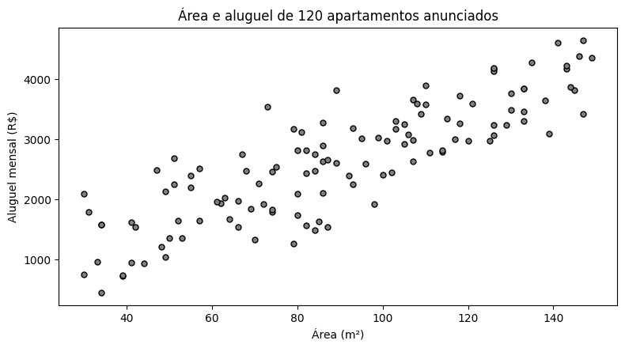
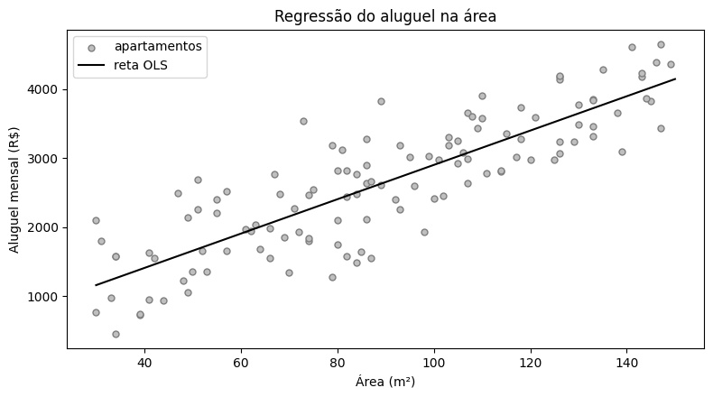
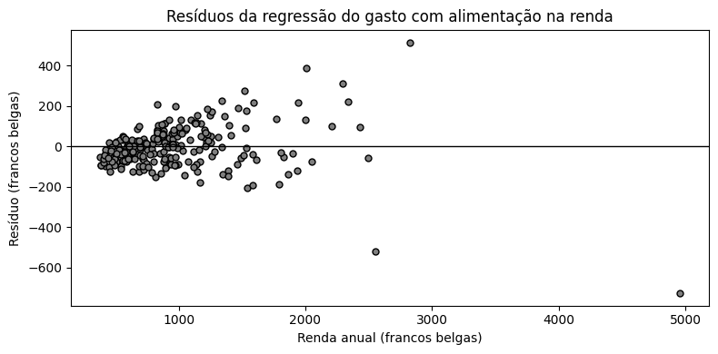

# Capítulo 06 — Resoluções

[Notebook do estudante](../ch06-student.ipynb) · [exercícios](../exercises/ch06.md)

Consulte as resoluções depois da tentativa.

# Resoluções 01–06 · Regressão linear simples

**Prof. Daniel de Abreu Pereira Uhr**

**Curso:** Estatística e Econometria com Python


Editorial worked solution

## Contexto — Imobiliária

A imobiliária, empresa fictícia, quer descrever a relação entre o **aluguel mensal** (R\$) e a **área** (m²) dos apartamentos que anuncia. Ela reuniu 120 anúncios, com áreas de 30 a 150 m². Os dados são didáticos.

Execute a célula abaixo antes de começar.

```python
import numpy as np
import pandas as pd
import matplotlib.pyplot as plt
import statsmodels.formula.api as smf

rng = np.random.default_rng(2026)
apartamentos = pd.DataFrame({"area_m2": rng.integers(30, 151, size=120)})
apartamentos["aluguel"] = np.round(400 + 25 * apartamentos["area_m2"] + rng.normal(0, 450, size=120), -1)
```

## Resolução do Exercício 01 — O gráfico primeiro

**Raciocínio:** queremos descrever o aluguel médio para cada área; logo, o aluguel é $Y$ e a área é $X$.

```python
fig, ax = plt.subplots(figsize=(8, 4.5))
ax.scatter(apartamentos["area_m2"], apartamentos["aluguel"], color="#7F7F7F", edgecolor="black", s=25)
ax.set_title("Área e aluguel de 120 apartamentos anunciados")
ax.set_xlabel("Área (m²)")
ax.set_ylabel("Aluguel mensal (R$)")
fig.tight_layout()
plt.show()
```



**Resultado e interpretação:** a relação é positiva e aproximadamente linear, com dispersão moderada: apartamentos da mesma área têm aluguéis diferentes, por localização, conservação ou andar. Não há anúncio muito distante dos demais. O aluguel é a variável de interesse ($Y$); a área é a característica usada para descrevê-lo ($X$).

## Resolução do Exercício 02 — OLS à mão

**Raciocínio:** aplicamos as fórmulas de mínimos quadrados e comparamos com a razão covariância/variância do Capítulo 5.

```python
x = apartamentos["area_m2"]
y = apartamentos["aluguel"]

b1 = ((x - x.mean()) * (y - y.mean())).sum() / ((x - x.mean()) ** 2).sum()
b0 = y.mean() - b1 * x.mean()
print(f"β̂1 = {b1:.4f} R$ por m²")
print(f"β̂0 = {b0:.2f} R$")
print(f"cov/var = {x.cov(y) / x.var():.4f}")
```

```text
β̂1 = 24.8854 R$ por m²
β̂0 = 411.07 R$
cov/var = 24.8854
```

**Resultado e interpretação:** $\hat{\beta}_1 \approx 24{,}89$ e $\hat{\beta}_0 \approx 411$. A inclinação coincide com a covariância dividida pela variância: os denominadores $n - 1$ se cancelam.

## Resolução do Exercício 03 — OLS no statsmodels

**Raciocínio:** a fórmula `"aluguel ~ area_m2"` inclui o intercepto automaticamente.

```python
modelo = smf.ols("aluguel ~ area_m2", data=apartamentos).fit()
print(modelo.params)

grade = np.linspace(30, 150, 100)
fig, ax = plt.subplots(figsize=(8, 4.5))
ax.scatter(x, y, color="#BFBFBF", edgecolor="#7F7F7F", s=25, label="apartamentos")
ax.plot(grade, modelo.params["Intercept"] + modelo.params["area_m2"] * grade, color="black", label="reta OLS")
ax.set_title("Regressão do aluguel na área")
ax.set_xlabel("Área (m²)")
ax.set_ylabel("Aluguel mensal (R$)")
ax.legend()
fig.tight_layout()
plt.show()
```

```text
Intercept    411.065938
area_m2       24.885449
dtype: float64
```



**Resultado e interpretação:** os coeficientes do statsmodels coincidem com os de Exercício 02. A reta passa pelo meio da nuvem de pontos.

## Resolução do Exercício 04 — Ajustados e resíduos

**Raciocínio:** o ajustado é o aluguel que a reta atribui à área; o resíduo, a diferença entre o aluguel anunciado e o ajustado.

```python
apartamentos["ajustado"] = modelo.fittedvalues
apartamentos["residuo"] = modelo.resid
print(apartamentos.head(2).round(2).to_string(index=False))
print(f"Soma dos resíduos: {apartamentos['residuo'].sum():.6f}")
print(f"Correlação entre resíduos e área: {apartamentos['residuo'].corr(apartamentos['area_m2']):.6f}")
```

```text
 area_m2  aluguel  ajustado  residuo
     133   3850.0   3720.83   129.17
      51   2250.0   1680.22   569.78
Soma dos resíduos: 0.000000
Correlação entre resíduos e área: 0.000000
```

**Resultado e interpretação:** um resíduo positivo indica um apartamento anunciado acima do aluguel médio dos apartamentos de mesma área, segundo a reta; um negativo, abaixo. O resíduo não diz se o aluguel é “caro” ou “barato”: ele reúne tudo o que a área não capta, como localização e conservação.

Os resíduos somam zero e não têm correlação com a área, por construção do critério de mínimos quadrados.

## Resolução do Exercício 05 — Interpretar e mudar de escala

**Raciocínio:** os coeficientes têm as unidades das variáveis; mudar as unidades muda os números, não a relação.

```python
escalas = apartamentos.assign(aluguel_mil=apartamentos["aluguel"] / 1_000, area_dezenas=apartamentos["area_m2"] / 10)
print(smf.ols("aluguel_mil ~ area_dezenas", data=escalas).fit().params.round(4))
```

```text
Intercept       0.4111
area_dezenas    0.2489
dtype: float64
```

**Resultado e interpretação:**

- **Inclinação:** apartamentos com 1 m² a mais têm aluguel, em média, cerca de R\$ 24,89 maior. É uma diferença média associada entre apartamentos anunciados, não o aumento de aluguel que uma reforma de ampliação produziria — apartamentos maiores podem diferir também em localização e padrão.
- **Intercepto:** cerca de R\$ 411 seria o aluguel previsto para um apartamento de 0 m², algo que não existe, muito abaixo da menor área observada (30 m²). Aqui o intercepto serve apenas para posicionar a reta.
- **Escalas:** com o aluguel em R\$ mil e a área em dezenas de m², a inclinação passa a 0,2489 — R\$ 248,9 a mais por 10 m² —, e o intercepto, a 0,411 — os mesmos R\$ 411 expressos em milhares.

## Resolução do Exercício 06 — A cobertura de 300 m²

**Raciocínio:** a reta foi estimada com áreas de 30 a 150 m²; 300 m² está muito fora desse alcance.

```python
previsao_300 = modelo.params["Intercept"] + modelo.params["area_m2"] * 300
print(f"Aluguel previsto pela reta para 300 m²: R$ {previsao_300:,.0f}".replace(",", "."))
print(f"Área máxima nos dados: {apartamentos['area_m2'].max()} m²")
```

```text
Aluguel previsto pela reta para 300 m²: R$ 7.877
Área máxima nos dados: 149 m²
```

**Resultado e interpretação:** a reta prevê cerca de R\$ 7.880. A previsão é arriscada porque:

1. **é extrapolação:** nenhum anúncio tem mais de 150 m², e nada garante que o aluguel continue crescendo R\$ 24,89 por m² até 300 m²;
2. **coberturas são outro produto:** terraço, vista e exclusividade podem pesar mais que a área, e o mercado de imóveis grandes pode ter outra dinâmica;
3. **a reta descreve médias:** mesmo dentro dos dados, apartamentos da mesma área têm aluguéis bem diferentes.

Para responder melhor, a imobiliária poderia reunir anúncios de coberturas e apartamentos grandes semelhantes, na mesma região, e comparar diretamente.

# Resoluções 07–12 · Regressão linear simples

**Prof. Daniel de Abreu Pereira Uhr**

**Curso:** Estatística e Econometria com Python


Editorial worked solution

## Contexto — Operadora logística

A operadora logística, operadora fictícia de transporte, quer entender o consumo de diesel (litros por rota) em função da distância (km). No laboratório, há uma população de 30.000 rotas da frota nova. Em cada rota, o consumo depende da distância e da **carga transportada** (toneladas), e rotas mais longas tendem a levar mais carga. Há também uma frota antiga, com o mesmo mecanismo, mas consumo muito mais variável.

Execute a célula abaixo antes de começar e use o mesmo gerador `rng` em todas as questões, na ordem em que aparecem.

```python
import numpy as np
import pandas as pd
import matplotlib.pyplot as plt
import statsmodels.formula.api as smf

rng = np.random.default_rng(2026)
N = 30_000
km = np.round(rng.uniform(50, 600, size=N), 1)
carga_t = np.round(np.clip(8 + 0.02 * km + rng.normal(0, 3, size=N), 1, None), 1)
litros = np.round(5 + 0.30 * km + 2.0 * carga_t + rng.normal(0, 12, size=N), 1)
litros_frota_antiga = np.round(5 + 0.30 * km + 2.0 * carga_t + rng.normal(0, 45, size=N), 1)

rotas = pd.DataFrame({"km": km, "carga_t": carga_t, "litros": litros})
rotas_antigas = pd.DataFrame({"km": km, "litros": litros_frota_antiga})
```

## Resolução do Exercício 07 — Decomposição e $R^2$

**Raciocínio:** a variação total dos litros em torno da média se divide na parte acompanhada pela reta e na parte dos resíduos.

```python
n = 80
amostra = rotas.iloc[rng.choice(N, size=n, replace=True)]
modelo = smf.ols("litros ~ km", data=amostra).fit()

y = amostra["litros"]
sqt = ((y - y.mean()) ** 2).sum()
sqe = ((modelo.fittedvalues - y.mean()) ** 2).sum()
sqr = (modelo.resid ** 2).sum()

print(modelo.params.round(4))
print(f"SQT = {sqt:.0f}; SQE + SQR = {sqe + sqr:.0f}")
print(f"R² = {sqe / sqt:.4f}; statsmodels = {modelo.rsquared:.4f}; correlação² = {amostra['km'].corr(y) ** 2:.4f}")
```

```text
Intercept    24.1863
km            0.3376
dtype: float64
SQT = 257442; SQE + SQR = 257442
R² = 0.9381; statsmodels = 0.9381; correlação² = 0.9381
```

**Resultado e interpretação:** a inclinação é de cerca de 0,34 litro por km. A decomposição fecha, e o $R^2$, de 0,94, é igual ao quadrado da correlação: na frota nova, a reta acompanha a maior parte da variação do consumo entre rotas.

## Resolução do Exercício 08 — A frota antiga

**Raciocínio:** o mecanismo é o mesmo; muda apenas a dispersão dos demais fatores.

```python
amostra_antiga = rotas_antigas.iloc[rng.choice(N, size=n, replace=True)]
modelo_antigo = smf.ols("litros ~ km", data=amostra_antiga).fit()
print(f"Frota nova:   inclinação {modelo.params['km']:.3f} L/km; R² {modelo.rsquared:.3f}")
print(f"Frota antiga: inclinação {modelo_antigo.params['km']:.3f} L/km; R² {modelo_antigo.rsquared:.3f}")
```

```text
Frota nova:   inclinação 0.338 L/km; R² 0.938
Frota antiga: inclinação 0.308 L/km; R² 0.523
```

**Resultado e interpretação:** a inclinação da frota antiga, 0,31 L/km, é parecida com a da nova, 0,34 L/km, mas o $R^2$ cai de 0,94 para 0,52. Na frota antiga, fatores como o estado dos motores fazem o consumo variar muito entre rotas da mesma distância; a reta acompanha uma fração menor dessa variação, mas a relação média entre distância e consumo é semelhante.

## Resolução do Exercício 09 — O que o $R^2$ não diz

**Avaliação:** a frase confunde ajuste com magnitude. O $R^2$ baixo indica que outros fatores pesam muito na variação do consumo da frota antiga, não que a distância importe pouco: a inclinação estimada, em litros por km, é semelhante à da frota nova.

O $R^2$ alto da frota nova **não** garante, por exemplo:

1. que a inclinação represente o consumo adicional por km para a mesma carga (veja o Desafio B);
2. que a relação continue linear fora da faixa de 50 a 600 km;
3. que a reta seja útil para uma decisão específica, como dimensionar o tanque de uma rota de 1.000 km.

## Resolução do Exercício 10 — Não viés por simulação

**Raciocínio:** no laboratório, a regressão com todas as rotas dá a reta populacional. Comparamos com a média de 5.000 estimativas amostrais.

```python
inclinacao_populacional = smf.ols("litros ~ km", data=rotas).fit().params["km"]

R = 5_000
indices = rng.choice(N, size=(R, n), replace=True)
x_sim = km[indices]
y_sim = litros[indices]
dx = x_sim - x_sim.mean(axis=1, keepdims=True)
dy = y_sim - y_sim.mean(axis=1, keepdims=True)
inclinacoes = (dx * dy).sum(axis=1) / (dx**2).sum(axis=1)

print(f"Inclinação da regressão populacional: {inclinacao_populacional:.4f} L/km")
print(f"Média das {R} inclinações amostrais: {inclinacoes.mean():.4f} L/km")
print(f"Desvio-padrão das inclinações: {inclinacoes.std():.4f}")
```

```text
Inclinação da regressão populacional: 0.3403 L/km
Média das 5000 inclinações amostrais: 0.3403 L/km
Desvio-padrão das inclinações: 0.0096
```

**Resultado e interpretação:** a média das 5.000 inclinações coincide com a inclinação populacional, cerca de 0,34 L/km: o estimador OLS acerta, em média, a inclinação da média condicional $E(\text{litros} \mid \text{km})$.

## Resolução do Exercício 11 — Hipóteses no contexto

1. **Linearidade:** em rotas muito longas, paradas para descanso ou trechos de serra poderiam tornar o consumo por km diferente — a relação deixaria de ser uma reta.
2. **Amostragem aleatória:** se os dados viessem apenas das rotas de um grande cliente, ou só de rotas em que o motorista registrou o consumo, a amostra não representaria a frota.
3. **Variação em $X$:** se a empresa analisasse só rotas de 300 km, não haveria como estimar a inclinação.
4. **$E(u \mid X) = 0$:** o erro inclui carga, relevo e trânsito. Se algum desses fatores mudar sistematicamente com a distância — como a carga, aqui —, a hipótese falha para a pergunta sobre o efeito da distância com os demais fatores fixos.

## Resolução do Exercício 12 — Consumo por km para a mesma carga

**Raciocínio:** a regressão simples estima a média de litros para cada distância. Rotas mais longas também levam mais carga, e a carga consome diesel.

```python
print(f"Mecanismo do laboratório: 0,30 L/km com a carga fixa")
print(f"Inclinação populacional da regressão simples: {inclinacao_populacional:.4f} L/km")
print(f"Média das simulações: {inclinacoes.mean():.4f} L/km")
print(f"Correlação entre carga e distância: {rotas['carga_t'].corr(rotas['km']):.3f}")
```

```text
Mecanismo do laboratório: 0,30 L/km com a carga fixa
Inclinação populacional da regressão simples: 0.3403 L/km
Média das simulações: 0.3403 L/km
Correlação entre carga e distância: 0.729
```

**Resultado e interpretação:** a regressão simples fica em torno de 0,34 L/km, acima dos 0,30 L/km do mecanismo. A carga não está no modelo; seu efeito fica no erro. Como a carga cresce com a distância (correlação positiva), o erro tende a ser maior em rotas longas: para a pergunta “e se a distância aumentar com a carga fixa?”, $E(u \mid X) \neq 0$.

A regressão simples não está “errada”: ela descreve corretamente quanto o consumo médio aumenta entre rotas mais longas, **incluindo** o fato de que levam mais carga. Mas não responde à pergunta do gerente. Para comparar rotas com a mesma carga, é preciso incluir a carga no modelo — a regressão múltipla do Capítulo 7.

# Resoluções 13–18 · Regressão linear simples

**Prof. Daniel de Abreu Pereira Uhr**

**Curso:** Estatística e Econometria com Python


Editorial worked solution

## Contexto — Engel com OLS

Esta aplicação usa os **dados reais** de Engel: renda anual e gasto anual com alimentação, em francos belgas, de 235 famílias de trabalhadores na Bélgica, em 1857. A ficha `data/ch06/engel_1857_FONTE.md` registra fonte, condição de uso, proveniência e limites.

Execute a célula abaixo antes de começar; ela confere a integridade do arquivo e carrega a base.

```python
import hashlib

import numpy as np
import pandas as pd
import matplotlib.pyplot as plt
import statsmodels.formula.api as smf

caminho = "data/ch06/engel_1857.csv"
with open(caminho, "rb") as arquivo:
    print("Arquivo confere com a ficha:", hashlib.sha256(arquivo.read()).hexdigest() == "05b60e091325bc170cb6803ce78f80c029bfe2ae072891ec577f1ebe8deefd61")

engel = pd.read_csv(caminho)
```

```text
Arquivo confere com a ficha: True
```

## Resolução do Exercício 13 — Estimar a regressão

**Raciocínio:** o gasto com alimentação é $Y$; a renda é $X$.

```python
modelo = smf.ols("foodexp ~ income", data=engel).fit()
print(modelo.params.round(4))
print(f"cov/var = {engel['income'].cov(engel['foodexp']) / engel['income'].var():.4f}")
```

```text
Intercept    147.4754
income         0.4852
dtype: float64
cov/var = 0.4852
```

**Resultado e interpretação:** $\hat{\beta}_0 \approx 147{,}48$ e $\hat{\beta}_1 \approx 0{,}4852$; a inclinação coincide com a do Capítulo 5.

## Resolução do Exercício 14 — Interpretar os coeficientes

**Raciocínio:** cada coeficiente tem as unidades das variáveis — francos de alimentação e francos de renda.

```python
print(f"Renda mínima observada: {engel['income'].min():.1f} francos")
```

```text
Renda mínima observada: 377.1 francos
```

**Resultado e interpretação:**

- **Inclinação:** famílias com 1 franco a mais de renda gastam, em média, cerca de 0,49 franco a mais com alimentação — ou 48,5 francos a mais por 100 francos de renda. É uma comparação entre famílias diferentes, não a reação de uma família a um aumento de renda.
- **Intercepto:** cerca de 147 francos seria o gasto previsto com renda zero. A menor renda observada é de 377 francos; o intercepto é uma extrapolação, sem leitura econômica confiável. Ele apenas posiciona a reta.

## Resolução do Exercício 15 — Ajustados e resíduos

**Raciocínio:** o resíduo mostra quanto cada família gasta acima ou abaixo do que a reta indica para sua renda.

```python
engel["ajustado"] = modelo.fittedvalues
engel["residuo"] = modelo.resid
print("Família com maior resíduo positivo:")
print(engel.loc[engel["residuo"].idxmax()].round(1))

fig, ax = plt.subplots(figsize=(8, 4))
ax.scatter(engel["income"], engel["residuo"], color="#7F7F7F", edgecolor="black", s=25)
ax.axhline(0, color="black", linewidth=1)
ax.set_title("Resíduos da regressão do gasto com alimentação na renda")
ax.set_xlabel("Renda anual (francos belgas)")
ax.set_ylabel("Resíduo (francos belgas)")
fig.tight_layout()
plt.show()

quartil_renda = pd.qcut(engel["income"], 4, labels=["1º quartil", "2º quartil", "3º quartil", "4º quartil"])
print(engel.groupby(quartil_renda, observed=True)["residuo"].std().round(1))
```

```text
Família com maior resíduo positivo:
income      2822.5
foodexp     2032.7
ajustado    1516.9
residuo      515.8
Name: 58, dtype: float64
```



```text
income
1º quartil     44.2
2º quartil     71.8
3º quartil     81.2
4º quartil    191.3
Name: residuo, dtype: float64
```

**Resultado e interpretação:** a família com maior resíduo positivo, com renda de cerca de 2.820 francos, gasta com alimentação cerca de 516 francos acima do que a reta indica para sua renda — uma hipótese seria ter mais membros, mas a base não permite verificar essa explicação.

O gráfico mostra que os resíduos se espalham cada vez mais à medida que a renda cresce: o desvio-padrão dos resíduos sobe de cerca de 44 francos no primeiro quartil de renda para cerca de 191 no último. Famílias mais ricas diferem mais entre si no gasto com alimentação. Esse padrão — variância do erro mudando com $X$ — chama-se heterocedasticidade e afeta a inferência; ele será estudado no Capítulo 11.

## Resolução do Exercício 16 — Quanto a reta acompanha

**Raciocínio:** decompomos a variação total do gasto com alimentação.

```python
y = engel["foodexp"]
sqt = ((y - y.mean()) ** 2).sum()
sqe = ((engel["ajustado"] - y.mean()) ** 2).sum()
sqr = (engel["residuo"] ** 2).sum()
print(f"SQT = {sqt:,.0f}; SQE = {sqe:,.0f}; SQR = {sqr:,.0f}".replace(",", "."))
print(f"R² = {sqe / sqt:.4f}; statsmodels = {modelo.rsquared:.4f}")
```

```text
SQT = 17.884.262; SQE = 14.850.458; SQR = 3.033.805
R² = 0.8304; statsmodels = 0.8304
```

**Resultado e interpretação:** o $R^2$ é 0,83: a reta acompanha cerca de 83% da variação do gasto com alimentação entre as famílias. Isso descreve o quanto gasto e renda se alinham a uma reta nesses dados; não significa que a renda “cause” 83% do gasto nem que o modelo seja adequado para todas as faixas de renda — os resíduos de Exercício 15 mostram que a dispersão residual absoluta é maior nas rendas altas.

## Resolução do Exercício 17 — Escalas

**Raciocínio:** dividir uma variável por 1.000 muda as unidades dos coeficientes associados a ela.

```python
escalas = engel.assign(renda_mil=engel["income"] / 1_000, alimentacao_mil=engel["foodexp"] / 1_000)
print("Ambas em mil francos:", smf.ols("alimentacao_mil ~ renda_mil", data=escalas).fit().params.round(4).to_dict())
print("Só a renda em mil francos:", smf.ols("foodexp ~ renda_mil", data=escalas).fit().params.round(2).to_dict())
```

```text
Ambas em mil francos: {'Intercept': 0.1475, 'renda_mil': 0.4852}
Só a renda em mil francos: {'Intercept': 147.48, 'renda_mil': 485.18}
```

**Resultado e interpretação:**

- **Ambas em milhares de francos:** a inclinação continua 0,4852 — mil francos de renda a mais correspondem a 0,485 mil francos de alimentação, a mesma proporção —, e o intercepto passa a 0,147 mil francos.
- **Só a renda em milhares:** a inclinação fica 1.000 vezes maior, cerca de 485 francos de alimentação por mil francos de renda, e o intercepto não muda.

## Resolução do Exercício 18 — Parágrafo de relatório

**Texto (exemplo):**

> A regressão do gasto anual com alimentação na renda anual de 235 famílias de trabalhadores belgas em 1857 indica que famílias com 100 francos a mais de renda gastavam, em média, cerca de 48,5 francos a mais com alimentação. A reta acompanha cerca de 83% da variação do gasto entre as famílias ($R^2 = 0{,}83$).
>
> A relação é descritiva: compara famílias diferentes e não mostra como uma família reagiria a um aumento de renda. Ela vale para famílias de trabalhadores daquela época e na faixa de renda observada (377 a quase 5.000 francos); o intercepto não tem leitura econômica. Os resíduos se dispersam muito mais entre as famílias de renda alta, o que sugere investigar variância não constante; qualquer análise inferencial deverá levar isso em conta.

### Transferência do Exercício 18 — Perfis e alcance

Use a mesma reta ajustada de Engel para rendas anuais de 800, 1.400 e 6.000 francos belgas. Calcule o gasto ajustado e indique se cada perfil está dentro da faixa de renda observada. Calcule a diferença ajustada entre os dois primeiros. Explique por que essa diferença não é efeito individual da renda nem garantia de gasto familiar. Explique a hipótese adicional do último perfil e por que o R² não fornece um intervalo de previsão. Proponha duas verificações antes de usar modelo semelhante em uma decisão comercial atual.

```python
transfer_x = np.array([800., 1400., 6000.])
transfer_slope = engel["income"].cov(engel["foodexp"])/engel["income"].var()
transfer_intercept = engel["foodexp"].mean()-transfer_slope*engel["income"].mean()
transfer_fitted = transfer_intercept+transfer_slope*transfer_x
transfer_inside = ((transfer_x >= engel["income"].min()) &
                   (transfer_x <= engel["income"].max()))
print(pd.DataFrame({"income": transfer_x, "fitted": transfer_fitted,
    "in_range": transfer_inside}).round(4).to_string(index=False))
print("1400 - 800:", round(float(transfer_fitted[1]-transfer_fitted[0]), 4))
```

```text
 income    fitted  in_range
  800.0  535.6181      True
 1400.0  826.7252      True
 6000.0 3058.5459     False
1400 - 800: 291.1071
```

Os dois primeiros perfis interpolam dentro da faixa; 6.000 extrapola além dela. O primeiro contraste é de cerca de 291,11 francos na reta, não uma resposta causal individual. Confira população, período, unidades e cobertura da resposta; avalie desempenho em registros fora do ajuste e quantifique incerteza antes de compromissos individuais. Maior dispersão residual absoluta sugere investigar variância não constante; não comprova a função de variância populacional nem estabelece acurácia relativa.
