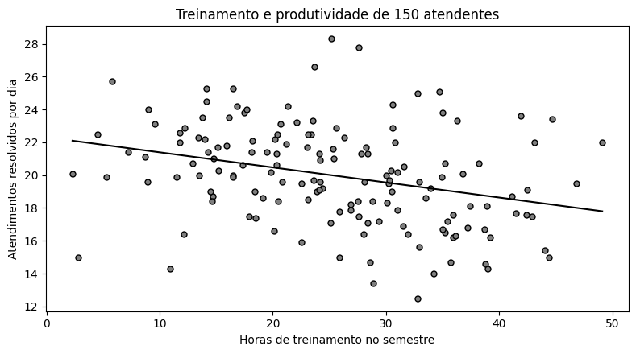
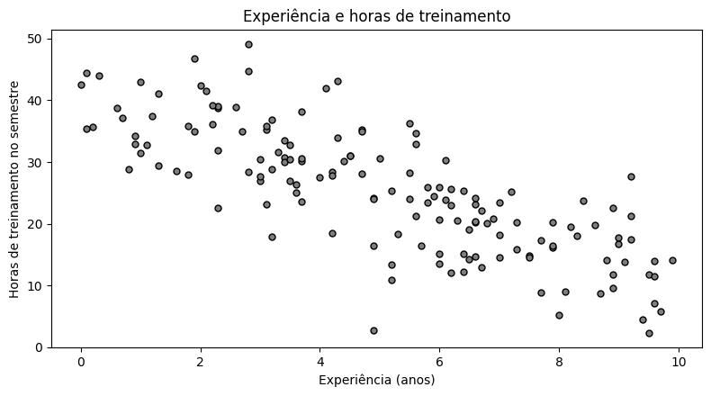
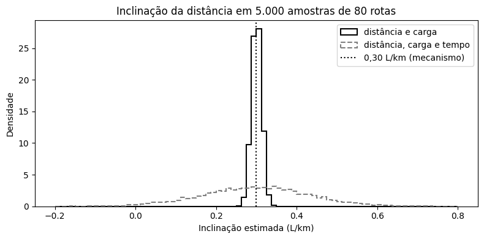
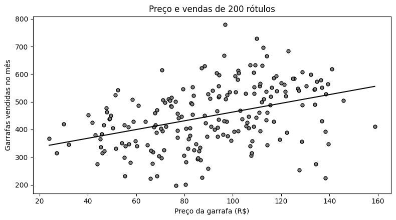
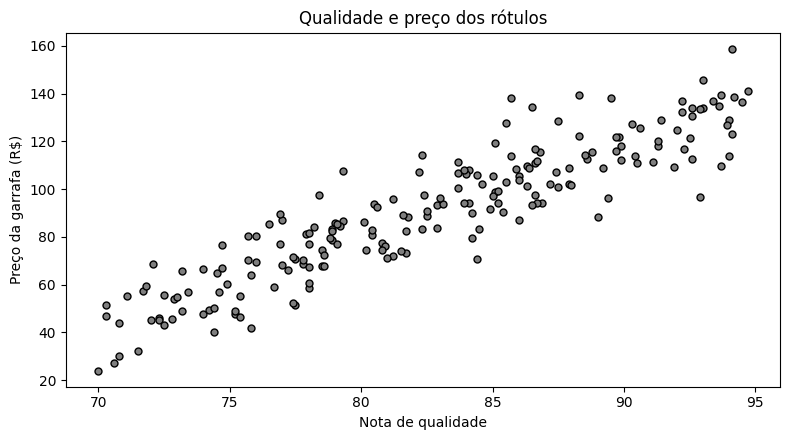

# Capítulo 07 — Resoluções

[Notebook do estudante](../ch07-student.ipynb) · [exercícios](../exercises/ch07.md)

Consulte as resoluções depois da tentativa.

# Resoluções 01–06 · Regressão linear múltipla

**Prof. Daniel de Abreu Pereira Uhr**

**Curso:** Estatística e Econometria com Python


Editorial worked solution

## Contexto — Central de atendimento

A central de atendimento, central de atendimento fictícia, quer saber se o treinamento está associado a maior produtividade. Para 150 atendentes, ela registrou as **horas de treinamento** recebidas no último semestre, os **anos de experiência** e a **produtividade**, medida em atendimentos resolvidos por dia. Como a empresa concentra o treinamento nos recém-contratados, atendentes novos recebem mais horas. Os dados são didáticos.

Execute a célula abaixo antes de começar.

```python
import numpy as np
import pandas as pd
import matplotlib.pyplot as plt
import statsmodels.formula.api as smf

rng = np.random.default_rng(2026)
n_atendentes = 150
equipe = pd.DataFrame({"experiencia_anos": np.round(rng.uniform(0, 10, size=n_atendentes), 1)})
equipe["treinamento_h"] = np.round(np.clip(40 - 3 * equipe["experiencia_anos"] + rng.normal(0, 6, size=n_atendentes), 0, None), 1)
equipe["produtividade"] = np.round(10 + 0.15 * equipe["treinamento_h"] + 1.2 * equipe["experiencia_anos"] + rng.normal(0, 2, size=n_atendentes), 1)
```

## Resolução do Exercício 01 — A primeira análise

**Raciocínio:** começamos pelo gráfico e pela regressão simples, como faria uma primeira análise.

```python
simples = smf.ols("produtividade ~ treinamento_h", data=equipe).fit()
print(simples.params.round(3))

fig, ax = plt.subplots(figsize=(8, 4.5))
ax.scatter(equipe["treinamento_h"], equipe["produtividade"], color="#7F7F7F", edgecolor="black", s=25)
grade = np.linspace(equipe["treinamento_h"].min(), equipe["treinamento_h"].max(), 100)
ax.plot(grade, simples.params["Intercept"] + simples.params["treinamento_h"] * grade, color="black")
ax.set_title("Treinamento e produtividade de 150 atendentes")
ax.set_xlabel("Horas de treinamento no semestre")
ax.set_ylabel("Atendimentos resolvidos por dia")
fig.tight_layout()
plt.show()
```

```text
Intercept        22.310
treinamento_h    -0.092
dtype: float64
```



**Resultado e interpretação:** a inclinação simples é **negativa**, cerca de −0,09 atendimento por dia por hora de treinamento. Um gestor apressado concluiria que o treinamento reduz a produtividade e cortaria o programa.

## Resolução do Exercício 02 — Regressão múltipla

**Raciocínio:** incluímos a experiência para comparar atendentes com a mesma experiência.

```python
multipla = smf.ols("produtividade ~ treinamento_h + experiencia_anos", data=equipe).fit()
print(multipla.params.round(3))
print(f"R²: simples {simples.rsquared:.3f}; múltipla {multipla.rsquared:.3f}")
```

```text
Intercept           9.589
treinamento_h       0.161
experiencia_anos    1.246
dtype: float64
R²: simples 0.096; múltipla 0.545
```

**Resultado e interpretação:**

- **Treinamento:** entre atendentes com a **mesma experiência**, uma hora a mais de treinamento está associada, em média, a cerca de 0,16 atendimento a mais por dia — 10 horas, a cerca de 1,6 atendimento a mais.
- **Experiência:** entre atendentes com as **mesmas horas de treinamento**, um ano a mais de experiência está associado a cerca de 1,25 atendimento a mais por dia.

O sinal do treinamento se inverte: a relação negativa da regressão simples desaparece quando a experiência é mantida constante.

## Resolução do Exercício 03 — Treinamento e experiência

**Raciocínio:** a variável omitida só produz viés se estiver relacionada ao regressor incluído.

```python
print(f"Correlação entre treinamento e experiência: {equipe['treinamento_h'].corr(equipe['experiencia_anos']):.3f}")

fig, ax = plt.subplots(figsize=(8, 4.5))
ax.scatter(equipe["experiencia_anos"], equipe["treinamento_h"], color="#7F7F7F", edgecolor="black", s=25)
ax.set_title("Experiência e horas de treinamento")
ax.set_xlabel("Experiência (anos)")
ax.set_ylabel("Horas de treinamento no semestre")
fig.tight_layout()
plt.show()
```

```text
Correlação entre treinamento e experiência: -0.786
```



**Resultado e interpretação:** a correlação é fortemente negativa, cerca de −0,79. A empresa concentra o treinamento nos recém-contratados, que ainda têm pouca experiência e, por isso, resolvem menos atendimentos. A regressão simples compara, em boa parte, novatos muito treinados com veteranos pouco treinados.

## Resolução do Exercício 04 — A fórmula do viés

**Raciocínio:** aplicamos a identidade da seção 7.5.

```python
delta = smf.ols("experiencia_anos ~ treinamento_h", data=equipe).fit().params["treinamento_h"]
b1 = multipla.params["treinamento_h"]
b2 = multipla.params["experiencia_anos"]
print(f"δ̃1 = {delta:.4f} ano de experiência por hora de treinamento")
print(f"β̂1 + β̂2 · δ̃1 = {b1:.4f} + {b2:.4f} × ({delta:.4f}) = {b1 + b2 * delta:.4f}")
print(f"Inclinação simples: {simples.params['treinamento_h']:.4f}")
```

```text
δ̃1 = -0.2029 ano de experiência por hora de treinamento
β̂1 + β̂2 · δ̃1 = 0.1610 + 1.2463 × (-0.2029) = -0.0919
Inclinação simples: -0.0919
```

**Resultado e interpretação:** a identidade fecha. $\tilde{\delta}_1$ é negativo — atendentes com mais treinamento têm menos experiência — e a experiência se associa positivamente à produtividade ($\hat{\beta}_2 > 0$). Pelo quadro de sinais, variável omitida associada positivamente a $Y$ e negativamente ao regressor incluído produz **viés negativo**: a inclinação simples subestima a do treinamento. Aqui, o viés é grande o bastante para inverter o sinal.

## Resolução do Exercício 05 — Comunicar o resultado

**Frases (exemplo):**

> Comparando atendentes com a mesma experiência, cada 10 horas de treinamento estão associadas a cerca de 1,6 atendimento resolvido a mais por dia.
>
> A comparação simples era enganosa porque o treinamento é dado sobretudo aos novatos, que resolvem menos atendimentos por terem pouca experiência; ela atribuía ao treinamento a diferença de experiência.

## Resolução do Exercício 06 — Efeito do treinamento?

**Avaliação:**

1. **O que é mantido constante:** a regressão compara atendentes com a mesma experiência. Ela não mantém constantes motivação, habilidade, equipe, supervisor ou tipo de atendimento, que não estão no modelo.
2. **Variáveis omitidas plausíveis:**
   - **motivação:** se atendentes mais motivados buscam mais treinamento e também produzem mais, a variável omitida se relaciona positivamente com o treinamento e com a produtividade — viés positivo: o coeficiente superestimaria o efeito;
   - **dificuldade inicial:** se supervisores encaminham para treinamento extra os atendentes com mais dificuldade, a variável omitida se relaciona positivamente com o treinamento e negativamente com a produtividade — viés negativo: o coeficiente subestimaria o efeito.
3. **Desenho mais confiável:** sortear, entre atendentes com perfil semelhante, quem recebe o treinamento adicional e comparar a produtividade depois, como no teste A/B do Capítulo 4. Sem isso, a resposta honesta é: “há uma associação positiva entre treinamento e produtividade entre atendentes de mesma experiência, mas não podemos afirmar que o treinamento a causa”.

# Resoluções 07–12 · Regressão linear múltipla

**Prof. Daniel de Abreu Pereira Uhr**

**Curso:** Estatística e Econometria com Python


Editorial worked solution

## Contexto — Operadora logística, de volta

No Desafio B do Capítulo 6, a regressão simples dos litros de diesel na distância ficou em cerca de 0,34 L/km, enquanto o consumo adicional por km **para a mesma carga** é 0,30 L/km no mecanismo do laboratório. Agora a carga entra no modelo.

A célula abaixo reproduz a população de 30.000 rotas do Capítulo 6 — distância, carga e litros, com o mesmo código e a mesma seed — e acrescenta o **tempo de viagem** (horas), que depende quase só da distância.

Execute a célula antes de começar e use o mesmo gerador `rng` em todas as questões, na ordem em que aparecem.

```python
import numpy as np
import pandas as pd
import matplotlib.pyplot as plt
import statsmodels.formula.api as smf

rng = np.random.default_rng(2026)
N = 30_000
km = np.round(rng.uniform(50, 600, size=N), 1)
carga_t = np.round(np.clip(8 + 0.02 * km + rng.normal(0, 3, size=N), 1, None), 1)
litros = np.round(5 + 0.30 * km + 2.0 * carga_t + rng.normal(0, 12, size=N), 1)
tempo_h = np.round(km / 70 + rng.normal(0, 0.15, size=N), 2)

rotas = pd.DataFrame({"km": km, "carga_t": carga_t, "litros": litros, "tempo_h": tempo_h})
```

## Resolução do Exercício 07 — A carga no modelo

**Raciocínio:** a regressão múltipla compara rotas com a mesma carga; no laboratório, sabemos que o consumo adicional por km com carga fixa é 0,30 L.

```python
n = 80
amostra = rotas.iloc[rng.choice(N, size=n, replace=True)]
simples = smf.ols("litros ~ km", data=amostra).fit()
multipla = smf.ols("litros ~ km + carga_t", data=amostra).fit()

print(f"Simples: {simples.params['km']:.4f} L/km")
print(f"Múltipla: {multipla.params['km']:.4f} L/km; carga {multipla.params['carga_t']:.3f} L por tonelada")
```

```text
Simples: 0.3376 L/km
Múltipla: 0.2946 L/km; carga 2.712 L por tonelada
```

**Resultado e interpretação:** a inclinação simples fica acima de 0,30, e a múltipla, perto de 0,30: entre rotas com a mesma carga, cada km a mais está associado a cerca de 0,30 litro a mais. O coeficiente da carga indica que, entre rotas de mesma distância, cada tonelada a mais está associada a cerca de 2,7 litros a mais; no mecanismo, são 2,0 litros. A diferença é variação amostral: com 80 rotas, cada coeficiente erra para mais ou para menos, como mostrará o laboratório de Exercício 09.

## Resolução do Exercício 08 — Partialling-out

**Raciocínio:** o resíduo da regressão da distância na carga é a parte da distância que não acompanha a carga.

```python
amostra = amostra.assign(km_alem_da_carga=smf.ols("km ~ carga_t", data=amostra).fit().resid)
dois_passos = smf.ols("litros ~ km_alem_da_carga", data=amostra).fit()
print(f"Dois passos: {dois_passos.params['km_alem_da_carga']:.4f}   múltipla: {multipla.params['km']:.4f}")
```

```text
Dois passos: 0.2946   múltipla: 0.2946
```

**Resultado e interpretação:** os coeficientes coincidem. O resíduo representa os km **além do esperado** para a carga da rota: rotas mais longas do que a carga indicaria. A regressão múltipla usa apenas essa variação da distância para estimar seu coeficiente.

## Resolução do Exercício 09 — Laboratório

**Raciocínio:** repetimos as duas regressões em 5.000 amostras com `np.linalg.lstsq`.

```python
R = 5_000
indices = rng.choice(N, size=(R, n), replace=True)
inclinacao_simples = np.empty(R)
inclinacao_multipla = np.empty(R)
inclinacao_com_tempo = np.empty(R)

for r in range(R):
    sub = rotas.iloc[indices[r]]
    uns = np.ones(n)
    inclinacao_simples[r] = np.linalg.lstsq(np.column_stack([uns, sub["km"]]), sub["litros"], rcond=None)[0][1]
    inclinacao_multipla[r] = np.linalg.lstsq(np.column_stack([uns, sub["km"], sub["carga_t"]]), sub["litros"], rcond=None)[0][1]
    inclinacao_com_tempo[r] = np.linalg.lstsq(np.column_stack([uns, sub["km"], sub["carga_t"], sub["tempo_h"]]), sub["litros"], rcond=None)[0][1]

print(f"Simples:  média {inclinacao_simples.mean():.4f}; desvio-padrão {inclinacao_simples.std():.4f}")
print(f"Múltipla: média {inclinacao_multipla.mean():.4f}; desvio-padrão {inclinacao_multipla.std():.4f}")
```

```text
Simples:  média 0.3403; desvio-padrão 0.0096
Múltipla: média 0.3009; desvio-padrão 0.0124
```

**Resultado e interpretação:** sem a carga, as inclinações se concentram em torno de 0,34 L/km — o viés do Capítulo 6; com a carga, em torno de 0,30, o valor do mecanismo. A carga era a fonte de $E(u \mid X) \neq 0$ para a pergunta sobre a distância com carga fixa. O desvio-padrão da regressão múltipla é um pouco maior, porque distância e carga andam juntas.

(O mesmo laço já calculou a regressão com o tempo de viagem, usada em Exercício 11.)

## Resolução do Exercício 10 — $R^2$ e colinearidade perfeita

**Raciocínio:** acrescentar a carga não pode reduzir o $R^2$. Já a distância em milhas é a mesma informação da distância em km.

```python
print(f"R²: simples {simples.rsquared:.4f}; múltipla {multipla.rsquared:.4f}")

amostra = amostra.assign(milhas=amostra["km"] / 1.609)
redundante = smf.ols("litros ~ km + milhas + carga_t", data=amostra).fit()
print(redundante.params.round(4))
print(f"Efeito combinado de 1 km: {redundante.params['km'] + redundante.params['milhas'] / 1.609:.4f} L")
```

```text
R²: simples 0.9381; múltipla 0.9542
Intercept   -2.1170
km           0.2125
milhas       0.1321
carga_t      2.7115
dtype: float64
Efeito combinado de 1 km: 0.2946 L
```

**Resultado e interpretação:** o $R^2$ aumenta com a carga no modelo. Com km e milhas juntos, há colinearidade perfeita: o statsmodels estima, mas divide o efeito da distância de forma arbitrária entre as duas colunas. Só a combinação — o consumo adicional por km, igual ao da regressão múltipla de Exercício 07 — tem sentido. A distância deve entrar uma única vez.

## Resolução do Exercício 11 — Colinearidade alta

**Raciocínio:** o tempo de viagem é quase uma função da distância; incluí-lo deixa pouca variação própria da distância.

```python
print(f"Correlação entre distância e tempo de viagem: {rotas['km'].corr(rotas['tempo_h']):.4f}")
print(f"Com carga:          média {inclinacao_multipla.mean():.4f}; desvio-padrão {inclinacao_multipla.std():.4f}")
print(f"Com carga e tempo:  média {inclinacao_com_tempo.mean():.4f}; desvio-padrão {inclinacao_com_tempo.std():.4f}")

fig, ax = plt.subplots(figsize=(8, 4))
ax.hist(inclinacao_multipla, bins=80, range=(-0.2, 0.8), density=True, histtype="step", color="black", linewidth=1.5, label="distância e carga")
ax.hist(inclinacao_com_tempo, bins=80, range=(-0.2, 0.8), density=True, histtype="step", color="#7F7F7F", linestyle="--", linewidth=1.5, label="distância, carga e tempo")
ax.axvline(0.30, color="black", linestyle=":", label="0,30 L/km (mecanismo)")
ax.set_title("Inclinação da distância em 5.000 amostras de 80 rotas")
ax.set_xlabel("Inclinação estimada (L/km)")
ax.set_ylabel("Densidade")
ax.legend()
fig.tight_layout()
plt.show()
```

```text
Correlação entre distância e tempo de viagem: 0.9979
Com carga:          média 0.3009; desvio-padrão 0.0124
Com carga e tempo:  média 0.2991; desvio-padrão 0.1354
```



**Resultado e interpretação:** distância e tempo têm correlação de cerca de 0,998. Com o tempo no modelo, a média da inclinação continua perto de 0,30 — no laboratório, o tempo não afeta o consumo —, mas o desvio-padrão fica cerca de dez vezes maior: em uma amostra qualquer, a estimativa pode cair muito longe de 0,30, até com sinal negativo.

## Resolução do Exercício 12 — Controlar pelo tempo de viagem?

**Avaliação:** a proposta é ruim por dois motivos.

1. **Muda a pergunta.** O tempo de viagem é, em grande parte, **consequência** da distância. Controlar por ele significa comparar rotas com o mesmo tempo de viagem e distâncias diferentes — rotas raras, que só diferem por velocidade média. Isso não responde à pergunta do gerente sobre o consumo adicional por km, com a carga fixa.
2. **Destrói a precisão.** Como mostrou Exercício 11, a colinearidade quase perfeita entre distância e tempo torna a estimativa da distância muito instável entre amostras.

Controles devem ser escolhidos pelo mecanismo e pela pergunta. Aqui, a carga é um bom controle — afeta o consumo e acompanha a distância, cuja interpretação exige justificar a ordem das decisões —; o tempo de viagem não é.

# Resoluções 13–18 · Regressão linear múltipla

**Prof. Daniel de Abreu Pereira Uhr**

**Curso:** Estatística e Econometria com Python


Editorial worked solution

## Contexto — Adega Papagaio

A Adega Papagaio, loja online fictícia de vinhos, reuniu dados de 200 rótulos: **preço** da garrafa (R\$), **nota de qualidade** atribuída por especialistas (de 70 a 95) e **garrafas vendidas** no mês. A gestão quer saber como as vendas se relacionam com o preço para definir sua política de preços. Os dados são didáticos.

Execute a célula abaixo antes de começar.

```python
import numpy as np
import pandas as pd
import matplotlib.pyplot as plt
import statsmodels.formula.api as smf

rng = np.random.default_rng(2026)
n_rotulos = 200
vinhos = pd.DataFrame({"qualidade": np.round(rng.uniform(70, 95, size=n_rotulos), 1)})
vinhos["preco"] = np.round(np.clip(-240 + 4 * vinhos["qualidade"] + rng.normal(0, 12, size=n_rotulos), 20, None), 2)
vinhos["vendas"] = np.round(-1_900 - 6 * vinhos["preco"] + 35 * vinhos["qualidade"] + rng.normal(0, 40, size=n_rotulos)).astype(int)
```

## Resolução do Exercício 13 — Vinhos mais caros vendem mais?

**Raciocínio:** a primeira análise compara rótulos de preços diferentes, sem considerar outras diferenças entre eles.

```python
simples = smf.ols("vendas ~ preco", data=vinhos).fit()
print(simples.params.round(3))

fig, ax = plt.subplots(figsize=(8, 4.5))
ax.scatter(vinhos["preco"], vinhos["vendas"], color="#7F7F7F", edgecolor="black", s=25)
grade = np.linspace(vinhos["preco"].min(), vinhos["preco"].max(), 100)
ax.plot(grade, simples.params["Intercept"] + simples.params["preco"] * grade, color="black")
ax.set_title("Preço e vendas de 200 rótulos")
ax.set_xlabel("Preço da garrafa (R$)")
ax.set_ylabel("Garrafas vendidas no mês")
fig.tight_layout()
plt.show()
```

```text
Intercept    304.884
preco          1.582
dtype: float64
```



**Resultado e interpretação:** a inclinação simples é **positiva**: rótulos com R\$ 1 a mais de preço vendem, em média, cerca de 1,6 garrafa a mais por mês. Lida ao pé da letra, sugeriria aumentar os preços para vender mais — o contrário do que se espera de uma curva de demanda.

## Resolução do Exercício 14 — Preço e qualidade

**Raciocínio:** se a qualidade se relaciona com o preço e com as vendas, ela pode estar por trás da inclinação simples.

```python
print(f"Correlação entre preço e qualidade: {vinhos['preco'].corr(vinhos['qualidade']):.3f}")

fig, ax = plt.subplots(figsize=(8, 4.5))
ax.scatter(vinhos["qualidade"], vinhos["preco"], color="#7F7F7F", edgecolor="black", s=25)
ax.set_title("Qualidade e preço dos rótulos")
ax.set_xlabel("Nota de qualidade")
ax.set_ylabel("Preço da garrafa (R$)")
fig.tight_layout()
plt.show()
```

```text
Correlação entre preço e qualidade: 0.911
```



**Resultado e interpretação:** a correlação é de cerca de 0,91: vinhos melhores são mais caros. Como os consumidores também procuram vinhos melhores, a regressão simples compara, em boa parte, vinhos caros **e** bons com vinhos baratos **e** comuns. A diferença de vendas reflete a qualidade, não só o preço.

## Resolução do Exercício 15 — Mantendo a qualidade constante

**Raciocínio:** a regressão múltipla compara rótulos de mesma nota de qualidade.

```python
multipla = smf.ols("vendas ~ preco + qualidade", data=vinhos).fit()
print(multipla.params.round(3))
print(f"R²: simples {simples.rsquared:.3f}; múltipla {multipla.rsquared:.3f}")
```

```text
Intercept   -1829.856
preco          -5.854
qualidade      34.001
dtype: float64
R²: simples 0.155; múltipla 0.854
```

**Resultado e interpretação:**

- **Preço:** entre rótulos com a **mesma nota de qualidade**, R\$ 1 a mais de preço está associado, em média, a cerca de 5,9 garrafas a **menos** por mês — R\$ 10 a mais, a cerca de 59 garrafas a menos.
- **Qualidade:** entre rótulos com o **mesmo preço**, um ponto a mais na nota está associado a cerca de 34 garrafas a mais por mês.

Mantida a qualidade, a relação entre preço e vendas é negativa, como numa curva de demanda.

## Resolução do Exercício 16 — Por que o sinal mudou

**Raciocínio:** a qualidade é a variável omitida na regressão simples.

```python
delta = smf.ols("qualidade ~ preco", data=vinhos).fit().params["preco"]
b1 = multipla.params["preco"]
b2 = multipla.params["qualidade"]
print(f"δ̃1 = {delta:.4f} ponto de qualidade por real")
print(f"β̂1 + β̂2 · δ̃1 = {b1:.3f} + {b2:.3f} × {delta:.4f} = {b1 + b2 * delta:.3f}")
print(f"Inclinação simples: {simples.params['preco']:.3f}")
```

```text
δ̃1 = 0.2187 ponto de qualidade por real
β̂1 + β̂2 · δ̃1 = -5.854 + 34.001 × 0.2187 = 1.582
Inclinação simples: 1.582
```

**Resultado e interpretação:** cada real a mais de preço acompanha, em média, cerca de 0,22 ponto a mais de qualidade, e cada ponto de qualidade está associado a cerca de 34 garrafas a mais. O termo $\hat{\beta}_2\,\tilde{\delta}_1 \approx 34 \times 0{,}22 \approx 7{,}4$ supera os −5,9 do preço e torna a inclinação simples positiva. Pelo quadro de sinais: variável omitida associada positivamente às vendas e ao preço produz viés positivo — aqui, grande o suficiente para inverter o sinal.

## Resolução do Exercício 17 — O que a regressão múltipla ainda não garante

1. **Outras variáveis omitidas:** marca, país, prêmios, avaliações de clientes e destaque na página do site podem se relacionar com o preço e com as vendas.
2. **Preço reage à demanda:** a loja pode aumentar o preço justamente dos rótulos que vendem bem, ou fazer promoções dos que vendem pouco. Nesse caso, as vendas também influenciam o preço, e a regressão mistura as duas direções.
3. **Comparação entre rótulos, não mudança de preço:** o coeficiente compara vinhos diferentes com a mesma nota; não mostra o que aconteceria com as vendas de **um** rótulo se seu preço mudasse.
4. **Medida de qualidade:** a nota dos especialistas pode não refletir a qualidade percebida pelos clientes; o que ela não capta continua no erro.

## Resolução do Exercício 18 — Recomendação à gestão

**Recomendação (exemplo):**

> A primeira análise sugeria que vinhos mais caros vendem mais, mas ela comparava vinhos caros e bons com vinhos baratos e comuns. A qualidade, que acompanha o preço e atrai clientes, explicava a relação positiva; essa análise não deve orientar a política de preços.
>
> Comparando rótulos com a mesma nota de qualidade, cada R\$ 10 a mais de preço está associado a cerca de 59 garrafas a menos por mês. É uma associação parcial negativa, ainda sem identificação do efeito de mudar o preço: marca, prêmios, destaque no site e a própria política de preços da loja podem afetar a comparação.
>
> Para medir melhor, recomendamos testes de preço planejados — por exemplo, variar o preço de rótulos semelhantes em períodos sorteados — e acompanhar as vendas antes de mudar a política para todo o catálogo.

### Transferência do Exercício 18 — Suporte e próxima decisão

Para nota 85, compare os preços hipotéticos 90 e 100 com o mesmo ajuste. Calcule o contraste e conte rótulos na janela de notas [83, 87], informando os extremos de preço. Explique por que estar dentro desses extremos não prova suporte conjunto nem efeito causal. Entregue uma ficha com quatro registros ausentes, seu momento de coleta e a decisão que cada registro informa. Proponha unidade de sorteio, resposta e duas ameaças para um futuro teste de preços, sem executar novo experimento. Diga por que não é possível recomendar um preço ótimo ou calcular contribuição com os três campos disponíveis.

```python
transfer_model = smf.ols("vendas ~ preco + qualidade", data=vinhos).fit()
transfer_profiles = pd.DataFrame({"preco": [90., 100.], "qualidade": [85., 85.]})
transfer_profiles["fitted"] = transfer_model.predict(transfer_profiles)
transfer_near = vinhos.loc[vinhos["qualidade"].between(83, 87)]
print(transfer_profiles.round(4).to_string(index=False))
print(len(transfer_near), transfer_near["preco"].min(), transfer_near["preco"].max())
print(round(10*transfer_model.params["preco"], 4))
```

```text
 preco  qualidade  fitted
  90.0       85.0 533.302
 100.0       85.0 474.758
44 70.57 138.33
-58.544
```

A janela é uma checagem descritiva, não prova de suporte conjunto. Registre preços efetivos e vigência, disponibilidade antes e durante o teste, notas datadas antes do sorteio e calendário de promoções fixado antes dos resultados. Uma unidade possível de sorteio é o rótulo durante período prefixado, com garrafas líquidas vendidas como resposta; considere substituição entre produtos e faltas de estoque. Uma observação repetida não é uma nova atribuição independente. Não se obtém preço ótimo de associação observacional, e faltam custos unitários. O capítulo fornece a comparação numérica; um parecer adequado deve explicitar como falhas de mensuração ou disponibilidade mudariam o teste proposto.
