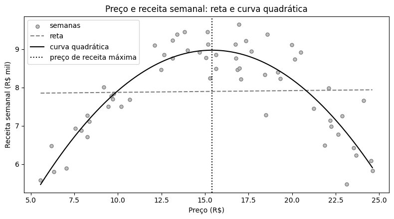
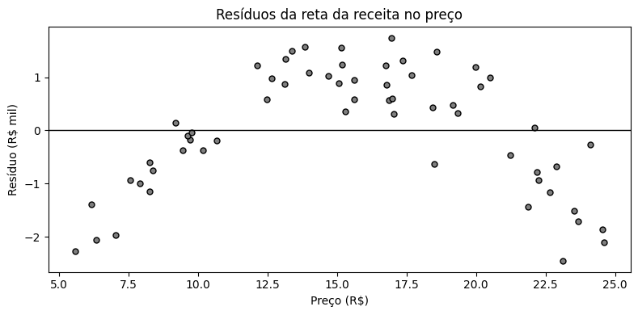

# Capítulo 10 — Resoluções

[Notebook do estudante](../ch10-student.ipynb) · [exercícios](../exercises/ch10.md)

Consulte as resoluções depois da tentativa.

# Resoluções 01–06 · Transformações, não linearidades e elasticidades

**Prof. Daniel de Abreu Pereira Uhr**

**Curso:** Estatística e Econometria com Python


Editorial worked solution

## Contexto — Imobiliária

A imobiliária, do Capítulo 6, ampliou sua base: 300 apartamentos anunciados, com **aluguel** mensal (R\$), **área** (m²), **idade** do imóvel (anos) e **distância** ao centro (km). Os dados são didáticos e foram gerados com um mecanismo em logaritmo.

Execute a célula abaixo antes de começar.

```python
import numpy as np
import pandas as pd
import statsmodels.formula.api as smf

rng = np.random.default_rng(2026)
n_apartamentos = 300
apartamentos = pd.DataFrame({
    "area_m2": rng.integers(30, 151, size=n_apartamentos),
    "idade_anos": rng.integers(0, 41, size=n_apartamentos),
    "distancia_km": np.round(rng.uniform(0.5, 20, size=n_apartamentos), 1),
})
log_aluguel = (4.5 + 0.8 * np.log(apartamentos["area_m2"]) - 0.01 * apartamentos["idade_anos"]
               - 0.15 * np.log(apartamentos["distancia_km"]) + rng.normal(0, 0.15, size=n_apartamentos))
apartamentos["aluguel"] = np.round(np.exp(log_aluguel), -1)
```

## Resolução do Exercício 01 — Um modelo em logaritmos

**Raciocínio:** com $\log Y$, regressores em logaritmo têm coeficientes que são elasticidades; regressores em níveis, semielasticidades.

```python
modelo = smf.ols("np.log(aluguel) ~ np.log(area_m2) + idade_anos + np.log(distancia_km)", data=apartamentos).fit()
print(modelo.params.round(4))
```

```text
Intercept               4.4361
np.log(area_m2)         0.8153
idade_anos             -0.0089
np.log(distancia_km)   -0.1620
dtype: float64
```

**Resultado e interpretação:** a área e a distância entram em logaritmo: seus coeficientes, cerca de 0,82 e −0,16, são **elasticidades**. A idade entra em anos: seu coeficiente, cerca de −0,009, é uma **semielasticidade**.

## Resolução do Exercício 02 — Elasticidades

**Raciocínio:** em um modelo log-log, 1% a mais de $X$ está associado a cerca de $\beta$ % de $Y$; para 10%, cerca de $10\beta$ %.

```python
b = modelo.params
print(f"10% a mais de área: cerca de {10 * b['np.log(area_m2)']:.1f}% a mais de aluguel (exato: {100 * (1.10 ** b['np.log(area_m2)'] - 1):.1f}%)")
print(f"10% a mais de distância: cerca de {10 * b['np.log(distancia_km)']:.1f}% de aluguel (exato: {100 * (1.10 ** b['np.log(distancia_km)'] - 1):.1f}%)")
```

```text
10% a mais de área: cerca de 8.2% a mais de aluguel (exato: 8.1%)
10% a mais de distância: cerca de -1.6% de aluguel (exato: -1.5%)
```

**Resultado e interpretação:** com idade e distância iguais, um apartamento 10% maior tem aluguel cerca de 8% maior. Com área e idade iguais, um apartamento 10% mais distante do centro tem aluguel cerca de 1,6% menor. Para variações de 10%, as leituras aproximada e exata quase coincidem.

## Resolução do Exercício 03 — Semielasticidade da idade

**Raciocínio:** em log-nível, um ano a mais está associado a cerca de $100\beta$ %; o exato é $100(e^{\beta} - 1)$ %. Para 20 anos, usa-se $20\beta$.

```python
b_idade = b["idade_anos"]
print(f"1 ano: aproximado {100 * b_idade:.2f}%; exato {100 * (np.exp(b_idade) - 1):.2f}%")
print(f"20 anos: aproximado {100 * 20 * b_idade:.1f}%; exato {100 * (np.exp(20 * b_idade) - 1):.1f}%")
```

```text
1 ano: aproximado -0.89%; exato -0.88%
20 anos: aproximado -17.7%; exato -16.2%
```

**Resultado e interpretação:** cada ano a mais de idade está associado a um aluguel cerca de 0,9% menor; as duas leituras coincidem. Para 20 anos, a leitura aproximada indica cerca de 17,7% a menos e a exata, cerca de 16,2%. A diferença entre as leituras cresce com o tamanho da variação total, $20\beta$: aqui, já é de cerca de 1,5 ponto percentual; para variações totais de poucos por cento, as duas leituras praticamente coincidem.

## Resolução do Exercício 04 — Um modelo nível-log

**Raciocínio:** em nível-log, 1% a mais de $X$ está associado a cerca de $\beta/100$ unidades de $Y$.

```python
nivel_log = smf.ols("aluguel ~ np.log(distancia_km)", data=apartamentos).fit()
b_dist = nivel_log.params["np.log(distancia_km)"]
print(nivel_log.params.round(1))
print(f"1% mais distante: cerca de R$ {b_dist / 100:.2f}; 10% mais distante: cerca de R$ {b_dist * np.log(1.10):.0f}")
```

```text
Intercept               2440.3
np.log(distancia_km)    -209.5
dtype: float64
1% mais distante: cerca de R$ -2.09; 10% mais distante: cerca de R$ -20
```

**Resultado e interpretação:** 1% a mais de distância ao centro está associado a cerca de R\$ 2,09 a menos de aluguel; 10% a mais, a cerca de R\$ 20 a menos — calculado com $\beta \cdot \log(1{,}10)$, que é a conta exata para o modelo. A leitura está em reais, não em percentual, porque o aluguel entra em níveis.

## Resolução do Exercício 05 — Elasticidade constante ou variável

**Raciocínio:** no modelo linear, a elasticidade é $\beta \cdot X / \hat{Y}$ e muda com $X$; no log-log, é constante.

```python
linear = smf.ols("aluguel ~ area_m2", data=apartamentos).fit()
area_media = apartamentos["area_m2"].mean()
aluguel_previsto = linear.params["Intercept"] + linear.params["area_m2"] * area_media
print(f"Elasticidade do modelo linear na área média ({area_media:.0f} m²): {linear.params['area_m2'] * area_media / aluguel_previsto:.3f}")
print(f"Elasticidade do modelo log-log: {b['np.log(area_m2)']:.3f}")
```

```text
Elasticidade do modelo linear na área média (90 m²): 0.795
Elasticidade do modelo log-log: 0.815
```

**Resultado e interpretação:** as duas elasticidades ficam próximas. A diferença está na hipótese: o modelo log-log supõe a mesma elasticidade para apartamentos pequenos e grandes; no modelo linear, a elasticidade muda ao longo da área, e o número calculado vale apenas para a área média.

## Resolução do Exercício 06 — O dobro da área

**Raciocínio:** dobrar a área multiplica o aluguel previsto por $2^{\beta}$.

```python
fator = 2 ** b["np.log(area_m2)"]
print(f"Dobrar a área multiplica o aluguel previsto por {fator:.2f}: cerca de {100 * (fator - 1):.0f}% a mais")
```

```text
Dobrar a área multiplica o aluguel previsto por 1.76: cerca de 76% a mais
```

**Avaliação:** segundo os dados, um apartamento com o dobro da área custa cerca de 76% a mais, e não 100%. A afirmação do corretor equivaleria a uma elasticidade igual a 1; a estimada, cerca de 0,82, indica que o aluguel cresce **menos** que proporcionalmente à área — o preço por m² cai à medida que os apartamentos ficam maiores. A comparação é entre apartamentos anunciados de mesma idade e distância, e vale para a faixa de 30 a 150 m².

# Resoluções 07–12 · Transformações, não linearidades e elasticidades

**Prof. Daniel de Abreu Pereira Uhr**

**Curso:** Estatística e Econometria com Python


Editorial worked solution

## Contexto — Beija-flor: preço e receita

No Capítulo 5, a Beija-flor acompanhou o preço e a quantidade vendida de um produto em 60 semanas. A correlação entre preço e receita semanal era praticamente nula, embora a relação fosse forte e em forma de U invertido. Agora, você vai modelar essa curva.

A célula abaixo reproduz os dados do Capítulo 5 com o mesmo código e a mesma seed: as primeiras linhas repetem a geração das lojas daquela aula, para que as semanas sejam idênticas.

Execute a célula antes de começar.

```python
import numpy as np
import pandas as pd
import matplotlib.pyplot as plt
import statsmodels.formula.api as smf

rng = np.random.default_rng(2026)
area = rng.uniform(1, 4, size=80)
fluxo = 5 * area + rng.normal(0, 1.5, size=80)
_ = rng.normal(0, 3, size=80), rng.poisson(2 * fluxo), rng.normal(0, 25, size=80)

semanas = pd.DataFrame({"preco": np.round(rng.uniform(5, 25, size=60), 2)})
semanas["quantidade"] = np.round(1_200 - 40 * semanas["preco"] + rng.normal(0, 40, size=60))
semanas["receita"] = semanas["preco"] * semanas["quantidade"]
```

## Resolução do Exercício 07 — A reta

**Raciocínio:** a reta só capta a associação linear, que aqui é quase nula.

```python
print(f"Correlação entre preço e receita: {semanas['preco'].corr(semanas['receita']):.3f}")
linear = smf.ols("receita ~ preco", data=semanas).fit()
print(linear.params.round(2))
print(f"R² da reta: {linear.rsquared:.4f}")
```

```text
Correlação entre preço e receita: 0.022
Intercept    7825.72
preco           4.55
dtype: float64
R² da reta: 0.0005
```

**Resultado e interpretação:** a correlação é de cerca de 0,02, e a reta acompanha praticamente nada da variação da receita ($R^2 \approx 0{,}0005$). Como no Capítulo 5, isso não significa ausência de relação, e sim ausência de relação **linear**.

## Resolução do Exercício 08 — A curva

**Raciocínio:** um termo quadrático permite que a receita suba e depois desça.

```python
quadratico = smf.ols("receita ~ preco + I(preco**2)", data=semanas).fit()
print(quadratico.params.round(2))
print(f"R² da curva: {quadratico.rsquared:.3f}")
```

```text
Intercept         380.20
preco            1115.11
I(preco ** 2)     -36.19
dtype: float64
R² da curva: 0.800
```

**Resultado e interpretação:** o coeficiente do termo quadrático é negativo, o que produz um U invertido, e o $R^2$ sobe para cerca de 0,80. Os dois $R^2$ podem ser comparados porque a variável dependente é a mesma — a receita em reais —; o que não se compara são $R^2$ de $Y$ e de $\log Y$.

## Resolução do Exercício 09 — Efeitos marginais

**Raciocínio:** o efeito de R\$ 1 a mais no preço é $\beta_1 + 2\beta_2 \cdot \text{preço}$.

```python
b = quadratico.params
for preco in [10, 15, 20]:
    print(f"Preço de R$ {preco}: R$ 1 a mais → cerca de R$ {b['preco'] + 2 * b['I(preco ** 2)'] * preco:.0f} de receita semanal")
```

```text
Preço de R$ 10: R$ 1 a mais → cerca de R$ 391 de receita semanal
Preço de R$ 15: R$ 1 a mais → cerca de R$ 29 de receita semanal
Preço de R$ 20: R$ 1 a mais → cerca de R$ -332 de receita semanal
```

**Resultado e interpretação:** com preço de R\$ 10, um real a mais está associado a cerca de R\$ 391 a mais de receita semanal; com R\$ 15, a apenas cerca de R\$ 29; com R\$ 20, a cerca de R\$ 332 a **menos**. Abaixo de cerca de R\$ 15, aumentar o preço eleva a receita; acima, a reduz.

## Resolução do Exercício 10 — O preço que maximiza a receita

**Raciocínio:** o efeito marginal se anula em $-\beta_1/(2\beta_2)$.

```python
preco_maximo = -b["preco"] / (2 * b["I(preco ** 2)"])
print(f"Preço que maximiza a receita prevista: R$ {preco_maximo:.2f}")
print(f"Preços observados: de R$ {semanas['preco'].min():.2f} a R$ {semanas['preco'].max():.2f}")

grade = np.linspace(semanas["preco"].min(), semanas["preco"].max(), 200)
fig, ax = plt.subplots(figsize=(8, 4.5))
ax.scatter(semanas["preco"], semanas["receita"] / 1_000, color="#BFBFBF", edgecolor="#7F7F7F", s=25, label="semanas")
ax.plot(grade, (linear.params["Intercept"] + linear.params["preco"] * grade) / 1_000, color="#7F7F7F", linestyle="--", label="reta")
ax.plot(grade, (b["Intercept"] + b["preco"] * grade + b["I(preco ** 2)"] * grade**2) / 1_000, color="black", label="curva quadrática")
ax.axvline(preco_maximo, color="black", linestyle=":", label="preço de receita máxima")
ax.set_title("Preço e receita semanal: reta e curva quadrática")
ax.set_xlabel("Preço (R$)")
ax.set_ylabel("Receita semanal (R$ mil)")
ax.legend()
fig.tight_layout()
plt.show()
```

```text
Preço que maximiza a receita prevista: R$ 15.41
Preços observados: de R$ 5.57 a R$ 24.61
```



**Resultado e interpretação:** a receita prevista é máxima com preço de cerca de R\$ 15,41, bem dentro do intervalo de preços observado (de R\$ 5,57 a R\$ 24,61) e perto dos R\$ 15 implícitos no mecanismo (receita $= 1.200p - 40p^2$, máxima em $p = 15$). A curva acompanha bem os dados; a reta, quase horizontal, não descreve nada.

## Resolução do Exercício 11 — Resíduos

**Raciocínio:** se a forma funcional estiver errada, os resíduos mostram um padrão sistemático.

```python
fig, ax = plt.subplots(figsize=(8, 4))
ax.scatter(semanas["preco"], linear.resid / 1_000, color="#7F7F7F", edgecolor="black", s=25)
ax.axhline(0, color="black", linewidth=1)
ax.set_title("Resíduos da reta da receita no preço")
ax.set_xlabel("Preço (R$)")
ax.set_ylabel("Resíduo (R$ mil)")
fig.tight_layout()
plt.show()
```



**Resultado e interpretação:** os resíduos são negativos nos preços baixos e altos e positivos nos intermediários — o próprio U invertido que a reta não captou. Esse padrão indica forma funcional inadequada, e não “ruído”.

## Resolução do Exercício 12 — Receita não é lucro

**Raciocínio:** com demanda linear $q = a - c\,p$, o lucro é $(p - 6)(a - c\,p)$, máximo em $p^* = (a/c + 6)/2$.

```python
demanda = smf.ols("quantidade ~ preco", data=semanas).fit()
a, c = demanda.params["Intercept"], -demanda.params["preco"]
preco_lucro = (a / c + 6) / 2
print(f"Demanda estimada: quantidade = {a:.0f} − {c:.1f} · preço")
print(f"Preço que maximiza o lucro: R$ {preco_lucro:.2f}   (receita máxima em R$ {preco_maximo:.2f})")
```

```text
Demanda estimada: quantidade = 1178 − 38.4 · preço
Preço que maximiza o lucro: R$ 18.34   (receita máxima em R$ 15.41)
```

**Resultado e interpretação:** com custo de R\$ 6 por unidade, o lucro é máximo com preço de cerca de R\$ 18, acima do preço que maximiza a receita. Perto do preço de receita máxima, aumentar um pouco o preço quase não muda a receita, mas reduz a quantidade — e cada unidade a menos economiza R\$ 6 de custo. Por isso, o preço ótimo para o lucro é maior.

Maximizar a receita só coincidiria com maximizar o lucro se o custo por unidade fosse zero. A escolha também depende de fatores fora do modelo: reação de concorrentes, efeito sobre outros produtos e incerteza das estimativas.

# Resoluções 13–18 · Transformações, não linearidades e elasticidades

**Prof. Daniel de Abreu Pereira Uhr**

**Curso:** Estatística e Econometria com Python


Editorial worked solution

## Contexto — Hortifrúti

A hortifrúti, rede fictícia de hortifrútis, **sorteou** o preço de um produto em cada uma de suas 200 lojas, entre R\$ 4 e R\$ 12, durante um mês, e registrou a **quantidade vendida** e a **renda** média do bairro (R\$ mil). A rede quer saber se aumentar o preço em 5% elevaria ou reduziria a receita. Os dados são didáticos.

Execute a célula abaixo antes de começar.

```python
import numpy as np
import pandas as pd
import statsmodels.formula.api as smf

rng = np.random.default_rng(2026)
n_lojas = 200
lojas = pd.DataFrame({
    "preco": np.round(rng.uniform(4, 12, size=n_lojas), 2),
    "renda_mil": np.round(rng.uniform(2, 8, size=n_lojas), 2),
})
log_quantidade = 8.0 - 1.4 * np.log(lojas["preco"]) + 0.5 * np.log(lojas["renda_mil"]) + rng.normal(0, 0.25, size=n_lojas)
lojas["quantidade"] = np.round(np.exp(log_quantidade))
```

## Resolução do Exercício 13 — O modelo log-log

**Raciocínio:** com logaritmos dos dois lados, cada coeficiente é a variação percentual da quantidade associada a 1% a mais do regressor.

```python
modelo = smf.ols("np.log(quantidade) ~ np.log(preco) + np.log(renda_mil)", data=lojas).fit()
print(modelo.params.round(3))
print("IC de 95% da elasticidade-preço:", modelo.conf_int().loc["np.log(preco)"].round(3).tolist())
```

```text
Intercept            8.207
np.log(preco)       -1.501
np.log(renda_mil)    0.503
dtype: float64
IC de 95% da elasticidade-preço: [-1.633, -1.368]
```

**Resultado e interpretação:** 1% a mais no preço está associado a cerca de 1,50% a menos na quantidade vendida, com a renda do bairro constante; o intervalo de 95% vai de cerca de −1,63 a −1,37. A elasticidade-renda, cerca de 0,50, indica que lojas em bairros com 10% a mais de renda vendem cerca de 5% a mais, com o mesmo preço.

## Resolução do Exercício 14 — O papel do sorteio

**Resposta:** como o preço foi sorteado, ele não depende da demanda local: lojas com preço alto e baixo são, em média, semelhantes em tudo o mais. A diferença de quantidade entre elas estima a resposta da demanda ao preço.

Se a rede tivesse cobrado mais nas lojas de maior demanda, preço alto e quantidade alta andariam juntos por causa dessa escolha, e não por causa da demanda: a elasticidade estimada ficaria menor em valor absoluto — a demanda pareceria menos sensível ao preço do que é. É o problema da direção reversa do Capítulo 5.

## Resolução do Exercício 15 — A demanda é elástica?

**Raciocínio:** a demanda é elástica quando a elasticidade é menor que −1.

```python
print(modelo.t_test("np.log(preco) = -1"))
```

```text
                             Test for Constraints                             
==============================================================================
                 coef    std err          t      P>|t|      [0.025      0.975]
------------------------------------------------------------------------------
c0            -1.5005      0.067     -7.475      0.000      -1.633      -1.368
==============================================================================
```

**Resultado e interpretação:** o teste rejeita com folga a elasticidade unitária, e todo o intervalo fica abaixo de −1: a demanda é **elástica**. A quantidade responde mais que proporcionalmente ao preço.

## Resolução do Exercício 16 — Efeito de 5% no preço

**Raciocínio:** com elasticidade $\varepsilon$, um aumento de 5% multiplica a quantidade por $1{,}05^{\varepsilon}$ e a receita por $1{,}05 \times 1{,}05^{\varepsilon} = 1{,}05^{1+\varepsilon}$.

```python
inferior, superior = modelo.conf_int().loc["np.log(preco)"]
for rotulo, elasticidade in [("estimativa", modelo.params["np.log(preco)"]), ("limite inferior", inferior), ("limite superior", superior)]:
    quantidade = 100 * (1.05 ** elasticidade - 1)
    receita = 100 * (1.05 ** (1 + elasticidade) - 1)
    print(f"{rotulo:>15}: elasticidade {elasticidade:.3f}; quantidade {quantidade:.1f}% (aprox. {5 * elasticidade:.1f}%); receita {receita:.1f}%")
```

```text
     estimativa: elasticidade -1.501; quantidade -7.1% (aprox. -7.5%); receita -2.4%
limite inferior: elasticidade -1.633; quantidade -7.7% (aprox. -8.2%); receita -3.0%
limite superior: elasticidade -1.368; quantidade -6.5% (aprox. -6.8%); receita -1.8%
```

**Resultado e interpretação:** um aumento de 5% no preço reduz a quantidade em cerca de 7,1% (7,5% pela aproximação) e a receita em cerca de 2,4%. Mesmo nos limites do intervalo, a receita cai: entre cerca de 1,8% e 3,0%. Com demanda elástica, aumentar o preço reduz a receita.

## Resolução do Exercício 17 — Limites

1. **Um produto e um mês:** a elasticidade vale para este produto, nesta época; produtos sazonais podem reagir de outro modo em outros meses.
2. **Faixa de preços testada:** o modelo supõe elasticidade constante entre R\$ 4 e R\$ 12; fora dessa faixa, nada garante.
3. **Efeitos fora do modelo:** reações de concorrentes e efeitos sobre as vendas de outros produtos da loja não foram medidos.

## Resolução do Exercício 18 — Recomendação de preço

**Recomendação (exemplo):**

> O teste, com preços sorteados entre 200 lojas, indica demanda elástica: 1% a mais no preço reduz a quantidade vendida em cerca de 1,5% (intervalo de 1,37% a 1,63%). Um aumento de 5% no preço reduziria a receita do produto em cerca de 2,4% — entre 1,8% e 3,0%, considerando a incerteza.
>
> Se o objetivo for receita, não recomendamos aumentar o preço. Como lucro não é receita, a decisão final depende do custo do produto: com custo alto, vender menos unidades a um preço maior pode ainda aumentar o lucro. Recomendamos calcular a margem com o custo unitário e, se necessário, repetir o teste em outra época do ano.

Continuação do exercício 18. Admita mil unidades a R\$ 8, custo unitário de R\$ 4 e implantação de R\$ 100. Compare a contribuição líquida a R\$ 8 e R\$ 8,40 e examine os extremos da elasticidade.

```python
unit_cost = 4
setup_cost = 100
for elasticity in [-1.633, -1.501, -1.368]:
    units = 1000 * 1.05 ** elasticity
    revenue = 8.40 * units
    gain = (8.40 - unit_cost) * units - (8 - unit_cost) * 1000 - setup_cost
    print(round(elasticity, 3), round(units, 1), round(revenue, 2), round(gain, 2))
```

```text
-1.633 923.4 7756.7 -36.97
-1.501 929.4 7806.82 -10.71
-1.368 935.4 7857.64 15.91
```

A estimativa central indica pequena perda após a implantação. Os extremos ficam em lados opostos de zero. Pelo critério de contribuição adicional esperada positiva, mantenha o preço atual com essa estimativa.
