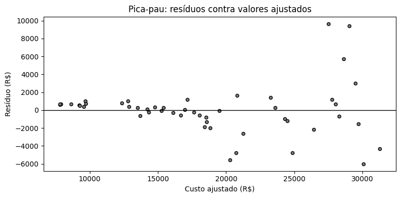
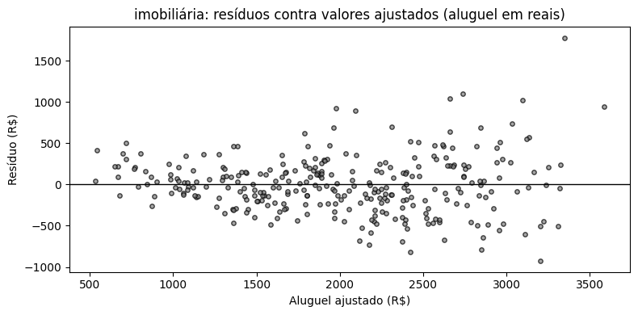
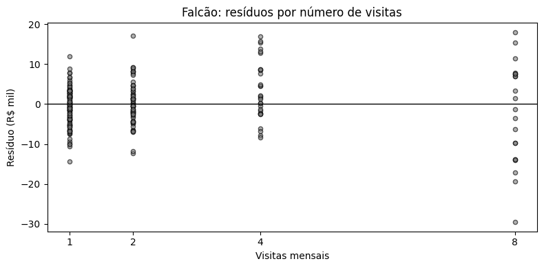

# Capítulo 11 — Resoluções

[Notebook do estudante](../ch11-student.ipynb) · [exercícios](../exercises/ch11.md)

Consulte as resoluções depois da tentativa.

# Resoluções 01–06 · Heterocedasticidade e erros-padrão robustos

**Prof. Daniel de Abreu Pereira Uhr**

**Curso:** Estatística e Econometria com Python


Editorial worked solution

## Contexto — Indústria Pica-pau

No Capítulo 6, o laboratório da Pica-pau gerou 20.000 lotes de móveis com custo = R\$ 6.000 + R\$ 12 por unidade + um erro com desvio-padrão constante de R\$ 2.000. Agora, o laboratório mantém os mesmos tamanhos de lote e os mesmos choques, mas muda a **dispersão** do erro em três versões:

- **constante:** desvio-padrão de R\$ 2.000 — o laboratório do Capítulo 6;
- **crescente:** desvio-padrão de $0{,}0015 \cdot \text{unidades}^2$, de R\$ 60 nos lotes de 200 unidades a R\$ 6.000 nos de 2.000 — lotes grandes envolvem mais etapas e imprevistos;
- **maior no meio:** desvio-padrão de $3.500 - 3 \cdot |\text{unidades} - 1.100|$, máximo nos lotes médios (usado no desafio).

O analista observa 50 lotes — os mesmos do Capítulo 6 — com os custos da versão **crescente**.

Execute a célula abaixo antes de começar.

```python
import numpy as np
import pandas as pd
import matplotlib.pyplot as plt
import statsmodels.formula.api as smf
from scipy import stats

rng = np.random.default_rng(2026)
N = 20_000
unidades = rng.integers(200, 2_001, size=N)
choque = rng.normal(0, 1, size=N)
custo_constante = np.round(6_000 + 12 * unidades + 2_000 * choque, 2)
custo_crescente = np.round(6_000 + 12 * unidades + 0.0015 * unidades**2 * choque, 2)
custo_meio = np.round(6_000 + 12 * unidades + (3_500 - 3 * np.abs(unidades - 1_100)) * choque, 2)

n = 50
amostra = rng.choice(N, size=n, replace=True)
lotes = pd.DataFrame({"unidades": unidades[amostra], "custo": custo_crescente[amostra]})


def erros_padrao_simples(x, y):
    desvio_x = x - x.mean()
    soma_quadrados_x = (desvio_x**2).sum()
    inclinacao = (desvio_x * (y - y.mean())).sum() / soma_quadrados_x
    residuos = y - y.mean() - inclinacao * desvio_x
    n_obs = len(x)
    usual = np.sqrt((residuos**2).sum() / (n_obs - 2) / soma_quadrados_x)
    hc0 = np.sqrt((desvio_x**2 * residuos**2).sum() / soma_quadrados_x**2)
    hc1 = hc0 * np.sqrt(n_obs / (n_obs - 2))
    return inclinacao, usual, hc0, hc1
```

## Resolução do Exercício 01 — Diagnóstico

**Raciocínio:** a dispersão dos resíduos ao longo dos ajustados e por faixas indica se a dispersão do erro muda com as unidades.

```python
modelo_usual = smf.ols("custo ~ unidades", data=lotes).fit()
print(modelo_usual.params.round(2))

faixas = pd.cut(lotes["unidades"], bins=[200, 650, 1_100, 1_550, 2_000], include_lowest=True,
                labels=["200 a 650", "650 a 1.100", "1.100 a 1.550", "1.550 a 2.000"])
print(modelo_usual.resid.groupby(faixas, observed=True).agg(["count", "std"]).round(0))

fig, ax = plt.subplots(figsize=(8, 4))
ax.scatter(modelo_usual.fittedvalues, modelo_usual.resid, color="#7F7F7F", edgecolor="black", s=20)
ax.axhline(0, color="black", linewidth=1)
ax.set_title("Pica-pau: resíduos contra valores ajustados")
ax.set_xlabel("Custo ajustado (R$)")
ax.set_ylabel("Resíduo (R$)")
fig.tight_layout()
plt.show()
```

```text
Intercept    5020.62
unidades       13.40
dtype: float64
               count     std
unidades                    
200 a 650         14   392.0
650 a 1.100       16   817.0
1.100 a 1.550      9  2743.0
1.550 a 2.000     11  5178.0
```



**Resultado e interpretação:** os resíduos formam um funil: o desvio-padrão sobe de cerca de R\$ 390 nos lotes de até 650 unidades para cerca de R\$ 5.200 nos maiores. Há heterocedasticidade — a dispersão do custo cresce com o tamanho do lote —, sem sinal de curvatura.

## Resolução do Exercício 02 — Erros-padrão à mão

**Raciocínio:** o erro-padrão usual usa uma variância comum; HC0 usa o resíduo ao quadrado de cada lote, ponderado por $(x_i - \bar{x})^2$; HC1 corrige os graus de liberdade.

```python
_, usual, hc0, hc1 = erros_padrao_simples(lotes["unidades"].to_numpy(), lotes["custo"].to_numpy())
modelo_hc0 = smf.ols("custo ~ unidades", data=lotes).fit(cov_type="HC0")
modelo_hc1 = smf.ols("custo ~ unidades", data=lotes).fit(cov_type="HC1")
print(pd.DataFrame({"à mão": [usual, hc0, hc1],
                    "statsmodels": [modelo_usual.bse["unidades"], modelo_hc0.bse["unidades"], modelo_hc1.bse["unidades"]]},
                   index=["usual", "HC0", "HC1"]).round(3))
print("IC de 95% usual:", modelo_usual.conf_int().loc["unidades"].round(2).tolist())
print("IC de 95% HC1:  ", modelo_hc1.conf_int().loc["unidades"].round(2).tolist())
```

```text
       à mão  statsmodels
usual  0.782        0.782
HC0    0.972        0.972
HC1    0.992        0.992
IC de 95% usual: [11.82, 14.97]
IC de 95% HC1:   [11.45, 15.34]
```

**Resultado e interpretação:** as fórmulas à mão coincidem com o statsmodels. O erro-padrão da inclinação passa de cerca de R\$ 0,78 por unidade (usual) para R\$ 0,99 (HC1), e o intervalo de 95% se alarga. A estimativa — cerca de R\$ 13,40 por unidade — é a mesma nos dois casos.

## Resolução do Exercício 03 — Viés e incerteza no laboratório

**Raciocínio:** repetimos o trabalho do analista em 5.000 amostras e comparamos o centro e a dispersão das estimativas com os erros-padrão.

```python
indices = rng.choice(N, size=(5_000, n), replace=True)


def laboratorio(custo):
    beta_populacao = smf.ols("custo ~ unidades", data=pd.DataFrame({"unidades": unidades, "custo": custo})).fit().params["unidades"]
    resultados = np.array([erros_padrao_simples(unidades[i].astype(float), custo[i]) for i in indices])
    return beta_populacao, resultados


beta_crescente, resultados_crescente = laboratorio(custo_crescente)
print(f"Inclinação da população: {beta_crescente:.3f}; média das estimativas: {resultados_crescente[:, 0].mean():.3f}")
print(f"Desvio-padrão real das estimativas: {resultados_crescente[:, 0].std():.3f}")
print(f"Média dos erros-padrão — usual: {resultados_crescente[:, 1].mean():.3f}; HC1: {resultados_crescente[:, 3].mean():.3f}")
```

```text
Inclinação da população: 12.044; média das estimativas: 12.050
Desvio-padrão real das estimativas: 0.948
Média dos erros-padrão — usual: 0.759; HC1: 0.897
```

**Resultado e interpretação:** a média das inclinações, cerca de R\$ 12,05 por unidade, coincide com a da população: a heterocedasticidade não vicia o estimador. Mas as estimativas variam com desvio-padrão de cerca de 0,95, enquanto o erro-padrão usual diz, em média, 0,76 — ele subestima a incerteza. O HC1, com média de cerca de 0,90, fica bem mais perto.

## Resolução do Exercício 04 — Cobertura

**Raciocínio:** um intervalo de 95% deveria conter a inclinação da população em 95% das amostras.

```python
t_critico = stats.t.ppf(0.975, n - 2)


def coberturas(beta_populacao, resultados):
    return {nome: (np.abs(resultados[:, 0] - beta_populacao) <= t_critico * resultados[:, coluna]).mean()
            for coluna, nome in [(1, "usual"), (3, "HC1")]}


print("Versão crescente:", {nome: round(float(valor), 3) for nome, valor in coberturas(beta_crescente, resultados_crescente).items()})
```

```text
Versão crescente: {'usual': 0.886, 'HC1': 0.932}
```

**Resultado e interpretação:** os intervalos usuais contêm a inclinação da população em apenas cerca de 88,6% das amostras; os robustos, em cerca de 93,2%. Com 50 lotes, o HC1 ainda fica um pouco abaixo de 95% — a Dica do HC3 na aula trata disso —, mas corrige a maior parte do problema.

## Resolução do Exercício 05 — E quando a variância é constante?

**Raciocínio:** com homocedasticidade, os dois erros-padrão estimam a mesma coisa.

```python
beta_constante, resultados_constante = laboratorio(custo_constante)
print(f"Média dos erros-padrão — usual: {resultados_constante[:, 1].mean():.3f}; HC1: {resultados_constante[:, 3].mean():.3f}; desvio real: {resultados_constante[:, 0].std():.3f}")
print("Versão constante:", {nome: round(float(valor), 3) for nome, valor in coberturas(beta_constante, resultados_constante).items()})
```

```text
Média dos erros-padrão — usual: 0.549; HC1: 0.539; desvio real: 0.563
Versão constante: {'usual': 0.944, 'HC1': 0.933}
```

**Resultado e interpretação:** com variância constante, os intervalos usuais têm cobertura de cerca de 94,4%, como esperado, e os robustos, de cerca de 93,3% — uma perda pequena. Os erros-padrão médios ficam muito próximos. O erro-padrão robusto custa pouco quando a variância é constante e protege muito quando não é; como, com dados reais, não sabemos qual é o caso, ele é o padrão do curso para dados observacionais.

## Resolução do Exercício 06 — Usual grande demais

**Raciocínio:** a fórmula robusta pondera cada resíduo ao quadrado por $(x_i - \bar{x})^2$; a usual trata todos os erros como igualmente dispersos.

```python
beta_meio, resultados_meio = laboratorio(custo_meio)
print(f"Média dos erros-padrão — usual: {resultados_meio[:, 1].mean():.3f}; HC1: {resultados_meio[:, 3].mean():.3f}; desvio real: {resultados_meio[:, 0].std():.3f}")
print("Versão maior no meio:", {nome: round(float(valor), 3) for nome, valor in coberturas(beta_meio, resultados_meio).items()})
```

```text
Média dos erros-padrão — usual: 0.635; HC1: 0.440; desvio real: 0.452
Versão maior no meio: {'usual': 0.995, 'HC1': 0.946}
```

**Resultado e interpretação:** agora o erro-padrão usual erra **para mais**: em média, cerca de 0,64, contra um desvio-padrão real de cerca de 0,45. Os intervalos usuais são largos demais e contêm a inclinação em cerca de 99,5% das amostras; os robustos, com média próxima do desvio real, em cerca de 94,6%.

A explicação está nos pesos. A inclinação depende sobretudo dos lotes com $X$ distante da média — os muito pequenos e os muito grandes —, e é deles que vêm os pesos $(x_i - \bar{x})^2$ grandes. Nesta versão, esses lotes têm erros pouco dispersos; a dispersão alta está nos lotes médios, que pouco influenciam a inclinação. A fórmula usual mistura todas as dispersões em um $\hat{\sigma}^2$ comum e, por isso, exagera a incerteza. Na versão crescente, ocorre o contrário: os lotes grandes, com peso alto, são os mais dispersos. Erro-padrão usual largo demais também é um problema: os testes perdem poder e deixam passar diferenças reais.

# Resoluções 07–12 · Heterocedasticidade e erros-padrão robustos

**Prof. Daniel de Abreu Pereira Uhr**

**Curso:** Estatística e Econometria com Python


Editorial worked solution

## Contexto — Imobiliária

Você volta aos 300 apartamentos da imobiliária do Capítulo 10: **aluguel** mensal (R\$), **área** (m²), **idade** do imóvel (anos) e **distância** ao centro (km). A célula abaixo reproduz os dados com o mesmo código e a mesma seed. Agora, a pergunta é sobre a precisão das estimativas.

Execute a célula abaixo antes de começar.

```python
import numpy as np
import pandas as pd
import matplotlib.pyplot as plt
import statsmodels.formula.api as smf

rng = np.random.default_rng(2026)
n_apartamentos = 300
apartamentos = pd.DataFrame({
    "area_m2": rng.integers(30, 151, size=n_apartamentos),
    "idade_anos": rng.integers(0, 41, size=n_apartamentos),
    "distancia_km": np.round(rng.uniform(0.5, 20, size=n_apartamentos), 1),
})
log_aluguel = (4.5 + 0.8 * np.log(apartamentos["area_m2"]) - 0.01 * apartamentos["idade_anos"]
               - 0.15 * np.log(apartamentos["distancia_km"]) + rng.normal(0, 0.15, size=n_apartamentos))
apartamentos["aluguel"] = np.round(np.exp(log_aluguel), -1)
```

## Resolução do Exercício 07 — Diagnóstico

**Raciocínio:** na regressão múltipla, o gráfico dos resíduos contra os ajustados resume todos os regressores em um só eixo.

```python
formula_niveis = "aluguel ~ area_m2 + idade_anos + distancia_km"
modelo_usual = smf.ols(formula_niveis, data=apartamentos).fit()
print(modelo_usual.params.round(2))

faixas_area = pd.cut(apartamentos["area_m2"], bins=[30, 60, 90, 120, 150], include_lowest=True,
                     labels=["30 a 60", "60 a 90", "90 a 120", "120 a 150"])
print(modelo_usual.resid.groupby(faixas_area, observed=True).agg(["count", "std"]).round(0))

fig, ax = plt.subplots(figsize=(8, 4))
ax.scatter(modelo_usual.fittedvalues, modelo_usual.resid, color="#7F7F7F", edgecolor="black", s=15, alpha=0.7)
ax.axhline(0, color="black", linewidth=1)
ax.set_title("imobiliária: resíduos contra valores ajustados (aluguel em reais)")
ax.set_xlabel("Aluguel ajustado (R$)")
ax.set_ylabel("Resíduo (R$)")
fig.tight_layout()
plt.show()
```

```text
Intercept       1082.75
area_m2           18.68
idade_anos       -17.63
distancia_km     -41.55
dtype: float64
           count    std
area_m2                
30 a 60       69  228.0
60 a 90       84  300.0
90 a 120      78  314.0
120 a 150     69  494.0
```



**Resultado e interpretação:** os resíduos se espalham mais entre os aluguéis ajustados altos, e o desvio-padrão por faixa sobe de cerca de R\$ 230 nos apartamentos de até 60 m² para cerca de R\$ 490 nos maiores. Há heterocedasticidade: aluguéis de apartamentos grandes variam mais em reais — como esperado se as diferenças forem proporcionais, o mecanismo do Capítulo 10.

## Resolução do Exercício 08 — Usuais e robustos lado a lado

**Raciocínio:** os coeficientes são os mesmos; comparamos apenas os erros-padrão.

```python
modelo_hc1 = smf.ols(formula_niveis, data=apartamentos).fit(cov_type="HC1")
tabela = pd.DataFrame({"coeficiente": modelo_usual.params, "EP usual": modelo_usual.bse, "EP HC1": modelo_hc1.bse,
                       "razão HC1/usual": modelo_hc1.bse / modelo_usual.bse})
print(tabela.round(3))
```

```text
              coeficiente  EP usual  EP HC1  razão HC1/usual
Intercept        1082.752    72.139  66.166            0.917
area_m2            18.679     0.592   0.655            1.105
idade_anos        -17.630     1.694   1.636            0.966
distancia_km      -41.554     3.615   4.311            1.193
```

**Resultado e interpretação:** o erro-padrão robusto da distância é cerca de 19% maior que o usual, e o da área, cerca de 11% maior. O da idade **diminui** cerca de 3%, e o do intercepto, cerca de 8%. O erro-padrão robusto não é sempre maior: ele corrige o usual na direção que os dados indicarem, coeficiente a coeficiente.

## Resolução do Exercício 09 — Intervalos e conclusões

**Raciocínio:** comparamos os intervalos e verificamos se alguma conclusão depende do tipo de erro-padrão.

```python
print("IC de 95% da distância — usual:", modelo_usual.conf_int().loc["distancia_km"].round(1).tolist())
print("IC de 95% da distância — HC1:  ", modelo_hc1.conf_int().loc["distancia_km"].round(1).tolist())
print("p-valores HC1:", modelo_hc1.pvalues.apply(lambda p: f"{p:.1e}").to_dict())
```

```text
IC de 95% da distância — usual: [-48.7, -34.4]
IC de 95% da distância — HC1:   [-50.0, -33.1]
p-valores HC1: {'Intercept': '3.5e-60', 'area_m2': '5.4e-179', 'idade_anos': '4.3e-27', 'distancia_km': '5.5e-22'}
```

**Resultado e interpretação:** com área e idade iguais, cada quilômetro a mais de distância ao centro está associado a um aluguel cerca de R\$ 42 menor. Com o erro-padrão robusto, o intervalo se alarga um pouco, mas continua longe de zero. Nenhuma conclusão muda: área, idade e distância continuam claramente associadas ao aluguel. Mesmo quando a conclusão não muda, reportar os erros-padrão robustos dá ao leitor a medida correta da precisão.

## Resolução do Exercício 10 — O modelo em logaritmo

**Raciocínio:** se as diferenças de aluguel são proporcionais, a dispersão em logaritmo deve ser quase constante.

```python
formula_log = "np.log(aluguel) ~ np.log(area_m2) + idade_anos + np.log(distancia_km)"
log_usual = smf.ols(formula_log, data=apartamentos).fit()
log_hc1 = smf.ols(formula_log, data=apartamentos).fit(cov_type="HC1")
print("Razão HC1/usual:", (log_hc1.bse / log_usual.bse).round(2).to_dict())
print(log_usual.resid.groupby(faixas_area, observed=True).std().round(3))
```

```text
Razão HC1/usual: {'Intercept': 1.01, 'np.log(area_m2)': 1.03, 'idade_anos': 1.0, 'np.log(distancia_km)': 1.04}
area_m2
30 a 60      0.153
60 a 90      0.150
90 a 120     0.131
120 a 150    0.154
dtype: float64
```

**Resultado e interpretação:** no modelo em logaritmo, o desvio-padrão dos resíduos é praticamente o mesmo em todas as faixas de área (cerca de 0,13 a 0,15), e os erros-padrão robustos ficam entre 0% e 4% acima dos usuais. Nesta escala, a variância é quase constante — o mecanismo dos dados é proporcional.

## Resolução do Exercício 11 — Forma funcional ou remédio?

**Resposta:** a afirmação mistura duas decisões. A forma funcional responde à pergunta: o log-log fala de variações percentuais e elasticidades; o modelo em reais, de diferenças em reais. Se a pergunta for “quantos reais a mais por m²?”, o modelo em níveis continua sendo o adequado, com erros-padrão robustos. O logaritmo também pode não eliminar a heterocedasticidade — na base Engel, o erro-padrão robusto da elasticidade ainda é cerca de 27% maior que o usual — e não serve para variáveis com zeros ou valores negativos.

A resposta à heterocedasticidade é reportar erros-padrão robustos, qualquer que seja a forma funcional escolhida pela pergunta.

## Resolução do Exercício 12 — Descartar os grandes

**Raciocínio:** excluir observações muda a amostra, a população a que as conclusões se aplicam e a informação disponível.

```python
ate_120 = apartamentos[apartamentos["area_m2"] <= 120]
modelo_ate_120 = smf.ols(formula_niveis, data=ate_120).fit(cov_type="HC1")
print(f"Apartamentos excluídos: {len(apartamentos) - len(ate_120)} de {len(apartamentos)}")
print(pd.DataFrame({"todos (HC1)": modelo_hc1.params, "EP todos": modelo_hc1.bse,
                    "até 120 m² (HC1)": modelo_ate_120.params, "EP até 120 m²": modelo_ate_120.bse}).round(3))
```

```text
Apartamentos excluídos: 69 de 300
              todos (HC1)  EP todos  até 120 m² (HC1)  EP até 120 m²
Intercept        1082.752    66.166          1054.395         67.965
area_m2            18.679     0.655            17.634          0.687
idade_anos        -17.630     1.636           -15.118          1.425
distancia_km      -41.554     4.311           -36.762          3.804
```

**Avaliação:** a proposta descarta 69 dos 300 apartamentos — quase um quarto da amostra. Os erros-padrão mudam pouco: o da área até sobe, de cerca de 0,655 para 0,687, porque a amostra ficou menor e a área passou a variar menos; os da idade e da distância caem um pouco. As **estimativas** também mudam — a associação com a distância passa de cerca de R\$ 42 para R\$ 37 por km —, porque, com um mecanismo proporcional, os coeficientes em reais são menores entre os apartamentos menores. A análise passa a responder a outra pergunta: as conclusões valem só para apartamentos de até 120 m².

Descartar observações para “resolver” a heterocedasticidade troca um problema de inferência — que os erros-padrão robustos resolvem — por perda de informação e de alcance. Exclusões só se justificam por razões substantivas, declaradas e mostradas com e sem a exclusão, como discutirá a Capítulo 12.

# Resoluções 13–18 · Heterocedasticidade e erros-padrão robustos

**Prof. Daniel de Abreu Pereira Uhr**

**Curso:** Estatística e Econometria com Python


Editorial worked solution

## Contexto — Distribuidora Falcão

A Falcão, distribuidora fictícia de alimentos, **sorteou** o número de visitas mensais de vendedores a 240 clientes — 1, 2, 4 ou 8 visitas, com probabilidades de 50%, 25%, 15% e 10% — e registrou as **compras** mensais de cada cliente (R\$ mil). Os dados são didáticos.

Cada visita custa R\$ 350, e a margem bruta da distribuidora é de 20%. Uma visita se paga se aumentar as compras do cliente em mais de R\$ 350 / 0,20 = **R\$ 1,75 mil** por mês.

O relatório da equipe comercial, feito com a tabela de regressão padrão, conclui que “as visitas se pagam com folga” e recomenda ampliá-las.

Execute a célula abaixo antes de começar.

```python
import numpy as np
import pandas as pd
import matplotlib.pyplot as plt
import statsmodels.formula.api as smf

rng = np.random.default_rng(2026)
n_clientes = 240
visitas = rng.choice([1, 2, 4, 8], size=n_clientes, p=[0.5, 0.25, 0.15, 0.10])
resposta_cliente = 2.0 + rng.normal(0, 1.5, size=n_clientes)
clientes = pd.DataFrame({
    "visitas": visitas,
    "compras": np.round(30 + resposta_cliente * visitas + rng.normal(0, 4, size=n_clientes), 1),
})
```

## Resolução do Exercício 13 — A conclusão do relatório

**Raciocínio:** a visita se paga se o efeito sobre as compras superar R\$ 1,75 mil; o relatório compara a estimativa e seu intervalo com esse valor.

```python
modelo_usual = smf.ols("compras ~ visitas", data=clientes).fit()
print(modelo_usual.params.round(3))
print(f"Erro-padrão usual: {modelo_usual.bse['visitas']:.3f}")
print("IC de 95% (usual):", modelo_usual.conf_int().loc["visitas"].round(2).tolist())
```

```text
Intercept    29.987
visitas       2.251
dtype: float64
Erro-padrão usual: 0.199
IC de 95% (usual): [1.86, 2.64]
```

**Resultado e interpretação:** cada visita a mais está associada a cerca de R\$ 2,25 mil a mais de compras mensais. Com o erro-padrão usual, o intervalo de 95% vai de cerca de R\$ 1,86 mil a R\$ 2,64 mil — inteiramente acima do ponto de equilíbrio de R\$ 1,75 mil. É a base da conclusão do relatório: as visitas se pagariam com folga.

## Resolução do Exercício 14 — Diagnóstico

**Raciocínio:** com apenas quatro valores de visitas, a dispersão por grupo é o diagnóstico mais direto.

```python
print(modelo_usual.resid.groupby(clientes["visitas"]).agg(["count", "std"]).round(2))

fig, ax = plt.subplots(figsize=(8, 4))
ax.scatter(clientes["visitas"], modelo_usual.resid, color="#7F7F7F", edgecolor="black", s=20, alpha=0.6)
ax.axhline(0, color="black", linewidth=1)
ax.set_xticks([1, 2, 4, 8])
ax.set_title("Falcão: resíduos por número de visitas")
ax.set_xlabel("Visitas mensais")
ax.set_ylabel("Resíduo (R$ mil)")
fig.tight_layout()
plt.show()
```

```text
         count    std
visitas              
1          121   4.47
2           67   5.21
4           30   7.33
8           22  12.54
```



**Resultado e interpretação:** a dispersão dos resíduos cresce com o número de visitas: desvio-padrão de cerca de R\$ 4,5 mil entre os clientes com 1 visita e de cerca de R\$ 12,5 mil entre os com 8. E há poucos clientes nos níveis altos — 30 com 4 visitas e 22 com 8 —, justamente os que mais pesam na inclinação, por estarem longe da média de visitas.

## Resolução do Exercício 15 — Erros-padrão robustos

**Raciocínio:** com a dispersão concentrada nas observações de maior peso, o erro-padrão usual deve subestimar a incerteza.

```python
modelo_hc1 = smf.ols("compras ~ visitas", data=clientes).fit(cov_type="HC1")
print(f"Erro-padrão HC1: {modelo_hc1.bse['visitas']:.3f}   (usual: {modelo_usual.bse['visitas']:.3f})")
print("IC de 95% (HC1):", modelo_hc1.conf_int().loc["visitas"].round(2).tolist())
```

```text
Erro-padrão HC1: 0.344   (usual: 0.199)
IC de 95% (HC1): [1.58, 2.92]
```

**Resultado e interpretação:** o erro-padrão robusto, cerca de 0,34, é cerca de 70% maior que o usual. O intervalo de 95% passa a ir de cerca de R\$ 1,58 mil a R\$ 2,92 mil e **inclui** o ponto de equilíbrio de R\$ 1,75 mil. A estimativa continua a mesma, mas os dados já não permitem afirmar que as visitas se pagam.

## Resolução do Exercício 16 — Teste do ponto de equilíbrio

**Raciocínio:** testamos se o efeito é compatível com exatamente R\$ 1,75 mil.

```python
for rotulo, modelo in [("usual", modelo_usual), ("HC1", modelo_hc1)]:
    teste = modelo.t_test("visitas = 1.75")
    print(f"{rotulo:>5}: estatística = {float(np.squeeze(teste.tvalue)):.2f}; p-valor = {float(np.squeeze(teste.pvalue)):.3f}")
```

```text
usual: estatística = 2.52; p-valor = 0.012
  HC1: estatística = 1.46; p-valor = 0.145
```

**Resultado e interpretação:** com o erro-padrão usual, a hipótese de que o efeito é igual a R\$ 1,75 mil é rejeitada a 5% (p-valor de cerca de 0,012). Com o HC1, não é (p-valor de cerca de 0,15). A conclusão do relatório dependia da hipótese de homocedasticidade — que os dados de Exercício 14 mostram ser falsa.

## Resolução do Exercício 17 — Sorteio e heterocedasticidade

**Resposta:** como as visitas foram sorteadas, clientes com 1, 2, 4 e 8 visitas são, em média, semelhantes em tudo o mais: a diferença média de compras entre eles estima o **efeito médio** de uma visita a mais, como no teste de preços dos Capítulos 8 e 10.

O sorteio, porém, não iguala a resposta dos clientes: alguns reagem muito às visitas, outros quase nada. Com uma visita, essas diferenças pesam pouco; com oito, multiplicadas pelo número de visitas, afastam muito as compras de um cliente das de outro. Efeitos heterogêneos geram heterocedasticidade — a ligação que dá nome ao teste de Breusch e Pagan, sobre “variação aleatória de coeficientes”.

Os erros-padrão robustos não mudam a leitura causal nem a estimativa: corrigem a medida de precisão do efeito médio.

## Resolução do Exercício 18 — Recomendação

**Recomendação (exemplo):**

> O teste, com visitas sorteadas entre 240 clientes, estima que cada visita a mais aumenta as compras mensais em cerca de R\$ 2,25 mil, em média — acima do ponto de equilíbrio de R\$ 1,75 mil. Mas a resposta varia muito entre clientes, e, com erros-padrão robustos a essa variação, o intervalo de 95% vai de R\$ 1,58 mil a R\$ 2,92 mil: não podemos afirmar que as visitas se pagam em média. A conclusão do relatório anterior dependia de uma hipótese que os dados não sustentam.
>
> Recomendamos não ampliar as visitas para toda a carteira por enquanto e continuar o teste com mais clientes nos níveis de 4 e 8 visitas, em que há poucas observações e a dispersão é maior. Como a resposta varia entre clientes, vale investigar quais respondem mais — por porte ou segmento — antes de redefinir a política. A análise mede o efeito sobre as compras do mês, não sobre a fidelização de longo prazo.

### Exercício 18 · Decisão sobre a rota

**Sua decisão.** Nos exercícios 13–18, reproduza a análise e entregue um parecer para um segundo cenário. Suponha que uma rota custe R\$ 400 por visita, tenha margem de 15% e disponibilidade para 60 visitas adicionais. Informe o ponto de equilíbrio, a contribuição estimada para o lote de visitas e o intervalo associado à inclinação média, mantendo as hipóteses de custo e margem. Explique que informação adicional a Falcão deveria levantar antes de comprometer a rota.

```python
modelo_hc1 = smf.ols("compras ~ visitas", data=clientes).fit(cov_type="HC1")
slope = modelo_hc1.params["visitas"]
bounds = modelo_hc1.conf_int().loc["visitas"].to_numpy()
margin, cost, visits_in_plan = 0.15, 400, 60
net = visits_in_plan * (1000 * margin * slope - cost)
net_bounds = visits_in_plan * (1000 * margin * bounds - cost)
print("Compras de equilíbrio por visita (mil):", round(cost / (1000 * margin), 3))
print("Contribuição líquida esperada:", round(net))
print("Intervalo de 95% da contribuição média:", net_bounds.round().astype(int).tolist())
```

```text
Compras de equilíbrio por visita (mil): 2.667
Contribuição líquida esperada: -3743
Intervalo de 95% da contribuição média: [-9811, 2324]
```

Com margem de 15%, cada visita precisa gerar aproximadamente R\$ 2,667 mil em compras adicionais. Na inclinação estimada, a perda média é de cerca de R\$ 62 por visita. O intervalo da contribuição esperada das 60 visitas atravessa zero. Comprometer todas exigiria evidência mais forte ou condições econômicas melhores. Para prever o caixa realizado em uma rota específica, seria necessário considerar a variação individual e a dependência entre clientes.
