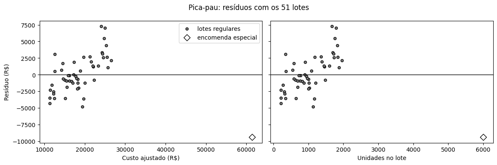

# Capítulo 12 — Resoluções

[Notebook do estudante](../ch12-student.ipynb) · [exercícios](../exercises/ch12.md)

Consulte as resoluções depois da tentativa.

# Resoluções 01–06 · Diagnóstico, especificação e robustez

**Prof. Daniel de Abreu Pereira Uhr**

**Curso:** Estatística e Econometria com Python


Editorial worked solution

## Contexto — Indústria Pica-pau

No Capítulo 6, o analista da Pica-pau estimou quanto o custo de um lote de móveis aumenta a cada unidade adicional, com 50 lotes regulares, de 200 a 2.000 unidades. Agora, a planilha traz também uma **encomenda especial**: 6.000 unidades para uma rede hoteleira, produzidas com madeira comprada em contrato à parte, a preço negociado. O custo registrado foi de R\$ 52 mil.

A pergunta continua a mesma: **quanto o custo de um lote regular aumenta a cada unidade adicional?**

A célula abaixo reproduz os 50 lotes do Capítulo 6, com o mesmo código e a mesma seed, e acrescenta a encomenda especial. Execute-a antes de começar.

```python
import numpy as np
import pandas as pd
import matplotlib.pyplot as plt
import statsmodels.formula.api as smf

rng = np.random.default_rng(2026)
N = 20_000
beta_0, beta_1 = 6_000, 12
unidades = rng.integers(200, 2_001, size=N)
erro = rng.normal(0, 2_000, size=N)
populacao = pd.DataFrame({"unidades": unidades, "custo": np.round(beta_0 + beta_1 * unidades + erro, 2)})
n = 50
amostra = populacao.iloc[rng.choice(N, size=n, replace=True)].reset_index(drop=True)

encomenda = pd.DataFrame({"unidades": [6_000], "custo": [52_000.0]})
lotes = pd.concat([amostra.assign(tipo="regular"), encomenda.assign(tipo="encomenda especial")], ignore_index=True)
especial = lotes["tipo"] == "encomenda especial"
```

## Resolução do Exercício 01 — Resíduos

**Raciocínio:** os gráficos de resíduos mostram o que examinar; os resíduos studentizados colocam cada lote em uma escala comum.

```python
modelo = smf.ols("custo ~ unidades", data=lotes).fit()
influencia = modelo.get_influence()
lotes["studentizado"] = influencia.resid_studentized_external

fig, axes = plt.subplots(1, 2, figsize=(12, 4), sharey=True)
for ax, x, rotulo in [(axes[0], modelo.fittedvalues, "Custo ajustado (R$)"), (axes[1], lotes["unidades"], "Unidades no lote")]:
    ax.scatter(x[~especial], modelo.resid[~especial], color="#7F7F7F", edgecolor="black", s=20, label="lotes regulares")
    ax.scatter(x[especial], modelo.resid[especial], color="white", edgecolor="black", marker="D", s=60, label="encomenda especial")
    ax.axhline(0, color="black", linewidth=1)
    ax.set_xlabel(rotulo)
axes[0].set_ylabel("Resíduo (R$)")
axes[0].legend()
fig.suptitle("Pica-pau: resíduos com os 51 lotes")
fig.tight_layout()
plt.show()

maiores = lotes["studentizado"].abs().sort_values(ascending=False).index[:4]
print(lotes.loc[maiores, ["tipo", "unidades", "custo", "studentizado"]].round(2))
```



```text
                  tipo  unidades     custo  studentizado
50  encomenda especial      6000  52000.00         -7.70
21             regular      1678  31357.90          2.55
15             regular      1792  32054.76          2.44
16             regular      1761  30234.30          1.86
```

**Resultado e interpretação:** a encomenda especial aparece isolada, muito à direita e muito abaixo da reta, com resíduo studentizado de cerca de −7,7 — longe de qualquer valor plausível por acaso. Os resíduos dos lotes regulares sobem com as unidades — negativos nos lotes pequenos, positivos nos grandes —: a reta, puxada para baixo pela encomenda, ficou inclinada de menos para eles. Os demais resíduos studentizados são de cerca de 2,5 ou menos em módulo, o que se espera para alguns lotes entre 50.

## Resolução do Exercício 02 — Alavancagem

**Raciocínio:** a alavancagem mede quanto as unidades de um lote se afastam das dos demais.

```python
lotes["alavancagem"] = influencia.hat_matrix_diag
k = 1
n_lotes = len(lotes)
print(f"Alavancagem média (k + 1)/n: {(k + 1) / n_lotes:.3f}; sinal 2(k + 1)/n: {2 * (k + 1) / n_lotes:.3f}")
print(lotes.sort_values("alavancagem", ascending=False)[["tipo", "unidades", "alavancagem"]].head(3).round(3))
```

```text
Alavancagem média (k + 1)/n: 0.039; sinal 2(k + 1)/n: 0.078
                  tipo  unidades  alavancagem
50  encomenda especial      6000        0.649
18             regular       207        0.042
41             regular       209        0.041
```

**Resultado e interpretação:** a encomenda especial tem alavancagem de cerca de 0,65 — mais de 15 vezes a média de cerca de 0,04 —, enquanto a maior entre os lotes regulares fica perto de 0,04. Com 6.000 unidades, ela está três vezes além do maior lote regular: sozinha, ela define a ponta direita da reta.

## Resolução do Exercício 03 — Influência

**Raciocínio:** a distância de Cook combina resíduo e alavancagem; a medida mais direta é reestimar sem o lote.

```python
lotes["cook"] = influencia.cooks_distance[0]
print(f"Sinal 4/n: {4 / n_lotes:.3f}")
print(lotes.sort_values("cook", ascending=False)[["tipo", "unidades", "custo", "cook"]].head(4).round(3))
print(f"Lotes regulares acima de 4/n: {(lotes.loc[~especial, 'cook'] > 4 / n_lotes).sum()}")
print()
sem_encomenda = smf.ols("custo ~ unidades", data=amostra).fit()
print(pd.DataFrame({"51 lotes": modelo.params, "50 lotes regulares": sem_encomenda.params}).round(2))
previsto = sem_encomenda.params["Intercept"] + sem_encomenda.params["unidades"] * 6_000
print(f"Custo previsto pela reta dos lotes regulares para 6.000 unidades: R$ {previsto:,.0f}".replace(",", "."))
```

```text
Sinal 4/n: 0.078
                  tipo  unidades     custo    cook
50  encomenda especial      6000  52000.00  25.052
15             regular      1792  32054.76   0.088
21             regular      1678  31357.90   0.084
16             regular      1761  30234.30   0.052
Lotes regulares acima de 4/n: 2

           51 lotes  50 lotes regulares
Intercept   9546.86             6195.19
unidades       8.65               12.11
Custo previsto pela reta dos lotes regulares para 6.000 unidades: R$ 78.884
```

**Resultado e interpretação:** a distância de Cook da encomenda especial, cerca de 25, é centenas de vezes o sinal de 0,078; dois lotes regulares passam um pouco do sinal. Sozinha, a encomenda reduz a inclinação de cerca de R\$ 12,11 para R\$ 8,65 por unidade — quase 30% a menos — e eleva o intercepto. A reta dos lotes regulares preveria cerca de R\$ 78,9 mil para 6.000 unidades; a encomenda custou R\$ 52 mil.

## Resolução do Exercício 04 — Decisão

**Resposta:**

1. **É um erro?** Não há indício: o custo baixo tem explicação — madeira de contrato à parte, preço negociado.
2. **É outro tipo de unidade?** Sim: é uma encomenda com outro processo de compra de insumos e uma escala três vezes maior que a de qualquer lote regular.
3. **É um caso que a forma funcional não acomoda?** Talvez também: custos por unidade podem cair em escalas muito grandes, mas não há lotes entre 2.000 e 6.000 unidades para verificar.
4. **A conclusão muda?** Sim: a inclinação cai quase 30%.

Como a pergunta é sobre lotes regulares, a análise principal usa os 50 lotes regulares, declara a exclusão e mostra o resultado com a encomenda. Os dois lotes regulares acima de $4/n$ permanecem: não há razão substantiva para retirá-los, e passar da regra prática, com 50 lotes, é esperado para alguns.

## Resolução do Exercício 05 — Relato

**Raciocínio:** o relato mostra a estimativa principal e o resultado com a observação excluída.

```python
linhas = []
for rotulo, dados in [("50 lotes regulares — principal", amostra), ("51 lotes, com a encomenda", lotes)]:
    ajuste = smf.ols("custo ~ unidades", data=dados).fit(cov_type="HC1")
    inferior, superior = ajuste.conf_int().loc["unidades"]
    linhas.append({"especificação": rotulo, "inclinação": ajuste.params["unidades"], "EP HC1": ajuste.bse["unidades"],
                   "IC inferior": inferior, "IC superior": superior})
print(pd.DataFrame(linhas).set_index("especificação").round(2).to_string())
```

```text
                                inclinação  EP HC1  IC inferior  IC superior
especificação                                                               
50 lotes regulares — principal       12.11    0.57        10.99        13.24
51 lotes, com a encomenda             8.65    1.28         6.14        11.16
```

**Relato (exemplo):**

> Entre os 50 lotes regulares, cada unidade adicional está associada a cerca de R\$ 12,1 de custo a mais (intervalo de 95%: aproximadamente R\$ 11,0 a R\$ 13,2). A encomenda especial de 6.000 unidades para a rede hoteleira foi excluída da análise principal: foi produzida com madeira de contrato à parte e está muito além da escala dos lotes regulares. Com ela, a estimativa cairia para cerca de R\$ 8,7 por unidade — valor que não descreve os lotes regulares. O custo de encomendas desse porte merece uma análise própria, que esta base não permite.

## Resolução do Exercício 06 — Alavancagem não é influência

**Raciocínio:** a influência exige alavancagem **e** resíduo; Cook resume a mudança de todos os coeficientes, não só da inclinação.

```python
print(f"Sem lote extra: intercepto {sem_encomenda.params['Intercept']:.0f}; inclinação {sem_encomenda.params['unidades']:.2f}; sinal 4/n = {4 / 51:.3f}")
for rotulo, (novas_unidades, novo_custo) in [("6.000 unidades, perto da reta", (6_000, 78_000.0)),
                                              ("1.100 unidades, R$ 9 mil acima", (1_100, 28_200.0))]:
    dados = pd.concat([amostra, pd.DataFrame({"unidades": [novas_unidades], "custo": [novo_custo]})], ignore_index=True)
    ajuste = smf.ols("custo ~ unidades", data=dados).fit()
    medidas = ajuste.get_influence()
    print(f"{rotulo}: alavancagem {medidas.hat_matrix_diag[-1]:.3f}; studentizado {medidas.resid_studentized_external[-1]:.2f}; "
          f"Cook {medidas.cooks_distance[0][-1]:.3f}; intercepto {ajuste.params['Intercept']:.0f}; inclinação {ajuste.params['unidades']:.2f}")
```

```text
Sem lote extra: intercepto 6195; inclinação 12.11; sinal 4/n = 0.078
6.000 unidades, perto da reta: alavancagem 0.649; studentizado -0.25; Cook 0.060; intercepto 6305; inclinação 12.00
1.100 unidades, R$ 9 mil acima: alavancagem 0.020; studentizado 4.15; Cook 0.133; intercepto 6315; inclinação 12.16
```

**Resultado e interpretação:** o lote de 6.000 unidades perto da reta tem a mesma alavancagem da encomenda especial, cerca de 0,65, mas resíduo pequeno e distância de Cook muito abaixo do sinal: a inclinação quase não muda. Ele apenas confirma a relação, e ainda a torna mais precisa. Alavancagem alta é potencial de influência, não influência.

O lote de 1.100 unidades tem alavancagem baixa, perto da média, mas resíduo studentizado acima de 4. Sua distância de Cook passa do sinal $4/n$, embora a inclinação praticamente não mude — de 12,11 para 12,16: como ele está perto do centro das unidades, desloca a reta inteira para cima, sem girá-la. A regra $4/n$ sinaliza uma mudança nos coeficientes, que pode não envolver o coeficiente de interesse. Por isso, a pergunta certa após o sinal é sempre “o que muda, e isso importa para a pergunta?”.

# Resoluções 07–12 · Diagnóstico, especificação e robustez

**Prof. Daniel de Abreu Pereira Uhr**

**Curso:** Estatística e Econometria com Python


Editorial worked solution

## Contexto — Rede de calçados

No Capítulo 8, a rede fictícia de calçados relacionou as vendas mensais de 60 lojas ao investimento em mídia **digital**, **rádio** e **panfletos** (R\$ mil por mês). Como as lojas planejam rádio e panfletos em conjunto, os coeficientes desses dois ficaram muito imprecisos — o do rádio, até negativo.

Agora, a diretora de marketing quer saber: **podemos cortar os panfletos sem perder vendas?**

A célula abaixo reproduz os dados do Capítulo 8, com o mesmo código e a mesma seed. Neste laboratório, a dispersão do erro é constante; por isso, este bloco usa os erros-padrão usuais, sobre os quais a fórmula do VIF fala diretamente. Execute-a antes de começar.

```python
import numpy as np
import pandas as pd
import statsmodels.formula.api as smf
from statsmodels.stats.outliers_influence import variance_inflation_factor

rng = np.random.default_rng(2026)
N = 50_000

digital = np.round(rng.uniform(2, 20, size=N), 2)
radio = np.round(rng.uniform(0, 15, size=N), 2)
panfletos = np.round(np.clip(0.8 * radio + rng.normal(0, 1.0, size=N), 0, None), 2)
vendas = np.round(120 + 3.0 * digital + 2.0 * radio + 2.0 * panfletos + rng.normal(0, 25, size=N), 1)
populacao = pd.DataFrame({"digital": digital, "radio": radio, "panfletos": panfletos, "vendas": vendas})

n = 60
amostra = populacao.iloc[rng.choice(N, size=n, replace=True)].reset_index(drop=True)
```

## Resolução do Exercício 07 — VIF

**Raciocínio:** $VIF_j = 1/(1 - R^2_j)$, em que $R^2_j$ vem da regressão de $X_j$ nos demais regressores.

```python
modelo = smf.ols("vendas ~ digital + radio + panfletos", data=amostra).fit()
midias = ["digital", "radio", "panfletos"]

vif_mao = {}
for midia in midias:
    outras = " + ".join(m for m in midias if m != midia)
    r2 = smf.ols(f"{midia} ~ {outras}", data=amostra).fit().rsquared
    vif_mao[midia] = 1 / (1 - r2)

exog, nomes = modelo.model.exog, modelo.model.exog_names
vif_funcao = {nome: variance_inflation_factor(exog, j) for j, nome in enumerate(nomes) if nome != "Intercept"}
print(pd.DataFrame({"VIF à mão": vif_mao, "VIF pela função": vif_funcao}).round(2))
```

```text
           VIF à mão  VIF pela função
digital         1.02             1.02
radio          13.03            13.03
panfletos      13.11            13.11
```

**Resultado e interpretação:** os dois cálculos coincidem. O VIF da mídia digital é cerca de 1,02 — ela quase não se relaciona com as outras. Os do rádio e dos panfletos passam de 13: mais de 92% da variação de cada um é explicada pelo outro.

## Resolução do Exercício 08 — VIF, variação própria e erro-padrão

**Raciocínio:** a variação própria é a fração $1 - R^2_j$ da variação total; a variância de $\hat{\beta}_j$ é inversamente proporcional a ela.

```python
linhas = []
for midia in midias:
    outras = " + ".join(m for m in midias if m != midia)
    propria = smf.ols(f"{midia} ~ {outras}", data=amostra).fit().resid
    razao = amostra[midia].std() / propria.std()
    linhas.append({"mídia": midia, "desvio de X": amostra[midia].std(), "desvio da variação própria": propria.std(),
                   "razão²": razao**2, "VIF": vif_mao[midia], "erro-padrão": modelo.bse[midia]})
print(pd.DataFrame(linhas).set_index("mídia").round(3).to_string())
```

```text
           desvio de X  desvio da variação própria  razão²     VIF  erro-padrão
mídia                                                                          
digital          5.379                       5.317   1.023   1.023        0.586
radio            3.845                       1.065  13.032  13.032        2.923
panfletos        3.062                       0.846  13.111  13.111        3.683
```

**Resultado e interpretação:** o quadrado da razão entre o desvio de cada mídia e o de sua variação própria é exatamente o VIF. Rádio e panfletos variam bastante — desvios de cerca de 3,9 e 3,1 —, mas suas variações próprias são de apenas cerca de 1,1 e 0,85: quase toda a variação é comum aos dois. Por isso, seus erros-padrão, cerca de 2,9 e 3,7, são 5 a 6 vezes o da mídia digital, 0,59 — os números do Capítulo 8, agora resumidos no VIF.

## Resolução do Exercício 09 — O que os dados conseguem responder

**Raciocínio:** a soma dos dois coeficientes usa a variação **comum** de rádio e panfletos, que é grande.

```python
soma = modelo.t_test("radio + panfletos = 0")
print(f"Efeito conjunto: {float(np.squeeze(soma.effect)):.2f}; erro-padrão {float(np.squeeze(soma.sd)):.2f}; IC de 95%: {np.round(soma.conf_int(), 2).tolist()[0]}")
teste_f = modelo.f_test("radio = 0, panfletos = 0")
print(f"Teste F de rádio = panfletos = 0: F = {float(np.squeeze(teste_f.fvalue)):.2f}; p-valor = {float(teste_f.pvalue):.4f}")
```

```text
Efeito conjunto: 3.87; erro-padrão 1.19; IC de 95%: [1.48, 6.26]
Teste F de rádio = panfletos = 0: F = 5.73; p-valor = 0.0055
```

**Resultado e interpretação:** R\$ 1 mil a mais em rádio **e** R\$ 1 mil a mais em panfletos estão associados a cerca de R\$ 3,87 mil a mais de vendas, com intervalo de R\$ 1,48 mil a R\$ 6,26 mil — perto dos R\$ 4 mil do mecanismo, com erro-padrão de cerca de 1,2, bem menor que os individuais. O teste $F$ rejeita que os dois coeficientes sejam zero (p ≈ 0,005). Os dados respondem bem à pergunta “rádio e panfletos, juntos, se associam às vendas?” e mal à pergunta “qual dos dois?”.

## Resolução do Exercício 10 — Retirar os panfletos

**Raciocínio:** sem os panfletos, o coeficiente do rádio absorve o efeito dos panfletos que costumam acompanhá-lo — o viés de variável omitida do Capítulo 7.

```python
sem_panfletos = smf.ols("vendas ~ digital + radio", data=amostra).fit()
print(f"Rádio sem panfletos: {sem_panfletos.params['radio']:.2f}; IC de 95%: {sem_panfletos.conf_int().loc['radio'].round(2).tolist()}")
print(f"Mesma regressão na população do laboratório: {smf.ols('vendas ~ digital + radio', data=populacao).fit().params['radio']:.2f}")
```

```text
Rádio sem panfletos: 2.37; IC de 95%: [0.72, 4.02]
Mesma regressão na população do laboratório: 3.54
```

**Resultado e interpretação:** sem os panfletos, o coeficiente do rádio fica em cerca de R\$ 2,37 mil, com intervalo de R\$ 0,72 mil a R\$ 4,02 mil, e o erro-padrão cai. Mas ele mede outra coisa: o rádio **junto com os panfletos que o acompanham** — na população do laboratório, cerca de R\$ 3,54 mil, e não os R\$ 2 mil do mecanismo. Retirar uma variável colinear não revela o efeito da outra; muda a pergunta.

## Resolução do Exercício 11 — Resposta à diretora

**Resposta (exemplo):**

> Com os dados atuais, não é possível dizer se cortar os panfletos reduziria as vendas: como rádio e panfletos sempre variaram juntos nas lojas, os dados não conseguem separar o efeito de cada um — os intervalos de cada coeficiente são enormes. O que os dados mostram com segurança é que rádio e panfletos, **juntos**, se associam a vendas maiores: cerca de R\$ 3,9 mil a mais por R\$ 1 mil investido em cada um.
>
> Para responder à pergunta, é preciso variação independente: por exemplo, sortear lojas para manter o rádio e reduzir os panfletos durante alguns meses. Retirar os panfletos da regressão não resolve: o coeficiente do rádio passaria a incluir o efeito dos panfletos.

## Resolução do Exercício 12 — Informação como remédio

**Raciocínio:** com panfletos sorteados, rádio e panfletos deixam de andar juntos, e cada um ganha variação própria.

```python
panfletos_sorteados = np.round(rng.uniform(0, 12, size=N), 2)
vendas_sorteio = np.round(120 + 3.0 * digital + 2.0 * radio + 2.0 * panfletos_sorteados + rng.normal(0, 25, size=N), 1)
populacao_sorteio = pd.DataFrame({"digital": digital, "radio": radio, "panfletos": panfletos_sorteados, "vendas": vendas_sorteio})
amostra_sorteio = populacao_sorteio.iloc[rng.choice(N, size=n, replace=True)].reset_index(drop=True)

modelo_sorteio = smf.ols("vendas ~ digital + radio + panfletos", data=amostra_sorteio).fit()
exog_s, nomes_s = modelo_sorteio.model.exog, modelo_sorteio.model.exog_names
print(f"Correlação entre rádio e panfletos: {amostra_sorteio['radio'].corr(amostra_sorteio['panfletos']):.2f}")
print(pd.DataFrame({
    "coeficiente": modelo_sorteio.params[midias],
    "erro-padrão — sorteio": modelo_sorteio.bse[midias],
    "erro-padrão — planejamento conjunto": modelo.bse[midias],
    "VIF — sorteio": [variance_inflation_factor(exog_s, nomes_s.index(m)) for m in midias],
}).round(2).to_string())
print(modelo_sorteio.conf_int().loc[["radio", "panfletos"]].set_axis(["IC inferior", "IC superior"], axis=1).round(2))
```

```text
Correlação entre rádio e panfletos: 0.06
           coeficiente  erro-padrão — sorteio  erro-padrão — planejamento conjunto  VIF — sorteio
digital           3.03                   0.56                                 0.59           1.03
radio             1.73                   0.85                                 2.92           1.02
panfletos         1.11                   0.89                                 3.68           1.02
           IC inferior  IC superior
radio             0.03         3.44
panfletos        -0.68         2.89
```

**Resultado e interpretação:** com os panfletos sorteados, a correlação com o rádio desaparece e os VIFs caem para perto de 1. Com as **mesmas 60 lojas**, os erros-padrão do rádio e dos panfletos ficam em torno de 0,85 e 0,89 — cerca de quatro vezes menores que no planejamento conjunto. Ainda há incerteza, como mostram os intervalos, mas agora cada coeficiente responde à sua própria pergunta.

O remédio para a colinearidade não é retirar variáveis nem trocar de modelo: é **informação** — variação independente, de preferência sorteada.

# Resoluções 13–18 · Diagnóstico, especificação e robustez

**Prof. Daniel de Abreu Pereira Uhr**

**Curso:** Estatística e Econometria com Python


Editorial worked solution

## Contexto — Rede de cafeterias

A rede fictícia de cafeterias avalia aumentar em 10% o preço do café. Um analista reuniu dados de 150 cafeterias: **preço** médio da xícara (R\$), **xícaras** vendidas por semana, **renda** média do bairro (R\$ mil) e número de **concorrentes** num raio de 500 m. Ele estimou a regressão do logaritmo das xícaras no logaritmo do preço e concluiu que a demanda “cresce com o preço” — e que o aumento elevaria a receita.

Os preços não foram sorteados: a rede cobra mais em bairros de renda alta e onde há poucos concorrentes. Os dados são didáticos. Como os dados são observacionais, use erros-padrão HC1.

Execute a célula abaixo antes de começar.

```python
import numpy as np
import pandas as pd
import statsmodels.formula.api as smf

rng = np.random.default_rng(2026)
n_cafeterias = 150
renda = np.round(rng.uniform(2, 12, size=n_cafeterias), 2)
concorrentes = rng.poisson(3, size=n_cafeterias)
preco = np.round(np.exp(np.log(6) + 0.3 * np.log(renda / 5) - 0.04 * (concorrentes - 3) + rng.normal(0, 0.06, size=n_cafeterias)), 2)
log_xicaras = 7.0 - 1.3 * np.log(preco) + 0.7 * np.log(renda) - 0.08 * concorrentes + rng.normal(0, 0.15, size=n_cafeterias)
cafeterias = pd.DataFrame({"preco": preco, "renda": renda, "concorrentes": concorrentes, "xicaras": np.round(np.exp(log_xicaras))})
```

## Resolução do Exercício 13 — A regressão do analista

**Raciocínio:** no modelo log-log, o coeficiente do preço é a elasticidade (Capítulo 10).

```python
simples = smf.ols("np.log(xicaras) ~ np.log(preco)", data=cafeterias).fit(cov_type="HC1")
print(f"Elasticidade sem controles: {simples.params['np.log(preco)']:.2f}; IC de 95%: {simples.conf_int().loc['np.log(preco)'].round(2).tolist()}")
```

```text
Elasticidade sem controles: 0.56; IC de 95%: [0.32, 0.79]
```

**Resultado e interpretação:** sem controles, cafeterias com preço 1% maior vendem cerca de 0,56% **mais** xícaras, com intervalo de 0,32% a 0,79%. Lida como resposta da demanda ao preço, essa elasticidade positiva levaria à conclusão do analista: aumentar o preço elevaria tanto a quantidade quanto a receita. Uma demanda que cresce com o preço contraria a teoria econômica — um sinal para investigar a especificação.

## Resolução do Exercício 14 — Como os preços foram definidos

**Raciocínio:** um fator omitido vicia o coeficiente quando se relaciona com o regressor de interesse e com $Y$ (Capítulo 7).

```python
print(cafeterias[["preco", "renda", "concorrentes", "xicaras"]].corr().round(2))
```

```text
              preco  renda  concorrentes  xicaras
preco          1.00   0.72         -0.37     0.37
renda          0.72   1.00          0.20     0.53
concorrentes  -0.37   0.20          1.00    -0.14
xicaras        0.37   0.53         -0.14     1.00
```

**Resultado e interpretação:** o preço é muito correlacionado com a renda do bairro (0,72) e negativamente com o número de concorrentes (−0,37). Renda alta aumenta as vendas; concorrentes as reduzem. Assim, as cafeterias caras estão onde a demanda é maior — bairros ricos e com pouca concorrência. Sem controles, a regressão atribui ao preço as vendas maiores que vêm desses fatores: a elasticidade fica viesada para cima, a ponto de mudar de sinal.

## Resolução do Exercício 15 — Tabela de sensibilidade

**Raciocínio:** reestimamos a elasticidade com os controles plausíveis, um de cada vez e juntos.

```python
especificacoes = {
    "sem controles": "np.log(xicaras) ~ np.log(preco)",
    "+ renda": "np.log(xicaras) ~ np.log(preco) + np.log(renda)",
    "+ concorrentes": "np.log(xicaras) ~ np.log(preco) + concorrentes",
    "+ renda + concorrentes": "np.log(xicaras) ~ np.log(preco) + np.log(renda) + concorrentes",
}
linhas = []
for rotulo, formula in especificacoes.items():
    modelo = smf.ols(formula, data=cafeterias).fit(cov_type="HC1")
    inferior, superior = modelo.conf_int().loc["np.log(preco)"]
    linhas.append({"especificação": rotulo, "elasticidade": modelo.params["np.log(preco)"], "EP HC1": modelo.bse["np.log(preco)"],
                   "IC inferior": inferior, "IC superior": superior})
sensibilidade = pd.DataFrame(linhas).set_index("especificação")
print(sensibilidade.round(2).to_string())
```

```text
                        elasticidade  EP HC1  IC inferior  IC superior
especificação                                                         
sem controles                   0.56    0.12         0.32         0.79
+ renda                        -0.08    0.13        -0.33         0.17
+ concorrentes                  0.57    0.12         0.33         0.81
+ renda + concorrentes         -1.24    0.19        -1.61        -0.88
```

**Resultado e interpretação:** a elasticidade muda drasticamente com os controles. Só com a renda, ela cai para cerca de −0,08, com intervalo que inclui zero; só com os concorrentes, quase não muda; com os dois, chega a cerca de −1,24, com intervalo de −1,61 a −0,88 — demanda **elástica**. O controle dos concorrentes, sozinho, quase não muda a elasticidade, porque o viés da renda omitida continua dominando; com a renda no modelo, a concorrência passa a fazer diferença. Controlar parte dos fatores pode ser tão enganoso quanto não controlar nenhum.

## Resolução do Exercício 16 — O que acontece com a receita

**Raciocínio:** com elasticidade $\varepsilon$, um aumento de 10% multiplica a receita por $1{,}10^{1 + \varepsilon}$ (Capítulo 10).

```python
receita = pd.DataFrame({
    "receita (%)": 100 * (1.10 ** (1 + sensibilidade["elasticidade"]) - 1),
    "limite inferior (%)": 100 * (1.10 ** (1 + sensibilidade["IC inferior"]) - 1),
    "limite superior (%)": 100 * (1.10 ** (1 + sensibilidade["IC superior"]) - 1),
})
print(receita.round(1).to_string())
```

```text
                        receita (%)  limite inferior (%)  limite superior (%)
especificação                                                                
sem controles                  16.0                 13.4                 18.6
+ renda                         9.1                  6.5                 11.8
+ concorrentes                 16.1                 13.5                 18.8
+ renda + concorrentes         -2.3                 -5.6                  1.1
```

**Resultado e interpretação:** a recomendação depende inteiramente da especificação. Sem controles, o aumento de 10% elevaria a receita em cerca de 16%; só com a renda, em cerca de 9%. Com os dois controles, a receita **cairia** cerca de 2,3%, com intervalo de −5,6% a +1,1%: o mais provável é queda, e um ganho, se houver, seria pequeno.

## Resolução do Exercício 17 — Relato de robustez

**Resposta:** a pergunta é sobre a resposta da demanda ao preço, mantidos os fatores que a rede usa para definir o preço — renda do bairro e concorrência. A especificação com os dois controles é a que a pergunta justifica; as outras omitem fatores que se relacionam com o preço e com as vendas.

O que **não** é robusto: o sinal e o tamanho da elasticidade, que mudam de +0,56 a −1,24 conforme os controles. O que se mantém: nenhuma especificação plausível sustenta uma demanda que cresce com o preço depois que renda e concorrência são consideradas.

Limites:

1. **Fatores não observados:** fluxo de pessoas, localização dentro do bairro e qualidade do ponto também podem influenciar o preço e as vendas; a elasticidade com dois controles pode ainda estar viesada.
2. **Faixa de preços:** os preços observados vão de cerca de R\$ 4,50 a R\$ 8,75; um aumento uniforme de 10% leva parte das lojas para perto do limite dessa faixa.
3. **Comparação entre cafeterias:** a análise compara lojas diferentes, não a reação de uma mesma loja a uma mudança de preço.

## Resolução do Exercício 18 — Recomendação

**Recomendação (exemplo):**

> A conclusão de que a demanda cresce com o preço não resiste a controles plausíveis. Ela surge porque a rede cobra mais caro onde a demanda já é maior — bairros de renda alta e com pouca concorrência. Considerando esses dois fatores, a elasticidade-preço estimada é de cerca de −1,24 (intervalo de 95%: −1,61 a −0,88): a demanda é elástica, e um aumento de 10% no preço reduziria a receita em cerca de 2%, provavelmente entre −5,6% e +1,1%.
>
> | Especificação | Elasticidade | Efeito de +10% no preço sobre a receita |
> |---|---|---|
> | sem controles | +0,56 | +16% |
> | com renda e concorrência | −1,24 | −2% |
>
> Não recomendamos o aumento com base nesses dados. Como a estimativa depende fortemente dos controles e outros fatores podem estar ausentes, recomendamos um teste de preços **sorteados** entre as cafeterias por algumas semanas, como o da hortifrúti no Capítulo 10: com o preço sorteado, a elasticidade não depende de quais controles incluir.

### Exercício 18 — Transferência para outra loja

Uma loja hipotética vende 900 xícaras por semana a R\$ 6. Avalie um reajuste de 5% pela especificação completa, diante de uma meta de pelo menos 1% de receita semanal adicional. Calcule a variação prevista de receita e o intervalo HC1 transformado. Explique como verificar suporte para R\$ 6 e R\$ 6,30 entre lojas de renda e concorrência comparáveis e por que esse intervalo observacional não encerra a decisão de implantação.

```python
full_model = smf.ols(list(especificacoes.values())[-1], data=cafeterias).fit(cov_type="HC1")
estimate = full_model.params["np.log(preco)"]
lower, upper = full_model.conf_int().loc["np.log(preco)"]
baseline = 900 * 6
change = baseline * (1.05 ** (1 + np.array([estimate, lower, upper])) - 1)
print(np.round(change, 2))
print(0.01 * baseline)
```

```text
[ -64.   -158.     31.69]
54.0
```

A diferença semanal projetada é de cerca de −R\$ 64, com extremos de −R\$ 158 e +R\$ 32. A meta é +R\$ 54. Todo o intervalo fica abaixo da meta sob essa especificação e receita de referência fixa. Verifique a sobreposição local dos preços por renda e concorrência antes de extrapolar para a loja. Atender a uma meta em um modelo observacional ainda exigiria um desenho crível para orientar a intervenção.
