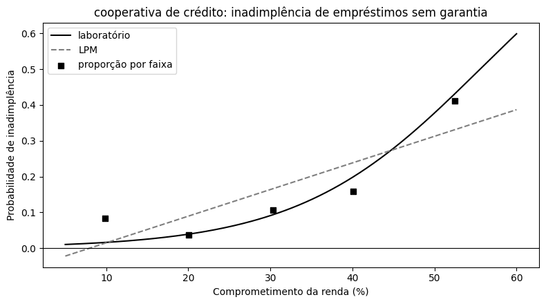

# Capítulo 13 — Resoluções

[Notebook do estudante](../ch13-student.ipynb) · [exercícios](../exercises/ch13.md)

Consulte as resoluções depois da tentativa.

# Resoluções 01–06 · Modelos para variável dependente binária

**Prof. Daniel de Abreu Pereira Uhr**

**Curso:** Estatística e Econometria com Python


Editorial worked solution

## Contexto — Cooperativa de crédito

A cooperativa de crédito, cooperativa de crédito fictícia, analisa 800 empréstimos pessoais encerrados. Para cada um, registrou o **comprometimento** da renda do cooperado com a parcela (%), se havia **garantia** e se o empréstimo ficou **inadimplente** (1) ou foi pago (0). A cooperativa cobra uma taxa de risco proporcional à probabilidade de inadimplência de cada perfil.

Os dados vêm de um laboratório, com o mecanismo escrito na célula abaixo. Execute-a antes de começar.

```python
import numpy as np
import pandas as pd
import matplotlib.pyplot as plt
import statsmodels.formula.api as smf


def logistica(indice):
    return 1 / (1 + np.exp(-indice))


rng = np.random.default_rng(2026)
n_emprestimos = 800
emprestimos = pd.DataFrame({
    "comprometimento": np.round(rng.uniform(5, 60, size=n_emprestimos), 1),
    "garantia": rng.binomial(1, 0.4, size=n_emprestimos),
})
probabilidade_lab = logistica(-5.0 + 0.09 * emprestimos["comprometimento"] - 1.0 * emprestimos["garantia"])
emprestimos["inadimplente"] = rng.binomial(1, probabilidade_lab)
```

## Resolução do Exercício 01 — Proporções

**Raciocínio:** a média de uma variável binária é a proporção de uns — uma estimativa da probabilidade no grupo.

```python
faixas = pd.cut(emprestimos["comprometimento"], bins=[5, 20, 35, 50, 60], include_lowest=True,
                labels=["5 a 20%", "20 a 35%", "35 a 50%", "50 a 60%"])
print(f"Inadimplência total: {emprestimos['inadimplente'].mean():.3f}")
print(emprestimos.groupby("garantia")["inadimplente"].agg(["size", "mean"]).rename(index={0: "sem garantia", 1: "com garantia"}).round(3))
print(emprestimos.groupby(faixas, observed=True)["inadimplente"].agg(["size", "mean"]).round(3))
```

```text
Inadimplência total: 0.158
              size   mean
garantia                 
sem garantia   466  0.193
com garantia   334  0.108
                 size   mean
comprometimento             
5 a 20%           190  0.047
20 a 35%          221  0.072
35 a 50%          232  0.185
50 a 60%          157  0.369
```

**Resultado e interpretação:** cerca de 15,8% dos empréstimos ficaram inadimplentes. A proporção cresce com o comprometimento — de cerca de 4,7% na faixa de 5 a 20% para 36,9% na de 50 a 60% — e é menor com garantia. Como `inadimplente` vale 0 ou 1, sua média em cada grupo é a proporção de inadimplentes, que estima a probabilidade de inadimplência daquele grupo.

## Resolução do Exercício 02 — O LPM

**Raciocínio:** no LPM, cada coeficiente é a diferença de probabilidade por unidade do regressor.

```python
lpm = smf.ols("inadimplente ~ comprometimento + garantia", data=emprestimos).fit(cov_type="HC1")
intervalos = lpm.conf_int()
print(pd.DataFrame({"coeficiente": lpm.params, "EP HC1": lpm.bse, "IC inferior": intervalos[0], "IC superior": intervalos[1]}).round(4))
```

```text
                 coeficiente  EP HC1  IC inferior  IC superior
Intercept            -0.0591  0.0263      -0.1107      -0.0075
comprometimento       0.0074  0.0008       0.0058       0.0090
garantia             -0.0828  0.0238      -0.1294      -0.0362
```

**Resultado e interpretação:** cada ponto percentual a mais de comprometimento da renda está associado a cerca de 0,74 ponto percentual a mais de probabilidade de inadimplência, com a mesma garantia. Empréstimos com garantia têm probabilidade cerca de 8,3 pontos percentuais menor, com o mesmo comprometimento.

## Resolução do Exercício 03 — Por que HC1

**Raciocínio:** a variância de uma binária é $p(1 - p)$, que muda com a probabilidade e, portanto, com $X$.

```python
lpm_usual = smf.ols("inadimplente ~ comprometimento + garantia", data=emprestimos).fit()
print(pd.DataFrame({"EP usual": lpm_usual.bse, "EP HC1": lpm.bse}).round(4))
```

```text
                 EP usual  EP HC1
Intercept          0.0308  0.0263
comprometimento    0.0008  0.0008
garantia           0.0246  0.0238
```

**Resultado e interpretação:** neste caso, os erros-padrão HC1 e usuais são próximos — o do intercepto é o que mais muda. Mas o LPM é heterocedástico por construção: um empréstimo com probabilidade de 0,5 tem variância 0,25; um com probabilidade de 0,05, variância 0,0475. Como a dispersão depende de $X$, a hipótese de homocedasticidade nunca vale no LPM, e HC1 é o padrão.

## Resolução do Exercício 04 — Previsões fora de [0, 1]

**Raciocínio:** a reta do LPM não tem limites; para perfis extremos, a previsão pode sair de [0, 1].

```python
print(f"Previsões negativas: {(lpm.fittedvalues < 0).sum()} de {len(emprestimos)}; menor: {lpm.fittedvalues.min():.3f}")
perfis = pd.DataFrame({"comprometimento": [5.0, 60.0], "garantia": [1, 0]}, index=["5% com garantia", "60% sem garantia"])
perfis["LPM"] = lpm.predict(perfis)
perfis["laboratório"] = logistica(-5.0 + 0.09 * perfis["comprometimento"] - 1.0 * perfis["garantia"])
print(perfis.round(3))
```

```text
Previsões negativas: 99 de 800; menor: -0.103
                  comprometimento  garantia    LPM  laboratório
5% com garantia               5.0         1 -0.105        0.004
60% sem garantia             60.0         0  0.387        0.599
```

**Resultado e interpretação:** o LPM prevê probabilidades negativas para cerca de um em cada oito empréstimos — os de baixo comprometimento com garantia. Para 5% de comprometimento com garantia, prevê cerca de −0,105, quando a probabilidade do laboratório é 0,004. Para 60% sem garantia, prevê cerca de 0,39, quando a do laboratório é 0,60. A reta erra nas duas pontas: não reconhece que o risco quase não cai abaixo de zero nem que ele acelera no comprometimento alto.

## Resolução do Exercício 05 — A reta e as faixas

**Raciocínio:** comparamos o que os dados mostram em cada faixa com o que a reta impõe.

```python
print(pd.DataFrame({"proporção observada": emprestimos.groupby(faixas, observed=True)["inadimplente"].mean(),
                    "previsão média do LPM": lpm.fittedvalues.groupby(faixas, observed=True).mean()}).round(3))

sem_garantia = emprestimos[emprestimos["garantia"] == 0]
faixas_sem = pd.cut(sem_garantia["comprometimento"], bins=[5, 15, 25, 35, 45, 60], include_lowest=True)
pontos = sem_garantia.groupby(faixas_sem, observed=True).agg(comprometimento=("comprometimento", "mean"), proporcao=("inadimplente", "mean"))
grade = np.linspace(5, 60, 200)

fig, ax = plt.subplots(figsize=(8, 4.5))
ax.plot(grade, logistica(-5.0 + 0.09 * grade), color="black", label="laboratório")
ax.plot(grade, lpm.params["Intercept"] + lpm.params["comprometimento"] * grade, color="#7F7F7F", linestyle="--", label="LPM")
ax.scatter(pontos["comprometimento"], pontos["proporcao"], color="black", marker="s", label="proporção por faixa")
ax.axhline(0, color="black", linewidth=0.8)
ax.set_title("cooperativa de crédito: inadimplência de empréstimos sem garantia")
ax.set_xlabel("Comprometimento da renda (%)")
ax.set_ylabel("Probabilidade de inadimplência")
ax.legend()
fig.tight_layout()
plt.show()
```

```text
                 proporção observada  previsão média do LPM
comprometimento                                            
5 a 20%                        0.047                 -0.001
20 a 35%                       0.072                  0.112
35 a 50%                       0.185                  0.224
50 a 60%                       0.369                  0.315
```



**Resultado e interpretação:** na faixa mais baixa, o LPM prevê, em média, uma probabilidade de cerca de zero, abaixo dos 4,7% observados; nas intermediárias, superestima (11,2% contra 7,2% e 22,4% contra 18,5%); na mais alta, prevê cerca de 31,5%, abaixo dos 36,9%. O gráfico mostra a curvatura: o risco cresce devagar com comprometimento baixo e acelera com comprometimento alto. A reta acerta a média, mas erra o formato — e erra mais justamente nas pontas.

## Resolução do Exercício 06 — Taxa de risco

**Raciocínio:** a taxa é proporcional à probabilidade prevista; erros na probabilidade viram erros no preço.

```python
perfis["taxa LPM (p.p.)"] = 0.30 * 100 * perfis["LPM"]
perfis["taxa correta (p.p.)"] = 0.30 * 100 * perfis["laboratório"]
print(perfis[["taxa LPM (p.p.)", "taxa correta (p.p.)"]].round(2))
```

```text
                  taxa LPM (p.p.)  taxa correta (p.p.)
5% com garantia             -3.14                 0.12
60% sem garantia            11.61                17.96
```

**Avaliação:** pelo LPM, o cooperado de 5% com garantia teria uma taxa de risco **negativa**, cerca de −3,1 pontos percentuais — um desconto sem sentido —, quando a correta é de cerca de 0,1 ponto. O de 60% sem garantia pagaria cerca de 11,6 pontos, quando o risco justificaria cerca de 18: a cooperativa cobraria menos do que deveria justamente dos empréstimos mais arriscados.

O LPM serve para perguntas sobre **efeitos médios** — por exemplo, quanto, em média, a garantia reduz a inadimplência na carteira. Não serve para **precificar perfis individuais**, sobretudo nas pontas, onde a probabilidade fica perto de 0 ou cresce depressa. Para isso, Logit ou Probit são mais adequados (seções 13.4 e 13.5).

# Resoluções 07–12 · Modelos para variável dependente binária

**Prof. Daniel de Abreu Pereira Uhr**

**Curso:** Estatística e Econometria com Python


Editorial worked solution

## Contexto — Loja virtual do caso de conversão

A loja virtual do caso de conversão, loja virtual fictícia, **sorteou** um desconto de 0%, 5%, 10% ou 15% para cada um de 2.000 visitantes e registrou se o visitante **comprou** (1) ou não (0) e se era **cliente recorrente** (1) ou novo (0). A loja quer saber quanto o desconto aumenta a probabilidade de compra.

Os dados vêm de um laboratório, com o mecanismo escrito na célula abaixo. Execute-a antes de começar.

```python
import numpy as np
import pandas as pd
import statsmodels.formula.api as smf


def logistica(indice):
    return 1 / (1 + np.exp(-indice))


rng = np.random.default_rng(2026)
n_visitantes = 2_000
visitantes = pd.DataFrame({
    "desconto": rng.choice([0, 5, 10, 15], size=n_visitantes),
    "recorrente": rng.binomial(1, 0.35, size=n_visitantes),
})
probabilidade_lab = logistica(-2.2 + 0.08 * visitantes["desconto"] + 0.9 * visitantes["recorrente"])
visitantes["compra"] = rng.binomial(1, probabilidade_lab)
```

## Resolução do Exercício 07 — Proporções

**Raciocínio:** proporções por grupo estimam as probabilidades de compra em cada grupo.

```python
print(f"Compra no total: {visitantes['compra'].mean():.3f}")
print(visitantes.pivot_table(index="desconto", columns="recorrente", values="compra", aggfunc="mean").rename(columns={0: "novo", 1: "recorrente"}).round(3))
print(visitantes.groupby("desconto")["compra"].mean().round(3).to_dict())
```

```text
Compra no total: 0.236
recorrente   novo  recorrente
desconto                     
0           0.117       0.209
5           0.100       0.316
10          0.217       0.418
15          0.266       0.464
{0: 0.152, 5: 0.176, 10: 0.275, 15: 0.336}
```

**Resultado e interpretação:** cerca de 23,6% dos visitantes compraram. A proporção cresce com o desconto — de cerca de 15,2% sem desconto para 33,6% com 15% — e é maior entre clientes recorrentes em todos os níveis de desconto.

## Resolução do Exercício 08 — Três modelos

**Raciocínio:** os três modelos usam o mesmo índice linear, mas com funções diferentes.

```python
lpm = smf.ols("compra ~ desconto + recorrente", data=visitantes).fit(cov_type="HC1")
logit = smf.logit("compra ~ desconto + recorrente", data=visitantes).fit(disp=0)
probit = smf.probit("compra ~ desconto + recorrente", data=visitantes).fit(disp=0)
print(pd.DataFrame({"LPM": lpm.params, "Logit": logit.params, "Probit": probit.params}).round(4))
```

```text
               LPM   Logit  Probit
Intercept   0.0718 -2.2172 -1.3156
desconto    0.0136  0.0803  0.0466
recorrente  0.1761  0.9672  0.5681
```

**Resultado e interpretação:** no LPM, cada ponto de desconto está associado a cerca de 1,4 ponto percentual a mais de probabilidade de compra. Os coeficientes do Logit e do Probit estão na escala do índice — os do Logit são cerca de 1,7 vez os do Probit, porque a função logística é menos íngreme que a Normal acumulada. Eles indicam o sinal, mas não a variação de probabilidade, que depende de onde o visitante está na curva.

## Resolução do Exercício 09 — Probabilidades previstas

**Raciocínio:** `predict` traduz o índice em probabilidade para cada perfil.

```python
grade = pd.DataFrame([(d, r) for r in (0, 1) for d in (0, 5, 10, 15)], columns=["desconto", "recorrente"])
grade["Logit"] = logit.predict(grade)
grade["LPM"] = lpm.predict(grade)
print(grade.pivot_table(index="desconto", columns="recorrente", values=["Logit", "LPM"]).rename(columns={0: "novo", 1: "recorrente"}).round(3))
```

```text
              LPM             Logit           
recorrente   novo recorrente   novo recorrente
desconto                                      
0           0.072      0.248  0.098      0.223
5           0.140      0.316  0.140      0.300
10          0.208      0.384  0.196      0.390
15          0.276      0.452  0.267      0.489
```

**Resultado e interpretação:** pelo Logit, um cliente novo sem desconto compra com probabilidade de cerca de 10%, e com 15% de desconto, de cerca de 27%; um recorrente, de cerca de 22% e 49%. O LPM dá valores parecidos no meio da tabela, mas distribui o efeito do desconto de forma igual para novos e recorrentes, porque sua reta tem a mesma inclinação para todos.

## Resolução do Exercício 10 — Efeito médio do desconto

**Raciocínio:** o efeito marginal médio resume na escala de probabilidade; para o salto de 0% para 15%, usamos a diferença média de previsões.

```python
def efeito_medio(modelo, dados, coluna, alto, baixo):
    return (modelo.predict(dados.assign(**{coluna: alto})) - modelo.predict(dados.assign(**{coluna: baixo}))).mean()


print(f"Por ponto de desconto — LPM: {lpm.params['desconto']:.4f}; "
      f"Logit: {logit.get_margeff(at='overall').summary_frame().loc['desconto', 'dy/dx']:.4f}; "
      f"Probit: {probit.get_margeff(at='overall').summary_frame().loc['desconto', 'dy/dx']:.4f}")
print(f"15% contra nenhum desconto — LPM: {15 * lpm.params['desconto']:.3f}; "
      f"Logit: {efeito_medio(logit, visitantes, 'desconto', 15, 0):.3f}; Probit: {efeito_medio(probit, visitantes, 'desconto', 15, 0):.3f}")
```

```text
Por ponto de desconto — LPM: 0.0136; Logit: 0.0135; Probit: 0.0134
15% contra nenhum desconto — LPM: 0.204; Logit: 0.202; Probit: 0.201
```

**Resultado e interpretação:** os três modelos concordam: cada ponto de desconto aumenta a probabilidade de compra em cerca de 1,35 ponto percentual, em média, e 15% de desconto em vez de nenhum, em cerca de 20 pontos. Aqui, as probabilidades ficam entre 10% e 50%, longe de 0 e 1, e a pergunta é sobre um efeito médio: o LPM com HC1 basta. Como o desconto foi sorteado, esse efeito médio pode ser lido como **causal**.

## Resolução do Exercício 11 — Razão de chances

**Raciocínio:** no Logit, $e^{5\beta}$ multiplica as odds quando o desconto aumenta 5 pontos.

```python
razao_chances = np.exp(5 * logit.params["desconto"])
p_novo = logit.predict(pd.DataFrame({"desconto": [0, 5], "recorrente": [0, 0]}))
print(f"Razão de chances por 5 pontos de desconto: {razao_chances:.3f}")
print(f"Clientes novos — probabilidades sem desconto e com 5%: {p_novo.iloc[0]:.3f} e {p_novo.iloc[1]:.3f}; razão de probabilidades: {p_novo.iloc[1] / p_novo.iloc[0]:.3f}")
```

```text
Razão de chances por 5 pontos de desconto: 1.494
Clientes novos — probabilidades sem desconto e com 5%: 0.098 e 0.140; razão de probabilidades: 1.425
```

**Resultado e interpretação:** 5 pontos de desconto multiplicam as **odds** de compra por cerca de 1,49. Para um cliente novo, a **probabilidade** passa de cerca de 9,8% para 14,0%, uma razão de cerca de 1,42 — menor que a razão de chances. As duas diferem porque odds e probabilidades crescem de forma diferente: como as probabilidades aqui são baixas, ficam próximas, mas não iguais. Dizer “o desconto torna a compra 49% mais provável” seria errado: é a chance, não a probabilidade, que cresce 49%.

## Resolução do Exercício 12 — Para quem o desconto rende mais

**Raciocínio:** na curva em S, a mesma mudança no índice muda mais a probabilidade de quem está mais perto do centro da curva.

```python
for valor, rotulo in [(0, "novos"), (1, "recorrentes")]:
    grupo = visitantes[visitantes["recorrente"] == valor]
    sem = logit.predict(grupo.assign(desconto=0)).mean()
    efeito = efeito_medio(logit, grupo, "desconto", 15, 0)
    print(f"Clientes {rotulo}: probabilidade sem desconto {sem:.3f}; efeito de 15% {efeito:.3f}")
```

```text
Clientes novos: probabilidade sem desconto 0.098; efeito de 15% 0.168
Clientes recorrentes: probabilidade sem desconto 0.223; efeito de 15% 0.266
```

**Resultado e interpretação:** o desconto de 15% aumenta a probabilidade de compra em cerca de 16,8 pontos percentuais para clientes novos e 26,6 pontos para recorrentes. O modelo não tem interação: o desconto desloca o índice da mesma forma para todos. Mas recorrentes partem de uma probabilidade maior (cerca de 22%, contra 10%), mais perto do centro da curva em S, onde ela é mais íngreme. No Logit e no Probit, o efeito sobre a probabilidade varia com o perfil mesmo sem interação.

Como o desconto foi sorteado, os dois efeitos podem ser lidos como causais para cada grupo. A conclusão gerencial — o desconto rende mais pontos percentuais de conversão entre recorrentes — depende, porém, da forma funcional escolhida: um Logit sem interação impõe essa diferença. Para testar se o efeito difere entre os grupos além do que a curva impõe, seria preciso incluir a interação.

# Resoluções 13–18 · Modelos para variável dependente binária

**Prof. Daniel de Abreu Pereira Uhr**

**Curso:** Estatística e Econometria com Python


Editorial worked solution

## Contexto — Operadora de saúde e o experimento da RAND

A operadora de saúde, operadora fictícia de planos de saúde, estuda introduzir **coparticipação** nas consultas. Para estimar quanto isso reduziria a probabilidade de o segurado usar o serviço no ano, usa a base real do **Health Insurance Experiment** da RAND: nos Estados Unidos, nas décadas de 1970 e 1980, famílias foram **sorteadas** entre planos de seguro-saúde com diferentes coparticipações.

A base e sua ficha de fonte estão em `data/ch13/`. Cada linha é uma pessoa em um ano (pessoa-ano). Este bloco usa os planos sem franquia individual (`idp = 0`), com coparticipação de 0%, 25%, 50% e 95%. A coparticipação é recuperada de `lncoins` = log(coparticipação + 1). Os controles de saúde são: `physlm` (limitação física), `disea` (número de doenças crônicas) e `hlthg`, `hlthf` e `hlthp` (saúde autoavaliada boa, regular e ruim, contra excelente).

Execute a célula abaixo antes de começar.

```python
import hashlib

import numpy as np
import pandas as pd
import statsmodels.formula.api as smf

caminho = "data/ch13/randhie.csv"
with open(caminho, "rb") as arquivo:
    print("Arquivo confere com a ficha:", hashlib.sha256(arquivo.read()).hexdigest() == "7ee0d2dea0ca8ecfcfbb02c31d63a88abe632318f5a110d638d6a035f4827f91")

rand = pd.read_csv(caminho)
rand["coparticipacao"] = np.round(np.exp(rand["lncoins"]) - 1).astype(int)
planos = rand[rand["idp"] == 0].copy()
planos["consultou"] = (planos["mdvis"] > 0).astype(int)
print("Pessoas-ano nos planos sem franquia individual:", len(planos))
```

```text
Arquivo confere com a ficha: True
Pessoas-ano nos planos sem franquia individual: 14941
```

## Resolução do Exercício 13 — Proporções por plano

**Raciocínio:** a proporção que consultou em cada plano estima a probabilidade de uso naquele plano.

```python
print(planos.groupby("coparticipacao")["consultou"].agg(pessoas_ano="size", proporcao="mean").round(3))
```

```text
                pessoas_ano  proporcao
coparticipacao                        
0                      6822      0.782
25                     4065      0.696
50                     1401      0.680
95                     2653      0.555
```

**Resultado e interpretação:** no plano gratuito, cerca de 78,2% das pessoas-ano tiveram pelo menos uma consulta; com coparticipação de 25%, 69,6%; com 50%, 68,0%; com 95%, 55,5%. A probabilidade de uso cai com a coparticipação.

## Resolução do Exercício 14 — Três modelos sem controles

**Raciocínio:** com apenas as indicadoras dos planos, cada modelo pode reproduzir exatamente a proporção de cada plano.

```python
def efeito_plano(modelo, dados, plano):
    return (modelo.predict(dados.assign(coparticipacao=plano)) - modelo.predict(dados.assign(coparticipacao=0))).mean()


formula = "consultou ~ C(coparticipacao)"
modelos = {"LPM": smf.ols(formula, data=planos).fit(cov_type="HC1"),
           "Logit": smf.logit(formula, data=planos).fit(disp=0),
           "Probit": smf.probit(formula, data=planos).fit(disp=0)}
print(pd.DataFrame({nome: [efeito_plano(m, planos, p) for p in (25, 50, 95)] for nome, m in modelos.items()},
                   index=["25%", "50%", "95%"]).round(4))
```

```text
        LPM   Logit  Probit
25% -0.0859 -0.0859 -0.0859
50% -0.1017 -0.1017 -0.1017
95% -0.2270 -0.2270 -0.2270
```

**Resultado e interpretação:** os três modelos dão os mesmos efeitos: cerca de −8,6, −10,2 e −22,7 pontos percentuais para coparticipações de 25%, 50% e 95%, contra o plano gratuito — exatamente as diferenças entre as proporções de Exercício 13. Com apenas indicadoras de grupos, cada modelo tem um parâmetro por grupo e reproduz a proporção de cada um; a forma da curva não importa. As diferenças entre os modelos só aparecem com regressores contínuos ou com várias variáveis.

## Resolução do Exercício 15 — Com controles de saúde

**Raciocínio:** em um experimento com sorteio, os controles não deveriam mudar muito os efeitos; servem para comparar pessoas com saúde semelhante.

```python
formula_controles = "consultou ~ C(coparticipacao) + physlm + disea + hlthg + hlthf + hlthp"
modelos_c = {"LPM": smf.ols(formula_controles, data=planos).fit(cov_type="HC1"),
             "Logit": smf.logit(formula_controles, data=planos).fit(disp=0),
             "Probit": smf.probit(formula_controles, data=planos).fit(disp=0)}
print(pd.DataFrame({nome: [efeito_plano(m, planos, p) for p in (25, 50, 95)] for nome, m in modelos_c.items()},
                   index=["25%", "50%", "95%"]).round(4))
lpm_c = modelos_c["LPM"]
print(f"LPM — erro-padrão HC1 do plano de 25%: {lpm_c.bse['C(coparticipacao)[T.25]']:.4f}; IC: {lpm_c.conf_int().loc['C(coparticipacao)[T.25]'].round(3).tolist()}")
print(f"LPM — previsões acima de 1: {(lpm_c.fittedvalues > 1).sum()}; abaixo de 0: {(lpm_c.fittedvalues < 0).sum()}; maior: {lpm_c.fittedvalues.max():.3f}")
```

```text
        LPM   Logit  Probit
25% -0.0900 -0.0905 -0.0897
50% -0.1038 -0.1056 -0.1058
95% -0.2225 -0.2209 -0.2209
LPM — erro-padrão HC1 do plano de 25%: 0.0086; IC: [-0.107, -0.073]
LPM — previsões acima de 1: 174; abaixo de 0: 0; maior: 1.327
```

**Resultado e interpretação:** com os controles, os efeitos quase não mudam: cerca de −9, −10,5 e −22 pontos percentuais nos três modelos. Isso é o esperado em um experimento: como os planos foram sorteados, a saúde dos segurados não está relacionada ao plano, e controlar por ela não altera a comparação. Com os controles, porém, o LPM prevê probabilidades acima de 1 para 174 pessoas-ano — as com muitas doenças crônicas —, enquanto Logit e Probit ficam sempre em [0, 1].

## Resolução do Exercício 16 — Razão de chances

**Raciocínio:** odds ratio e razão de probabilidades são medidas diferentes.

```python
proporcoes = planos.groupby("coparticipacao")["consultou"].mean()
print(f"Razão de chances (Logit com controles), 95% contra gratuito: {np.exp(modelos_c['Logit'].params['C(coparticipacao)[T.95]']):.3f}")
print(f"Razão de proporções, 95% contra gratuito: {proporcoes[95] / proporcoes[0]:.3f}")
```

```text
Razão de chances (Logit com controles), 95% contra gratuito: 0.343
Razão de proporções, 95% contra gratuito: 0.710
```

**Resultado e interpretação:** a razão de chances é cerca de 0,34; a razão de proporções, cerca de 0,71. Dizer que a coparticipação de 95% “reduz a probabilidade de uso em 66%” seria um erro grave: a probabilidade cai cerca de 29% em termos relativos (de 78% para 55,5%), ou 22 pontos percentuais. Como as probabilidades aqui são altas, odds e probabilidades divergem muito. Para a operadora de saúde, a resposta útil está em pontos percentuais.

## Resolução do Exercício 17 — Limites

1. **Observações dependentes:** cada linha é uma pessoa em um ano; as mesmas pessoas e famílias aparecem várias vezes, e a base não traz identificadores. Os erros-padrão — mesmo HC1 — não incorporam essa dependência; o extrato não permite quantificar sua distorção.
2. **Contexto:** Estados Unidos, décadas de 1970 e 1980; o sistema de saúde, os preços e o comportamento dos segurados brasileiros de hoje são diferentes.
3. **O que se mede:** apenas se houve consulta ambulatorial no ano; nada diz sobre o número de consultas (Capítulo 14), as despesas, as internações ou a saúde dos segurados.

## Resolução do Exercício 18 — Recomendação

**Recomendação (exemplo):**

> A evidência histórica examinada — um experimento em que famílias foram sorteadas entre planos — indica que uma coparticipação de 25% reduz a probabilidade de o segurado consultar um médico no ano em cerca de 9 pontos percentuais: de cerca de 78% para cerca de 69%. O resultado é praticamente igual no LPM, no Logit e no Probit, e quase não muda com controles de saúde, nesta especificação, sem garantia de igualdade em qualquer amostra. O intervalo do LPM, de cerca de 7 a 11 pontos, é provavelmente otimista, porque a base repete as mesmas pessoas em vários anos.
>
> Para a operadora de saúde, isso significa menos segurados usando o serviço no ano, com impacto sobre os custos que depende também do número de consultas de quem continua usando (próxima aula). Duas cautelas: o experimento foi feito nos Estados Unidos, há décadas, e a redução no uso pode incluir consultas necessárias — o efeito sobre a saúde dos segurados não é medido aqui. Recomendamos tratar 9 pontos como ordem de grandeza e, se possível, testar a coparticipação em uma parte da carteira antes de adotá-la para todos.

### Transferência do Exercício 18

Usando o Logit ajustado e as mesmas pessoas-ano de referência, calcule probabilidades médias sob gratuidade e coparticipação de 25%. Apresente contagens esperadas do evento e diferença para 1.000 e 5.000 pessoas-ano comparáveis. Explique por que a conta não fornece número de consultas, economia ou pessoas únicas em anos repetidos. Indique identificadores e evidências operacionais necessários antes de transportar o resultado para uma carteira atual.

Nota de interpretação: HC1 não incorpora dependência por família ou pessoa. O extrato não determina o sentido ou a magnitude do erro de incerteza resultante. É necessário conferir o momento dos controles de saúde antes de interpretar causalmente o ajuste; sorteio não garante equilíbrio exato nem que toda medida posterior seja um controle válido.

```python
import hashlib
from pathlib import Path
j_path = Path("data/ch13/randhie.csv")
assert hashlib.sha256(j_path.read_bytes()).hexdigest() == "7ee0d2dea0ca8ecfcfbb02c31d63a88abe632318f5a110d638d6a035f4827f91"
j_raw = pd.read_csv(j_path)
j_data = j_raw.loc[j_raw["idp"].eq(0)].copy()
j_data["plan"] = np.rint(np.expm1(j_data["lncoins"])).astype(int)
j_data["any_visit"] = j_data["mdvis"].gt(0).astype(int)
assert len(j_data) == 14941
assert set(j_data["plan"]) == {0,25,50,95}
assert not j_data[["plan","any_visit","physlm","disea","hlthg","hlthf","hlthp"]].isna().any().any()
print(j_data.groupby("plan")["any_visit"].agg(["size","mean"]).round(4).to_string())
j_formula = "any_visit ~ C(plan) + physlm + disea + hlthg + hlthf + hlthp"
j_models = {"LPM": smf.ols(j_formula, data=j_data).fit(cov_type="HC1"),
            "Logit": smf.logit(j_formula, data=j_data).fit(disp=0),
            "Probit": smf.probit(j_formula, data=j_data).fit(disp=0)}
assert all(m.nobs == len(j_data) for m in j_models.values())
j_zero = j_data.assign(plan=0)
j_25 = j_data.assign(plan=25)
j_rows = []
for name, model_j in j_models.items():
    p0, p25 = model_j.predict(j_zero), model_j.predict(j_25)
    j_rows.append({"model": name, "p0": p0.mean(), "p25": p25.mean(),
        "difference_pp": 100*(p25-p0).mean(),
        "outside0": ((p0<0)|(p0>1)).sum(), "outside25": ((p25<0)|(p25>1)).sum()})
j_table = pd.DataFrame(j_rows)
print(j_table.round(4).to_string(index=False))
j_sizes = np.array([1000,5000,10000])
j_p0 = float(j_models["Logit"].predict(j_zero).mean())
j_p25 = float(j_models["Logit"].predict(j_25).mean())
j_scenarios = pd.DataFrame({"person_years":j_sizes,
    "any_visit_free":j_sizes*j_p0, "any_visit_25":j_sizes*j_p25,
    "difference":j_sizes*(j_p25-j_p0)})
print(j_scenarios.round(2).to_string(index=False))
assert np.isclose((j_models["Logit"].predict(j_25)-j_models["Logit"].predict(j_zero)).sum(), len(j_data)*(j_p25-j_p0))
```

```text
      size    mean
plan              
0     6822  0.7819
25    4065  0.6959
50    1401  0.6802
95    2653  0.5548
 model     p0    p25  difference_pp  outside0  outside25
   LPM 0.7824 0.6924        -8.9999       294         70
 Logit 0.7825 0.6920        -9.0465         0          0
Probit 0.7822 0.6925        -8.9706         0          0
 person_years  any_visit_free  any_visit_25  difference
         1000          782.48        692.02      -90.47
         5000         3912.41       3460.09     -452.33
        10000         7824.82       6920.17     -904.65
```

Multiplique as probabilidades médias padronizadas pela exposição do cenário. São ocorrências esperadas em pessoas-ano de alguma consulta; anos repetidos não são indivíduos distintos. A diferença não é número de consultas evitadas e não pode ser precificada como se fosse. HC1 sozinho não fornece intervalo validado para o desenho. Exija identificadores, cobertura e período comparáveis, contagens, custos e evidências de acesso/saúde.
