# Capítulo 15 — Resoluções

[Notebook do estudante](../ch15-student.ipynb) · [exercícios](../exercises/ch15.md)

Consulte as resoluções depois da tentativa.

# Resoluções 01–05

**Prof. Daniel de Abreu Pereira Uhr**

**Curso:** Estatística e Econometria com Python


Editorial worked solution

## Contexto — Rede de supermercados do caso: as vendas de uma loja

No capítulo 11, a rede fictícia de supermercados deste caso comparou as vendas mensais de suas lojas. Agora, o gerente de uma das lojas quer entender as **vendas semanais** (R\$ mil) dessa loja ao longo de três anos: uma semana boa costuma ser seguida de outra semana boa? Por quanto tempo?

A célula abaixo simula 156 semanas, de 2023 a 2025, com um mecanismo AR(1) e 300 semanas de aquecimento, como no capítulo. Os parâmetros estão no código, mas responda às questões a partir dos dados, como faria o analista.

```python
import numpy as np
import pandas as pd
import matplotlib.pyplot as plt
from statsmodels.tsa.stattools import acf

rng = np.random.default_rng(2026)
aquecimento, T = 300, 156

choques = rng.normal(0, 15, size=aquecimento + T)
y = np.empty(aquecimento + T)
y[0] = 200.0
for t in range(1, aquecimento + T):
    y[t] = 100 + 0.5 * y[t - 1] + choques[t]

loja = pd.DataFrame({
    "semana": pd.period_range("2023-01-02", periods=T, freq="W"),
    "vendas": np.round(y[aquecimento:], 1),
})
```

## Resolução do Exercício 01 — Organizar a série

**Raciocínio:** antes de qualquer cálculo, a série precisa estar em ordem cronológica e completa; o gráfico no tempo é o primeiro passo da análise.

```python
consecutivas = pd.period_range(loja["semana"].iloc[0], periods=len(loja), freq="W")
print("Semanas em ordem e sem lacunas:", (loja["semana"] == consecutivas).all())
print(f"Vendas — média {loja['vendas'].mean():.1f}; desvio-padrão {loja['vendas'].std():.1f}; mínimo {loja['vendas'].min()}; máximo {loja['vendas'].max()}")

fig, ax = plt.subplots(figsize=(11, 4))
ax.plot(loja["semana"].dt.start_time, loja["vendas"], color="black", linewidth=1)
ax.axhline(loja["vendas"].mean(), color="#7F7F7F", linestyle="--", linewidth=1, label="média das 156 semanas")
ax.set_title("rede de supermercados do caso — vendas semanais de uma loja")
ax.set_ylabel("R$ mil")
ax.legend()
fig.tight_layout()
plt.show()
```

```text
Semanas em ordem e sem lacunas: True
Vendas — média 199.9; desvio-padrão 17.8; mínimo 149.5; máximo 244.9
```

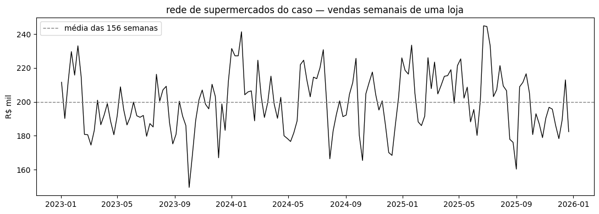

**Resultado e interpretação:** as 156 semanas estão em ordem e sem lacunas. As vendas giram em torno de R\$ 199,9 mil por semana, com desvio-padrão de cerca de R\$ 17,8 mil, entre R\$ 149,5 mil e R\$ 244,9 mil. A série não tem tendência e oscila em torno da média; há sequências curtas de semanas acima ou abaixo dela, menos longas que na distribuidora de bebidas.

## Resolução do Exercício 02 — Defasagens

**Raciocínio:** `shift(k)` traz para cada linha o valor de $k$ semanas antes; as primeiras $k$ linhas ficam sem valor.

```python
loja["vendas_anterior"] = loja["vendas"].shift(1)
loja["vendas_2_antes"] = loja["vendas"].shift(2)
print(loja.head(3))
print()
print("Linhas sem valor:", loja[["vendas_anterior", "vendas_2_antes"]].isna().sum().to_dict())
print(f"Correlação com a semana anterior: {loja['vendas'].corr(loja['vendas_anterior']):.3f}")
print(f"Correlação com duas semanas antes: {loja['vendas'].corr(loja['vendas_2_antes']):.3f}")
```

```text
                  semana  vendas  vendas_anterior  vendas_2_antes
0  2023-01-02/2023-01-08   211.6              NaN             NaN
1  2023-01-09/2023-01-15   190.2            211.6             NaN
2  2023-01-16/2023-01-22   211.4            190.2           211.6

Linhas sem valor: {'vendas_anterior': 1, 'vendas_2_antes': 2}
Correlação com a semana anterior: 0.533
Correlação com duas semanas antes: 0.197
```

**Resultado e interpretação:** a primeira defasagem deixa uma linha sem valor, e a segunda, duas. A correlação com a semana anterior é de cerca de 0,53; com duas semanas antes, de cerca de 0,20. Há dependência, mais fraca que na distribuidora de bebidas, e ela decai rapidamente.

## Resolução do Exercício 03 — Autocovariância e autocorrelação à mão

**Raciocínio:** $\hat\gamma_k = \frac{1}{T}\sum_{t=k+1}^{T} (y_t - \bar y)(y_{t-k} - \bar y)$ e $r_k = \hat\gamma_k/\hat\gamma_0$, com a média $\bar y$ da série inteira.

```python
desvio = loja["vendas"] - loja["vendas"].mean()
gamas = [(desvio * desvio.shift(k)).sum() / T for k in range(3)]
print("Autocovariâncias de ordem 0, 1 e 2:", np.round(gamas, 2))
print("Autocorrelações de ordem 1 e 2, à mão:", np.round([gamas[1] / gamas[0], gamas[2] / gamas[0]], 3))
print("Autocorrelações de ordem 1 e 2, com acf:", np.round(acf(loja["vendas"], nlags=2)[1:], 3))
```

```text
Autocovariâncias de ordem 0, 1 e 2: [314.78 166.89  61.54]
Autocorrelações de ordem 1 e 2, à mão: [0.53  0.195]
Autocorrelações de ordem 1 e 2, com acf: [0.53  0.195]
```

**Resultado e interpretação:** as autocovariâncias são de cerca de 314,8 (a variância, dividida por $T$), 166,9 e 61,5. As autocorrelações, à mão e com `acf`, são de cerca de 0,530 e 0,195, um pouco menores que as correlações de Exercício 02, de 0,533 e 0,197. A diferença vem do cálculo: a autocorrelação usa a média e a variância da série inteira e divide por $T$; `corr` usa a média e o desvio-padrão de cada coluna, apenas nas semanas que têm a defasagem.

## Resolução do Exercício 04 — O correlograma

**Raciocínio:** autocorrelações dentro da faixa $\pm 1{,}96/\sqrt{T}$ seriam compatíveis com ausência de dependência; o que importa é o padrão das primeiras defasagens.

```python
def correlograma(ax, valores, titulo, defasagens=8):
    autocorr = acf(valores, nlags=defasagens)[1:]
    faixa = 1.96 / np.sqrt(len(valores))
    ax.axhspan(-faixa, faixa, color="#E0E0E0")
    ax.bar(range(1, defasagens + 1), autocorr, color="#595959", width=0.4)
    ax.axhline(0, color="black", linewidth=0.8)
    ax.set_xticks(range(1, defasagens + 1))
    ax.set_ylim(-1, 1)
    ax.set_title(titulo)
    ax.set_xlabel("Defasagem")
```

```python
fig, ax = plt.subplots(figsize=(8, 4))
correlograma(ax, loja["vendas"], "rede de supermercados do caso — correlograma das vendas")
ax.set_ylabel("Autocorrelação")
fig.tight_layout()
plt.show()

print(f"Faixa: ±{1.96 / np.sqrt(T):.3f}")
print(pd.Series(acf(loja["vendas"], nlags=8)[1:], index=pd.RangeIndex(1, 9, name="defasagem"), name="autocorrelação").round(3))
```

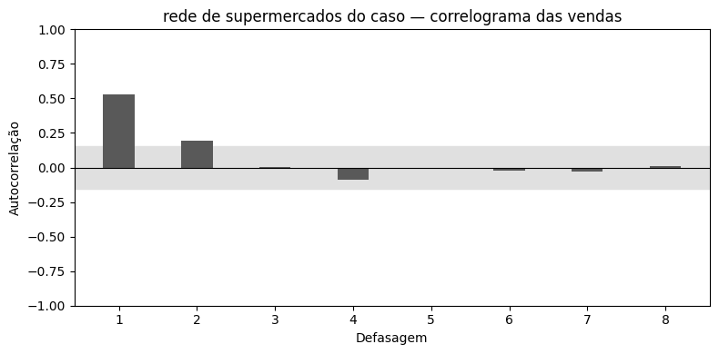

```text
Faixa: ±0.157
defasagem
1    0.530
2    0.195
3    0.005
4   -0.088
5   -0.010
6   -0.025
7   -0.029
8    0.010
Name: autocorrelação, dtype: float64
```

**Resultado e interpretação:** as autocorrelações das defasagens 1 e 2, de cerca de 0,53 e 0,20, ficam fora da faixa de cerca de ±0,16; a partir da terceira, ficam dentro dela, perto de zero. Para o gerente: uma semana boa tende a ser seguida de outra semana acima da média, com cerca de metade do desvio, e o efeito praticamente desaparece em duas ou três semanas. Uma semana excepcional não muda o patamar da loja.

## Resolução do Exercício 05 — Embaralhar as semanas

**Raciocínio:** embaralhar mantém os valores e muda apenas a ordem; se a dependência estiver na ordem, ela desaparece.

```python
embaralhada = loja[["semana"]].assign(vendas=rng.permutation(loja["vendas"].to_numpy()))
print(f"Original — média {loja['vendas'].mean():.1f}; desvio-padrão {loja['vendas'].std():.1f}")
print(f"Embaralhada — média {embaralhada['vendas'].mean():.1f}; desvio-padrão {embaralhada['vendas'].std():.1f}")
print("Autocorrelações da série embaralhada, 1 a 6:", np.round(acf(embaralhada["vendas"], nlags=6)[1:], 3))

fig, axes = plt.subplots(2, 1, figsize=(11, 6), sharex=True, sharey=True)
for ax, dados, titulo in [(axes[0], loja, "Série original"), (axes[1], embaralhada, "Série embaralhada")]:
    ax.plot(dados["semana"].dt.start_time, dados["vendas"], color="black", linewidth=1)
    ax.set_title(titulo)
    ax.set_ylabel("R$ mil")
fig.tight_layout()
plt.show()

fig, axes = plt.subplots(1, 2, figsize=(12, 4), sharey=True)
correlograma(axes[0], loja["vendas"], "Série original")
correlograma(axes[1], embaralhada["vendas"], "Série embaralhada")
axes[0].set_ylabel("Autocorrelação")
fig.tight_layout()
plt.show()
```

```text
Original — média 199.9; desvio-padrão 17.8
Embaralhada — média 199.9; desvio-padrão 17.8
Autocorrelações da série embaralhada, 1 a 6: [-0.153 -0.012  0.033  0.024 -0.102  0.037]
```

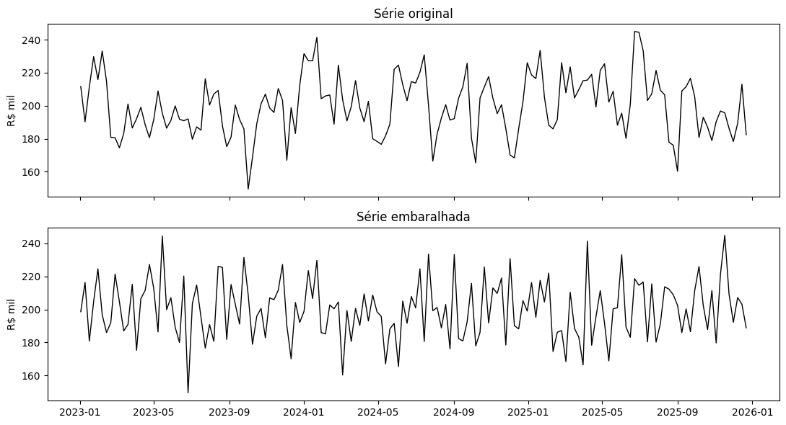

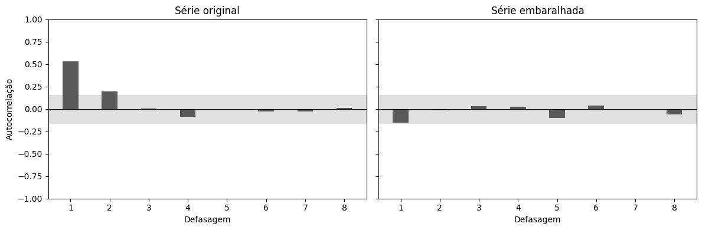

**Resultado e interpretação:** a série embaralhada tem exatamente os mesmos 156 valores: a média e o desvio-padrão não mudam, cerca de 199,9 e 17,8. Mas a ordem se perde, e com ela a dependência: as autocorrelações ficam entre cerca de −0,15 e 0,04, todas dentro da faixa, e o gráfico no tempo perde as sequências de semanas parecidas — a série embaralhada parece ruído branco. Tudo o que a série dizia sobre como uma semana se relaciona com a seguinte estava na ordem.

Por isso, em séries temporais, nunca se embaralham ou sorteiam observações. Separar semanas para testar um modelo por sorteio, por exemplo, misturaria passado e futuro: o modelo seria estimado com semanas posteriores às que deveria prever, e a dependência que queremos medir seria destruída. Quando é preciso separar períodos, separa-se no tempo — o passado para estimar, o futuro para avaliar —, um tema do Curso 3.

# Resoluções 06–12

**Prof. Daniel de Abreu Pereira Uhr**

**Curso:** Estatística e Econometria com Python


Editorial worked solution

## Contexto — Hotel: quanto dura um mês fraco?

O hotel, hotel executivo fictício em uma capital, acompanha sua **taxa de ocupação mensal** (% dos quartos ocupados). A série foi ajustada para a sazonalidade pela equipe de planejamento, de modo que suas oscilações refletem choques — um congresso, obras na região, a entrada de um concorrente — e não as temporadas. A gerência quer saber quanto um mês forte ou fraco ainda pesa nos seguintes, para planejar tarifas e a escala de funcionários.

A célula abaixo simula 120 meses, de 2015 a 2024, com um mecanismo AR(1) e 300 meses de aquecimento. Os parâmetros estão no código; responda a partir dos dados, como faria o analista, e use os parâmetros apenas para conferir.

```python
import numpy as np
import pandas as pd
import matplotlib.pyplot as plt
import statsmodels.formula.api as smf
from statsmodels.stats.diagnostic import acorr_ljungbox
from statsmodels.tsa.ar_model import AutoReg
from statsmodels.tsa.stattools import acf

rng = np.random.default_rng(2026)
aquecimento, T = 300, 120

choques = rng.normal(0, 3, size=aquecimento + T)
y = np.empty(aquecimento + T)
y[0] = 70.0
for t in range(1, aquecimento + T):
    y[t] = 14 + 0.8 * y[t - 1] + choques[t]

hotel = pd.DataFrame({
    "mes": pd.period_range("2015-01", periods=T, freq="M"),
    "ocupacao": np.round(y[aquecimento:], 1),
})
```

## Resolução do Exercício 06 — A série

**Raciocínio:** o gráfico no tempo mostra o comportamento da série; o correlograma, quanto ela depende do próprio passado. Em dados mensais, 12 defasagens cobrem um ano.

```python
def correlograma(ax, valores, titulo, defasagens=12):
    autocorr = acf(valores, nlags=defasagens)[1:]
    faixa = 1.96 / np.sqrt(len(valores))
    ax.axhspan(-faixa, faixa, color="#E0E0E0")
    ax.bar(range(1, defasagens + 1), autocorr, color="#595959", width=0.4)
    ax.axhline(0, color="black", linewidth=0.8)
    ax.set_xticks(range(1, defasagens + 1))
    ax.set_ylim(-1, 1)
    ax.set_title(titulo)
    ax.set_xlabel("Defasagem")
```

```python
fig, axes = plt.subplots(1, 2, figsize=(13, 4), gridspec_kw={"width_ratios": [3, 2]})
axes[0].plot(hotel["mes"].dt.start_time, hotel["ocupacao"], color="black", linewidth=1)
axes[0].axhline(hotel["ocupacao"].mean(), color="#7F7F7F", linestyle="--", linewidth=1, label="média dos 120 meses")
axes[0].set_title("hotel — ocupação mensal")
axes[0].set_ylabel("% dos quartos")
axes[0].legend()
correlograma(axes[1], hotel["ocupacao"], "Correlograma da ocupação")
fig.tight_layout()
plt.show()

print(f"Ocupação — média {hotel['ocupacao'].mean():.1f}%; mínimo {hotel['ocupacao'].min()}%; máximo {hotel['ocupacao'].max()}%")
print("Autocorrelações 1 a 6:", np.round(acf(hotel["ocupacao"], nlags=6)[1:], 3), f"— faixa ±{1.96 / np.sqrt(T):.3f}")

hotel["ocupacao_anterior"] = hotel["ocupacao"].shift(1)
```

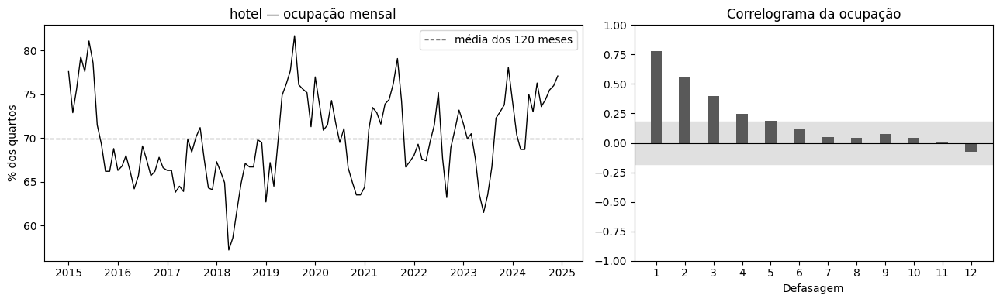

```text
Ocupação — média 69.9%; mínimo 57.2%; máximo 81.7%
Autocorrelações 1 a 6: [0.778 0.563 0.395 0.249 0.189 0.112] — faixa ±0.179
```

**Resultado e interpretação:** a ocupação oscila em torno de 70%, entre cerca de 57% e 82%, com sequências longas de meses acima e abaixo da média. As autocorrelações decaem devagar — cerca de 0,78, 0,56, 0,40 e 0,25 nas quatro primeiras defasagens — e as cinco primeiras ficam fora da faixa de cerca de ±0,18: a série é persistente, mais que as vendas da distribuidora de bebidas.

## Resolução do Exercício 07 — Estimar o AR(1)

**Raciocínio:** o AR(1) é a regressão da ocupação em sua defasagem; `AutoReg` cria a defasagem internamente e deve dar os mesmos coeficientes.

```python
ar1 = smf.ols("ocupacao ~ ocupacao_anterior", data=hotel).fit()
intervalos = ar1.conf_int()
print(pd.DataFrame({
    "coeficiente": ar1.params, "EP": ar1.bse, "IC 2,5%": intervalos[0], "IC 97,5%": intervalos[1],
}).round(3))
print(f"\nMeses usados: {int(ar1.nobs)}")
print("AutoReg:", AutoReg(hotel["ocupacao"], lags=1).fit().params.round(3).to_dict())
```

```text
                   coeficiente     EP  IC 2,5%  IC 97,5%
Intercept               14.481  3.933    6.693    22.269
ocupacao_anterior        0.793  0.056    0.681     0.904

Meses usados: 119
AutoReg: {'const': 14.481, 'ocupacao.L1': 0.793}
```

**Resultado e interpretação:** a persistência estimada é de cerca de 0,793, com erro-padrão de 0,056 e intervalo de 0,68 a 0,90; a constante é de cerca de 14,5. `AutoReg` dá os mesmos coeficientes. Uma ocupação 10 pontos acima da média em um mês é seguida, em média, por uma ocupação cerca de 8 pontos acima no mês seguinte.

## Resolução do Exercício 08 — Persistência

**Raciocínio:** média de longo prazo $\hat c/(1 - \hat\phi)$; meia-vida $\log(0{,}5)/\log(\hat\phi)$.

```python
c_hat, phi_hat = ar1.params["Intercept"], ar1.params["ocupacao_anterior"]
media_longo_prazo = c_hat / (1 - phi_hat)
print(f"Média de longo prazo: {media_longo_prazo:.2f}% (laboratório: {14 / (1 - 0.8):.0f}%)")
print(f"Meia-vida: {np.log(0.5) / np.log(phi_hat):.2f} meses (laboratório: {np.log(0.5) / np.log(0.8):.2f})")
```

```text
Média de longo prazo: 69.84% (laboratório: 70%)
Meia-vida: 2.98 meses (laboratório: 3.11)
```

**Resultado e interpretação:** a média de longo prazo estimada é de cerca de 69,8%, perto dos 70% do mecanismo, e a meia-vida, de cerca de 3,0 meses (no laboratório, 3,1). Para a gerência: metade de um choque de ocupação se dissipa em cerca de três meses — um mês fraco ainda pesa no trimestre seguinte.

## Resolução do Exercício 09 — Resíduos

**Raciocínio:** se o AR(1) captou a dependência, seus resíduos se comportam como ruído branco. O Ljung–Box testa conjuntamente as autocorrelações; `model_df=1` desconta a defasagem estimada.

```python
fig, ax = plt.subplots(figsize=(8, 4))
correlograma(ax, ar1.resid, "Resíduos do AR(1)")
ax.set_ylabel("Autocorrelação")
fig.tight_layout()
plt.show()

autocorr_residuos = acf(ar1.resid, nlags=12)[1:]
print(f"Maior autocorrelação dos resíduos, em módulo: {np.abs(autocorr_residuos).max():.4f} (defasagem {np.abs(autocorr_residuos).argmax() + 1}); faixa ±{1.96 / np.sqrt(len(ar1.resid)):.4f}")
print(f"Desvio-padrão dos resíduos: {np.sqrt(ar1.scale):.2f} pontos")
print(acorr_ljungbox(ar1.resid, lags=[6, 12], model_df=1).round(3))
```

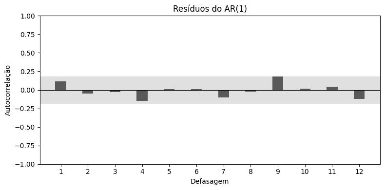

```text
Maior autocorrelação dos resíduos, em módulo: 0.1795 (defasagem 9); faixa ±0.1797
Desvio-padrão dos resíduos: 2.96 pontos
    lb_stat  lb_pvalue
6     4.872      0.432
12   12.794      0.307
```

**Resultado e interpretação:** as barras ficam dentro da faixa; a da defasagem 9, de cerca de 0,18, encosta em sua borda. Com 12 barras, uma no limite por acaso não surpreende, e não há padrão nas primeiras defasagens. O Ljung–Box, com p-valores de cerca de 0,43 e 0,31, não indica autocorrelação. O AR(1) captou a dependência da série; o desvio-padrão dos resíduos, de cerca de 3,0 pontos, é o tamanho típico de uma surpresa mensal.

## Resolução do Exercício 10 — Um mês excepcional

**Raciocínio:** no AR(1), o que resta de um choque após $h$ períodos é o choque vezes $\hat\phi^h$.

```python
meses = np.array([1, 3, 6, 12])
print(pd.DataFrame({"efeito do choque (pontos)": -10 * phi_hat ** meses}, index=pd.Index(meses, name="meses depois")).round(2))
```

```text
              efeito do choque (pontos)
meses depois                           
1                                 -7.93
3                                 -4.98
6                                 -2.48
12                                -0.62
```

**Resultado e interpretação:** um choque de −10 pontos ainda deixa a ocupação cerca de 7,9 pontos abaixo do normal no mês seguinte, 5,0 pontos depois de três meses, 2,5 depois de seis e 0,6 depois de um ano. Um mês muito fraco afeta o semestre seguinte: a gerência deve esperar ocupação abaixo do normal por alguns meses, e não só no mês do choque.

## Resolução do Exercício 11 — Depois do último mês

**Raciocínio:** em desvios da média, o desvio esperado após $h$ meses é $\hat\phi^h\,(y_T - \hat\mu)$, e a ocupação esperada é $\hat\mu + \hat\phi^h\,(y_T - \hat\mu)$ — a previsão da seção 15.8.

```python
ultima = hotel["ocupacao"].iloc[-1]
desvio_atual = ultima - media_longo_prazo
print(f"Último mês ({hotel['mes'].iloc[-1]}): {ultima}%; desvio em relação à média de longo prazo: {desvio_atual:.2f} pontos")
print(pd.DataFrame({
    "desvio restante (pontos)": desvio_atual * phi_hat ** meses,
    "ocupação esperada (%)": media_longo_prazo + desvio_atual * phi_hat ** meses,
}, index=pd.Index(meses, name="meses à frente")).round(2))
```

```text
Último mês (2024-12): 77.1%; desvio em relação à média de longo prazo: 7.26 pontos
                desvio restante (pontos)  ocupação esperada (%)
meses à frente                                                 
1                                   5.76                  75.59
3                                   3.62                  73.45
6                                   1.80                  71.64
12                                  0.45                  70.28
```

**Resultado e interpretação:** dezembro de 2024 terminou com 77,1%, cerca de 7,3 pontos acima da média de longo prazo. A ocupação esperada é de cerca de 75,6% em janeiro de 2025, 73,5% em março, 71,6% em junho e 70,3% em dezembro: o bom momento se dissipa gradualmente. Essas previsões ilustram a persistência, mas não mostram a incerteza: com surpresas típicas de cerca de 3 pontos por mês, a ocupação de cada mês pode se afastar bastante desses valores.

## Resolução do Exercício 12 — Um AR(2) é necessário?

**Raciocínio:** um AR(2) só se justifica se a segunda defasagem acrescentar informação: coeficiente distinguível de zero, resíduos do AR(1) com dependência ou critérios de informação melhores. A comparação dos critérios exige a mesma amostra.

```python
hotel["ocupacao_2_antes"] = hotel["ocupacao"].shift(2)
mesma_amostra = hotel.dropna()
ar1_mesma_amostra = smf.ols("ocupacao ~ ocupacao_anterior", data=mesma_amostra).fit()
ar2 = smf.ols("ocupacao ~ ocupacao_anterior + ocupacao_2_antes", data=mesma_amostra).fit()
print(pd.DataFrame({"coeficiente": ar2.params, "EP": ar2.bse, "p-valor": ar2.pvalues}).round(3))
print()
print(pd.DataFrame({
    "AIC": [ar1_mesma_amostra.aic, ar2.aic], "BIC": [ar1_mesma_amostra.bic, ar2.bic],
}, index=["AR(1)", "AR(2)"]).round(1))
```

```text
                   coeficiente     EP  p-valor
Intercept               15.790  4.168    0.000
ocupacao_anterior        0.906  0.092    0.000
ocupacao_2_antes        -0.132  0.092    0.153

         AIC    BIC
AR(1)  592.9  598.4
AR(2)  592.8  601.1
```

**Resultado e interpretação:** o coeficiente da segunda defasagem é de cerca de −0,13, com p-valor de cerca de 0,15: não se distingue de zero. Os resíduos do AR(1) já não tinham dependência (Exercício 09), o AIC é praticamente igual nos dois modelos (592,9 e 592,8) e o BIC prefere o AR(1) (598,4 contra 601,1). O AR(1) basta — e é o mecanismo do laboratório.

Defasagens desnecessárias custam precisão: no AR(2), o erro-padrão do coeficiente da primeira defasagem sobe para cerca de 0,092, contra 0,056 no AR(1) de Exercício 07, porque as duas defasagens, muito correlacionadas entre si, disputam a mesma informação — a multicolinearidade do capítulo 12.

# Resoluções 13–19

**Prof. Daniel de Abreu Pereira Uhr**

**Curso:** Estatística e Econometria com Python


Editorial worked solution

## Contexto — Consultoria econômica: quanto dura um choque?

A consultoria econômica, consultoria de remuneração do capítulo 10, assessora empresas em reajustes salariais e no planejamento de contratações. Dois clientes perguntaram: “se a inflação surpreender para cima neste trimestre, por quanto tempo ela continuará alta?” e “se o desemprego subir, quanto tempo ele leva para voltar?”.

A base e sua ficha estão em `data/ch15/`. São dados reais e trimestrais da economia dos Estados Unidos, de 1959T1 a 2009T3: `cpi` é o índice de preços ao consumidor, `infl` é a inflação anualizada (%), calculada a partir dele, e `unemp` é a taxa de desemprego (%), todos com ajuste sazonal. Leia a ficha antes de começar.

```python
import hashlib

import numpy as np
import pandas as pd
pd.set_option("display.max_columns", None)
pd.set_option("display.width", 150)
import matplotlib.pyplot as plt
import statsmodels.formula.api as smf
from statsmodels.stats.diagnostic import acorr_ljungbox
from statsmodels.tsa.ar_model import AutoReg
from statsmodels.tsa.stattools import acf

caminho = "data/ch15/macrodata.csv"
with open(caminho, "rb") as arquivo:
    print("Arquivo confere com a ficha:", hashlib.sha256(arquivo.read()).hexdigest() == "7853fcc0d92a9b89b627cb6eb2d27faf4a00c7515e3b37a9a24001ef597ca8f0")

macro = pd.read_csv(caminho)
macro["trimestre"] = pd.PeriodIndex.from_fields(year=macro["year"], quarter=macro["quarter"], freq="Q")
macro = macro.set_index("trimestre")[["cpi", "infl", "unemp"]]
print(macro.head(3))
print(macro.tail(3))
```

```text
Arquivo confere com a ficha: True
             cpi  infl  unemp
trimestre                    
1959Q1     28.98  0.00    5.8
1959Q2     29.15  2.34    5.1
1959Q3     29.35  2.74    5.3
               cpi  infl  unemp
trimestre                      
2009Q1     212.671  0.94    8.1
2009Q2     214.469  3.37    9.2
2009Q3     216.385  3.56    9.6
```

## Resolução do Exercício 13 — Os dados

**Raciocínio:** com dados reais, conferir a base vem antes de modelar: período, frequência, lacunas e a construção de cada variável.

```python
print(f"Período: {macro.index[0]} a {macro.index[-1]}; {len(macro)} trimestres")
print("Trimestres consecutivos:", (macro.index == pd.period_range(macro.index[0], periods=len(macro), freq="Q")).all())

recalculada = 400 * np.log(macro["cpi"] / macro["cpi"].shift(1))
print(f"Maior diferença entre infl e 400·ln(cpi_t/cpi_t-1), de 1959Q2 em diante: {(macro['infl'] - recalculada).iloc[1:].abs().max():.3f}")
print()
print(macro.head(2).assign(recalculada=recalculada.head(2).round(2)))
```

```text
Período: 1959Q1 a 2009Q3; 203 trimestres
Trimestres consecutivos: True
Maior diferença entre infl e 400·ln(cpi_t/cpi_t-1), de 1959Q2 em diante: 0.005

             cpi  infl  unemp  recalculada
trimestre                                 
1959Q1     28.98  0.00    5.8          NaN
1959Q2     29.15  2.34    5.1         2.34
```

**Resultado e interpretação:** são 203 trimestres consecutivos, de 1959T1 a 2009T3. De 1959T2 em diante, `infl` coincide com $400 \cdot \ln(\text{cpi}_t/\text{cpi}_{t-1})$ até o arredondamento: é a variação trimestral do índice, em log, multiplicada por 4 para anualizar e por 100 para ficar em %. Em 1959T1, porém, a inflação aparece como 0. Sem o índice do trimestre anterior, ela não pode ser calculada: o zero é um valor ausente registrado como número. Mantê-lo criaria um trimestre de inflação zero que não aconteceu. Usamos a inflação de 1959T2 em diante, 202 trimestres; o desemprego usa os 203.

```python
inflacao = macro["infl"].iloc[1:]
desemprego = macro["unemp"]

fig, axes = plt.subplots(2, 1, figsize=(11, 6), sharex=True)
for ax, serie, titulo in [(axes[0], inflacao, "Inflação anualizada (%)"), (axes[1], desemprego, "Taxa de desemprego (%)")]:
    ax.plot(serie.index.start_time, serie, color="black", linewidth=1)
    ax.axhline(serie.mean(), color="#7F7F7F", linestyle="--", linewidth=1)
    ax.set_title(titulo)
fig.tight_layout()
plt.show()

print(f"Inflação — média {inflacao.mean():.2f}%; de {inflacao.min()}% ({inflacao.idxmin()}) a {inflacao.max()}% ({inflacao.idxmax()})")
print(f"Desemprego — média {desemprego.mean():.2f}%; de {desemprego.min()}% ({desemprego.idxmin()}) a {desemprego.max()}% ({desemprego.idxmax()})")
```

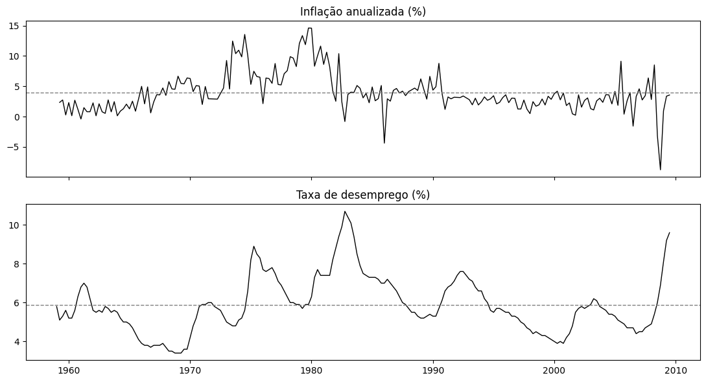

```text
Inflação — média 3.98%; de -8.79% (2008Q4) a 14.62% (1979Q4)
Desemprego — média 5.88%; de 3.4% (1968Q4) a 10.7% (1982Q4)
```

**Resultado e interpretação:** a inflação oscila muito de um trimestre para outro, com uma fase alta nos anos 1970 e no início dos anos 1980 — o máximo, de cerca de 14,6%, é de 1979T4 — e uma queda brusca no fim de 2008, com a crise financeira, quando chega a −8,8%. O desemprego se move devagar, em ondas longas que acompanham as recessões, entre 3,4% (1968T4) e 10,7% (1982T4). Visualmente, o desemprego é muito mais persistente que a inflação.

## Resolução do Exercício 14 — Autocorrelações

**Raciocínio:** em dados trimestrais, 12 defasagens cobrem três anos.

```python
def correlograma(ax, valores, titulo, defasagens=12):
    autocorr = acf(valores, nlags=defasagens)[1:]
    faixa = 1.96 / np.sqrt(len(valores))
    ax.axhspan(-faixa, faixa, color="#E0E0E0")
    ax.bar(range(1, defasagens + 1), autocorr, color="#595959", width=0.4)
    ax.axhline(0, color="black", linewidth=0.8)
    ax.set_xticks(range(1, defasagens + 1))
    ax.set_ylim(-1, 1)
    ax.set_title(titulo)
    ax.set_xlabel("Defasagem")
```

```python
fig, axes = plt.subplots(1, 2, figsize=(13, 4), sharey=True)
correlograma(axes[0], inflacao, "Inflação")
correlograma(axes[1], desemprego, "Desemprego")
axes[0].set_ylabel("Autocorrelação")
fig.tight_layout()
plt.show()

print(pd.DataFrame({
    "inflação": acf(inflacao, nlags=12)[1:], "desemprego": acf(desemprego, nlags=12)[1:],
}, index=pd.RangeIndex(1, 13, name="defasagem")).round(3).T)
print(f"Faixas: ±{1.96 / np.sqrt(len(inflacao)):.3f} (inflação) e ±{1.96 / np.sqrt(len(desemprego)):.3f} (desemprego)")
```

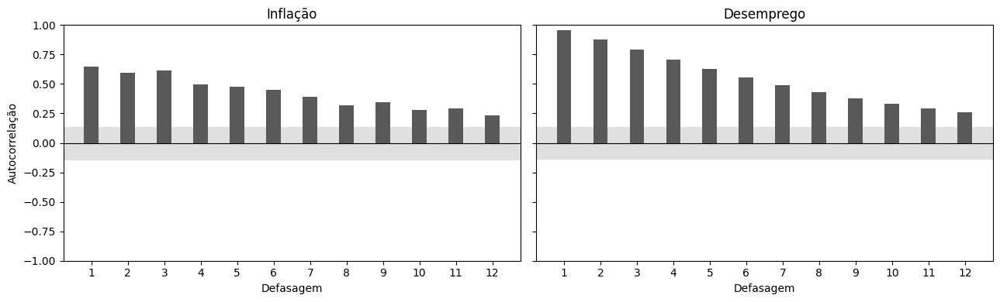

```text
defasagem      1      2      3      4      5      6      7      8      9      10     11     12
inflação    0.644  0.597  0.614  0.493  0.478  0.450  0.392  0.319  0.347  0.279  0.295  0.236
desemprego  0.956  0.880  0.793  0.706  0.627  0.556  0.491  0.429  0.376  0.332  0.292  0.260
Faixas: ±0.138 (inflação) e ±0.138 (desemprego)
```

**Resultado e interpretação:** nas duas séries, as autocorrelações ficam muito acima da faixa de cerca de ±0,14 nas 12 defasagens. O desemprego começa em cerca de 0,96 e decai suavemente — 0,71 após um ano, 0,43 após dois. A inflação começa em 0,64 e decai devagar, de forma irregular — 0,49 após um ano, 0,32 após dois e 0,24 após três. As duas séries guardam memória longa, mas o desemprego muito mais.

## Resolução do Exercício 15 — AR(1) e seus resíduos

**Raciocínio:** o AR(1) é o modelo mais simples; ele só basta se seus resíduos ficarem sem dependência. A função `defasagens` monta a tabela com a série e suas defasagens.

```python
def defasagens(serie, p):
    tabela = pd.DataFrame({"y": serie})
    for k in range(1, p + 1):
        tabela[f"y_{k}"] = serie.shift(k)
    return tabela


modelos_ar1 = {}
for nome, serie in [("inflação", inflacao), ("desemprego", desemprego)]:
    modelo = smf.ols("y ~ y_1", data=defasagens(serie, 1)).fit()
    modelos_ar1[nome] = modelo
    phi_hat = modelo.params["y_1"]
    inferior, superior = modelo.conf_int().loc["y_1"]
    print(f"{nome}: persistência {phi_hat:.3f} (EP {modelo.bse['y_1']:.3f}; IC {inferior:.3f} a {superior:.3f}); meia-vida {np.log(0.5) / np.log(phi_hat):.1f} trimestres")
    print(f"   autocorrelações dos resíduos, 1 a 4: {np.round(acf(modelo.resid, nlags=4)[1:], 3)}")
    print(f"   Ljung–Box, p-valores com 4 e 8 defasagens: {acorr_ljungbox(modelo.resid, lags=[4, 8], model_df=1)['lb_pvalue'].round(4).tolist()}")

fig, axes = plt.subplots(1, 2, figsize=(13, 4), sharey=True)
correlograma(axes[0], modelos_ar1["inflação"].resid, "Resíduos do AR(1) — inflação")
correlograma(axes[1], modelos_ar1["desemprego"].resid, "Resíduos do AR(1) — desemprego")
axes[0].set_ylabel("Autocorrelação")
fig.tight_layout()
plt.show()
```

```text
inflação: persistência 0.644 (EP 0.054; IC 0.537 a 0.751); meia-vida 1.6 trimestres
   autocorrelações dos resíduos, 1 a 4: [-0.202  0.056  0.284 -0.012]
   Ljung–Box, p-valores com 4 e 8 defasagens: [0.0, 0.0]
desemprego: persistência 0.988 (EP 0.017; IC 0.955 a 1.021); meia-vida 57.6 trimestres
   autocorrelações dos resíduos, 1 a 4: [0.649 0.36  0.182 0.011]
   Ljung–Box, p-valores com 4 e 8 defasagens: [0.0, 0.0]
```

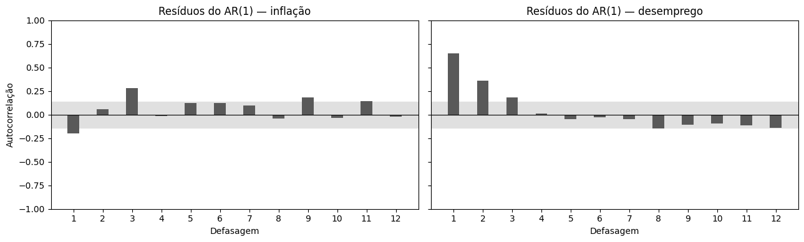

**Resultado e interpretação:** no AR(1), a persistência da inflação é de cerca de 0,644, com meia-vida de cerca de 1,6 trimestre, e a do desemprego, de cerca de 0,988, com meia-vida de cerca de 58 trimestres — mais de 14 anos. Mas os resíduos contam outra história. Nos do desemprego, as três primeiras barras ficam fora da faixa, e a autocorrelação de primeira ordem é de cerca de 0,65: o AR(1) deixa muita dependência sem explicar. Nos da inflação, as barras das defasagens 1 e 3, de cerca de −0,20 e 0,28, ficam fora da faixa, e as das defasagens 9 e 11, um pouco acima dela. O Ljung–Box rejeita a ausência de autocorrelação nos dois casos (p < 0,001). O AR(1) não basta, e suas meias-vidas não são confiáveis.

Note ainda que o intervalo da persistência do desemprego, de cerca de 0,955 a 1,021, contém 1 — o caso em que os choques nunca se dissipam, tema do capítulo 16.

## Resolução do Exercício 16 — Mais defasagens

**Raciocínio:** no desemprego, a forte autocorrelação de primeira ordem dos resíduos sugere uma segunda defasagem; na inflação, a frequência trimestral sugere um ano de defasagens. O critério final são os resíduos.

```python
ar2_desemprego = smf.ols("y ~ y_1 + y_2", data=defasagens(desemprego, 2)).fit()
ar4_inflacao = smf.ols("y ~ y_1 + y_2 + y_3 + y_4", data=defasagens(inflacao, 4)).fit()

for nome, modelo, p, serie in [("Desemprego, AR(2)", ar2_desemprego, 2, desemprego), ("Inflação, AR(4)", ar4_inflacao, 4, inflacao)]:
    soma = modelo.params.iloc[1:].sum()
    print(f"{nome} — {int(modelo.nobs)} trimestres")
    print(pd.DataFrame({"coeficiente": modelo.params, "EP": modelo.bse}).round(3).T)
    print(f"   AutoReg: {np.round(AutoReg(serie, lags=p).fit().params.to_numpy(), 3)}")
    print(f"   soma das persistências {soma:.3f}; média de longo prazo {modelo.params['Intercept'] / (1 - soma):.2f}%; desvio-padrão dos resíduos {np.sqrt(modelo.scale):.3f}")
    print(f"   autocorrelações dos resíduos, 1 a 8: {np.round(acf(modelo.resid, nlags=8)[1:], 3)}")
    print(f"   Ljung–Box, p-valores com 8 e 12 defasagens: {acorr_ljungbox(modelo.resid, lags=[8, 12], model_df=p)['lb_pvalue'].round(3).tolist()}")
    print()

fig, axes = plt.subplots(1, 2, figsize=(13, 4), sharey=True)
correlograma(axes[0], ar4_inflacao.resid, "Resíduos do AR(4) — inflação")
correlograma(axes[1], ar2_desemprego.resid, "Resíduos do AR(2) — desemprego")
axes[0].set_ylabel("Autocorrelação")
fig.tight_layout()
plt.show()
```

```text
Desemprego, AR(2) — 201 trimestres
             Intercept    y_1    y_2
coeficiente      0.249  1.639 -0.680
EP               0.076  0.052  0.053
   AutoReg: [ 0.249  1.639 -0.68 ]
   soma das persistências 0.959; média de longo prazo 6.14%; desvio-padrão dos resíduos 0.253
   autocorrelações dos resíduos, 1 a 8: [ 0.064 -0.039  0.036 -0.071 -0.049  0.113  0.129 -0.168]
   Ljung–Box, p-valores com 8 e 12 defasagens: [0.02, 0.103]

Inflação, AR(4) — 198 trimestres
             Intercept    y_1    y_2    y_3    y_4
coeficiente      0.742  0.361  0.189  0.294 -0.026
EP               0.290  0.073  0.074  0.073  0.077
   AutoReg: [ 0.742  0.361  0.189  0.294 -0.026]
   soma das persistências 0.818; média de longo prazo 4.09%; desvio-padrão dos resíduos 2.298
   autocorrelações dos resíduos, 1 a 8: [ 0.002 -0.024 -0.019 -0.042  0.063  0.017  0.037 -0.132]
   Ljung–Box, p-valores com 8 e 12 defasagens: [0.254, 0.256]
```

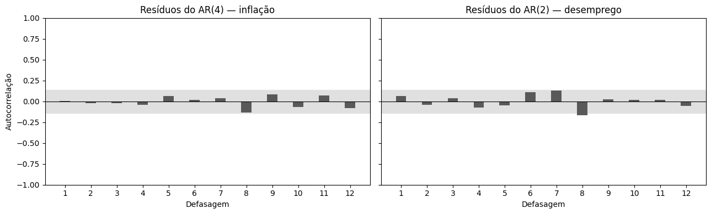

**Resultado e interpretação — desemprego:** o AR(2) tem coeficientes de cerca de 1,639 e −0,680, ambos precisos, com soma de 0,959 e média de longo prazo de cerca de 6,1%. A autocorrelação de primeira ordem dos resíduos cai de cerca de 0,65 para 0,06, e quase todas as barras ficam dentro da faixa. A exceção é a defasagem 8, cerca de −0,17, fora dela; o Ljung–Box dá p ≈ 0,02 com 8 defasagens e p ≈ 0,10 com 12. Resta uma dependência de prazo mais longo, de cerca de dois anos, ligada aos ciclos econômicos, que um AR curto não descreve inteiramente. A dinâmica dos primeiros trimestres, que importa para a pergunta da consultoria econômica, está captada; Exercício 17 verifica se a conclusão depende do número de defasagens.

**Inflação:** o AR(4) tem coeficientes de cerca de 0,361, 0,189, 0,294 e −0,026, com soma de 0,818 e média de longo prazo de cerca de 4,1%. Os resíduos ficam dentro da faixa em todas as defasagens, e o Ljung–Box não indica autocorrelação (p ≈ 0,25 com 8 e com 12 defasagens). `AutoReg` dá os mesmos coeficientes nos dois modelos.

Os critérios de informação, na mesma amostra:

```python
criterios = {}
for nome, serie in [("desemprego", desemprego), ("inflação", inflacao)]:
    tabela = defasagens(serie, 8).dropna()
    modelos = [smf.ols("y ~ " + " + ".join(f"y_{k}" for k in range(1, p + 1)), data=tabela).fit() for p in range(1, 9)]
    criterios[f"{nome}: AIC"] = [modelo.aic for modelo in modelos]
    criterios[f"{nome}: BIC"] = [modelo.bic for modelo in modelos]
print(f"Trimestres na comparação: {len(tabela)} (inflação) e {len(defasagens(desemprego, 8).dropna())} (desemprego)")
print(pd.DataFrame(criterios, index=[f"AR({p})" for p in range(1, 9)]).round(1))
```

```text
Trimestres na comparação: 194 (inflação) e 195 (desemprego)
       desemprego: AIC  desemprego: BIC  inflação: AIC  inflação: BIC
AR(1)            135.0            141.5          909.6          916.1
AR(2)              6.4             16.3          892.6          902.4
AR(3)              7.9             20.9          878.0          891.0
AR(4)              9.8             26.2          879.8          896.2
AR(5)             10.4             30.1          881.0          900.6
AR(6)             11.1             34.0          882.9          905.7
AR(7)             10.0             36.2          884.8          911.0
AR(8)             11.3             40.8          883.5          912.9
```

**Resultado e interpretação:** no desemprego, o AIC e o BIC preferem o AR(2), com grande vantagem sobre o AR(1) e pequena sobre os modelos maiores: acrescentar defasagens não resolve a autocorrelação da defasagem 8. Na inflação, os dois critérios preferem o AR(3), seguido de perto pelo AR(4): a quarta defasagem quase não contribui (−0,026). O AR(3) e o AR(4) dão praticamente a mesma dinâmica; mantemos o ano completo de defasagens, guiados pela frequência e pelos resíduos limpos.

## Resolução do Exercício 17 — Resposta a choques

**Raciocínio:** a recursão propaga o choque pelas defasagens; com uma só defasagem, ela reproduz $\phi^h$.

```python
def resposta(coeficientes, horizonte=20):
    psi = [1.0]
    for h in range(1, horizonte + 1):
        psi.append(sum(phi_j * psi[h - 1 - j] for j, phi_j in enumerate(coeficientes) if h - 1 - j >= 0))
    return np.array(psi)


phi_inflacao_ar1 = modelos_ar1["inflação"].params["y_1"]
print("Recursão igual a φʰ no AR(1) da inflação:", np.allclose(resposta([phi_inflacao_ar1]), phi_inflacao_ar1 ** np.arange(21)))

ar4_desemprego = smf.ols("y ~ y_1 + y_2 + y_3 + y_4", data=defasagens(desemprego, 4)).fit()
respostas = pd.DataFrame({
    "desemprego, AR(2)": resposta(ar2_desemprego.params.iloc[1:].to_numpy()),
    "desemprego, AR(4)": resposta(ar4_desemprego.params.iloc[1:].to_numpy()),
    "inflação, AR(4)": resposta(ar4_inflacao.params.iloc[1:].to_numpy()),
}, index=pd.RangeIndex(0, 21, name="trimestres depois"))
print(respostas.iloc[[0, 1, 2, 3, 4, 8, 12, 16, 20]].round(3))
print()
for nome in respostas:
    r = respostas[nome]
    print(f"{nome}: maior efeito {r.max():.2f}, no trimestre {r.idxmax()}; abaixo da metade a partir do trimestre {r[r < 0.5].index.min()}")

fig, ax = plt.subplots(figsize=(10, 4))
for nome, estilo in [("desemprego, AR(2)", "-"), ("desemprego, AR(4)", ":"), ("inflação, AR(4)", "--")]:
    ax.plot(respostas.index, respostas[nome], color="black", linestyle=estilo, label=nome)
ax.axhline(0.5, color="#7F7F7F", linewidth=0.8)
ax.axhline(0, color="black", linewidth=0.6)
ax.set_title("Resposta a um choque de 1 ponto")
ax.set_xlabel("Trimestres depois do choque")
ax.set_ylabel("Pontos percentuais")
ax.set_xticks(range(0, 21, 2))
ax.legend()
fig.tight_layout()
plt.show()
```

```text
Recursão igual a φʰ no AR(1) da inflação: True
                   desemprego, AR(2)  desemprego, AR(4)  inflação, AR(4)
trimestres depois                                                       
0                              1.000              1.000            1.000
1                              1.639              1.702            0.361
2                              2.008              2.070            0.319
3                              2.177              2.239            0.478
4                              2.204              2.272            0.313
8                              1.633              1.716            0.219
12                             0.898              0.965            0.146
16                             0.404              0.444            0.095
20                             0.146              0.164            0.062

desemprego, AR(2): maior efeito 2.20, no trimestre 4; abaixo da metade a partir do trimestre 16
desemprego, AR(4): maior efeito 2.27, no trimestre 4; abaixo da metade a partir do trimestre 16
inflação, AR(4): maior efeito 1.00, no trimestre 0; abaixo da metade a partir do trimestre 1
```

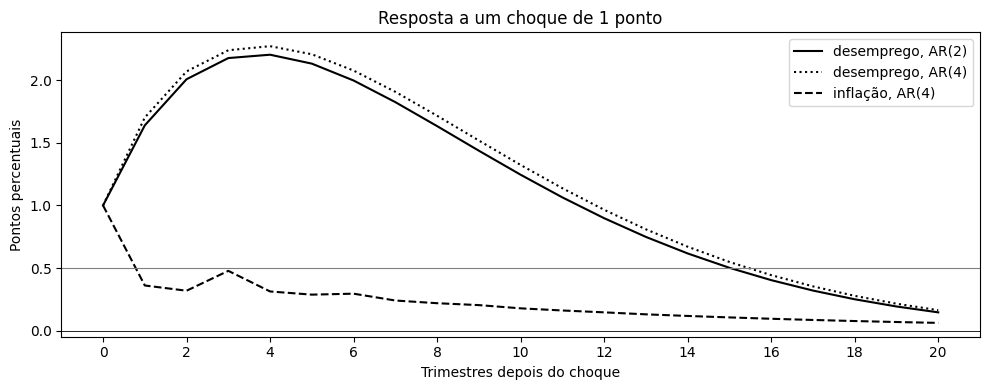

**Resultado e interpretação:** a recursão reproduz $\phi^h$ no AR(1), como esperado.

No **desemprego**, a resposta tem forma de **corcova**: um aumento inesperado de 1 ponto é seguido de novos aumentos — o efeito chega a cerca de 2,2 pontos após quatro trimestres — e só fica abaixo da metade a partir do 16º trimestre, quatro anos depois; após cinco anos, sobra cerca de 0,15 ponto. O desemprego sobe em sequência, como nas recessões, e demora a voltar. Com o AR(4), a resposta é praticamente a mesma — pico de cerca de 2,3 no quarto trimestre e queda abaixo da metade também a partir do 16º —: a conclusão não depende do número exato de defasagens. Para dar escala: o desvio-padrão dos resíduos do AR(2) é de cerca de 0,25 ponto; uma surpresa típica, de 0,25 ponto, chega a cerca de 0,55 ponto depois de um ano.

Na **inflação**, a resposta cai logo: um choque de 1 ponto deixa cerca de 0,36 ponto no trimestre seguinte, oscila entre cerca de 0,31 e 0,48 no primeiro ano — por causa do peso da terceira defasagem — e depois decai devagar: cerca de 0,22 após dois anos e 0,06 após cinco.

A persistência descreve a dinâmica de cada série; não identifica as causas dos choques nem o efeito de uma política.

## Resolução do Exercício 18 — Previsão de um passo

**Raciocínio:** $\hat y_{T+1} = \hat c + \hat\phi_1 y_T + \dots + \hat\phi_p y_{T-p+1}$, com os últimos $p$ valores observados.

```python
for nome, modelo, serie in [("Desemprego", ar2_desemprego, desemprego), ("Inflação", ar4_inflacao, inflacao)]:
    coeficientes = modelo.params.iloc[1:].to_numpy()
    p = len(coeficientes)
    ultimos = serie.iloc[-p:]
    previsao = modelo.params["Intercept"] + coeficientes @ ultimos.to_numpy()[::-1]
    conferencia = AutoReg(serie, lags=p).fit().forecast(1).iloc[0]
    print(f"{nome}: últimos valores {ultimos.tolist()} ({ultimos.index[0]} a {ultimos.index[-1]})")
    print(f"   previsão para 2009Q4: {previsao:.2f}% (AutoReg: {conferencia:.2f}%)")
```

```text
Desemprego: últimos valores [9.2, 9.6] (2009Q2 a 2009Q3)
   previsão para 2009Q4: 9.73% (AutoReg: 9.73%)
Inflação: últimos valores [-8.79, 0.94, 3.37, 3.56] (2008Q4 a 2009Q3)
   previsão para 2009Q4: 3.17% (AutoReg: 3.17%)
```

**Resultado e interpretação:** para 2009T4, o AR(2) prevê desemprego de cerca de 9,7%, continuando a subida dos últimos trimestres (9,2% e 9,6%); o AR(4) prevê inflação de cerca de 3,2%, perto dos dois últimos trimestres, depois dos −8,8% do fim de 2008. `AutoReg` confirma os dois valores. São previsões de um passo que ilustram a dinâmica estimada; não foram avaliadas fora da amostra nem acompanhadas de incerteza.

## Resolução do Exercício 19 — Recomendação

A inflação passada informa os cenários de reajuste, mas a resposta estimada perde intensidade rapidamente. O AR(4) incorpora quatro defasagens; não se deve substituir esse conjunto pelo último trimestre isolado. Uma inovação no desemprego pode acumular-se durante vários trimestres, de modo que o planejamento deve examinar cenários plurianuais.

As projeções descrevem dados dos Estados Unidos até 2009T3, dependem da ordem escolhida e estão sujeitas à incerteza dos parâmetros. A série reúne diferentes regimes econômicos. O desemprego conserva dependência residual e persistência elevada, o que limita uma interpretação mecânica de seu horizonte de dissipação. As inovações não identificam os efeitos de políticas específicas. O extrato contém a safra disponível em dezembro de 2009; não reconstrói o que era conhecido em todas as origens anteriores. A decisão de contratar ou reajustar preços precisa dos indicadores próprios da empresa e de revisões regulares do cenário.

### Transferência do exercício 19

Um cliente quer suspender contratações pelo número de trimestres indicado pela resposta do desemprego. Explique por que essa regra não é identificada pelo modelo. Especifique dois indicadores da empresa, as versões dos dados necessárias para avaliar uma previsão histórica e uma rotina trimestral de revisão.

A inovação é uma surpresa de previsão univariada, não uma intervenção identificada. O desemprego nacional não determina a necessidade local de pessoal. Acompanhe prazo de preenchimento de vagas e retenção, junto ao plano de demanda e capacidade. Reconstrua divulgações e versões disponíveis em cada origem, incluindo atrasos de publicação; o extrato revisado fornecido não permite isso. A cada trimestre, compare o cenário com novas divulgações e indicadores da empresa, documente mudanças e reavalie contratações em vez de impor uma suspensão fixa.
