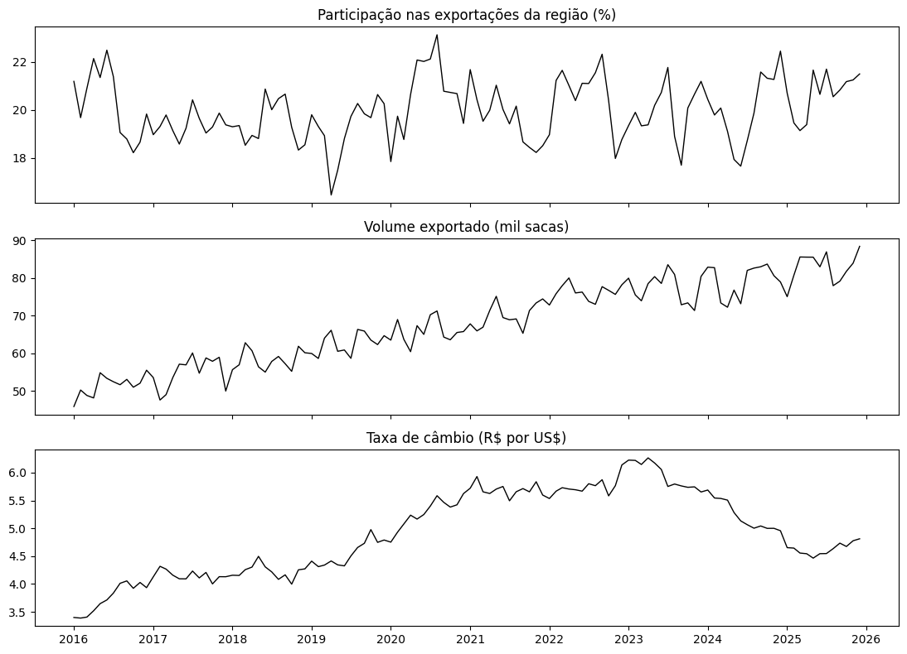
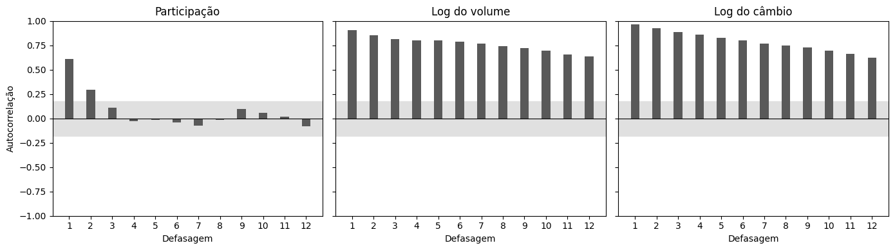
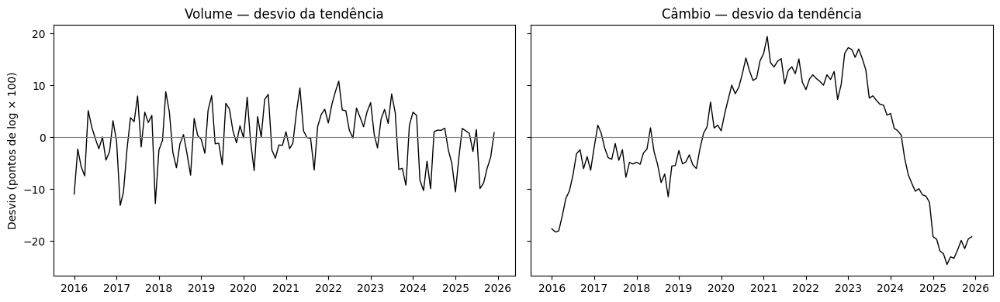
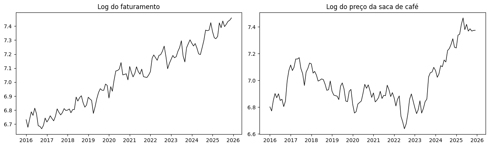
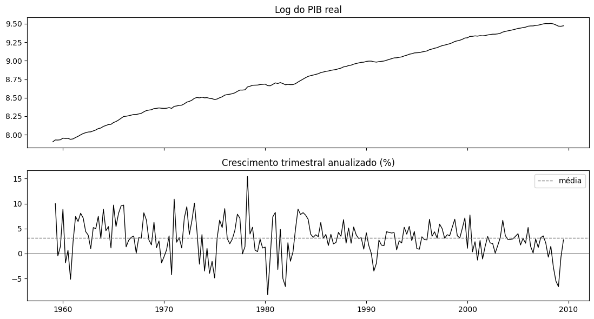
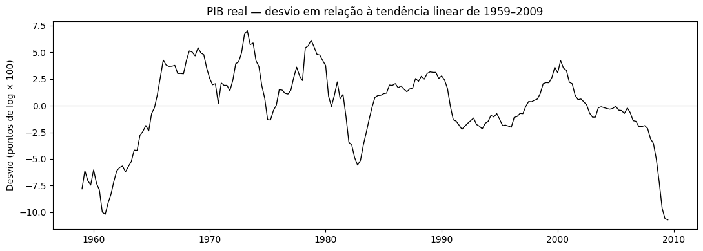

# Capítulo 16 — Resoluções

[Notebook do estudante](../ch16-student.ipynb) · [exercícios](../exercises/ch16.md)

Consulte as resoluções depois da tentativa.

# Resoluções 01–06

**Prof. Daniel de Abreu Pereira Uhr**

**Curso:** Estatística e Econometria com Python


Editorial worked solution

## exportadora — Exportadora brasileira

A empresa acompanha participação nas exportações regionais (%), volume (mil sacas de 60 kg) e câmbio (BRL por USD), mensalmente de 2016 a 2025. Os dados são simulados; os mecanismos aparecem no gerador. Use o conhecimento do laboratório para avaliar o procedimento, mas distinga-o do que um analista inferiria de uma trajetória desconhecida. As duas edições mantêm Brasil e BRL/USD.

```python
import numpy as np
import pandas as pd
import matplotlib.pyplot as plt
import statsmodels.formula.api as smf
from statsmodels.tsa.stattools import acf

rng = np.random.default_rng(2026)
aquecimento, T = 300, 120
meses = np.arange(T)


def ar1(persistencia, desvio):
    choques = rng.normal(0, desvio, size=aquecimento + T)
    u = np.zeros(aquecimento + T)
    for t in range(1, aquecimento + T):
        u[t] = persistencia * u[t - 1] + choques[t]
    return u[aquecimento:]


exportadora = pd.DataFrame({
    "mes": pd.period_range("2016-01", periods=T, freq="M"),
    "participacao": np.round(20 + ar1(0.6, 1.0), 2),
    "volume": np.round(np.exp(np.log(50) + 0.005 * meses + ar1(0.5, 0.05)), 2),
    "cambio": np.round(np.exp(np.log(3.4) + np.cumsum(np.r_[0, rng.normal(0.0015, 0.025, size=T - 1)])), 3),
})
```

## Resolução do Exercício 01 — Os gráficos

Desenhe as três séries com unidades e datas. Descreva patamar, tendência e movimentos persistentes. Qual conclusão é descritiva e qual depende de conhecer o gerador?

```python
datas = exportadora["mes"].dt.start_time
fig, axes = plt.subplots(3, 1, figsize=(11, 8), sharex=True)
for ax, coluna, titulo in [
    (axes[0], "participacao", "Participação nas exportações da região (%)"),
    (axes[1], "volume", "Volume exportado (mil sacas)"),
    (axes[2], "cambio", r"Taxa de câmbio (R\$ por US\$)"),
]:
    ax.plot(datas, exportadora[coluna], color="black", linewidth=1)
    ax.set_title(titulo)
fig.tight_layout()
plt.show()

print(exportadora[["participacao", "volume", "cambio"]].describe().round(2))
```



```text
       participacao  volume  cambio
count        120.00  120.00  120.00
mean          19.98   67.85    4.92
std            1.25   10.95    0.75
min           16.45   45.85    3.39
25%           19.09   58.74    4.27
50%           19.86   67.57    4.87
75%           20.87   77.01    5.66
max           23.12   88.40    6.26
```

A participação oscila em torno de 20%; volume cresce; câmbio apresenta movimentos prolongados. A tabela executada quantifica níveis e dispersão. Como sabemos o DGP, podemos associar participação ao AR, log do volume à tendência com desvios AR e log do câmbio ao passeio. Se o gerador fosse desconhecido, os gráficos seriam evidência descritiva, não prova dessa classificação.

## Resolução do Exercício 02 — As duas metades

Compare médias e desvios-padrão de participação, log do volume e log do câmbio nas duas metades. Por que médias semelhantes não verificam estacionariedade?

```python
series = pd.DataFrame({
    "participacao": exportadora["participacao"],
    "log_volume": np.log(exportadora["volume"]),
    "log_cambio": np.log(exportadora["cambio"]),
})
metades = {"2016–2020": series.iloc[:60], "2021–2025": series.iloc[60:]}
print("Médias")
print(pd.DataFrame({nome: parte.mean() for nome, parte in metades.items()}).round(3))
print()
print("Desvios-padrão")
print(pd.DataFrame({nome: parte.std() for nome, parte in metades.items()}).round(3))
```

```text
Médias
              2016–2020  2021–2025
participacao     19.801     20.157
log_volume        4.065      4.343
log_cambio        1.471      1.691

Desvios-padrão
              2016–2020  2021–2025
participacao      1.272      1.212
log_volume        0.105      0.072
log_cambio        0.124      0.097
```

Participação tem médias próximas nas duas metades; as outras séries têm médias de log maiores na segunda. A estatística amostral varia mesmo sob um processo estacionário. Inversamente, médias próximas podem ocorrer em processos não estacionários. A conclusão deve distinguir os momentos populacionais do mecanismo e as estatísticas de uma trajetória finita.

## Resolução do Exercício 03 — Os correlogramas

Calcule ACF até 12 meses e destaque 1, 6 e 12. O correlograma distingue tendência determinística e raiz unitária? Explique as faixas usadas.

```python
def correlograma(ax, valores, titulo, defasagens=12):
    autocorr = acf(valores, nlags=defasagens)[1:]
    faixa = 1.96 / np.sqrt(len(valores))
    ax.axhspan(-faixa, faixa, color="#E0E0E0")
    ax.bar(range(1, defasagens + 1), autocorr, color="#595959", width=0.4)
    ax.axhline(0, color="black", linewidth=0.8)
    ax.set_xticks(range(1, defasagens + 1))
    ax.set_ylim(-1, 1)
    ax.set_title(titulo)
    ax.set_xlabel("Defasagem")
```

```python
fig, axes = plt.subplots(1, 3, figsize=(14, 4), sharey=True)
for ax, coluna, titulo in [(axes[0], "participacao", "Participação"), (axes[1], "log_volume", "Log do volume"), (axes[2], "log_cambio", "Log do câmbio")]:
    correlograma(ax, series[coluna], titulo)
axes[0].set_ylabel("Autocorrelação")
fig.tight_layout()
plt.show()

defasagens = [1, 6, 12]
print(pd.DataFrame({coluna: acf(series[coluna], nlags=12)[defasagens] for coluna in series}, index=pd.Index(defasagens, name="defasagem")).round(3))
```



```text
           participacao  log_volume  log_cambio
defasagem                                      
1                 0.611       0.907       0.964
6                -0.041       0.787       0.801
12               -0.079       0.640       0.627
```

A ACF da participação cai; volume e câmbio permanecem persistentes. Esses dois mecanismos diferentes produzem ACFs visualmente semelhantes. As faixas são referências aproximadas sob ruído branco, não limites universais para uma série tendencial. Não decidir o tratamento só pela ACF.

## Resolução do Exercício 04 — Retirar a tendência

Estime tendências lineares nos logs do volume e do câmbio. Compare resíduos e ACF em 1, 6 e 12. Identifique o significado de 100 vezes o resíduo.

```python
com_tempo = series.assign(tempo=meses)
tendencias = {}
for coluna in ["log_volume", "log_cambio"]:
    modelo = smf.ols(f"{coluna} ~ tempo", data=com_tempo).fit()
    tendencias[coluna] = modelo
    print(f"{coluna}: tendência de {100 * modelo.params['tempo']:.2f}% ao mês; autocorrelações dos resíduos nas defasagens 1, 6 e 12: {np.round(acf(modelo.resid, nlags=12)[[1, 6, 12]], 3)}")

fig, axes = plt.subplots(1, 2, figsize=(13, 4), sharey=True)
for ax, coluna, titulo in [(axes[0], "log_volume", "Volume — desvio da tendência"), (axes[1], "log_cambio", "Câmbio — desvio da tendência")]:
    ax.plot(datas, 100 * tendencias[coluna].resid, color="black", linewidth=1)
    ax.axhline(0, color="#7F7F7F", linewidth=0.8)
    ax.set_title(titulo)
axes[0].set_ylabel("Desvio (pontos de log × 100)")
fig.tight_layout()
plt.show()
```

```text
log_volume: tendência de 0.45% ao mês; autocorrelações dos resíduos nas defasagens 1, 6 e 12: [ 0.394  0.162 -0.035]
log_cambio: tendência de 0.30% ao mês; autocorrelações dos resíduos nas defasagens 1, 6 e 12: [0.952 0.718 0.395]
```



Os resíduos do volume preservam dinâmica AR de curta duração neste DGP; os do câmbio permanecem persistentes. A reta é estimada ex post. Cem vezes o resíduo é desvio em pontos de log; o percentual exato é 100*expm1(resíduo). A transformação não é uma medida de capacidade potencial nem prova que a série real voltaria à reta.

## Resolução do Exercício 05 — Choques e meias-vidas

Estime AR(1) para participação e desvios do log do volume. Calcule meias-vidas e respostas em 1, 3 e 6 meses a −2 pontos percentuais na participação e −10% no volume. Compare com −10% no câmbio.

```python
desvios = pd.DataFrame({"participacao": series["participacao"], "desvio_volume": tendencias["log_volume"].resid})
rho_by_series = {}
for coluna in desvios:
    tabela = pd.DataFrame({"y": desvios[coluna], "y_anterior": desvios[coluna].shift(1)})
    persistencia = smf.ols("y ~ y_anterior", data=tabela).fit().params["y_anterior"]
    rho_by_series[coluna] = float(persistencia)
    print(f"{coluna}: persistência {persistencia:.3f}; meia-vida {np.log(0.5) / np.log(persistencia):.2f} meses; restante de um choque após 1, 3 e 6 meses: {np.round(persistencia ** np.array([1, 3, 6]), 3)}")
h = np.array([1,3,6])
print(pd.DataFrame({"h":h, "share_pp":-2*rho_by_series["participacao"]**h, "volume_exact_pct":100*np.expm1(np.log(.9)*rho_by_series["desvio_volume"]**h)}).round(4).to_string(index=False))
```

```text
participacao: persistência 0.619; meia-vida 1.44 meses; restante de um choque após 1, 3 e 6 meses: [0.619 0.237 0.056]
desvio_volume: persistência 0.394; meia-vida 0.75 meses; restante de um choque após 1, 3 e 6 meses: [0.394 0.061 0.004]
 h  share_pp  volume_exact_pct
 1   -1.2373           -4.0709
 3   -0.4736           -0.6446
 6   -0.1121           -0.0397
```

Com persistência entre zero e um, log(0,5)/log(phi) mede meia-vida do choque na escala modelada. Participação usa −2*phi^h em pontos percentuais. Volume usa 100*expm1(log(0,9)*phi^h), não −10*phi^h como igualdade exata. No passeio cambial, a queda relativa permanece sob as mesmas inovações futuras. As previsões são condicionadas ao modelo; não prescrevem política financeira.

## Resolução do Exercício 06 — Desafio: dispersão entre trajetórias

Simule as 1.000 trajetórias prescritas. Compare dispersão em 12, 60 e 119 meses e percentis 5/95 do câmbio final. Diferencie essa faixa de um intervalo de confiança e de previsão condicional.

```python
R = 1_000
choques_volume = rng.normal(0, 0.05, size=(R, aquecimento + T))
desvios_volume = np.zeros((R, aquecimento + T))
for t in range(1, aquecimento + T):
    desvios_volume[:, t] = 0.5 * desvios_volume[:, t - 1] + choques_volume[:, t]
trajetorias_volume = np.log(50) + 0.005 * meses + desvios_volume[:, aquecimento:]
trajetorias_cambio = np.log(3.4) + np.cumsum(np.c_[np.zeros(R), rng.normal(0.0015, 0.025, size=(R, T - 1))], axis=1)

marcos = [12, 60, 119]
print("Desvio-padrão do log entre as 1.000 trajetórias")
print(pd.DataFrame({
    "volume": trajetorias_volume[:, marcos].std(axis=0),
    "câmbio": trajetorias_cambio[:, marcos].std(axis=0),
}, index=pd.Index(marcos, name="mês")).round(3))
inferior, superior = np.exp(np.percentile(trajetorias_cambio[:, -1], [5, 95]))
print(f"\nCâmbio no último mês — 90% das trajetórias entre R$ {inferior:.2f} e R$ {superior:.2f} por US$")
```

```text
Desvio-padrão do log entre as 1.000 trajetórias
     volume  câmbio
mês                
12    0.061   0.085
60    0.056   0.189
119   0.056   0.262

Câmbio no último mês — 90% das trajetórias entre R$ 2.62 e R$ 6.11 por US$
```

Os parâmetros são conhecidos e as inovações variam. O componente AR aquecido do volume tem dispersão marginal aproximadamente constante no log; o passeio acumula variância. Os percentis são da distribuição simulada com inicialização especificada, não limites de confiança de um parâmetro. A incerteza em níveis inclui a transformação exponencial; a faixa não garante cobertura em uma empresa real.

# Resoluções 07–13

**Prof. Daniel de Abreu Pereira Uhr**

**Curso:** Estatística e Econometria com Python


Editorial worked solution

## torrefação do caso temporal — Torrefação

A torrefação registra faturamento mensal (R\$ mil) e preço de uma saca de 60 kg de café verde (R\$), de 2016 a 2025. Os dados são simulados. O problema é medir crescimento e elaborar cenários para compras; a base não contém margem, quantidade comprada ou política de estoque. Não invente esses valores.

```python
import numpy as np
import pandas as pd
import matplotlib.pyplot as plt
import statsmodels.formula.api as smf
from statsmodels.tsa.stattools import acf, adfuller

rng = np.random.default_rng(2026)
aquecimento, T = 300, 120
meses = np.arange(T)

choques = rng.normal(0, 0.04, size=aquecimento + T)
u = np.zeros(aquecimento + T)
for t in range(1, aquecimento + T):
    u[t] = 0.6 * u[t - 1] + choques[t]
u = u[aquecimento:]

torrefacao = pd.DataFrame({
    "mes": pd.period_range("2016-01", periods=T, freq="M"),
    "faturamento": np.round(np.exp(np.log(800) + 0.006 * meses + u), 1),
    "preco_cafe": np.round(np.exp(np.log(900) + np.cumsum(np.r_[0, rng.normal(0.004, 0.05, size=T - 1)])), 1),
})
```

## Resolução do Exercício 07 — Taxas de crescimento

Compare crescimento mensal log/exato e sua maior diferença. Calcule anualização log, composta e crescimento observado em 12 meses. Identifique unidades e sobreposição das janelas.

```python
logs = np.log(torrefacao[["faturamento", "preco_cafe"]])
crescimento_log = 100 * logs.diff()
crescimento_exato = 100 * torrefacao[["faturamento", "preco_cafe"]].pct_change()
print(pd.DataFrame({
    "média mensal, log (%)": crescimento_log.mean(),
    "média mensal, exato (%)": crescimento_exato.mean(),
    "maior diferença (p.p.)": (crescimento_exato - crescimento_log).abs().max(),
    "anualizado, 12 × log (%)": 12 * crescimento_log.mean(),
    "média em 12 meses (%)": (100 * logs.diff(12)).mean(),
    "desvio-padrão mensal (%)": crescimento_log.std(),
}).round(2).T)
print("annual_compound_pct", (100*np.expm1(12*logs.diff().mean())).round(3).to_dict())
```

```text
                          faturamento  preco_cafe
média mensal, log (%)            0.61        0.48
média mensal, exato (%)          0.71        0.63
maior diferença (p.p.)           0.57        1.45
anualizado, 12 × log (%)         7.32        5.76
média em 12 meses (%)            7.36        5.51
desvio-padrão mensal (%)         4.37        5.47
annual_compound_pct {'faturamento': 7.599, 'preco_cafe': 5.932}
```

O cálculo executado mostra que movimentos maiores ampliam a diferença entre log e taxa exata. Multiplicar a média do log por 12 fornece anualização logarítmica; expm1(12*média) fornece a taxa composta equivalente. A média de diff(12) não precisa ser idêntica por usar janelas distintas e sobrepostas. Não chamar nenhuma dessas extrapolações de crescimento futuro garantido.

## Resolução do Exercício 08 — Termos determinísticos

Examine os logs e justifique c ou ct antes de observar p-valores. Qual alternativa é relevante? Que limitações permanecem?

```python
datas = torrefacao["mes"].dt.start_time
fig, axes = plt.subplots(1, 2, figsize=(13, 4))
for ax, coluna, titulo in [(axes[0], "faturamento", "Log do faturamento"), (axes[1], "preco_cafe", "Log do preço da saca de café")]:
    ax.plot(datas, logs[coluna], color="black", linewidth=1)
    ax.set_title(titulo)
fig.tight_layout()
plt.show()
```



Usamos ct para confrontar os níveis de log com a alternativa de estacionariedade em torno de tendência. A escolha não decorre mecanicamente de uma linha crescente: conhecimento do indicador, intercepto, período e hipótese econômica entram no protocolo. Quebras ou tendências mais complexas continuam possíveis. Não escolher termos buscando rejeição.

## Resolução do Exercício 09 — ADF nos logs

Aplique ADF com os termos propostos. Registre lag máximo e escolhido, n efetivo, estatística, p e valores críticos; interprete sem confirmar H0 por não rejeição.

```python
adf_records = []
def adf(serie, termos):
    values = np.asarray(serie, dtype=float)
    result = adfuller(values, regression=termos, autolag="AIC")
    ntrend = 1 if termos == "c" else 2
    maxlag = min(int(np.ceil(12*(len(values)/100)**0.25)), len(values)//2-ntrend-1)
    record = dict(id=len(adf_records)+1, input_n=len(values), terms=termos,
                  statistic=float(result[0]), p=float(result[1]), lag=int(result[2]),
                  n=int(result[3]), maxlag=maxlag, cv1=result[4]["1%"],
                  cv5=result[4]["5%"], cv10=result[4]["10%"], AIC=float(result[5]))
    adf_records.append(record)
    return {"id":record["id"], "terms":termos, "stat":round(result[0],3),
            "p":f"{result[1]:.3g}", "lag":result[2], "n":result[3]}

def adf_details(count):
    print(pd.DataFrame(adf_records[-count:])[["id","input_n","maxlag","cv1","cv5","cv10","AIC"]].round(3).to_string(index=False))
```

```python
print(pd.DataFrame({
    "faturamento": adf(logs["faturamento"], "ct"),
    "preço do café": adf(logs["preco_cafe"], "ct"),
}).T)
adf_details(2)
```

```text
              id terms   stat         p lag    n
faturamento    1    ct -5.408  3.49e-05   1  118
preço do café  2    ct -1.423     0.854   0  119
 id  input_n  maxlag    cv1    cv5   cv10      AIC
  1      120      13 -4.038 -3.448 -3.149 -384.579
  2      120      13 -4.037 -3.448 -3.149 -318.021
```

Na amostra recebida, receita rejeita raiz com tendência; preço não rejeita. A evidência é condicionada à especificação e pode ter pouco poder. O gabarito exibe p pequeno sem arredondá-lo a zero e registra os lags efetivos. O resultado do preço não prova que qualquer choque econômico tenha efeito permanente.

## Resolução do Exercício 10 — ADF nas diferenças

Teste as diferenças dos logs com constante. Registre a perda de observações e explique por que rejeitar na diferença não escolhe automaticamente a transformação empresarial.

```python
print(pd.DataFrame({
    "crescimento do faturamento": adf(logs["faturamento"].diff().dropna(), "c"),
    "crescimento do preço do café": adf(logs["preco_cafe"].diff().dropna(), "c"),
}).T)
adf_details(2)
```

```text
                             id terms   stat         p lag    n
crescimento do faturamento    3     c -6.685  4.24e-09   7  111
crescimento do preço do café  4     c -9.915   3.1e-17   0  118
 id  input_n  maxlag    cv1    cv5   cv10      AIC
  3      119      13 -3.491 -2.888 -2.581 -365.986
  4      119      13 -3.487 -2.886 -2.580 -312.491
```

As duas diferenças rejeitam na amostra. Isso não torna crescimento e nível a mesma variável. Para o preço, diferenças são coerentes com o mecanismo simulado; para receita, diferenciar também funciona estatisticamente, mas perde a representação explícita de retorno à tendência. A pergunta gerencial determina qual objeto relatar.

## Resolução do Exercício 11 — Diferenciar ou retirar tendência

Compare ACF em 1, 2 e 12 dos resíduos da tendência e das diferenças do log da receita. Interprete a dependência introduzida pela transformação.

```python
modelo_tendencia = smf.ols("faturamento ~ tempo", data=logs.assign(tempo=meses)).fit()
print(f"Tendência estimada: {100 * modelo_tendencia.params['tempo']:.3f}% ao mês")
print(pd.DataFrame({
    "resíduos da tendência": acf(modelo_tendencia.resid, nlags=12)[[1, 2, 12]],
    "diferenças": acf(logs["faturamento"].diff().dropna(), nlags=12)[[1, 2, 12]],
}, index=pd.Index([1, 2, 12], name="defasagem")).round(3))
```

```text
Tendência estimada: 0.627% ao mês
           resíduos da tendência  diferenças
defasagem                                   
1                          0.597      -0.081
2                          0.272      -0.180
12                        -0.119      -0.160
```

Resíduos têm persistência positiva; as diferenças apresentam autocorrelação negativa em algumas defasagens. A segunda representação é adequada para crescimento, mas não preserva explicitamente a distância da trajetória. Os valores observados variam entre amostras: a identidade teórica pertence ao DGP, não obriga a ACF amostral a coincidir.

## Resolução do Exercício 12 — Choques e trajetória central

Calcule a queda exata restante após −20% na receita em 1, 3, 6 e 12 meses. Para alta de 20% no preço, calcule a trajetória central em um ano com a deriva estimada. Por que ela não é automaticamente a média aritmética?

```python
desvios = pd.DataFrame({"y": modelo_tendencia.resid, "y_anterior": modelo_tendencia.resid.shift(1)})
persistencia = smf.ols("y ~ y_anterior", data=desvios).fit().params["y_anterior"]
horizontes = np.array([1, 3, 6, 12])
print(f"Persistência dos desvios do faturamento: {persistencia:.3f}; meia-vida de {np.log(0.5) / np.log(persistencia):.2f} meses")
print("Queda restante do faturamento, em % abaixo da tendência:", np.round(100 * np.expm1(np.log(.8)*persistencia**horizontes), 2))

ultimo_preco = torrefacao["preco_cafe"].iloc[-1]
deriva = logs["preco_cafe"].diff().mean()
preco_apos_choque = 1.2 * ultimo_preco
print(f"\nÚltimo preço: R$ {ultimo_preco:.1f}; depois de uma alta de 20%: R$ {preco_apos_choque:.1f}")
print(f"Trajetória central (mediana condicional sob normalidade no log) em um ano, com a deriva de {100 * deriva:.2f}% ao mês: R$ {preco_apos_choque * np.exp(12 * deriva):.1f}")
print(pd.DataFrame({"h":horizontes,"approx_pct":-20*persistencia**horizontes,"exact_pct":100*np.expm1(np.log(.8)*persistencia**horizontes)}).round(4).to_string(index=False))
```

```text
Persistência dos desvios do faturamento: 0.601; meia-vida de 1.36 meses
Queda restante do faturamento, em % abaixo da tendência: [-12.55  -4.73  -1.05  -0.05]

Último preço: R$ 1593.8; depois de uma alta de 20%: R$ 1912.6
Trajetória central (mediana condicional sob normalidade no log) em um ano, com a deriva de 0.48% ao mês: R$ 2026.0
 h  approx_pct  exact_pct
 1    -12.0221   -12.5526
 3     -4.3439    -4.7310
 6     -0.9435    -1.0471
12     -0.0445    -0.0496
```

Usamos log(0,8) como choque na receita; a tabela compara a transformação exata com a aproximação original. No preço, multiplicar o nível após a alta por exp(12*deriva) produz uma trajetória central e, sob inovações gaussianas em log com parâmetros dados, uma mediana condicional. A média exigiria incorporar variância de previsão. Compras e repasses dependem também de quantidades, margem e contratos ausentes.

## Resolução do Exercício 13 — Desafio: especificação e amostra

Compare os três testes prefixados: c/120 meses, ct/120 e ct/36. Interprete sensibilidade e poder, sem selecionar o teste preferido após ver os resultados.

```python
print(pd.DataFrame({
    "faturamento, só constante": adf(logs["faturamento"], "c"),
    "faturamento, 120 meses, ct": adf(logs["faturamento"], "ct"),
    "faturamento, 36 meses, ct": adf(logs["faturamento"].iloc[:36], "ct"),
}).T)
adf_details(3)
```

```text
                           id terms   stat         p lag    n
faturamento, só constante   5     c  0.436     0.983   8  111
faturamento, 120 meses, ct  6    ct -5.408  3.49e-05   1  118
faturamento, 36 meses, ct   7    ct -3.049     0.119   0   35
 id  input_n  maxlag    cv1    cv5   cv10      AIC
  5      120      13 -3.491 -2.888 -2.581 -368.598
  6      120      13 -4.038 -3.448 -3.149 -384.579
  7       36      10 -4.244 -3.544 -3.205 -106.418
```

A omissão de tendência e a amostra curta mudam o resultado. O laboratório conhece o mecanismo, mas o analista não deve confundir essa vantagem com certeza obtida pelos dados. Uma nota adequada registra todos os testes e suas amostras, mantém a justificativa inicial e discute por que não rejeição pode refletir baixo poder.

# Resoluções 14–19

**Prof. Daniel de Abreu Pereira Uhr**

**Curso:** Estatística e Econometria com Python


Editorial worked solution

## consultoria econômica — Cenários macroeconômicos

Use o CSV histórico macrodata: EUA, 1959Q1–2009Q3, 203 trimestres. PIB real em bilhões de dólares encadeados de 2005, ajustado sazonalmente e em taxa anual; inflação anualizada e desemprego em %. Exclua somente o primeiro valor de inflação conforme a ficha. Esta é uma base real em recorte didático, não dados empresariais nem previsão atual. Preserve a pasta dados ao extrair o pacote.

```python
import hashlib
from pathlib import Path

import numpy as np
import pandas as pd
import matplotlib.pyplot as plt
import statsmodels.formula.api as smf
from statsmodels.tsa.stattools import acf, adfuller

caminho = "data/ch16/macrodata.csv"
with open(caminho, "rb") as arquivo:
    print("Arquivo confere com a ficha:", hashlib.sha256(arquivo.read()).hexdigest() == "7853fcc0d92a9b89b627cb6eb2d27faf4a00c7515e3b37a9a24001ef597ca8f0")

macro = pd.read_csv(caminho)
macro["trimestre"] = pd.PeriodIndex.from_fields(year=macro["year"], quarter=macro["quarter"], freq="Q")
macro = macro.set_index("trimestre")[["realgdp", "infl", "unemp"]]
log_pib = np.log(macro["realgdp"])
inflacao = macro["infl"].iloc[1:]
desemprego = macro["unemp"]
print(macro.head(3))
print(macro.tail(3))
assert len(macro)==203 and len(inflacao)==202
assert hashlib.sha256(Path(caminho).read_bytes()).hexdigest()=="7853fcc0d92a9b89b627cb6eb2d27faf4a00c7515e3b37a9a24001ef597ca8f0"
```

```text
Arquivo confere com a ficha: True
            realgdp  infl  unemp
trimestre                       
1959Q1     2710.349  0.00    5.8
1959Q2     2778.801  2.34    5.1
1959Q3     2775.488  2.74    5.3
             realgdp  infl  unemp
trimestre                        
2009Q1     12925.410  0.94    8.1
2009Q2     12901.504  3.37    9.2
2009Q3     12990.341  3.56    9.6
```

## Resolução do Exercício 14 — Crescimento do PIB

Calcule crescimento trimestral anualizado log/exato, quatro trimestres log/exato, estatísticas e datas dos extremos. Explique por que PIB em taxa anual não deve ser multiplicado por quatro novamente.

```python
crescimento = 400 * log_pib.diff().dropna()
crescimento_12m = 100 * log_pib.diff(4).dropna()
print(f"Crescimento anualizado — média {crescimento.mean():.2f}%; desvio-padrão {crescimento.std():.2f}; mínimo {crescimento.min():.2f}% ({crescimento.idxmin()}); máximo {crescimento.max():.2f}% ({crescimento.idxmax()})")
print(f"Crescimento em 12 meses — média {crescimento_12m.mean():.2f}%; último trimestre ({crescimento_12m.index[-1]}): {crescimento_12m.iloc[-1]:.2f}%")

fig, axes = plt.subplots(2, 1, figsize=(11, 6), sharex=True)
axes[0].plot(log_pib.index.start_time, log_pib, color="black", linewidth=1)
axes[0].set_title("Log do PIB real")
axes[1].plot(crescimento.index.start_time, crescimento, color="black", linewidth=1)
axes[1].axhline(crescimento.mean(), color="#7F7F7F", linestyle="--", linewidth=1, label="média")
axes[1].axhline(0, color="black", linewidth=0.6)
axes[1].set_title("Crescimento trimestral anualizado (%)")
axes[1].legend()
fig.tight_layout()
plt.show()
assert len(crescimento)==202 and len(crescimento_12m)==199
print(pd.DataFrame({"quarterly_annualized_exact_pct":100*np.expm1(4*log_pib.diff()), "four_quarter_exact_pct":100*np.expm1(log_pib.diff(4))}).tail(3).round(4).to_string())
```

```text
Crescimento anualizado — média 3.10%; desvio-padrão 3.52; mínimo -8.28% (1980Q2); máximo 15.43% (1978Q2)
Crescimento em 12 meses — média 3.11%; último trimestre (2009Q3): -2.54%
```



```text
           quarterly_annualized_exact_pct  four_quarter_exact_pct
trimestre                                                        
2009Q1                            -6.4288                 -3.3026
2009Q2                            -0.7378                 -3.8297
2009Q3                             2.7829                 -2.5086
```

O nível já está anualizado, e razões entre níveis trimestrais preservam o crescimento. A anualização da taxa usa fator quatro no log ou composição exponencial. Taxas de quatro trimestres usam níveis separados por um ano. As saídas e datas descrevem esta safra histórica; não são previsão ou atualização da situação econômica atual.

## Resolução do Exercício 15 — Tendência do PIB

Ajuste a tendência, calcule desvios log/exatos e ACF em 1, 8 e 20. Qual informação futura entrou na reta? É correto chamar o resíduo de hiato do produto?

```python
tendencia = smf.ols("log_pib ~ tempo", data=pd.DataFrame({"log_pib": log_pib, "tempo": np.arange(len(log_pib))})).fit()
desvios = 100 * tendencia.resid
print(f"Tendência: {100 * tendencia.params['tempo']:.3f}% ao trimestre; cerca de {400 * tendencia.params['tempo']:.2f}% ao ano")
print(f"Autocorrelações dos desvios nas defasagens 1, 8 e 20: {np.round(acf(desvios, nlags=20)[[1, 8, 20]], 3)}")
print(f"Desvio no último trimestre ({desvios.index[-1]}): {desvios.iloc[-1]:.1f} pontos de log × 100; menor desvio: {desvios.min():.1f} pontos de log × 100 ({desvios.idxmin()}); maior: {desvios.max():.1f} pontos de log × 100 ({desvios.idxmax()})")

fig, ax = plt.subplots(figsize=(11, 4))
ax.plot(desvios.index.start_time, desvios, color="black", linewidth=1)
ax.axhline(0, color="#7F7F7F", linewidth=0.8)
ax.set_title("PIB real — desvio em relação à tendência linear de 1959–2009")
ax.set_ylabel("Desvio (pontos de log × 100)")
fig.tight_layout()
plt.show()
print("final_log_deviation",float(desvios.iloc[-1]))
print("final_exact_deviation_pct",float(100*np.expm1(tendencia.resid.iloc[-1])))
```

```text
Tendência: 0.790% ao trimestre; cerca de 3.16% ao ano
Autocorrelações dos desvios nas defasagens 1, 8 e 20: [ 0.939  0.421 -0.028]
Desvio no último trimestre (2009Q3): -10.7 pontos de log × 100; menor desvio: -10.7 pontos de log × 100 (2009Q3); maior: 7.0 pontos de log × 100 (1973Q2)
```



```text
final_log_deviation -10.70826202216768
final_exact_deviation_pct -10.154856033335017
```

A reta utiliza todos os 203 trimestres, inclusive observações posteriores a cada data intermediária. O resíduo não é medida de produto potencial. O desvio de log no fim da amostra tem magnitude distinta do percentual exato correspondente, ambos calculados. Persistência dos desvios é um diagnóstico da especificação, não resposta causal identificada a recessões.

## Resolução do Exercício 16 — Raiz unitária no PIB

Compare ADF no log do PIB com ct e no crescimento com c. Redija uma conclusão que não transforme não rejeição em prova de perda permanente.

```python
adf_records = []
def adf(serie, termos):
    values = np.asarray(serie, dtype=float)
    result = adfuller(values, regression=termos, autolag="AIC")
    ntrend = 1 if termos == "c" else 2
    maxlag = min(int(np.ceil(12*(len(values)/100)**0.25)), len(values)//2-ntrend-1)
    record = dict(id=len(adf_records)+1, input_n=len(values), terms=termos,
                  statistic=float(result[0]), p=float(result[1]), lag=int(result[2]),
                  n=int(result[3]), maxlag=maxlag, cv1=result[4]["1%"],
                  cv5=result[4]["5%"], cv10=result[4]["10%"], AIC=float(result[5]))
    adf_records.append(record)
    return {"id":record["id"], "terms":termos, "stat":round(result[0],3),
            "p":f"{result[1]:.3g}", "lag":result[2], "n":result[3]}

def adf_details(count):
    print(pd.DataFrame(adf_records[-count:])[["id","input_n","maxlag","cv1","cv5","cv10","AIC"]].round(3).to_string(index=False))
```

```python
print(pd.DataFrame({
    "log do PIB": adf(log_pib, "ct"),
    "crescimento anualizado": adf(crescimento, "c"),
}).T)
adf_details(2)
```

```text
                       id terms   stat         p lag    n
log do PIB              1    ct -2.383     0.389   2  200
crescimento anualizado  2     c -6.973  8.58e-10   1  200
 id  input_n  maxlag    cv1    cv5   cv10       AIC
  1      203      15 -4.005 -3.433 -3.140 -1279.782
  2      202      15 -3.463 -2.876 -2.575   967.385
```

O teste especificado não rejeita a raiz no log do PIB e rejeita no crescimento. Essa combinação é compatível com integração de ordem um, mas baixo poder, quebras e escolhas determinísticas limitam a conclusão. Não demonstra que a economia nunca retorna a uma trajetória nem identifica efeito causal de uma recessão específica.

## Resolução do Exercício 17 — Desemprego e inflação

Aplique ADF com constante às duas séries. Explique o tratamento da inflação inicial, os limites do argumento de taxa limitada e a conexão com o Capítulo 15.

```python
print(pd.DataFrame({
    "desemprego": adf(desemprego, "c"),
    "inflação": adf(inflacao, "c"),
}).T)
adf_details(2)
```

```text
           id terms   stat      p lag    n
desemprego  3     c -2.536  0.107   9  193
inflação    4     c -3.093  0.027   2  199
 id  input_n  maxlag    cv1    cv5   cv10     AIC
  3      203      15 -3.465 -2.877 -2.575   4.767
  4      202      15 -3.464 -2.876 -2.575 848.461
```

A inflação inicial é excluída conforme ficha; desemprego mantém 203 linhas. Na fonte, inflação rejeita a 5% e desemprego não. Uma taxa limitada pode sofrer alterações de regime e não precisa ser estacionária. Somar coeficientes de AR(p) não substitui análise de raízes. O diagnóstico deve ser coerente com a dinâmica e não com uma regra de aceitar H0.

## Resolução do Exercício 18 — Parecer e transferência empresarial

Escreva um parecer para a consultoria econômica: cenários de recuperação e limites para contratação. Separe expansão, reposição e vagas abertas; liste dados necessários e um gatilho de revisão. Não invente número de vagas.

Exemplo: não assumir retorno garantido à reta ajustada; comparar trajetórias a partir do nível observado e registrar hipótese de recuperação, safra e possíveis quebras. Antes de decidir vagas, solicitar demanda contratada, produtividade, horas, capacidade, rotatividade, vagas já abertas, salários e prazo de recrutamento. A regra de revisão deve ser definida com a gestão e observável, como uma mudança documentada da carteira ou das hipóteses, sem inventar um limiar numérico. PIB não identifica diretamente emprego da empresa.

## Resolução do Exercício 19 — Desafio: relação espúria

Reproduza o passeio independente prefixado e as regressões em nível, HAC e crescimento. Interprete R² e testes, distinguindo este experimento de uma investigação de cointegração.

```python
rng = np.random.default_rng(2026)
serie_independente = np.cumsum(rng.normal(0.008, 0.02, size=len(log_pib)))
dados = pd.DataFrame({"log_pib": log_pib.to_numpy(), "independente": serie_independente})

nivel = smf.ols("log_pib ~ independente", data=dados).fit()
nivel_hac = smf.ols("log_pib ~ independente", data=dados).fit(cov_type="HAC", cov_kwds={"maxlags": 4})
crescimentos = 400 * dados.diff().dropna()
em_crescimento = smf.ols("log_pib ~ independente", data=crescimentos).fit()

print(f"Em nível: R² {nivel.rsquared:.3f}; inclinação {nivel.params['independente']:.3f}; t {nivel.tvalues['independente']:.1f} (HAC: {nivel_hac.tvalues['independente']:.1f})")
print(f"Em crescimento: R² {em_crescimento.rsquared:.4f}; inclinação {em_crescimento.params['independente']:.3f}; t {em_crescimento.tvalues['independente']:.2f}; p-valor {em_crescimento.pvalues['independente']:.3f}")
```

```text
Em nível: R² 0.982; inclinação 0.832; t 106.1 (HAC: 53.9)
Em crescimento: R² 0.0012; inclinação 0.014; t 0.48; p-valor 0.629
```

A relação forte em nível resulta da trajetória simulada independente combinada com o PIB histórico; HAC não corrige esse problema. Em crescimento, a associação fica pequena nesta realização. A experiência não prova que qualquer relação em nível seja falsa nem testa cointegração. Exigir fundamento econômico e tratamento da dinâmica antes de usar um ajuste em decisão empresarial.
