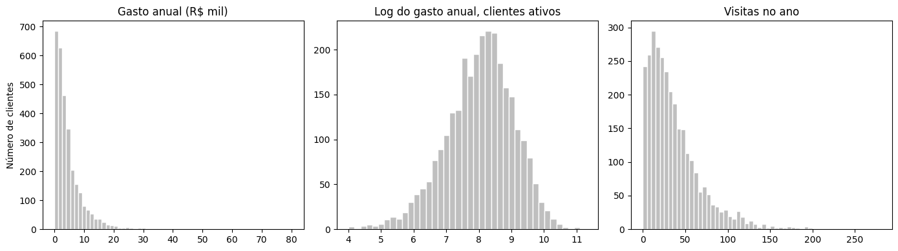
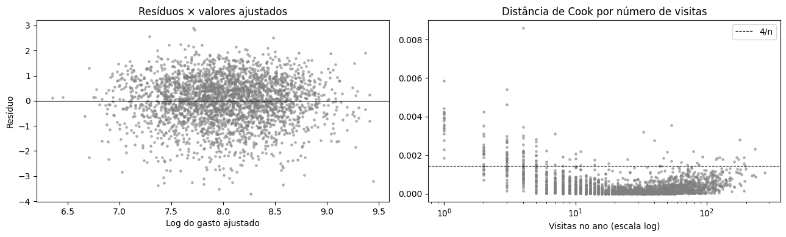
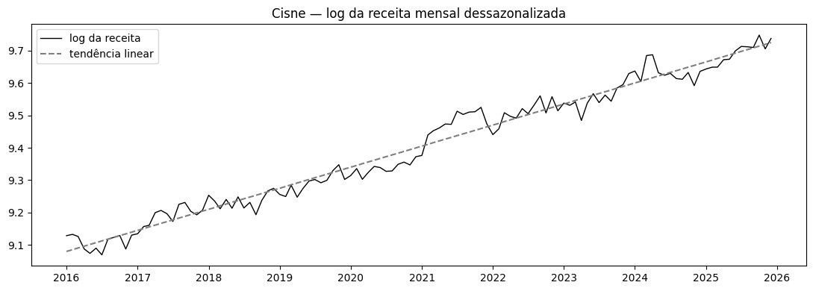

# Capítulo 17 — Resoluções

[Notebook do estudante](../ch17-student.ipynb) · [exercícios](../exercises/ch17.md)

Consulte as resoluções depois da tentativa.

# Resolução comentada — Projeto final

**Prof. Daniel de Abreu Pereira Uhr**

**Curso:** Estatística e Econometria com Python


Editorial worked solution

Esta referência oferece uma segunda leitura do projeto Cisne. Uma recomendação diferente pode ser defensável. Compare perguntas, amostras, pressupostos e evidências antes de comparar conclusões. As seções 0–12 usam informação acessível ao analista; a seção 13 abre o mecanismo conhecido apenas no laboratório.

## 0. Dados

Verificamos integridade antes de carregar. Um hash divergente interrompe a execução; transformações não alteram os CSVs.

```python
import hashlib
from pathlib import Path
import numpy as np
import pandas as pd

pasta = Path("data/ch17")
esperados = {'clientes_cisne.csv': '3e5951beb681ab52023168e2dce4fc83558d57ba48d63c59a7ed19509379947e', 'receita_mensal_cisne.csv': '3e3cdebb67ca123ce953a96e489726e5a0789c2a5d83da7dc854216ad5bf3d86'}
for arquivo, sha in esperados.items():
    actual = hashlib.sha256((pasta / arquivo).read_bytes()).hexdigest()
    if actual != sha:
        raise ValueError("SHA-256 mismatch: " + arquivo)
    print(arquivo, "SHA-256 OK")
clientes = pd.read_csv(pasta / "clientes_cisne.csv")
receita = pd.read_csv(pasta / "receita_mensal_cisne.csv")
clientes["loja"] = pd.Categorical(clientes["loja"], categories=['Centro', 'Leste', 'Norte', 'Oeste', 'Sul'])
clientes["canal_adesao"] = pd.Categorical(clientes["canal_adesao"], categories=['aplicativo', 'loja', 'site'])

pd.set_option("display.max_columns", None)
pd.set_option("display.width", 88)
import matplotlib.pyplot as plt
import statsmodels.formula.api as smf
from statsmodels.tsa.stattools import acf, adfuller

def reais(valor):
    return "R$ " + f"{valor:,.0f}".replace(",", ".")
```

```text
clientes_cisne.csv SHA-256 OK
receita_mensal_cisne.csv SHA-256 OK
```

## 1. Objetivo e perguntas

Marketing avalia adoção do app; a área comercial avalia ampliar cupons; finanças pede uma caracterização da receita. P1 compara escolhas observadas. P2 avalia a atribuição aleatória de uma oferta. A extensão usa outra unidade, o mês da rede. Não usamos desempenho agregado para atribuir efeito aos cupons.

O objeto observado são compras identificadas pelo cartão durante 2025. Uma mudança nesse registro pode acompanhar mudanças nas compras, mas não mede automaticamente todo o consumo do cliente.

## 2. Compreensão da base

Conferimos unidade, categorias, período e origem das variáveis. O resumo descreve a amostra, não o mercado.

```python
print(f"Clientes: {len(clientes)}; identificadores únicos: {clientes['cliente_id'].is_unique}")
print(clientes.describe().round(2).T)
print()
print("Lojas:", clientes["loja"].value_counts().to_dict())
print("Canal de adesão:", clientes["canal_adesao"].value_counts().to_dict())
print(f"Usam o aplicativo: {clientes['usa_app'].mean():.1%}; receberam cupom: {clientes['cupom'].mean():.1%}; renovaram: {clientes['renovou'].mean():.1%}")
```

```text
Clientes: 3000; identificadores únicos: True
                 count     mean      std   min     25%      50%      75%       max
idade           3000.0    45.53    13.63  18.0    36.0    46.00    55.00     85.00
renda_familiar  2877.0     6.02     3.98   0.4     3.2     5.10     7.60     44.20
distancia_km    3000.0     4.07     3.73   0.2     1.7     3.00     5.10     30.00
usa_app         3000.0     0.53     0.50   0.0     0.0     1.00     1.00      1.00
cupom           3000.0     0.49     0.50   0.0     0.0     0.00     1.00      1.00
visitas         3000.0    36.62    32.37   0.0    14.0    28.00    50.00    276.00
gasto_anual     3000.0  4767.65  5389.96   0.0  1459.6  3132.57  6018.41  80087.16
renovou         3000.0     0.70     0.46   0.0     0.0     1.00     1.00      1.00

Lojas: {'Centro': 733, 'Norte': 628, 'Leste': 609, 'Sul': 580, 'Oeste': 450}
Canal de adesão: {'loja': 1253, 'aplicativo': 967, 'site': 780}
Usam o aplicativo: 52.8%; receberam cupom: 49.2%; renovaram: 70.4%
```

São 3.000 clientes com IDs únicos. Loja, distância, renda e canal vêm do cadastro; idade descreve o cliente; uso do app é escolha em 2025. O cupom foi sorteado antes dos resultados. Visitas, gasto e renovação são respostas.

A proporção com cupom é 49,2%, compatível com atribuições independentes de probabilidade 1/2; não se exigiam exatamente 1.500 por grupo. Cerca de 52,8% usaram o app e 70,4% renovaram. Essas proporções ainda não respondem às comparações.

## 3. Qualidade dos dados

Investigamos ausências, zeros, extremos e coerência, registrando observações afetadas antes de escolher tratamentos.

```python
faixas_idade = pd.cut(clientes["idade"], [17, 35, 50, 65, 85])
print(f"Renda não informada: {clientes['renda_familiar'].isna().sum()} clientes ({clientes['renda_familiar'].isna().mean():.1%})")
print("Proporção sem renda por faixa de idade:", clientes.groupby(faixas_idade, observed=True)["renda_familiar"].apply(lambda s: s.isna().mean()).round(3).to_dict())

sem_visitas = clientes["visitas"] == 0
print(f"\nClientes com zero visitas: {sem_visitas.sum()}; gasto zero exatamente para eles: {((clientes['gasto_anual'] == 0) == sem_visitas).all()}")

tiquete = clientes["gasto_anual"] / clientes["visitas"].where(clientes["visitas"] > 0)
print(f"\nTíquete médio por compra (R$) — mediana {tiquete.median():.0f}; percentil 99 {tiquete.quantile(0.99):.0f}; percentil 99,5 {tiquete.quantile(0.995):.0f}; máximo {tiquete.max():.0f}")
print(f"Clientes com tíquete acima de R$ 400: {(tiquete > 400).sum()}")
print(clientes.assign(tiquete=tiquete.round(0)).nlargest(5, "tiquete")[["cliente_id", "renda_familiar", "visitas", "gasto_anual", "tiquete"]])
```

```text
Renda não informada: 123 clientes (4.1%)
Proporção sem renda por faixa de idade: {Interval(17, 35, closed='right'): 0.021, Interval(35, 50, closed='right'): 0.035, Interval(50, 65, closed='right'): 0.061, Interval(65, 85, closed='right'): 0.063}

Clientes com zero visitas: 100; gasto zero exatamente para eles: True

Tíquete médio por compra (R$) — mediana 117; percentil 99 344; percentil 99,5 432; máximo 1220
Clientes com tíquete acima de R$ 400: 18
     cliente_id  renda_familiar  visitas  gasto_anual  tiquete
1427      M1428             5.4       33     40243.52   1220.0
857       M0858             7.4        9      9047.54   1005.0
430       M0431             8.8       17     16031.00    943.0
2542      M2543            14.0       35     30875.68    882.0
1336      M1337            11.0       47     37799.18    804.0
```

A renda falta para 123 clientes (4,1%); a ausência cresce com a idade. Essa associação questiona ausência completamente aleatória, mas não distingue sozinha MAR de MNAR. P1 usa renda informada na referência. Imputação pela mediana com indicadora será sensibilidade, não garantia de recuperar o resultado sem ausências.

Cem clientes têm visitas e gasto zero. O log do gasto em P1 exige restringir a ativos e mudar a população descrita. Em P2, o cupom pode alterar a atividade: excluir inativos selecionaria por uma resposta posterior. Eles ficam na comparação principal.

Há 18 tíquetes acima de R\$ 400 no conjunto, plausíveis diante de compras para pequenos negócios. Extremo não prova erro. A referência mantém todos; a sensibilidade registra a exclusão e a amostra afetada.

## 4. Variáveis resposta

A escala deve servir à pergunta. Examinamos gasto, seu log entre ativos e visitas antes de relacioná-los ao cupom.

```python
ativos = clientes["gasto_anual"] > 0
fig, axes = plt.subplots(1, 3, figsize=(14, 4))
axes[0].hist(clientes["gasto_anual"] / 1000, bins=60, color="#BFBFBF", edgecolor="white")
axes[0].set_title("Gasto anual (R$ mil)")
axes[1].hist(np.log(clientes.loc[ativos, "gasto_anual"]), bins=40, color="#BFBFBF", edgecolor="white")
axes[1].set_title("Log do gasto anual, clientes ativos")
axes[2].hist(clientes["visitas"], bins=np.arange(0, 281, 5), color="#BFBFBF", edgecolor="white")
axes[2].set_title("Visitas no ano")
axes[0].set_ylabel("Número de clientes")
fig.tight_layout()
plt.show()

print(f"Gasto — média {reais(clientes['gasto_anual'].mean())}; mediana {reais(clientes['gasto_anual'].median())}")
print(f"Visitas — média {clientes['visitas'].mean():.1f}; variância {clientes['visitas'].var():.1f}; razão {clientes['visitas'].var() / clientes['visitas'].mean():.1f}")
print(f"Renovação: {clientes['renovou'].mean():.1%}")
```



```text
Gasto — média R$ 4.768; mediana R$ 3.133
Visitas — média 36.6; variância 1048.1; razão 28.6
Renovação: 70.4%
```

Gasto é assimétrico: média R\$ 4.768 e mediana R\$ 3.133. O log facilita comparação proporcional entre ativos, mas não substitui reais na conta empresarial. Visitas têm média 36,6 e variância 1.048,1: a dispersão marginal exige atenção à inferência, sem provar uma distribuição condicional. Renovação é binária.

Usamos OLS/HC1 para gasto e comparação linear de renovação, Poisson/HC1 para visitas. Binomial negativa e Logit são alternativas já estudadas, com covariâncias usuais identificadas explicitamente.

## 5. P1 — Especificação e estimação

Comparamos perfis. Diferenças de gasto acompanham idade, renda, distância e canal; a comparação bruta não isola a consequência do uso.

```python
print(clientes.assign(canal_aplicativo=(clientes["canal_adesao"] == "aplicativo").astype(int))
      .groupby("usa_app")[["gasto_anual", "visitas", "idade", "renda_familiar", "distancia_km", "canal_aplicativo"]].mean().round(2))
```

```text
         gasto_anual  visitas  idade  renda_familiar  distancia_km  canal_aplicativo
usa_app                                                                             
0            3770.77    30.34  49.06            5.87          4.11              0.16
1            5657.61    42.22  42.38            6.14          4.04              0.47
```

Usuários gastam em média R\$ 5.658, contra R\$ 3.771, e são mais jovens. A referência compara log do gasto entre ativos com renda informada, ajustando app, log da renda, idade, log da distância e loja, com Centro como referência. Renda aproxima capacidade de compra; idade e distância descrevem hábitos e acesso; loja captura diferenças entre unidades. São argumentos para ajuste, não prova de ausência de confundimento.

$$
E[\log G_i\mid A_i,X_i]=\alpha+\beta A_i+\gamma\log R_i+\delta H_i+\eta\log D_i+\sum_{s\ne 0}\lambda_s I_{is}.
$$

$G_i$ é gasto, $A_i$ indica app, $R_i$ é renda mensal, $H_i$ idade, $D_i$ distância e $I_{is}$ indica loja; $X_i$ reúne controles. O somatório representa indicadores. A comparação exponenciada é:

$$
100[\exp(\hat\beta)-1].
$$

Ela compara médias geométricas condicionais sob a especificação, não automaticamente médias aritméticas. Visitas ficam fora por poderem ser posteriores ao uso; canal entra numa alternativa, sem afirmar que sua exclusão da referência prova irrelevância.

```python
p1 = clientes[ativos & clientes["renda_familiar"].notna()].assign(
    log_gasto=lambda d: np.log(d["gasto_anual"]),
    log_renda=lambda d: np.log(d["renda_familiar"]),
    log_dist=lambda d: np.log(d["distancia_km"]),
)
formula_referencia = "log_gasto ~ usa_app + log_renda + idade + log_dist + C(loja)"
referencia = smf.ols(formula_referencia, data=p1).fit(cov_type="HC1")
intervalos = referencia.conf_int()
print(pd.DataFrame({"coeficiente": referencia.params, "EP (HC1)": referencia.bse, "IC 2,5%": intervalos[0], "IC 97,5%": intervalos[1]}).round(3))
print(f"\nClientes: {int(referencia.nobs)}; R² {referencia.rsquared:.3f}")
b, (inferior, superior) = referencia.params["usa_app"], intervalos.loc["usa_app"]
print(f"Uso do aplicativo: {100 * (np.exp(b) - 1):.1f}% geométricos (IC {100 * (np.exp(inferior) - 1):.1f}% a {100 * (np.exp(superior) - 1):.1f}%)")
```

```text
                  coeficiente  EP (HC1)  IC 2,5%  IC 97,5%
Intercept               7.218     0.090    7.042     7.393
C(loja)[T.Leste]       -0.089     0.052   -0.191     0.013
C(loja)[T.Norte]       -0.121     0.053   -0.225    -0.017
C(loja)[T.Oeste]       -0.011     0.058   -0.125     0.102
C(loja)[T.Sul]          0.061     0.055   -0.047     0.169
usa_app                 0.454     0.037    0.382     0.525
log_renda               0.454     0.029    0.397     0.511
idade                   0.005     0.001    0.003     0.008
log_dist               -0.354     0.022   -0.397    -0.310

Clientes: 2780; R² 0.204
Uso do aplicativo: 57.4% geométricos (IC 46.5% a 69.1%)
```

São 2.780 clientes. O coeficiente do app é 0,454, EP HC1 0,037 e intervalo 0,382–0,525. A transformação dá 57,4%, IC 46,5%–69,1%, para a comparação geométrica condicional. Não é previsão de receita da campanha.

Renda e distância descrevem elasticidades condicionais do objeto modelado; idade tem semielasticidade. Cerca de 20% da variação amostral do log é explicada. Isso não identifica efeito causal do app.

## 6. P1 — Diagnóstico e robustez

Inspecionamos resíduos e influência, depois alternativas com suas amostras. Diagnóstico orienta investigação, não exclusão automática.

```python
modelo_usual = smf.ols(formula_referencia, data=p1).fit()
influencia = modelo_usual.get_influence()
cook = pd.Series(influencia.cooks_distance[0], index=p1.index)
print(f"Erro-padrão do aplicativo — usual {modelo_usual.bse['usa_app']:.4f}; HC1 {referencia.bse['usa_app']:.4f}")
print(f"Clientes com distância de Cook acima de 4/n: {(cook > 4 / len(p1)).sum()}")
print(p1.loc[cook.nlargest(5).index, ["cliente_id", "visitas", "gasto_anual"]].assign(cook=cook.nlargest(5).round(4)))

fig, axes = plt.subplots(1, 2, figsize=(13, 4))
axes[0].scatter(modelo_usual.fittedvalues, modelo_usual.resid, s=6, color="#7F7F7F", alpha=0.5)
axes[0].axhline(0, color="black", linewidth=0.8)
axes[0].set_title("Resíduos × valores ajustados")
axes[0].set_xlabel("Log do gasto ajustado")
axes[0].set_ylabel("Resíduo")
axes[1].scatter(p1["visitas"], cook, s=6, color="#7F7F7F", alpha=0.5)
axes[1].axhline(4 / len(p1), color="black", linestyle="--", linewidth=0.8, label="4/n")
axes[1].set_xscale("log")
axes[1].set_title("Distância de Cook por número de visitas")
axes[1].set_xlabel("Visitas no ano (escala log)")
axes[1].legend()
fig.tight_layout()
plt.show()
```

```text
Erro-padrão do aplicativo — usual 0.0366; HC1 0.0367
Clientes com distância de Cook acima de 4/n: 131
     cliente_id  visitas  gasto_anual    cook
1626      M1627        4       513.60  0.0086
1256      M1257        1        86.19  0.0058
2366      M2367        3       188.37  0.0054
538       M0539        3       338.54  0.0046
702       M0703        1       127.24  0.0044
```



EPs usual e HC1 são próximos: 0,0366 e 0,0367. Essa proximidade para um coeficiente não prova homocedasticidade. A cauda inferior dos resíduos e clientes com poucas compras merecem atenção.

Cook 4/n sinaliza 131 observações. É triagem, não demonstração de que nenhuma observação altera a conclusão. A tabela seguinte avalia alternativas específicas, não exclusão individual de todos os casos influentes.

```python
todos_ativos = clientes[ativos].assign(
    log_gasto=lambda d: np.log(d["gasto_anual"]),
    log_dist=lambda d: np.log(d["distancia_km"]),
    renda_ausente=lambda d: d["renda_familiar"].isna().astype(int),
    log_renda=lambda d: np.log(d["renda_familiar"].fillna(d["renda_familiar"].median())),
)
tiquete_p1 = p1["gasto_anual"] / p1["visitas"]
alternativas = {
    "sem controles": ("log_gasto ~ usa_app", p1),
    "referência": (formula_referencia, p1),
    "+ canal de adesão": (formula_referencia + " + C(canal_adesao)", p1),
    "distância linear": ("log_gasto ~ usa_app + log_renda + idade + distancia_km + C(loja)", p1),
    "renda ausente com indicadora": ("log_gasto ~ usa_app + log_renda + renda_ausente + idade + log_dist + C(loja)", todos_ativos),
    "sem tíquete acima de R$ 400": (formula_referencia, p1[tiquete_p1 <= 400]),
    "+ log das visitas (outra pergunta)": (formula_referencia + " + np.log(visitas)", p1),
}
linhas = {}
for nome, (formula, dados) in alternativas.items():
    modelo = smf.ols(formula, data=dados).fit(cov_type="HC1")
    inferior, superior = modelo.conf_int().loc["usa_app"]
    linhas[nome] = {"coeficiente": modelo.params["usa_app"], "IC 2,5%": inferior, "IC 97,5%": superior,
                    "associação geométrica (%)": 100 * (np.exp(modelo.params["usa_app"]) - 1), "clientes": int(modelo.nobs)}
print(pd.DataFrame(linhas).T.round(3))

nivel = smf.ols("gasto_anual ~ usa_app + np.log(renda_familiar) + idade + np.log(distancia_km) + C(loja)",
                data=clientes.dropna(subset=["renda_familiar"])).fit(cov_type="HC1")
inferior, superior = nivel.conf_int().loc["usa_app"]
media_sem_app = clientes.loc[clientes["usa_app"] == 0, "gasto_anual"].mean()
print(f"\nGasto em reais, com os zeros: aplicativo +{reais(nivel.params['usa_app'])} (IC {reais(inferior)} a {reais(superior)}); média de quem não usa: {reais(media_sem_app)}")
```

```text
                                    coeficiente  IC 2,5%  IC 97,5%  \
sem controles                             0.439    0.363     0.515   
referência                                0.454    0.382     0.525   
+ canal de adesão                         0.464    0.389     0.538   
distância linear                          0.448    0.376     0.521   
renda ausente com indicadora              0.449    0.379     0.520   
sem tíquete acima de R$ 400               0.459    0.387     0.530   
+ log das visitas (outra pergunta)        0.069    0.039     0.099   

                                    associação geométrica (%)  clientes  
sem controles                                          55.078    2780.0  
referência                                             57.392    2780.0  
+ canal de adesão                                      58.974    2780.0  
distância linear                                       56.593    2780.0  
renda ausente com indicadora                           56.713    2900.0  
sem tíquete acima de R$ 400                            58.233    2763.0  
+ log das visitas (outra pergunta)                      7.150    2780.0  

Gasto em reais, com os zeros: aplicativo +R$ 1.922 (IC R$ 1.558 a R$ 2.285); média de quem não usa: R$ 3.771
```

Sem controlar visitas, os coeficientes variam aproximadamente de 0,439 a 0,464. A indicadora de ausência amplia a amostra a 2.900 ativos. Excluir tíquete acima de R\$ 400 remove 17 da referência, não os 18 do conjunto, deixando 2.763. Informe essas mudanças junto aos coeficientes.

Em níveis, com zeros e renda informada, a associação é R\$ 1.922 (IC R\$ 1.558–2.285). É outro objeto e amostra; concordância qualitativa não demonstra invariância do estimando.

Adicionar log das visitas reduz o coeficiente a 0,069. Compara gasto condicional a visitas e controles, sem identificar automaticamente efeito causal direto ou mediação. Não equivale à regressão do log do tíquete sem restrição apropriada no coeficiente de visitas. A queda não mede uma fração causal transmitida pelas visitas.

### P1 — Parecer para marketing

App está associado a maior gasto no objeto modelado. Engajamento ou preferências não medidos podem afetar uso e compras. Os dados observados não determinam direção ou tamanho desse confundimento. Não aplique 57,4% à receita esperada da campanha.

Uma avaliação futura poderia sortear incentivo à adoção. Identificaria o efeito da **oferta do incentivo**, sob o desenho, não automaticamente o efeito de usar o app. Acompanhe adesão, custos e compras. Converter incentivo em efeito do uso requer hipóteses e métodos não desenvolvidos aqui.

## 7. P2 — O sorteio

O desenho dá comparabilidade em expectativa, não igualdade exata na amostra realizada. Examinamos características anteriores ao piloto.

```python
pre_piloto = clientes.assign(canal_aplicativo=(clientes["canal_adesao"] == "aplicativo").astype(int))
linhas = {}
for variavel in ["idade", "renda_familiar", "distancia_km", "canal_aplicativo"]:
    modelo = smf.ols(f"{variavel} ~ cupom", data=pre_piloto).fit(cov_type="HC1")
    medias = pre_piloto.groupby("cupom")[variavel].mean()
    linhas[variavel] = {"sem cupom": medias[0], "com cupom": medias[1], "diferença": modelo.params["cupom"], "p-valor": modelo.pvalues["cupom"]}
print(pd.DataFrame(linhas).T.round(3))
print("\nClientes por grupo:", clientes["cupom"].value_counts().sort_index().to_dict())
```

```text
                  sem cupom  com cupom  diferença  p-valor
idade                45.374     45.695      0.321    0.519
renda_familiar        6.215      5.811     -0.404    0.006
distancia_km          4.082      4.062     -0.020    0.882
canal_aplicativo      0.315      0.330      0.015    0.394

Clientes por grupo: {0: 1523, 1: 1477}
```

São 1.523 sem cupom e 1.477 com cupom. A diferença de renda é cerca de −R\$ 404 mensais, p=0,006. Uma diferença significativa não prova falha no sorteio; ausência de diferenças tampouco certifica o desenho. O fundamento é protocolo e implementação.

A leitura causal exige atribuição independente, mensuração comparável, ausência de seleção posterior que desfaça a comparação e atenção à interferência. Compartilhamento de cupons e compras não identificadas seriam questões reais. O alvo é atribuição da oferta, não efeito de resgate entre quem escolheu resgatar.

## 8. P2 — Efeitos do cupom

Começamos por visitas. O coeficiente exponenciado compara médias de contagem, não probabilidades. HC1 relaxa a restrição de variância Poisson na inferência, sem reparar um desenho inadequado.

```python
print(clientes.groupby("cupom")["visitas"].agg(["mean", "var"]).round(1).rename(columns={"mean": "média", "var": "variância"}))

visitas_robusto = smf.poisson("visitas ~ cupom", data=clientes).fit(disp=0, cov_type="HC1")
visitas_usual = smf.poisson("visitas ~ cupom", data=clientes).fit(disp=0)
binomial_negativa = smf.negativebinomial("visitas ~ cupom", data=clientes).fit(disp=0, maxiter=100)


def percentual(modelo):
    inferior, superior = modelo.conf_int().loc["cupom"]
    return np.round(100 * (np.exp([modelo.params["cupom"], inferior, superior]) - 1), 1)


print(f"\nPoisson — efeito {percentual(visitas_robusto)[0]}% (IC robusto {percentual(visitas_robusto)[1]}% a {percentual(visitas_robusto)[2]}%); EP robusto {visitas_robusto.bse['cupom']:.4f} × usual {visitas_usual.bse['cupom']:.4f}")
print(f"Binomial negativa — efeito {percentual(binomial_negativa)[0]}% (IC {percentual(binomial_negativa)[1]}% a {percentual(binomial_negativa)[2]}%); α {binomial_negativa.params['alpha']:.3f}")
```

```text
       média  variância
cupom                  
0       34.0      894.4
1       39.3     1193.2

Poisson — efeito 15.5% (IC robusto 8.5% a 23.0%); EP robusto 0.0321 × usual 0.0060
Binomial negativa — efeito 15.5% (IC 8.4% a 23.2%); α 0.771
```

Poisson estima 15,5%, IC HC1 8,5%–23,0%. O EP usual do coeficiente, 0,0060, é menor que HC1, 0,0321. Binomial negativa dá 15,5% e dispersão 0,771; sua covariância aqui é usual, sob as hipóteses do modelo, não HC1.

Gasto será analisado na escala monetária. Comparamos todos os clientes e depois a mesma amostra com renda, com e sem controles anteriores ao piloto, separando mudança amostral de ajuste.

```python
controles = "idade + np.log(renda_familiar) + np.log(distancia_km) + C(loja) + C(canal_adesao)"
com_renda = clientes.dropna(subset=["renda_familiar"])
media_sem_cupom = clientes.loc[clientes["cupom"] == 0, "gasto_anual"].mean()

efeitos = {}
for nome, formula, dados in [
    ("gasto, sem controles", "gasto_anual ~ cupom", clientes),
    ("gasto, sem controles, renda informada", "gasto_anual ~ cupom", com_renda),
    ("gasto, com controles anteriores ao piloto", "gasto_anual ~ cupom + " + controles, com_renda),
]:
    modelo = smf.ols(formula, data=dados).fit(cov_type="HC1")
    inferior, superior = modelo.conf_int().loc["cupom"]
    efeitos[nome] = {"efeito (R$)": modelo.params["cupom"], "IC 2,5%": inferior, "IC 97,5%": superior, "EP": modelo.bse["cupom"], "clientes": int(modelo.nobs)}
print(pd.DataFrame(efeitos).T.round(0))
print(f"\nGasto médio do grupo sem cupom: {reais(media_sem_cupom)}")

visitas_controles = smf.poisson("visitas ~ cupom + " + controles, data=com_renda).fit(disp=0, cov_type="HC1")
print(f"Visitas com controles: {percentual(visitas_controles)[0]}% (IC {percentual(visitas_controles)[1]}% a {percentual(visitas_controles)[2]}%)")
```

```text
                                           efeito (R$)  IC 2,5%  IC 97,5%     EP  \
gasto, sem controles                             635.0    249.0    1020.0  197.0   
gasto, sem controles, renda informada            616.0    221.0    1010.0  201.0   
gasto, com controles anteriores ao piloto        708.0    339.0    1076.0  188.0   

                                           clientes  
gasto, sem controles                         3000.0  
gasto, sem controles, renda informada        2877.0  
gasto, com controles anteriores ao piloto    2877.0  

Gasto médio do grupo sem cupom: R$ 4.455
Visitas com controles: 15.1% (IC 8.4% a 22.2%)
```

A diferença é R\$ 635 (IC R\$ 249–1.020) nos 3.000 clientes. Nos 2.877 com renda, sem controles é R\$ 616; com controles, R\$ 708 (IC R\$ 339–1.076). A diferença entre 635 e 708 não é só ajuste: a amostra mudou.

Controles reduzem o EP aqui, não universalmente. O sorteio sustenta a comparação principal; ajuste exige atenção à especificação e à seleção por renda. Não controlamos visitas no efeito total sobre gasto nem excluímos zeros posteriores à atribuição.

```python
renovacao_lpm = smf.ols("renovou ~ cupom", data=clientes).fit(cov_type="HC1")
inferior, superior = renovacao_lpm.conf_int().loc["cupom"]
print("Renovação por grupo:", clientes.groupby("cupom")["renovou"].mean().round(3).to_dict())
print(f"LPM: {100 * renovacao_lpm.params['cupom']:.1f} pontos percentuais (IC {100 * inferior:.1f} a {100 * superior:.1f})")

renovacao_logit = smf.logit("renovou ~ cupom + " + controles, data=com_renda).fit(disp=0)
efeito_medio = (renovacao_logit.predict(com_renda.assign(cupom=1)) - renovacao_logit.predict(com_renda.assign(cupom=0))).mean()
print(f"Logit com controles — contraste discreto médio: {100 * efeito_medio:.1f} pontos percentuais")
```

```text
Renovação por grupo: {0: 0.669, 1: 0.74}
LPM: 7.1 pontos percentuais (IC 3.8 a 10.3)
Logit com controles — contraste discreto médio: 7.3 pontos percentuais
```

Renovação passa de 66,9% a 74,0%. LPM estima 7,1 pontos percentuais (IC HC1 3,8–10,3). No Logit, calculamos diferença discreta média nos mesmos clientes:

$$
\widehat\Delta_p=\frac{1}{n}\sum_{i=1}^{n}\{\hat p(C_i=1,X_i)-\hat p(C_i=0,X_i)\}.
$$

$C_i$ indica atribuição, $X_i$ são controles e $\hat p$ probabilidade prevista. O resultado é 7,3 pontos na amostra com renda, não a derivada contínua de uma dummy. A covariância é usual e não calculamos IC desse contraste; a incerteza principal permanece no LPM.

## 9. P2 — Heterogeneidade e decisão econômica

Distância é um recorte exploratório. Diferença de estimativas não basta para estabelecer diferença de efeitos.

```python
for nome, grupo in [("até 3 km", clientes[clientes["distancia_km"] <= 3]), ("acima de 3 km", clientes[clientes["distancia_km"] > 3])]:
    modelo = smf.poisson("visitas ~ cupom", data=grupo).fit(disp=0, cov_type="HC1")
    efeito, inferior, superior = percentual(modelo)
    print(f"Visitas, clientes {nome} ({len(grupo)}): {efeito}% (IC {inferior}% a {superior}%)")
interacao = smf.poisson("visitas ~ cupom * np.log(distancia_km / 3)", data=clientes).fit(disp=0, cov_type="HC1")
print(f"Interação cupom × log(distância/3): {interacao.params['cupom:np.log(distancia_km / 3)']:.3f} (p-valor {interacao.pvalues['cupom:np.log(distancia_km / 3)']:.3f})")
```

```text
Visitas, clientes até 3 km (1532): 19.2% (IC 9.8% a 29.4%)
Visitas, clientes acima de 3 km (1468): 8.7% (IC -0.1% a 18.2%)
Interação cupom × log(distância/3): -0.062 (p-valor 0.092)
```

As estimativas são 19,2% até 3 km e 8,7% acima. A interação é −0,062 (p=0,092): sugestiva e imprecisa, sem estabelecer igualdade ou segmentação ótima. Sobreposição dos ICs não é teste de igualdade; recortes exploratórios exigem considerar multiplicidade.

A conta usa margem 20% e custo incremental R\$ 120 por atribuição, não deduzido antes da margem. Mostramos contribuição corrente antes de um cenário futuro de renovação.

```python
margem, custo = 0.20, 120
gasto_simples = smf.ols("gasto_anual ~ cupom", data=clientes).fit(cov_type="HC1")
gasto_controles = smf.ols("gasto_anual ~ cupom + " + controles, data=com_renda).fit(cov_type="HC1")
for nome, modelo in [("sem controles", gasto_simples), ("com controles", gasto_controles)]:
    efeito, (inferior, superior) = modelo.params["cupom"], modelo.conf_int().loc["cupom"]
    print(f"Margem adicional por cliente ({nome}): R$ {margem * efeito:.0f} (IC R$ {margem * inferior:.0f} a R$ {margem * superior:.0f}) × custo de R$ {custo}")

valor_renovacao = renovacao_lpm.params["cupom"] * margem * media_sem_cupom
print(f"\nCenário para a renovação: {100 * renovacao_lpm.params['cupom']:.1f} pontos × margem de um ano de um cliente médio (R$ {margem * media_sem_cupom:.0f}) = R$ {valor_renovacao:.0f} por cliente")
print("Contribuição líquida corrente; margem e custo fixos")
for name, model in [("unadjusted", gasto_simples), ("adjusted", gasto_controles)]:
    ci = model.conf_int().loc["cupom"].to_numpy()
    print(name, np.round(margem * np.r_[model.params["cupom"], ci] - custo, 2))
print("break-even", custo / margem)
```

```text
Margem adicional por cliente (sem controles): R$ 127 (IC R$ 50 a R$ 204) × custo de R$ 120
Margem adicional por cliente (com controles): R$ 142 (IC R$ 68 a R$ 215) × custo de R$ 120

Cenário para a renovação: 7.1 pontos × margem de um ano de um cliente médio (R$ 891) = R$ 63 por cliente
Contribuição líquida corrente; margem e custo fixos
unadjusted [  6.91 -70.15  83.98]
adjusted [ 21.5  -52.15  95.16]
break-even 600.0
```

Para gasto adicional $\Delta_G$, margem $m$ e custo incremental $c$, a contribuição líquida é:

$$
\hat N=m\widehat\Delta_G-c,\qquad IC_N=[mL_G-c,\ mU_G-c]\quad(m>0).
$$

$L_G,U_G$ delimitam o IC do gasto. A transformação condiciona em margem e custo fixos: não incorpora incerteza contábil, implantação ou transporte a 2026. A referência dá **R\$ 7 líquidos, IC −R\$ 70 a R\$ 84**; o ajuste dá R\$ 22, IC −R\$ 52 a R\$ 95. Aumento positivo do gasto não garante retorno líquido positivo. Cobrir R\$ 120 com margem 20% exige R\$ 600 de gasto adicional.

Renovação acrescenta um cenário: multiplicar a diferença estimada pela margem de um ano de compras de um cliente médio sem cupom dá cerca de R\$ 63 por atribuição. Exige compras futuras adicionais, margem transportável e ausência de sobreposição com gasto já contado. Renovação não é receita futura observada; o cenário não herda o IC corrente nem é benefício assegurado.

**Parecer:** contribuição corrente ligeiramente positiva, mas compatível com perda. Expansão condicionada à confirmação contábil e operacional, com avaliação prospectiva e grupo sorteado, é defensável. Manter 10% sem cupom seria ilustração, não tamanho validado por poder ou otimização. Adiar para reduzir custo ou medir retorno também é defensável.

Conferir resgate, descontos embutidos, margem por grupo, estoque e atendimento. Separar custos variáveis de mudanças de capacidade. Visitas não determinam contratações: faltam tempo de serviço, horas, produtividade e salários. Defina responsáveis pela informação e condição de reavaliação.

## 10. Extensão — Receita da rede

Examinamos receita dessazonalizada e protocolo ADF. Constante e tendência são coerentes com a pergunta, não escolhidas apenas para rejeitar. Não estimamos previsão fora da amostra.

```python
receita["periodo"] = pd.PeriodIndex(receita["mes"], freq="M")
log_receita = np.log(receita["receita_mil"])
tempo = np.arange(len(receita))
tendencia = smf.ols("log_receita ~ tempo", data=pd.DataFrame({"log_receita": log_receita, "tempo": tempo})).fit()

fig, ax = plt.subplots(figsize=(11, 4))
ax.plot(receita["periodo"].dt.start_time, log_receita, color="black", linewidth=1, label="log da receita")
ax.plot(receita["periodo"].dt.start_time, tendencia.fittedvalues, color="#7F7F7F", linestyle="--", label="tendência linear")
ax.set_title("Cisne — log da receita mensal dessazonalizada")
ax.legend()
fig.tight_layout()
plt.show()

adf_result = adfuller(log_receita, regression="ct", autolag="AIC")
print("ADF ct / AIC", adf_result)
print("n_input / maxlag", len(log_receita), int(np.ceil(12*(len(log_receita)/100)**0.25)))
log_growth = np.diff(log_receita)
print("mean monthly log points", 100*log_growth.mean())
print("annualized log points", 1200*log_growth.mean())
print("exact annualized geometric growth (%)", 100*np.expm1(12*log_growth.mean()))
print("mean monthly exact growth (%)", 100*np.expm1(log_growth).mean())
print("mean 12-month log points", 100*log_receita.diff(12).mean())
print("mean 12-month exact growth (%)", 100*np.expm1(log_receita.diff(12)).mean())
print("trend log slope / exact annual (%)", tendencia.params["tempo"], 100*np.expm1(12*tendencia.params["tempo"]))
desvios = pd.DataFrame({"desvio": tendencia.resid, "anterior": tendencia.resid.shift(1)})
persistencia = smf.ols("desvio ~ anterior", data=desvios).fit().params["anterior"]
print("persistence / conditional half-life (months)", persistencia, np.log(.5)/np.log(persistencia))
print("ACF 1/6/12", acf(tendencia.resid,nlags=12)[[1,6,12]])
```



```text
ADF ct / AIC (np.float64(-3.71446069306269), np.float64(0.021422460467537107), 5, 114, {'1%': np.float64(-4.0404611509884285), '5%': np.float64(-3.449728197718056), '10%': np.float64(-3.1500478236218434)}, np.float64(-478.1779409345644))
n_input / maxlag 120 13
mean monthly log points 0.5117409512612391
annualized log points 6.140891415134869
exact annualized geometric growth (%) 6.333363747085334
mean monthly exact growth (%) 0.5514819996355544
mean 12-month log points 6.493525247988827
mean 12-month exact growth (%) 6.837466073221076
trend log slope / exact annual (%) 0.0054171193360447595 6.71648212424797
persistence / conditional half-life (months) 0.5914800495415063 1.3199602228502796
ACF 1/6/12 [ 0.59065016  0.02192499 -0.19383816]
```

ADF com constante e tendência, AIC e cinco defasagens usadas dá −3,71 (p=0,021). Rejeitar a 5% é evidência contra raiz unitária nessa especificação, não prova universal de estacionariedade, ausência de quebras ou estabilidade futura. Registramos máximo de defasagens, amostra efetiva, críticos e AIC.

Para receita $R_t$ e inclinação $b$ da tendência em log por mês:

$$
g_t=100\left(\frac{R_t}{R_{t-1}}-1\right),\qquad \ell_t=100\log\left(\frac{R_t}{R_{t-1}}\right),\qquad g_b^{(12)}=100[\exp(12b)-1].
$$

A média mensal é 0,51 ponto de log; multiplicar por 12 dá 6,1 pontos de log anuais, não percentual exato nem média de crescimentos em 12 meses. A inclinação estimada é 0,00542 unidade de log por mês; o cálculo mostra sua transformação exata.

Persistência dos desvios é aproximadamente 0,59, meia-vida condicional 1,3 mês. Isso descreve decaimento esperado sem novos choques, não recuperação garantida da receita realizada ou compensação de perdas. A série é da rede inteira, não do piloto. Finanças pode organizar acompanhamento, não garantir fluxo de caixa.

## 11. Conclusões e recomendações

**Marketing:** a associação geométrica de 57,4% não é retorno causal da campanha. Uma oferta de incentivo pode ser avaliada por desenho adequado, acompanhando adesão e custo.

**Comercial:** a atribuição eleva respostas no piloto sob suas hipóteses. Contribuição líquida corrente é pequena perante a incerteza. Expansão condicionada é decisão possível, não obrigação do p-valor. Separe renovação futura de margem corrente.

**Finanças:** tendência e persistência descrevem a história. ADF depende do protocolo; log e crescimento percentual exato são distintos. Não há compensação garantida após mês fraco.

## 12. Limites e reprodutibilidade

Dados sintéticos, uma rede e um ano de clientes limitam transporte. Compras sem cartão não aparecem; renda é declarada e parcialmente ausente. Ativos com renda não são todos os clientes. Robustez não elimina confundimento nem garante ausência ignorável. HC1, covariância usual e contraste sem intervalo têm funções distintas.

Custos e margens são premissas fixas; capacidade, emprego e retorno futuro não foram medidos. Reiniciar e executar reproduz cálculos, não valida premissas. Preserve arquivos, versões e decisões e revise recomendações diante de nova informação.

## 13. O que o laboratório sabia

Só agora usamos o mecanismo privado. O analista não dispõe dessa informação em uma empresa real. O laboratório esclarece o que cada comparação mede, sem certificar automaticamente causalidade.

| Objeto | Mecanismo | Comparação do analista |
|---|---|---|
| App e gasto | Razão de médias esperadas sob intervenção no app: +25,9%, integrando choques nos perfis fixados | Associação no log entre ativos com renda: +57,4% geométricos; alvo diferente |
| Cupom e visitas | Razão de médias esperadas: +15,4%, nos 3.000 perfis latentes | Poisson sem controles: +15,5%; médias observadas |
| Visitas por distância | +18,5% até 3 km; +10,4% acima | +19,2% e +8,7%; exploração incerta |
| Cupom e gasto | Razão de médias esperadas não arredondadas: +18,9331%; diferença R\$ 833,77 | Diferença observada cerca de R\$ 635, com IC; ajuste usa outra amostra |
| Cupom e renovação | +6,4 pontos percentuais, integração Monte Carlo com 400 repetições | +7,1 pontos LPM; +7,3 Logit em outra amostra |
| Tendência da receita | 0,005 unidade de log por mês | Inclinação estimada 0,00542 |

Se $v_i(c)$ é visita esperada sob atribuição $c$ e $t_i$ tíquete esperado sem cupom, integrando a heterogeneidade independente do tíquete:

$$
\mu_G(c)=\frac1n\sum_{i=1}^{n}t_i\exp(0.03c)v_i(c),\qquad \theta_G=100\left[\frac{\mu_G(1)}{\mu_G(0)}-1\right].
$$

A conta anterior multiplicava a razão agregada de visitas pelo fator de tíquete, sem ponderação individual: 18,9493%. A ponderação dá 18,9331%. Ambos arredondam a 18,9%, mas o alvo exige a correção. É gasto esperado não arredondado, integrado sobre choques nos perfis latentes fixados, não gasto contrafactual realizado do CSV.

O app afeta visitas e tíquete; engajamento latente afeta adoção e compras. Há um mecanismo de confundimento conhecido no laboratório. Entretanto, 25,9% e 57,4% diferem em escala, seleção e alvo: sua diferença não mede puramente viés. O IC do log não avalia cobertura de outro estimando; uma realização tampouco mede cobertura de longo prazo.

A ausência de renda depende da idade: MAR condicional à idade no mecanismo, não MCAR. Isso não era dedutível só da associação observada. Pequenos comerciantes tornam compras altas plausíveis, sem identificar todo tíquete alto como comerciante por limiar. Gerador e parâmetros técnicos permanecem fora do pacote pré-tentativa.
